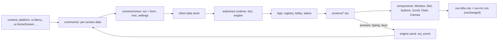
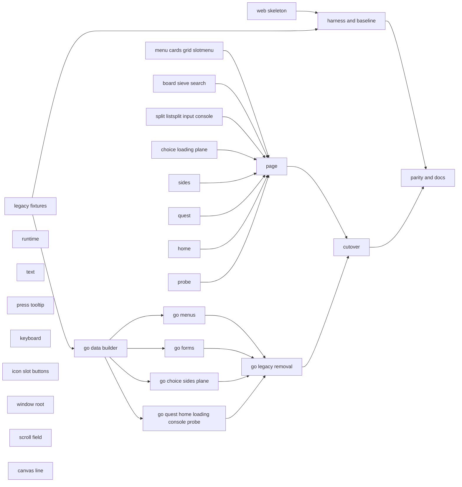

# React screens: plan

**Goal:** The DDUI screens are drawn by a React page (react-facet, built on PresentKim/ore-ui-react) that owns each screen's layout; the server sends a screen name and its data instead of a node tree. The look stays the same: the screens render the elements and classes the legacy renderer built, styled by the unchanged `oui-ddui.css` and `oui-mc.css`.
**Architecture:** `web/oreui` is an npm project (TypeScript, React 18, react-facet) whose esbuild bundle is committed as `assets/resourcepack/oreui/hbui/oui-app.js` and `oui-app.css`; `gameplay.html` loads it instead of `oui-ddui.js`. `common/ui` keeps its public Go API and builds per-screen data (`docs/plans/2026-10-30-react-screens.contract.md`). A Playwright harness draws Go-dumped fixtures with the legacy renderer (baseline) and with the new page, and compares the pictures.
**Tech stack:** Go 1.x (repo), TypeScript ^5.6.3, react 18.3.1, @react-facet/core and @react-facet/dom-fiber 18.6.0, ore-ui-react `github:PresentKim/ore-ui-react#5a4594b048ba6d97cf60b2740a225b052dfb8243`, esbuild ^0.28.2, vitest ^5.0.5 + jsdom ^30.1.3, @react-facet/dom-fiber-testing-library 18.6.0, pngjs ^7.0.0, pixelmatch ^7.1.0, Playwright (pre-installed: `require('playwright')`, no install).
**Spec:** docs/plans/2026-10-30-react-screens.contract.md
**Detail:** contracts
**Target-min:** 30

## Global constraints

- Contract: `docs/plans/2026-10-30-react-screens.contract.md` binds both sides. TS types come from `web/oreui/src/protocol.ts` (verbatim copy). Go data types are unexported: shared ones `dChrome dTab dBarButton dButton dItem dSlot dSlotRow dCell` (common/ui/screen.go, T9), per screen `<name>Data` (e.g. `menuData`), JSON tags exactly the contract's names. Go never sends `null` for an array (empty is `[]`); nullable objects are pointers (`null`).
- Legacy reference: `assets/resourcepack/oreui/hbui/oui-ddui.js` (until T23 deletes it) and the legacy DOM per fixture in `web/oreui/visual/baseline/<fixture>.html` (T2). A component renders the same elements, classes and inline styles the legacy renderer built for the same node; new CSS only in `web/oreui/src/app.css`.
- npm: always `--ignore-scripts` (`npm ci --ignore-scripts`). Imports `@ore-ui-react/<pkg>` resolve to `node_modules/ore-ui-react/packages/<pkg>/src/index.ts` (tsconfig `paths`, vitest `alias`, esbuild `alias`).
- Page: React tree rendered with `createRoot` from `@react-facet/dom-fiber` into `div#oui-ddui` appended to `body`; body gets `oui-active` while a screen shows. Pressable and keyboard-navigable elements carry the attribute `data-oui-press` (T5 sets it, T6 reads it).
- Gameface CSS: rem units, flex and absolute layout, no `@media`, no `calc()` in shorthands, no `min-width: 0`, presses on `mousedown` (never `click`), screen-sized boxes in vw/vh set by a CSS class.
- Bundle: `npm run build` (in `web/oreui`) writes `assets/resourcepack/oreui/hbui/oui-app.js` and `oui-app.css` (esbuild, iife, es2017, minified, `jsx: automatic`, `process.env.NODE_ENV` "production"). Line 1 of the JS is `/* oui-app src <hex> */`: sha256 over, sorted by path, every file under `web/oreui/src/` plus `web/oreui/package-lock.json`, each fed as `<path relative to web/oreui>\n<bytes>\n`.
- Commands: TS `cd web/oreui && npx vitest run <paths>` and `npm run typecheck`; Go `go vet ./... && go test ./common/... ./platform/... ./content/... ./assets/...` and `gofmt -l .` empty.
- Style: Go code reads like `common/ui` (doc comments on every func and type, English). TS: comments only for external constraints (a Gameface quirk, a vanilla behaviour). Docs under `docs/` are Korean. Nothing from the game's bundle or assets is copied.

## Main diagram

## File structure

- `web/oreui/{package.json,package-lock.json,tsconfig.json,vitest.config.ts,.gitignore,scripts/build.mjs,src/protocol.ts,test/smoke.test.ts}`: project skeleton (T0)
- `common/ui/fixtures_test.go`: fixture screens and their dump (T1); `web/oreui/visual/*`: harness and baseline (T2)
- `web/oreui/src/runtime/`: engine bridge, doc state, client settings (T3)
- `web/oreui/src/text/`: § colours, client spans (T4)
- `web/oreui/src/interact/`: presses, tooltips (T5), keyboard (T6)
- `web/oreui/src/components/`: Icon, Slot, buttons (T7), Window, ScreenRoot (T8), Scroll, Field (T9b), Canvas, Line (T14)
- `web/oreui/src/screens/`: one file per screen group (T10-T13, T15-T18)
- `web/oreui/src/{main.tsx,App.tsx,Status.tsx,screens/registry.ts,app.css}`: page (T19)
- `common/ui/screen.go`: data builder (T9); per-screen Go data (T20-T22, T24); legacy removal (T25)
- `assets/resourcepack/oreui/hbui/{gameplay.html,oui-app.js,oui-app.css}`, `assets/oreui_bundle_test.go`: cutover (T23)
- `docs/tech/oreui.md`, `CONTRIBUTING.md`: docs and the parity run (T26)

## Task graph

```mermaid
%% schedule
gantt
  title Predicted schedule (mm:ss)
  dateFormat X
  axisFormat %M:%S
  section lane 1
  T12 split listsplit input console :t12, 0, 173s
  T2 harness and baseline :t2, 254, 162s
  T25 go legacy removal :t25, 598, 120s
  T23 cutover :t23, 718, 113s
  T26 parity and docs :t26, 831, 154s
  section lane 2
  T10 menu cards grid slotmenu :t10, 0, 169s
  T9 go data builder :t9, 254, 129s
  T20 go menus :t20, 383, 215s
  section lane 3
  T3 runtime :t3, 0, 152s
  T0 web skeleton :t0, 152, 89s
  T19 page :t19, 257, 150s
  section lane 4
  T7 icon slot buttons :t7, 0, 151s
  T15 sides :t15, 151, 100s
  T24 go quest home loading console probe :t24, 383, 196s
  section lane 5
  T13 choice loading plane :t13, 0, 151s
  T16 quest :t16, 151, 100s
  T21 go forms :t21, 383, 166s
  section lane 6
  T11 board sieve search :t11, 0, 150s
  T1 legacy fixtures :t1, 150, 104s
  T22 go choice sides plane :t22, 383, 150s
  section lane 7
  T18 probe :t18, 0, 135s
  T6 keyboard :t6, 135, 106s
  section lane 8
  T5 press tooltip :t5, 0, 133s
  T4 text :t4, 133, 125s
  section lane 9
  T14 canvas line :t14, 0, 133s
  T17 home :t17, 133, 125s
  section lane 10
  T8 window root :t8, 0, 129s
  T9b scroll field :t9b, 129, 126s
```

critical path: T1 → T9 → T20 → T25 → T23 → T26 (13.9 min) · peak width 10 · predicted build 16.4 min · predicted total ≈ 27.3 min (target ✓)

Ruling: T1 -> T9 is a shared file (T1 adds a test hook to `common/ui/oreui.go`, T9 refactors `showOre` in it). T9 -> T20/T21/T22/T24 and those -> T25 are compile edges: one Go package, T9 adds the builder they call and T25 deletes what they stop using.

## Wave 0

### T0 web skeleton · Complexity 1 · Est. context 22k
**Owns:** web/oreui/package.json, web/oreui/package-lock.json, web/oreui/tsconfig.json, web/oreui/vitest.config.ts, web/oreui/.gitignore, web/oreui/scripts/build.mjs, web/oreui/src/protocol.ts, web/oreui/test/smoke.test.ts
**Components:** 1
**LOC owned:** 140
**Tests:** fast
**Kind:** mechanical
**Model:** haiku
**Produces:** web project skeleton per Global constraints · protocol.ts = the contract's TypeScript block verbatim
**Test code:** `test/smoke.test.ts` `it('loads the protocol')`: `import type { Root } from '../src/protocol'`, `const r: Root = { screen: 'menu', data: {} }`, `expect(r.screen).toBe('menu')`. `npm ci --ignore-scripts` then `npx vitest run test` passes and `npm run typecheck` passes.
**Steps:** package.json `{"name":"skygear-oreui","private":true,"type":"module"}`, scripts `build` = `node scripts/build.mjs`, `test` = `vitest run`, `typecheck` = `tsc -p tsconfig.json`; dependencies and devDependencies from Tech stack; tsconfig like ore-ui-react's (target es2017, module esnext, moduleResolution bundler, jsx react-jsx, strict, noEmit, lib dom+es2017, skipLibCheck, include `src`, `test`, `visual/*.ts`) plus `paths`; vitest environment jsdom, include `src/**/*.test.{ts,tsx}`, `test/**/*.test.ts`; build.mjs per the Bundle constraint (entry `src/main.tsx`, written by T19; prints the two output sizes); `.gitignore` `node_modules`, `visual/out`. Run `npm install --ignore-scripts` to write the lock.

## Package fixtures (Go test, harness)

App type: generator. Categories: file, encoding.
**Probe entry:** run=go test ./common/ui -run TestDumpFixtures

### T1 legacy fixtures · Complexity 3 · Est. context 40k
**Owns:** common/ui/fixtures_test.go, common/ui/oreui.go
**Components:** 1
**LOC owned:** 200
**Tests:** fast
**Model:** sonnet
**Produces:** ui.fixtureScreens() -> map[string]func() · TestDumpFixtures: with `OREUI_FIXTURES=<dir>`, writes `<dir>/<name>.json` = `{"root": <what showOre was given>, "vars": <merged SetVars of that screen>}` · ui.oreVarsShown func(vars map[string]any) (test hook)
e.g. `OREUI_FIXTURES=/tmp/f go test ./common/ui -run TestDumpFixtures` -> /tmp/f/menu.json `{"root":{"t":"box","class":"mc-screen",...},"vars":{}}`
**Review Focus:** `fixtures_cover_all`: the map has menu, confirm, cards, grid, sections, board, sieve, split, search, listsplit, input, slotmenu, choice, sides, sides-open, plane, quest, quest-panel, home, home-overlay, lobby-menu, loading, console, probe; `fixtures_need_no_player`: every fixture runs with a nil player
**Test code:** `TestFixturesShowOnce`: every fixture shows exactly one root; `TestDumpFixtures` skips without the env var and otherwise writes one file per fixture; search.json's vars has `@results` and `searchInfo`; sides.json's vars has `@side0`..`@side5` and `@picker`.
**Steps:** add `oreVarsShown` and route the SetVars of `SearchGrid` and `updateSides` through one helper in oreui.go that calls it when `oreShown` is set (sides.go keeps calling `updateSides`, unchanged); fixtures use rich data (§ colours, a toggle row, tabs, BarPager, Help, Back, slot rarity marks, a text cell spanning blanks, quest lines with three columns, a 64-colour face, lobby via `InLobby` and `LobbyHeader` set for the lobby fixtures and reset after).

### T2 harness and baseline · Complexity 4 · Est. context 45k
**Owns:** web/oreui/visual/harness.html, web/oreui/visual/mock-engine.js, web/oreui/visual/capture.mjs, web/oreui/visual/baseline/
**Components:** 2
**LOC owned:** 230
**Tests:** slow
**Model:** sonnet
**Consumes:** TestDumpFixtures (T1)
**Produces:** `node visual/capture.mjs --renderer legacy|app --fixtures DIR --out DIR [--compare DIR] [--max PCT]` · web/oreui/visual/baseline/<fixture>.png and .html (legacy `#oui-ddui` innerHTML)
e.g. `--renderer app --fixtures f --out visual/out --compare visual/baseline` -> stdout `menu 0.12%` per fixture, exit 1 when one is over --max (default 0.5)
**Review Focus:** `stale_vars_ignored`: the mock engine sends vars with the fixture's form id only; `no_animation`: screenshots identical on two runs
**Test code:** run the legacy capture twice; every PNG pair differs 0.00%. Each baseline .html has a `mc-` class.
**Steps:** mock-engine.js implements `window.engine.on/trigger` for `query:subscribe/vanilla.ddui.screenId` (-> `minecraft:custom_form`), `vanilla.ddui.string` [`minecraft`, `custom_form_data_1`, `oui`] (-> `{"form":"fx","root":...}`) and `oui_vars_1_0` `v` (-> `{"f":"fx","s":1,"p":vars}`), plus `window.__commands__` with a recording `setDataStorePathString`. harness.html links `../../../assets/resourcepack/oreui/hbui/oui-ddui.css`, `oui-mc.css` and, for app, `oui-app.css`; capture.mjs serves files over a local http server, viewport 1280x720, html font-size 10px, injects `*{animation:none!important;transition:none!important}`, waits 600 ms, screenshots, pixelmatch threshold 0.1. Generate the baseline from T1's dump into `visual/baseline`.

## Package runtime (TS)

App type: web UI runtime. Categories: protocol, encoding, state.
**Probe entry:** call=web/oreui/src/text/localize.localize

### T3 runtime · Complexity 5 · Est. context 45k
**Owns:** web/oreui/src/runtime/engine.ts, web/oreui/src/runtime/doc.ts, web/oreui/src/runtime/settings.ts, web/oreui/src/runtime/runtime.test.ts
**Components:** 3
**LOC owned:** 240
**Tests:** fast
**Model:** sonnet
**Produces:** engine.subscribe(name: string, params: unknown[], cb: (v: unknown) => void) -> void · engine.command(group: string, name: string) -> ((...a: unknown[]) => unknown) | null · engine.send(id: string, kind: string, value?: unknown) -> void · engine.registerInput(id: string, read: () => string) -> () => void · engine.notePress(x: number, y: number) -> void · doc.startDoc() -> void · doc.docFacet: Facet<DocState> · doc.DocState = { active: boolean; form: string; root: Root | null; error: string; updates: number; bytes: number } · settings.keepSettings(list: Setting[] | undefined) -> void
e.g. engine reports screenId 'minecraft:custom_form' and oui '{"form":"a","root":{"screen":"menu","data":{}}}' -> docFacet {active: true, form: 'a', root: {screen: 'menu', data: {}}, error: '', updates: 1, bytes: 47}
e.g. send('o1', 'click') with registerInput('text', () => 'hi') -> setDataStorePathString('minecraft', 'custom_form_data_1', 'oui_event', '{"seq":1,"id":"o1","kind":"click","value":null,"at":...,"inputs":{"text":"hi"}}')
**Review Focus:** `same_text_skipped`: the same oui string twice bumps updates but not the root; `bad_json`: error 'layout: ...' and the last root stays; `no_engine`: error 'no window.engine'; `setting_reverted`: a watched setting changed by the player is written back
**Test code:** fake `window.engine` and `window.__commands__`; the two examples; `keepSettings([{id:'video.ui_profile',kind:'option',value:0}])` with the query answering 1 calls `updateOption('video.ui_profile', 0)`.
**Steps:** port `subscribe`, `unwrap`, `command`, `send`, `inputValues`, `keepSettings`, `fixSetting` and the `oui` handling of `start` (no vars); body class `oui-active` follows `active`.

### T4 text · Complexity 4 · Est. context 38k
**Owns:** web/oreui/src/text/localize.ts, web/oreui/src/text/Rich.tsx, web/oreui/src/text/text.test.tsx
**Components:** 2
**LOC owned:** 190
**Tests:** fast
**Model:** sonnet
**Consumes:** engine.command(group: string, name: string) -> ((...a: unknown[]) => unknown) | null (T3)
**Produces:** localize.localize(s: string) -> string · Rich.Rich(props: { text: Text; className?: string }) -> JSX.Element · Rich.InkContext: React.Context<Ink> · Rich.Ink = 'panel' | 'dark'
e.g. localize('﷐key:item.stone.name﷑Stone﷒') -> 'Stone' (no translate command)
e.g. <Rich text="§aHi"/> in ink 'dark' -> the elements `rich(e, '§aHi')` builds for a dark node
**Review Focus:** `bold_reset`: '§lA§rB' bolds only A; `panel_ink`: the same text in 'panel' gets the dark variant colours; `span_unclosed`: a span without U+FDD2 stays as text
**Test code:** the examples; fmtDate/fmtAgo spans fall back to their fallback text without engine answers; `Rich` output equals the legacy `rich()` DOM for '§6Gold §7grey §lbold' in both inks (copy the legacy function into the test as the oracle).
**Steps:** port `engineText`, `tr`, `fmtDate`, `fmtAgo`, `localize`, `rich` (and its colour tables); default ink 'dark'.

## Package interaction (TS)

App type: web UI. Categories: protocol (mouse, touch, keys), state.
**Probe entry:** call=web/oreui/src/interact/press.usePressable

### T5 press tooltip · Complexity 6 · Est. context 50k
**Owns:** web/oreui/src/interact/press.ts, web/oreui/src/interact/Tooltip.tsx, web/oreui/src/interact/press.test.tsx
**Components:** 2
**LOC owned:** 260
**Tests:** fast
**Model:** sonnet
**Consumes:** engine.send(id: string, kind: string, value?: unknown) -> void (T3) · engine.notePress(x: number, y: number) -> void (T3)
**Produces:** press.usePressable(p: { id?: Id; alt?: Id; tip?: Text; quick?: boolean }) -> PressProps (spread on the element; sets `data-oui-press` when id is set) · press.PressProps = Record<string, unknown> · Tooltip.TooltipHost() -> JSX.Element · Tooltip.showTip(el: HTMLElement, text: Text) -> void · Tooltip.hideTip() -> void
e.g. usePressable({id: 'o1'}) then mousedown button 0 -> send('o1', 'click')
e.g. usePressable({id: 'o1', alt: 'o2'}) then mousedown button 2 -> send('o2', 'click')
**Review Focus:** `touch_two_taps`: on touch, a node with a tip shows it at the first tap and presses at the second; `quick_touch`: `quick` presses at the first tap; `other_tap_hides`: a tap elsewhere hides the tip; `mouse_after_touch`: Gameface's mousedown after a touchstart is not a second press
**Test code:** the examples; hover shows the tip, leave hides it; tip placement left of the element when no room on the right and clamped inside the viewport (port `showTip`).
**Steps:** port `onPress`, `noteTouch`, `noteMouse`, `withTip`, `showTip`, `hideTip`; use `isPrimaryPress`/`isMouseFromTouch`/`pointOf` from `@ore-ui-react/core` where they match.

### T6 keyboard · Complexity 5 · Est. context 42k
**Owns:** web/oreui/src/interact/keys.ts, web/oreui/src/interact/keys.test.ts
**Components:** 1
**LOC owned:** 220
**Tests:** fast
**Model:** sonnet
**Consumes:** engine.send(id: string, kind: string, value?: unknown) -> void (T3)
**Produces:** keys.useKeyboard(keys: Keys | undefined) -> void · keys.isBack(ev: KeyboardEvent) -> boolean
e.g. useKeyboard({up: 'o3'}) then keydown ArrowUp -> send('o3', 'click'); a second ArrowUp within 120 ms sends nothing
e.g. keydown Escape -> send('close', 'key')
**Review Focus:** `typing_no_keys`: keys in a focused input send nothing; `nav_first_key`: the first arrow selects the top-left `[data-oui-press]` and adds `oui-kb`; `enter_presses_selection`; `back_codes`: keyCode 4 and 166, key 'GoBack'/'BrowserBack' are back
**Test code:** the examples and the review cases on a jsdom page with four `[data-oui-press]` boxes at set rects (stub getBoundingClientRect).
**Steps:** port `onKey`, `navigable`, `middle`, `navKey`, `nearest`, `select`, `unmark`, `revealIn`, `keepFocus`, `dropFocus`, `isBack`, the contextmenu block and the close-key listener.

## Package components (TS)

App type: web UI. Categories: encoding (rendering), state.
**Probe entry:** call=web/oreui/src/components/Icon.iconSrc

### T7 icon slot buttons · Complexity 4 · Est. context 45k
**Owns:** web/oreui/src/components/Icon.tsx, web/oreui/src/components/Slot.tsx, web/oreui/src/components/Buttons.tsx, web/oreui/src/components/basic.test.tsx
**Components:** 3
**LOC owned:** 230
**Tests:** fast
**Model:** sonnet
**Consumes:** press.usePressable(p: { id?: Id; alt?: Id; tip?: Text; quick?: boolean }) -> PressProps (T5) · Rich.Rich(props: { text: Text; className?: string }) -> JSX.Element (T4) · Rich.InkContext: React.Context<Ink> (T4)
**Produces:** Icon.iconSrc(icon: Icon, size: number) -> string · Icon.Icon(props: { icon: Icon; className?: string; size?: number }) -> JSX.Element | null · Slot.SlotView(props: { slot: Slot; variant?: 'big' | 'mini' | 'jei-mesh' }) -> JSX.Element · Slot.Frame() -> JSX.Element · Slot.Gap(props: { size?: 3 | 6 }) -> JSX.Element · Buttons.McButton(props: { id: Id; className: string; tip?: Text; quick?: boolean; children?: ReactNode }) -> JSX.Element · Buttons.ListButton(props: { item: ListItem }) -> JSX.Element · Buttons.ActionButton(props: { button: Button }) -> JSX.Element · Buttons.Card(props: { button: Button }) -> JSX.Element
e.g. iconSrc('tex:textures/ui/confirm', 32) -> 'pack://textures/ui/confirm.png?filtering=point'
e.g. iconSrc('aux:65536', 32) -> 'geo-item://stone?width=32&height=32&bag=%7B%22%23item_id_aux%22%3A65536%7D'
e.g. <SlotView slot={{id:'o1',icon:'tex:a',count:'3',tip:'t',deco:'',selected:false}}/> -> div.mc-slot.pressable with img.mc-chosen, img.mc-icon, text.mc-count
**Review Focus:** `selected_not_pressable`; `toggle_row`: `{toggle: true, on: true}` renders `.mc-toggle-row` with the switch marked on; `empty_icon`: Icon with '' renders nothing
**Test code:** the examples; each component's DOM matches the legacy nodes `slotNode`, `button`, `listButton`, `toggleRow`, `actionButton`, `card`, `box("mc-frame")`, `box("mc-gap-N")` (classes, order) — fake `usePressable` returns `{'data-oui-press': ''}` when id.
**Steps:** read the legacy builders in `common/ui/oreui.go` and how `oui-ddui.js` `buildNode` turns each node into DOM; reproduce that DOM.

### T8 window root · Complexity 5 · Est. context 48k
**Owns:** web/oreui/src/components/Window.tsx, web/oreui/src/components/window.test.tsx
**Components:** 2
**LOC owned:** 230
**Tests:** fast
**Model:** sonnet
**Consumes:** press.usePressable(p: { id?: Id; alt?: Id; tip?: Text; quick?: boolean }) -> PressProps (T5) · Rich.Rich(props: { text: Text; className?: string }) -> JSX.Element (T4) · Rich.InkContext: React.Context<Ink> (T4) · Icon.Icon(props: { icon: Icon; className?: string; size?: number }) -> JSX.Element | null (T7)
**Produces:** Window.Window(props: { chrome: Chrome; className?: string; children?: ReactNode }) -> JSX.Element · Window.ScreenRoot(props: { className: string; children?: ReactNode }) -> JSX.Element · Window.LobbyContext: React.Context<Lobby | null> · Window.BarRow(props: { bar: BarButton[] }) -> JSX.Element
e.g. <Window chrome={{title:'T',tabs:[],bar:[]}}>x</Window> -> div.mc-screen > div.mc-window(326x166 in rem) > .mc-toolbar(.mc-toolbar-bg, .mc-toolbar-row > .mc-close#close), .mc-title, .mc-content > x
e.g. ScreenRoot in LobbyContext {title:'Sky',logo:'tex:l',touch:true} -> root classes '<className> mc-lobby mc-touch', first children the two preloads, shade and head
**Review Focus:** `close_sends_close`: the close button sends ('close','click'); `tab_on_not_pressable`; `lobby_dark_ink`: inside a lobby root InkContext is 'dark'; `fit_lobby_head`: the head hides when the window overlaps it and there is no room (port `fitLobbyHead`)
**Test code:** the examples; tabs render `.mc-tabs > .mc-tab(.mc-tab-bg,.mc-tab-front,img)`; a BarButton with glyph '?' renders text '?'.
**Steps:** port `window`, `tab`, `iconButton`, `lobbySkin`, `darkInk` (as InkContext) and `fitLobbyHead`; window content gets ink 'panel', buttons 'dark'.

### T9b scroll field · Complexity 4 · Est. context 40k
**Owns:** web/oreui/src/components/Scroll.tsx, web/oreui/src/components/Field.tsx, web/oreui/src/components/scroll.test.tsx
**Components:** 2
**LOC owned:** 200
**Tests:** fast
**Model:** sonnet
**Consumes:** engine.send(id: string, kind: string, value?: unknown) -> void (T3) · engine.registerInput(id: string, read: () => string) -> () => void (T3)
**Produces:** Scroll.Scroll(props: { className?: string; end?: boolean; children?: ReactNode }) -> JSX.Element · Field.Field(props: { id: Id; value: Text; placeholder?: Text; enter?: Id; delay?: number }) -> JSX.Element
e.g. <Scroll>x</Scroll> -> div.mc-scroll.mc-col with the legacy scrollbar elements
e.g. <Field id="search" value="" delay={250}/> typing 'ab' -> one send('search', 'change', 'ab') 250 ms after the last key
**Review Focus:** `field_keeps_text`: a re-render with the same id keeps typed text; `field_new_id_clears`; `enter_presses`: Enter sends (enter, 'click'); `end_scrolls`: end keeps it scrolled to the bottom after children change
**Test code:** the examples and review cases with fake timers.
**Steps:** port `withScrollbar`, `dragBar`, `updateBar`, `scrollToEnds` (thumb math may use `thumbOf` from `@ore-ui-react/core`), `buildInput`.

## Package screens (TS)

App type: web UI. Categories: encoding (rendering), state.
**Probe entry:** call=web/oreui/src/screens/menus.MenuScreen

Shared for T10-T18: each screen is `XScreen(props: { data: XData }) -> JSX.Element` from the contract, built from the components (import them; until they land, tests may `vi.mock` them with the producers' examples); its DOM matches `web/oreui/visual/baseline/<fixture>.html` for its fixtures (compare the structure in a test with a fixture data object written by hand from the contract). Read the legacy Go builder named in Steps for order and classes.

### T10 menu cards grid slotmenu · Complexity 4 · Est. context 45k
**Owns:** web/oreui/src/screens/menus.tsx, web/oreui/src/screens/menus.test.tsx
**Components:** 4
**LOC owned:** 200
**Tests:** fast
**Model:** sonnet
**Consumes:** Window.Window(props: { chrome: Chrome; className?: string; children?: ReactNode }) -> JSX.Element (T8) · Scroll.Scroll(props: { className?: string; end?: boolean; children?: ReactNode }) -> JSX.Element (T9b) · Slot.SlotView(props: { slot: Slot; variant?: 'big' | 'mini' | 'jei-mesh' }) -> JSX.Element (T7) · Buttons.ListButton(props: { item: ListItem }) -> JSX.Element (T7) · Buttons.Card(props: { button: Button }) -> JSX.Element (T7)
**Produces:** menus.MenuScreen(props: { data: MenuData }) -> JSX.Element · menus.CardsScreen(props: { data: CardsData }) -> JSX.Element · menus.GridScreen(props: { data: GridData }) -> JSX.Element · menus.SlotMenuScreen(props: { data: SlotMenuData }) -> JSX.Element
**Review Focus:** `empty_body_no_gap`: body '' draws no text and no gap
**Test code:** per screen one structure test against its baseline fixture; the review case.
**Steps:** legacy `oreMenu`, `oreCardMenu`, `oreItemGrid`, `oreSlotMenu`.

### T11 board sieve search · Complexity 5 · Est. context 48k
**Owns:** web/oreui/src/screens/boards.tsx, web/oreui/src/screens/boards.test.tsx
**Components:** 3
**LOC owned:** 220
**Tests:** fast
**Model:** sonnet
**Consumes:** Window.Window(props: { chrome: Chrome; className?: string; children?: ReactNode }) -> JSX.Element (T8) · Scroll.Scroll(props: { className?: string; end?: boolean; children?: ReactNode }) -> JSX.Element (T9b) · Field.Field(props: { id: Id; value: Text; placeholder?: Text; enter?: Id; delay?: number }) -> JSX.Element (T9b) · Slot.SlotView(props: { slot: Slot; variant?: 'big' | 'mini' | 'jei-mesh' }) -> JSX.Element (T7) · Buttons.ListButton(props: { item: ListItem }) -> JSX.Element (T7)
**Produces:** boards.BoardScreen(props: { data: BoardData }) -> JSX.Element · boards.SieveScreen(props: { data: SieveData }) -> JSX.Element · boards.SearchScreen(props: { data: SearchData }) -> JSX.Element
**Review Focus:** `text_span_width`: a text cell of span 3 has width 10.8rem and flexShrink 0; `drops_padded`: a recipe with 2 drops and lines 2 draws 16 frames; `search_keeps_typing`: new data with other results keeps the typed query
**Test code:** structure tests for board, sieve, search; the review cases.
**Steps:** legacy `boardRow`, `oreBoard`, `SieveBoard`, `SearchGrid` (results drawn from data, no region).

### T12 split listsplit input console · Complexity 5 · Est. context 48k
**Owns:** web/oreui/src/screens/splits.tsx, web/oreui/src/screens/splits.test.tsx
**Components:** 4
**LOC owned:** 230
**Tests:** fast
**Model:** sonnet
**Consumes:** Window.Window(props: { chrome: Chrome; className?: string; children?: ReactNode }) -> JSX.Element (T8) · Scroll.Scroll(props: { className?: string; end?: boolean; children?: ReactNode }) -> JSX.Element (T9b) · Field.Field(props: { id: Id; value: Text; placeholder?: Text; enter?: Id; delay?: number }) -> JSX.Element (T9b) · Slot.SlotView(props: { slot: Slot; variant?: 'big' | 'mini' | 'jei-mesh' }) -> JSX.Element (T7) · Buttons.ActionButton(props: { button: Button }) -> JSX.Element (T7) · Buttons.ListButton(props: { item: ListItem }) -> JSX.Element (T7) · Buttons.McButton(props: { id: Id; className: string; tip?: Text; quick?: boolean; children?: ReactNode }) -> JSX.Element (T7)
**Produces:** splits.SplitScreen(props: { data: SplitData }) -> JSX.Element · splits.ListSplitScreen(props: { data: ListSplitData }) -> JSX.Element · splits.InputScreen(props: { data: InputData }) -> JSX.Element · splits.ConsoleScreen(props: { data: ConsoleData }) -> JSX.Element
**Review Focus:** `split_48_cells`: 5 slots draw 5 slots and 43 frames; `pager_off`: prev '' draws `mc-btn off`; `pairs`: 4 actions -> one full and two pairs plus one; `console_end`: the log is an end scroll
**Test code:** structure tests per screen; the review cases.
**Steps:** legacy `oreSplit`, `oreListSplit`, `oreInput`, `ConsoleScreen`.

### T13 choice loading plane · Complexity 5 · Est. context 46k
**Owns:** web/oreui/src/screens/boards2.tsx, web/oreui/src/screens/boards2.test.tsx
**Components:** 3
**LOC owned:** 230
**Tests:** fast
**Model:** sonnet
**Consumes:** Window.Window(props: { chrome: Chrome; className?: string; children?: ReactNode }) -> JSX.Element (T8) · Window.ScreenRoot(props: { className: string; children?: ReactNode }) -> JSX.Element (T8) · Scroll.Scroll(props: { className?: string; end?: boolean; children?: ReactNode }) -> JSX.Element (T9b) · Buttons.ListButton(props: { item: ListItem }) -> JSX.Element (T7) · Buttons.ActionButton(props: { button: Button }) -> JSX.Element (T7) · press.usePressable(p: { id?: Id; alt?: Id; tip?: Text; quick?: boolean }) -> PressProps (T5)
**Produces:** boards2.ChoiceScreen(props: { data: ChoiceData }) -> JSX.Element · boards2.LoadingScreen(props: { data: LoadingData }) -> JSX.Element · boards2.PlaneScreen(props: { data: PlaneData }) -> JSX.Element
**Review Focus:** `plane_projection`: a spot at [0,0,1,1] with fov 70 dist 10 on a 1280x720 viewport lands where the legacy `layoutPlanes` puts it; `choice_on_not_pressable`; `plane_resize`: spots move on window resize
**Test code:** structure tests; the projection case with numbers from running the legacy function in the test.
**Steps:** legacy `oreChoices`, `LoadingScreen`, `PlaneMenu`; `oui-ddui.js` `plane` node and `layoutPlanes`.

### T14 canvas line · Complexity 6 · Est. context 50k
**Owns:** web/oreui/src/components/Canvas.tsx, web/oreui/src/components/Line.tsx, web/oreui/src/components/canvas.test.tsx
**Components:** 2
**LOC owned:** 260
**Tests:** fast
**Model:** sonnet
**Produces:** Canvas.Canvas(props: { planeKey: string; focusX: number; focusY: number; children?: ReactNode }) -> JSX.Element · Canvas.clampPan(pan: {x: number; y: number}, box: {w: number; h: number}, view: {w: number; h: number}, margin: number) -> {x: number; y: number} · Line.Line(props: { x1: number; y1: number; x2: number; y2: number; className: string }) -> JSX.Element
e.g. clampPan({x: -500, y: 0}, {w: 100, h: 100}, {w: 300, h: 200}, 24) -> {x: 24, y: 0}
**Review Focus:** `zoom_bounds`: zoom stays in 0.5..3; `pinch_late_finger`: a second finger touching later still pinches (`trackFingers`); `pan_kept_per_key`: a new data with the same planeKey keeps pan and zoom, a new key starts at the last zoom; `touch_starts_zoomed`
**Test code:** the example; wheel zoom about the pointer; the review cases with synthetic events.
**Steps:** port `buildCanvas`, `trackFingers`, `fingerPoints`, `fingerGap`, `dragCanvas`, `clamp` and the `line` node.

### T15 sides · Complexity 4 · Est. context 40k
**Owns:** web/oreui/src/screens/sides.tsx, web/oreui/src/screens/sides.test.tsx
**Components:** 1
**LOC owned:** 170
**Tests:** fast
**Model:** sonnet
**Consumes:** Window.Window(props: { chrome: Chrome; className?: string; children?: ReactNode }) -> JSX.Element (T8) · Line.Line(props: { x1: number; y1: number; x2: number; y2: number; className: string }) -> JSX.Element (T14) · Icon.Icon(props: { icon: Icon; className?: string; size?: number }) -> JSX.Element | null (T7) · press.usePressable(p: { id?: Id; alt?: Id; tip?: Text; quick?: boolean }) -> PressProps (T5)
**Produces:** sides.SidesScreen(props: { data: SidesData }) -> JSX.Element
**Review Focus:** `swatch_alt`: the swatch's right press sends its alt; `no_ports`: a card with no ports shows `none`; `picker_null`: no picker draws an empty box
**Test code:** structure test against `sides` and `sides-open`; the review cases.
**Steps:** legacy `SidesMenu`, `sidesVars`, `pickerNode`, `choiceNode` (regions become plain children).

### T16 quest · Complexity 4 · Est. context 44k
**Owns:** web/oreui/src/screens/quest.tsx, web/oreui/src/screens/quest.test.tsx
**Components:** 1
**LOC owned:** 170
**Tests:** fast
**Model:** sonnet
**Consumes:** Canvas.Canvas(props: { planeKey: string; focusX: number; focusY: number; children?: ReactNode }) -> JSX.Element (T14) · Line.Line(props: { x1: number; y1: number; x2: number; y2: number; className: string }) -> JSX.Element (T14) · Window.BarRow(props: { bar: BarButton[] }) -> JSX.Element (T8) · Window.ScreenRoot(props: { className: string; children?: ReactNode }) -> JSX.Element (T8) · Slot.SlotView(props: { slot: Slot; variant?: 'big' | 'mini' | 'jei-mesh' }) -> JSX.Element (T7) · Buttons.ActionButton(props: { button: Button }) -> JSX.Element (T7) · Scroll.Scroll(props: { className?: string; end?: boolean; children?: ReactNode }) -> JSX.Element (T9b) · press.usePressable(p: { id?: Id; alt?: Id; tip?: Text; quick?: boolean }) -> PressProps (T5)
**Produces:** quest.QuestScreen(props: { data: QuestData }) -> JSX.Element
**Review Focus:** `chapter_on_not_pressable`; `panel_close`: the panel's close sends panel.close; `node_classes`: 'mc-quest diamond open tracked'
**Test code:** structure tests against `quest` and `quest-panel`; the review cases.
**Steps:** legacy `QuestBookMenu` (lines and positions arrive computed).

### T17 home · Complexity 4 · Est. context 42k
**Owns:** web/oreui/src/screens/home.tsx, web/oreui/src/screens/home.test.tsx
**Components:** 2
**LOC owned:** 190
**Tests:** fast
**Model:** sonnet
**Consumes:** Window.ScreenRoot(props: { className: string; children?: ReactNode }) -> JSX.Element (T8) · Icon.Icon(props: { icon: Icon; className?: string; size?: number }) -> JSX.Element | null (T7) · press.usePressable(p: { id?: Id; alt?: Id; tip?: Text; quick?: boolean }) -> PressProps (T5) · Rich.Rich(props: { text: Text; className?: string }) -> JSX.Element (T4)
**Produces:** home.HomeScreen(props: { data: HomeData }) -> JSX.Element · home.Pixels(props: { w: number; h: number; px: string[]; className?: string }) -> JSX.Element
**Review Focus:** `face_64`: a 64-colour face draws the 8x8 pixels box, else the icon; `badge_zero_hidden`; `arrow_off`: next '' draws `mc-home-arrow off`
**Test code:** structure tests against `home` and `home-overlay`; the review cases.
**Steps:** legacy `HomeScreen`, `homeProfile`, `homeButtons`, `homeSave`, `homeArrow`; `oui-ddui.js` `pixels` node.

### T18 probe · Complexity 6 · Est. context 55k
**Owns:** web/oreui/src/screens/probe.tsx, web/oreui/src/screens/probe.test.tsx
**Components:** 2
**LOC owned:** 280
**Tests:** fast
**Model:** sonnet
**Consumes:** Window.Window(props: { chrome: Chrome; className?: string; children?: ReactNode }) -> JSX.Element (T8) · Scroll.Scroll(props: { className?: string; end?: boolean; children?: ReactNode }) -> JSX.Element (T9b) · Field.Field(props: { id: Id; value: Text; placeholder?: Text; enter?: Id; delay?: number }) -> JSX.Element (T9b) · engine.send(id: string, kind: string, value?: unknown) -> void (T3) · engine.command(group: string, name: string) -> ((...a: unknown[]) => unknown) | null (T3)
**Produces:** probe.ProbeScreen(props: { data: ProbeData }) -> JSX.Element
**Review Focus:** `probe_lines`: a keydown on the page sends one ('probe-0', 'probe', line) in the legacy line format; `restest_result`: a restest whose image loads reports ok
**Test code:** the review cases; nodes `input` and `box` render like the legacy ones.
**Steps:** port the probe and restest parts of `oui-ddui.js` (`probeEvent`, `probeLine`, `probeGamepads`, `drawProbe`, `resTests` and helpers, `buildResTest`); `engine`, `cursor` and raw slots are not ported (no server code uses them).

### T19 page · Complexity 5 · Est. context 50k
**Owns:** web/oreui/src/main.tsx, web/oreui/src/App.tsx, web/oreui/src/Status.tsx, web/oreui/src/screens/registry.ts, web/oreui/src/app.css, web/oreui/src/app.test.tsx
**Components:** 3
**LOC owned:** 220
**Tests:** fast
**Model:** sonnet
**Consumes:** doc.startDoc() -> void (T3) · doc.docFacet: Facet<DocState> (T3) · settings.keepSettings(list: Setting[] | undefined) -> void (T3) · keys.useKeyboard(keys: Keys | undefined) -> void (T6) · Tooltip.TooltipHost() -> JSX.Element (T5) · Window.LobbyContext: React.Context<Lobby | null> (T8) · every XScreen of T10-T18
**Produces:** App.App() -> JSX.Element · registry.screens: Record<ScreenName, (props: { data: any }) -> JSX.Element> · Status.Status(props: { doc: DocState; on: boolean }) -> JSX.Element | null
**Review Focus:** `form_change_remounts`: a new form id remounts the screen (fresh state), the same form keeps it; `unknown_screen`: an unknown name draws nothing and the status says so; `inactive_hides`: screenId other than custom_form draws nothing and drops `oui-active`
**Test code:** the review cases with fake doc states.
**Steps:** main.tsx creates `div#oui-ddui`, starts the doc and renders App; App keys the screen by form, provides LobbyContext, runs `useKeyboard(root.keys)` and `keepSettings`; Status ports `drawStatus`, `cssVar`, `fontOf`, `remPx`, `fontFaces` (shown when `root.debug`).

## Package Go screens

App type: library (server). Categories: protocol (JSON shape), state (ids and runs).
**Probe entry:** call=ui.showScreen

### T9 go data builder · Complexity 5 · Est. context 50k
**Owns:** common/ui/screen.go, common/ui/screen_test.go, common/ui/oreui.go, common/ui/window_test.go
**Components:** 2
**LOC owned:** 230
**Tests:** fast
**Model:** sonnet
**Produces:** ui.showScreen(p *player.Player, l *oreLayout, name string, data any) · ui.(*oreLayout).id(run func(p *player.Player, tx *world.Tx)) string · ui.(*oreLayout).chromeOf(title string, opts []Option) (dChrome, []Option) · ui.(*oreLayout).slotOf(sl ItemSlot) dSlot · ui.(*oreLayout).buttonOf(o Option) dButton · ui.(*oreLayout).itemOf(o Option) dItem · ui.(*oreLayout).buttonsOf(opts []Option) []dButton · ui.(*oreLayout).itemsOf(opts []Option) []dItem · ui.(*oreLayout).rowsOf(rows []SlotRow) []dSlotRow · ui.(*oreLayout).cellsOf(row []BoardCell) []dCell · ui.screenRoot(root any) (name string, data map[string]any) (test helper in screen_test.go)
e.g. chromeOf("§0§2§r", []Option{Tab("A", "textures/x", true, nil), Back("뒤로", f), {Label: "x"}}) -> dChrome{Title: "", Tabs: [{ID: "", Tip: "A", Icon: "tex:textures/x", On: true}], Bar: [{ID: "o0", Tip: "뒤로", Icon: "tex:textures/ui/sg/chevron_left", Glyph: "", Quick: true}]}, rest [{Label: "x"}]
e.g. slotOf(ItemSlot{Icon: "1", Tip: "§k§r§a돌", Run: f}) -> dSlot{ID: "o0", Icon: "aux:1", Tip: "§a돌", Deco: "tex:textures/ui/sg/deco_1_0"}
e.g. cellsOf([]BoardCell{TextCell("t"), Blank(), Blank(), SlotCell(s)}) -> [{K: "text", Text: "t", Span: 3}, {K: "slot", Slot: ...}, then 7 {K: "blank"}]
**Review Focus:** `arrays_not_null`: `json.Marshal(dChrome{})` has `"tabs":[]` and `"bar":[]` (constructors fill empty slices); `lobby_root`: with InLobby true the root has `lobby` {title, logo, touch} and no `mc-lobby` node; `keys_root`: l.keys go to root `keys`; `debug_root`: OreDebug player gets `debug: true`; `ids_unique`: ids from one layout never repeat
**Test code:** the examples and the review cases via `oreShown`.
**Steps:** showScreen builds `{"screen", "data", "keys", "lobby", "debug"}`, sets `l.size` to the window size when unset and goes through the same open/replace path as `showOre` (split `showOre` so the legacy path keeps `lobbySkin`). Remove `TestQuestBookToolbar` from window_test.go (T24 tests the quest data).

### T20 go menus · Complexity 4 · Est. context 50k
**Owns:** common/ui/oreui.go, common/ui/oreui_test.go, common/ui/ui_test.go
**Components:** 6
**LOC owned:** 220
**Tests:** fast
**Model:** sonnet
**Consumes:** ui.showScreen and the oreLayout data helpers (T9)
**Produces:** menuData cardsData boardData sieveData splitData searchData sent by oreMenu, oreCardMenu, oreBoard, SieveBoard, oreSplit, SearchGrid
**Review Focus:** `search_redraw`: a change event shows the whole search data again with the new results and the runs of the new slots press; `split_prev_off`: page 0 has prev ""; `confirm_items`: Confirm sends a menu with two items
**Test code:** per screen one test reading `screenRoot` and asserting the contract fields; the review cases.
**Steps:** replace each legacy body with data built by the T9 helpers and `showScreen`; SearchGrid's input shows the screen again (no vars).

### T21 go forms · Complexity 4 · Est. context 45k
**Owns:** common/ui/oreforms.go, common/ui/oreforms_test.go
**Components:** 4
**LOC owned:** 170
**Tests:** fast
**Model:** sonnet
**Consumes:** ui.showScreen and the oreLayout data helpers (T9)
**Produces:** listSplitData inputData gridData slotMenuData sent by oreListSplit, oreInput, oreItemGrid, oreSlotMenu
**Review Focus:** `input_field`: Input sends field "text", value def and submit labelled ui.input.create under CreateToken; `input_value`: a click with inputs {"text": "abc"} runs f with "abc"; `listrow_parts`: a ListRowText label arrives split into name and info
**Test code:** per screen one test; the review cases.
**Steps:** replace the legacy bodies; keep `listRowParts` and `l.field`'s values bookkeeping (field id registered in `l.values`).

### T22 go choice sides plane · Complexity 5 · Est. context 50k
**Owns:** common/ui/choice.go, common/ui/sides.go, common/ui/plane.go, common/ui/choice_test.go, common/ui/sides_test.go, common/ui/plane_test.go
**Components:** 3
**LOC owned:** 220
**Tests:** fast
**Model:** sonnet
**Consumes:** ui.showScreen and the oreLayout data helpers (T9)
**Produces:** choiceData sidesData planeData sent by oreChoices, SidesMenu, PlaneMenu
**Review Focus:** `sides_cycle`: a swatch press runs the next choice's Run, Refresh and shows the sides again; its alt runs the previous one; `picker_place`: the picker of a bottom-row card opens above it (`y` = card y - h - 2); `plane_close_keys`: Close and Keys still run
**Test code:** per screen tests; the review cases.
**Steps:** sides: `updateSides` shows the whole SidesMenu data again (picker in data), keeping the screen open; `sideCard` positions go in each card's x, y.

### T24 go quest home loading console probe · Complexity 5 · Est. context 50k
**Owns:** common/ui/quest.go, common/ui/home.go, common/ui/loading.go, common/ui/console.go, common/ui/probe.go, common/ui/home_test.go, common/ui/probe_test.go, common/ui/quest_test.go
**Components:** 5
**LOC owned:** 240
**Tests:** fast
**Model:** sonnet
**Consumes:** ui.showScreen and the oreLayout data helpers (T9)
**Produces:** questData homeData loadingData consoleData probeData sent by QuestBookMenu, HomeScreen, LoadingScreen, ConsoleScreen, ProbeScreen · ui.SetProbeInfo shows the probe screen again with the new info
**Review Focus:** `quest_lines_rem`: lines and nodes arrive in rem (place * 7.2); `home_face`: 64 colours go in face, else face [] and icon; `loading_close`: Esc on the loading screen shows it again; `console_field`: field is `cmd<len(lines)>`
**Test code:** per screen tests (TestQuestLinesDoneOnTop and the lane tests stay); the review cases.
**Steps:** replace the legacy bodies; `questLines` and `questLaneOrder` unchanged.

### T25 go legacy removal · Complexity 3 · Est. context 45k
**Owns:** common/ui/oreui.go, common/oreui/oreui.go, common/oreui/oreui_test.go, common/ui/fixtures_test.go, content/skygear/debug_oreui.go
**Components:** 2
**LOC owned:** 150
**Tests:** fast
**Model:** sonnet
**Consumes:** T20, T21, T22, T24 (all screens on showScreen)
**Produces:** no legacy layout code left: `showOre` with a node tree, `lobbySkin`, `darkInk`, `slotNode`, `button`, `listButton`, `toggleRow`, `actionButton`, `card`, `chrome`, `iconButton`, `tab`, `window`, `scroll`, `box`, `txt`, `img`, `gu`, `oreVarsShown`, `oreui.Form.SetVars` and the vars slots are gone · ui.SetOreDebug applies from the next screen shown
**Review Focus:** `fixtures_dump_roots`: TestDumpFixtures writes `{"root": Root}` for every fixture; `debug_next_screen`
**Test code:** existing tests pass; `go vet` clean; the review cases.
**Steps:** delete, then fix what no longer compiles; `ProbeNode` stays (raw nodes in probe data).

## Package cutover

App type: file I/O / generator. Categories: file, encoding.
**Probe entry:** run=cd web/oreui && npm run build

### T23 cutover · Complexity 3 · Est. context 40k
**Owns:** assets/resourcepack/oreui/hbui/gameplay.html, assets/resourcepack/oreui/hbui/oui-ddui.js, assets/resourcepack/oreui/hbui/oui-app.js, assets/resourcepack/oreui/hbui/oui-app.css, assets/oreui_bundle_test.go
**Components:** 2
**LOC owned:** 90
**Tests:** fast
**Model:** sonnet
**Consumes:** T19 (the page), T25 (Go on the new contract)
**Produces:** gameplay.html loads `/hbui/oui-ddui.css`, `/hbui/oui-mc.css`, `/hbui/oui-app.css` and `/hbui/oui-app.js` (deferred), not `oui-ddui.js`, which is deleted · TestOreUIBundleFresh
**Review Focus:** `bundle_fresh`: changing any byte under web/oreui/src makes TestOreUIBundleFresh fail with "run npm run build in web/oreui"; `vanilla_names_kept`: the vanilla bundle tags in gameplay.html are unchanged
**Test code:** TestOreUIBundleFresh recomputes the hash per the Bundle constraint and compares it with line 1 of oui-app.js.
**Steps:** `npm run build`, edit gameplay.html, delete oui-ddui.js, write the test.

### T26 parity and docs · Complexity 4 · Est. context 50k
**Owns:** docs/tech/oreui.md, docs/tech/oreui-probes.md, CONTRIBUTING.md, web/oreui/visual/README.md
**Components:** 2
**LOC owned:** 160
**Tests:** slow
**Model:** sonnet
**Consumes:** `node visual/capture.mjs ...` (T2) · the built bundle (T23)
**Produces:** a parity report (fixture and diff %) in the DONE reply · docs/tech/oreui.md describing the React page, the contract, `web/oreui` and its build, the parity harness (Korean, current state only) · CONTRIBUTING.md: run `npm run build` in web/oreui after changing it
**Review Focus:** `parity_all_under`: every fixture under 0.5% against the baseline, or listed with its diff for a fix task
**Test code:** `OREUI_FIXTURES=visual/out/fx go test ./common/ui -run TestDumpFixtures` then `node visual/capture.mjs --renderer app --fixtures visual/out/fx --out visual/out --compare visual/baseline`.
**Steps:** run the parity check, report fixtures over the limit with what differs (do not fix screen code), rewrite the docs.

## Review Focus

- runtime and interaction: the touch two-tap rule, Gameface's mousedown after touch, stale or repeated layouts, keys while typing, Esc and phone back.
- components and screens: DOM parity with the legacy renderer (classes, order, inline rem sizes), state kept across same-form updates (typed text, scroll, quest pan), ids never pressed when '' or selected.
- Go: arrays never `null`, one id per pressable, runs reachable after a whole-screen redraw (search, sides), lobby and keys in the root.
- cutover: a stale bundle is caught by the Go test, not in the game.

## Self-review

Coverage: every screen of the contract has a Go task (T20-T22, T24) and a TS screen (T10-T18); envelope, events and settings T3; lobby T8; parity T2/T26. No placeholders. Consumes match Produces names. Edges: only compile, shared-file and run dependencies; T2 runs T1's dump and needs T0's packages. Measurable fields on every task.
