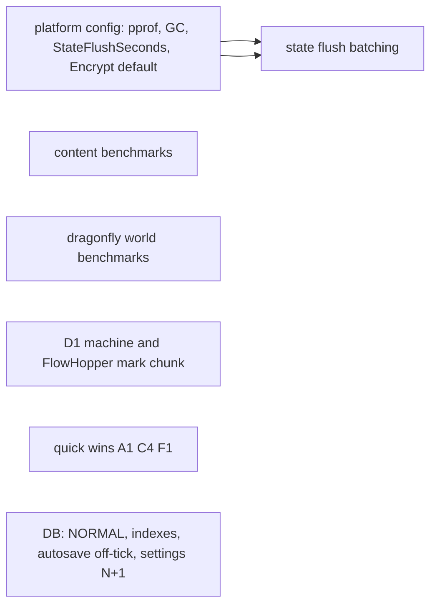

# perf/dev waves 0-1: instrumentation, the machine save fix, quick wins

**Goal:** Waves 0-1 of the perf review plan: pprof and GC settings, benchmarks, the machine/FlowHopper save bug (D1), and the low-risk quick wins (A1, C4, F1, P1, P2, P4, P5, A2, A3, A4).
**Architecture:** Go server. Game code in `content/skygear`, platform in `platform/`, vendored Dragonfly in `third_party/dragonfly` (own go.mod, not covered by the root `go test ./...`).
**Tech stack:** Go 1.26, SQLite (modernc), goleveldb.
**Spec:** docs/plans/2026-11-03-perf.spec.md
**Review plan:** docs/plans/2026-11-03-perf.review.md
**Detail:** contracts
**Target-min:** 11
**Ignore:** data/, .superlite/

## Global constraints

- Language Go. Root tests: `go build ./... && go vet ./... && go test ./...`. Dragonfly tests: `cd third_party/dragonfly && go test ./server/world/...`.
- No behaviour change beyond what the task states. Comments and identifiers in English, matching the repo style (full sentences, `// skygear patch` on Dragonfly edits).
- Any Dragonfly edit: run `.superlite/regen-dfpatch.sh`, which regenerates `third_party/dragonfly.patch`.
- Item IDs (A1, C4, …) refer to the audit findings quoted in each task.
- Never touch files outside your Owns list.

## Main diagram

```mermaid
%% schedule
gantt
  title Predicted schedule (mm:ss)
  dateFormat X
  axisFormat %M:%S
  section lane 1
  T6 DB and autosave :t6, 0, 140s
  section lane 2
  T5 quick wins A1  C4  F1 :t5, 0, 137s
  section lane 3
  T4 D1 machine state marks its chunk :t4, 0, 116s
  section lane 4
  T1 platform settings :t1, 0, 115s
  T7 state flush batching (A3  A2  A4) :t7, 115, 117s
  section lane 5
  T2 content benchmarks :t2, 0, 97s
  section lane 6
  T3 dragonfly world benchmarks :t3, 0, 94s
```

critical path: T1 → T7 (3.9 min) · peak width 6 · predicted build 3.9 min · predicted total ≈ 17.9 min (target ✗ 11.0)

## File structure

| File | Responsibility |
|---|---|
| platform/config.go, cmd/skygear/main.go, platform/instance/manager.go | settings and runtime setup |
| content/skygear/bench_test.go | content benchmarks |
| third_party/dragonfly/server/world/skygear_bench_test.go | world tick and save benchmarks |
| content/skygear/machine/machine.go, content/skygear/hopper/hopper.go | dirty marking |
| platform/db/*.go, platform/instance/instance.go, platform/account/settings.go | DB I/O |
| content/skygear/core/{session,saved}.go, content/skygear/second.go | state flush |

## Section: platform

### T1 platform settings · Complexity 3 · Est. context 30k
**Owns:** platform/config.go, cmd/skygear/main.go, platform/instance/manager.go, platform/config_test.go, README.md, CHANGELOG.md
**Components:** 2
**LOC owned:** 110
**Tests:** fast
**Kind:** design
**Model:** sonnet
**Est. time:** 2.5 min
**Consumes:** none
**Produces:** instance.Instance.StateFlushInterval() -> time.Duration
**Review Focus:** `TestDefaultConfigPerf`: defaults give Debug.Pprof "", Runtime.MemoryLimitMB 0, Runtime.GCPercent 0, Instance.StateFlushSeconds 10, ResourcePack.Encrypt false
**Test code (contracts):** `TestDefaultConfigPerf` as above; `TestStateFlushIntervalDefault`: manager Config with StateFlushInterval 0 becomes 10s (same pattern as AutosaveInterval at manager.go:117).
**Steps:** 1 failing tests, 2 run: FAIL, 3 implement, 4 run: PASS
**Notes:** New `[Debug] Pprof string` (empty = off; else `net/http/pprof` on that address in a goroutine, logged). New `[Runtime] MemoryLimitMB int, GCPercent int`: in main, if env `GOMEMLIMIT` is unset and MemoryLimitMB>0 call `debug.SetMemoryLimit`; if env `GOGC` is unset and GCPercent>0 call `debug.SetGCPercent`. New `[Instance] StateFlushSeconds` (default 10) to `instance.Config.StateFlushInterval`, exposed by `Instance.StateFlushInterval()` in manager.go. `ResourcePack.Encrypt` default true→false; update its comment, add a README table note and a CHANGELOG line that an existing `platform.toml` keeps its old value.

### T6 DB and autosave · Complexity 4 · Est. context 40k
**Owns:** platform/db/db.go, platform/db/settings.go, platform/db/perf_test.go, platform/instance/instance.go, platform/account/settings.go
**Components:** 3
**LOC owned:** 140
**Tests:** fast
**Kind:** design
**Model:** sonnet
**Est. time:** 3.5 min
**Consumes:** none
**Produces:** db.DB.Settings(accountID string) -> (map[string]string, error)
**Review Focus:** `TestSynchronousNormal`: file DB `PRAGMA synchronous` returns 1; `TestPerfIndexes`: `EXPLAIN QUERY PLAN` of JoinedSaves and FriendRequests-to contain `USING INDEX`; `TestSettingsOneQuery`: account with 3 settings, `Settings` returns all 3
**Test code (contracts):** the three tests above (use a temp-dir file DB; check the actual table and column names and the account-id type in db.go first).
**Steps:** 1 failing tests, 2 run: FAIL, 3 implement, 4 run: PASS
**Notes:** P2 add `_pragma=synchronous(NORMAL)` in `fileDSN` (db.go:25). P5 new migration: indexes on `save_members(account_id)` and `friend_requests(to_id)`. P4 `account/settings.go:69-90` loads all settings in one `Settings` call instead of one SELECT per key. P1 `instance.go:139-158`: build `states` inside `World.Do`, wait on `.Done()`, then call `SetPlayerStates` outside the transaction on the run goroutine; `session.Autosave(tx)` stays inside.

## Section: content

### T2 content benchmarks · Complexity 3 · Est. context 45k
**Owns:** content/skygear/helpers_test.go, content/skygear/bench_test.go
**Components:** 1
**LOC owned:** 140
**Tests:** fast
**Kind:** design
**Model:** sonnet
**Est. time:** 2.5 min
**Consumes:** none
**Produces:** none
**Review Focus:** `go test -run xxx -bench . -benchtime 1x ./content/skygear/` completes
**Test code (contracts):** `BenchmarkMachineTick` (a powered crusher with input, ticked b.N times), `BenchmarkMachineTickStuck` (output full), `BenchmarkMarshalSaved` (session with 2000 crops), `BenchmarkBundleTick` (100 conduit bundles), `BenchmarkEnergyStep` (energy network of 50 conduits, 10 machines), `BenchmarkControllerPeek` (storage controller with 50 drawers). Each calls `b.ReportAllocs()`.
**Steps:** 1 change helpers (`testSession`, `loadAround`, `placeTestMachine`, …) from `*testing.T` to `testing.TB` without changing callers, 2 write benchmarks, 3 run all content tests and benchmarks once
**Notes:** Record the numbers you get in your DONE report (they are the baseline).

### T4 D1 machine state marks its chunk · Complexity 6 · Est. context 50k
**Owns:** content/skygear/machine/machine.go, content/skygear/hopper/hopper.go, content/skygear/persist_test.go
**Components:** 2
**LOC owned:** 120
**Tests:** fast
**Kind:** design
**Model:** sonnet
**Est. time:** 4 min
**Consumes:** none
**Produces:** none
**Review Focus:** state: `TestSieveProgressSurvivesReload`; `TestFlowHopperInvSurvivesReload`; state: a dirty machine calls SetBlockEntity at most once per 100 ticks
**Test code (contracts):** `TestSieveProgressSurvivesReload`: open a save, place a sieve (or another non-animated machine) with input, close; reopen, tick N without touching anything, close; reopen → Progress and output equal the values before the last close. **Run it first on the unmodified code and confirm it FAILS** (report if it does not). `TestFlowHopperInvSurvivesReload`: same with a FlowHopper moving items.
**Steps:** 1 failing tests, 2 run: FAIL, 3 implement, 4 run: PASS
**Notes:** Cause: Dragonfly `saveChunk` (world.go:1210) stores only `c.modified` chunks, and machines change `*State` by pointer without `SetBlock`. Fix: `dirty bool` on the machine state, set by `markWorked`, storage `OnChange` of role slots and setters of Energy/Fluid/Boost/Charges/Mob/Recipe/Tier. In `Machine.Tick`, when dirty and `(currentTick+posHash(pos))%100==0`, call `tx.SetBlockEntity(pos, m)` (no neighbour update, no packet) and clear dirty. FlowHopper: same after `StepHopper` moved something and after Insert/Extract. Also check whether vanilla chest/hopper inventories mark the chunk; report the answer, do not fix it.

### T5 quick wins A1, C4, F1 · Complexity 4 · Est. context 40k
**Owns:** content/skygear/dimension/collector.go, content/skygear/conduit/conduitplate.go, content/skygear/conduit/conduitvisual.go, content/skygear/machine/autoequip.go, content/skygear/quickwins_test.go
**Components:** 3
**LOC owned:** 110
**Tests:** fast
**Kind:** design
**Model:** sonnet
**Est. time:** 3 min
**Consumes:** none
**Produces:** none
**Review Focus:** `TestCollectorFullNotDirty`; `TestRemovePlatesLeavesNone`; `TestStuckFellerScansOnce`
**Test code (contracts):** `TestCollectorFullNotDirty`: pool already at poolMax, two `Second` calls → `Dirty()==false`. `TestRemovePlatesLeavesNone`: bundle with plates on 3 sides broken → Plates map has no key for that pos. `TestStuckFellerScansOnce`: feller with full output and a log in range, 20 ticks → the full area is scanned at most once (count via a test hook or the remembered `logAt`).
**Steps:** 1 failing tests, 2 run: FAIL, 3 implement, 4 run: PASS
**Notes:** A1 `collector.go:69-76`: MarkDirty only when the new value differs. C4 `conduitplate.go:207` `removePlates` and `conduitvisual.go:146`: look up the 6 `PlateKey{pos, side}` keys directly instead of scanning the map. F1 `autoequip.go:88-114`: remember the found log position in state; while stuck re-check only that block, rescan when it is no longer a log.

### T7 state flush batching (A3, A2, A4) · Complexity 5 · Est. context 45k
**Owns:** content/skygear/core/session.go, content/skygear/core/saved.go, content/skygear/core/saved_test.go, content/skygear/second.go, content/skygear/game.go
**Components:** 2
**LOC owned:** 130
**Tests:** fast
**Kind:** design
**Model:** sonnet
**Est. time:** 3.5 min
**Consumes:** instance.Instance.StateFlushInterval() -> time.Duration (T1)
**Produces:** core.Session.FlushInterval time.Duration
**Review Focus:** `TestSavedRoundTrip`: marshal then load gives equal parts; `TestFlushEveryInterval`: interval 10s, dirty every second → Flush happens once per 10 Second calls; `TestAutosaveFlushes`
**Test code (contracts):** the three tests above; `BenchmarkMarshalSaved` in saved_test.go with 2000 crops.
**Steps:** 1 failing tests, 2 run: FAIL, 3 implement, 4 run: PASS
**Notes:** A3 `second.go:42`: flush only when dirty and at least `FlushInterval` (0 means 10s) since the last flush; `Autosave` (game.go:183) and Close still flush always; `kit.go:181` keeps its immediate `Flush`. Set `FlushInterval` from `inst.StateFlushInterval()` in `Start`. A2 `marshalSaved` (saved.go:95): marshal each part once and splice the objects (drop outer braces, join with commas, skip `{}`), reuse one buffer. A4 `loadSaved` (saved.go:78): parse once into `map[string]json.RawMessage`.

## Section: dragonfly

### T3 dragonfly world benchmarks · Complexity 4 · Est. context 45k
**Owns:** third_party/dragonfly/server/world/skygear_bench_test.go, third_party/dragonfly.patch
**Components:** 1
**LOC owned:** 120
**Tests:** fast
**Kind:** design
**Model:** sonnet
**Est. time:** 3 min
**Consumes:** none
**Produces:** none
**Review Focus:** `cd third_party/dragonfly && go test -run xxx -bench Skygear -benchtime 1x ./server/world/` completes
**Test code (contracts):** `BenchmarkSkygearTickLoaders` (synchronous world, 450 radius-0 loaders over 600 loaded chunks, one tick per op), `BenchmarkSkygearBlockEntityTick` (5000 ticking block entities), `BenchmarkSkygearSaveColumn` (store 100 modified columns to a temp mcdb), `BenchmarkSkygearDiskEncode` (encode one 24-subchunk column). `b.ReportAllocs()`.
**Steps:** 1 write benchmarks, 2 run once, 3 run `.superlite/regen-dfpatch.sh`
**Notes:** Look at existing `redstone_bench_test.go` for world setup. Put the numbers in your DONE report.

## Review Focus

| Package | App type | Categories | Risks |
|---|---|---|---|
| content/skygear | library + state | state, file | lost machine state, flush skipped on close |
| platform | data/DB | state, file | autosave ordering, migration on old DB |

**Probe entry:** run=go test ./...

## Self-review

All wave 0-1 items in the review plan map to T1-T7; edges: only T1→T7 (compile). No two tasks share a file.
