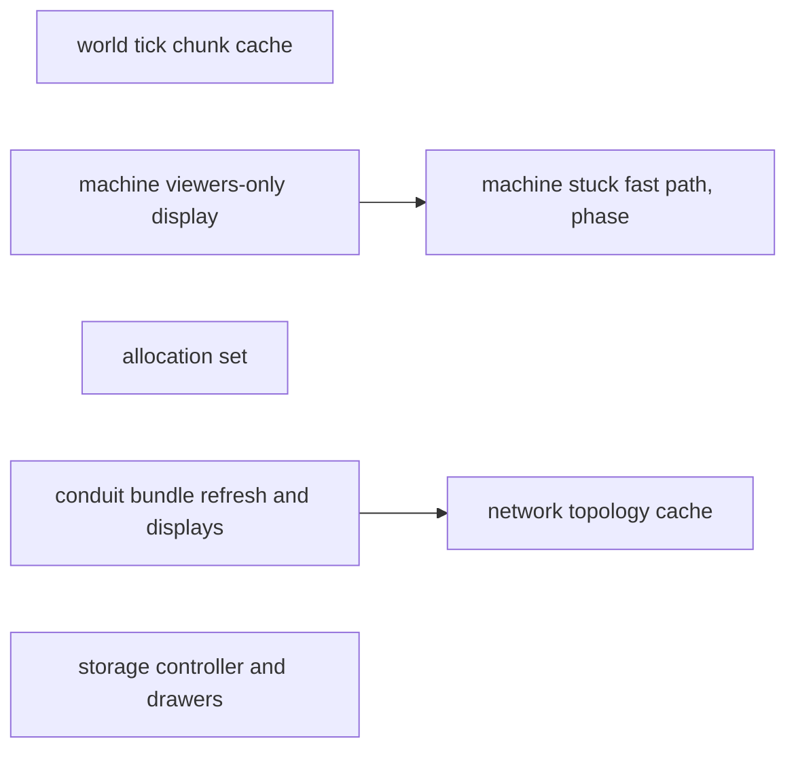

# perf/dev waves 2-3: tick CPU, conduits, storage

**Goal:** Waves 2-3 of the perf review plan: world tick chunk cache (T1, T2), machine tick (M1, M2, M5, M7, M8, M11), allocation set (M3, M4, M6, F3, S4), conduits (C1, C3, C5, C2, C6), storage (S1, S2, S3).
**Architecture:** Go server. Game code in `content/skygear`, shared systems in `common/`, vendored Dragonfly in `third_party/dragonfly` (own go.mod).
**Tech stack:** Go 1.26.
**Spec:** docs/plans/2026-11-03-perf.spec.md
**Review plan:** docs/plans/2026-11-03-perf.review.md
**Detail:** contracts
**Target-min:** 11
**Ignore:** data/, .superlite/

## Global constraints

- Root tests: `go build ./... && go vet ./... && go test ./...`. Dragonfly: `cd third_party/dragonfly && go test ./server/world/...`.
- Throughput and results must not change. Allowed delays (spec Decided-4): drawer labels, orphan display cleanup, timed expiry, bundle safety refresh up to ~2 s; hopper/gauge phase offsets.
- Every cache needs a safety net (periodic forced recompute or ok-form type assertions) and a test that the cached result equals a fresh computation.
- Report before/after numbers from the existing benchmarks (`content/skygear/bench_test.go`, `third_party/dragonfly/server/world/skygear_bench_test.go`) at `-benchtime 2s`.
- Dragonfly edits: `// skygear patch` comment, run `.superlite/regen-dfpatch.sh`, add a row to the patch table in `third_party/README.md`.
- Never touch files outside your Owns list.

## Main diagram

```mermaid
%% schedule
gantt
  title Predicted schedule (mm:ss)
  dateFormat X
  axisFormat %M:%S
  section lane 1
  T14 allocation set (M3  M4  M6  F3  S4) :t14, 0, 184s
  section lane 2
  T15 bundle refresh and display entities  :t15, 0, 140s
  T16 network topology cache (C2  C6) :t16, 140, 167s
  section lane 3
  T11 world tick chunk cache (T1  T2) :t11, 0, 123s
  section lane 4
  T17 controller cache and drawer labels ( :t17, 0, 117s
  section lane 5
  T12 machine display only for viewers (M1 :t12, 0, 113s
  T13 stuck machines and phase (M2  M5  M7 :t13, 113, 94s
```

critical path: T15 → T16 (5.1 min) · peak width 5 · predicted build 5.1 min · predicted total ≈ 18.8 min (target ✗ 11.0)

## File structure

| File | Responsibility |
|---|---|
| third_party/dragonfly/server/world/{tick,world}.go | tick scheduling |
| content/skygear/machine/machine.go, common/chestui | machine tick and display |
| content/skygear/core/items.go, machinerecipe/alloy.go, … | allocation-free helpers |
| content/skygear/conduit/*.go, common/{energy,itemnet,fluidnet,itemio} | conduits and networks |
| content/skygear/storage/*.go | drawers and controller |

## Section: dragonfly

### T11 world tick chunk cache (T1, T2) · Complexity 7 · Est. context 50k
**Owns:** third_party/dragonfly/server/world/tick.go, third_party/dragonfly/server/world/world.go, third_party/dragonfly/server/world/loader.go, third_party/dragonfly/server/world/tick_cache_test.go, third_party/dragonfly/server/world/skygear_bench_test.go, third_party/dragonfly.patch, third_party/README.md
**Components:** 2
**LOC owned:** 180
**Tests:** fast
**Kind:** design
**Model:** sonnet
**Est. time:** 5 min
**Consumes:** none
**Produces:** none
**Review Focus:** state: `TestTickSetMatchesFresh` — after loader add/move/remove, chunk load/unload and SetTickRange, the cached tick set equals the set computed the old way; `BenchmarkSkygearTickLoadersRange` (non-synchronous loader positions, 450 radius-0 loaders + 1 radius-12 loader over 600 chunks)
**Test code (contracts):** the test and benchmark above; existing `BenchmarkSkygearBlockEntityTick` allocs/op must drop.
**Steps:** 1 failing test and new benchmark, 2 run, 3 implement, 4 run, 5 regen patch
**Notes:** Today `tick.go:49,141-158,199-210` rebuilds viewer slices and checks every loaded chunk against every loader each tick. Cache the tick set (`[]*Column` + positions) on the world with a dirty flag set on: loader add/remove/move (`Loader.Move`, `world()`, `Close`, `ChangeWorld`), `addChunk`, `closeChunk`, `SetTickRange`; recompute by walking each loader's radius in `w.chunks`. T2: keep a reusable buffer instead of `slices.Collect(maps.Keys(c.BlockEntities))` (tick.go:159) and read `c.BlockEntities[pos]` instead of `tx.Block(pos)` (192-196), still skipping unloaded chunks. The existing bench runs a Synchronous world that ignores loader positions, hence the new Range benchmark.

## Section: machine

### T12 machine display only for viewers (M1, M11) · Complexity 5 · Est. context 40k
**Owns:** content/skygear/machine/machine.go, common/chestui/storage.go, content/skygear/machine/display_test.go
**Components:** 2
**LOC owned:** 90
**Tests:** fast
**Kind:** design
**Model:** sonnet
**Est. time:** 3 min
**Consumes:** none
**Produces:** chestui.Storage.HasViewers() -> bool
**Review Focus:** state: `TestDisplayFreshOnOpen` — a machine that worked unwatched shows the current progress and energy the moment a player opens it; `TestNoDisplayWithoutViewers` — 100 ticks unwatched do not call SetItem on display slots
**Test code (contracts):** the two tests above.
**Steps:** 1 failing tests, 2 run: FAIL, 3 implement, 4 run: PASS
**Notes:** `machine.go:1416-1430, 938-990`: ShowProgress/ShowEnergy run with no viewer. Add `HasViewers` (len under the lock; find the right chestui file). Machine.Tick shows only with viewers; OpenWindow sets `ShownPct=-1; shownEnergy=-1`, shows, then opens. M11: drop the duplicate ShowProgress at the end of DecodeNBT (machine.go:1182-1243). WAILA reads `st.Progress` directly; keep it.

### T13 stuck machines and phase (M2, M5, M7, M8) · Complexity 6 · Est. context 45k
**Owns:** content/skygear/machine/machine.go, content/skygear/machine/stuck_test.go
**Components:** 1
**LOC owned:** 120
**Tests:** fast
**Kind:** design
**Model:** sonnet
**Est. time:** 4 min
**Consumes:** chestui.Storage.HasViewers() -> bool (T12)
**Produces:** none
**Review Focus:** state: `TestStuckResumesWhenOutputTaken` — an output-blocked crusher resumes the tick after its output slot empties; `TestStuckKeepsStatus` — Stuck stays StuckOutput and the monitor sees it; numeric: `BenchmarkMachineTickStuck` allocs/op drops to near 0
**Test code (contracts):** the tests above; `testing.AllocsPerRun` on `Fits` is 0 for ≤ 8 slots.
**Steps:** 1 failing tests, 2 run: FAIL, 3 implement, 4 run: PASS
**Notes:** M2: bump `invVer` from storage OnChange of role slots; cache the input check by invVer; when `Stuck==StuckOutput` and invVer is unchanged, skip `process` (machine.go:1491-1515). M5: `Fits` (845) uses `var buf [8]item.Stack`. M7: precompute `"skygear:"+Kind` in Def (1030-1050). M8: phase the `%10` display/work cadence with a position hash (machine.go:1416).

### T14 allocation set (M3, M4, M6, F3, S4) · Complexity 4 · Est. context 40k
**Owns:** content/skygear/core/items.go, content/skygear/core/items_test.go, content/skygear/machinerecipe/alloy.go, content/skygear/machinerecipe/alloy_test.go, content/skygear/machine/alloy.go, content/skygear/machine/animate.go, content/skygear/machine/sieve.go, content/skygear/farm/crops.go, content/skygear/textfmt/textfmt.go, content/skygear/textfmt/textfmt_test.go
**Components:** 5
**LOC owned:** 140
**Tests:** fast
**Kind:** design
**Model:** sonnet
**Est. time:** 3.5 min
**Consumes:** none
**Produces:** none
**Review Focus:** `TestPlainTable` — new Plain equals the old one for plain, named, lored, enchanted, timed (NBT values) and anvil-cost stacks; `TestCropKeyFormat` and `TestIntFormat` — same strings as before for negative, zero, large values; `AllocsPerRun` of `MatchAlloy` is 0
**Test code (contracts):** the tests above (keep a copy of the old implementation in the test as the reference).
**Steps:** 1 failing tests, 2 run: FAIL, 3 implement, 4 run: PASS
**Notes:** M3 `items.go:83` Plain without NewStack/Comparable. M4 precompute recipe (name, meta) at init and compare `EncodeItem()` directly. M6 pass the ticked `m` to showActive/showSieve instead of `tx.Block(pos)` (animate.go:61, sieve.go:174). F3 CropKey with strconv.AppendInt. S4 textfmt.Int with strconv.AppendInt.

## Section: conduits

### T15 bundle refresh and display entities (C1, C3, C5, hopper M8) · Complexity 6 · Est. context 45k
**Owns:** content/skygear/conduit/bundle.go, content/skygear/conduit/conduitplate.go, content/skygear/conduit/conduitvisual.go, content/skygear/storage/holder.go, content/skygear/hopper/hopper.go, content/skygear/conduit/refresh_test.go
**Components:** 3
**LOC owned:** 140
**Tests:** fast
**Kind:** design
**Model:** sonnet
**Est. time:** 4 min
**Consumes:** none
**Produces:** none
**Review Focus:** state: `TestBundleRepairsWithinSafetyWindow` — a neighbour change without an update event is fixed within 40 ticks; `TestOrphanVisualClosed` — a visual whose bundle is gone closes within 20 ticks; `BenchmarkBundleTick` drops
**Test code (contracts):** the tests above.
**Steps:** 1 failing tests, 2 run: FAIL, 3 implement, 4 run: PASS
**Notes:** C1 `bundle.go:258-277`: every 4 ticks only AddConduit and display liveness; full Refresh every ~40 ticks phased by position hash; NeighbourUpdateTick still refreshes immediately. C3 `plugsFrom` uses `[6][3]int`; keep plate data with the handle to avoid `Entity(tx)`. C5 visual/plate/holder owner checks every 20 ticks, phased by handle hash. M8 hopper `%interval` (hopper.go:233) phased by position hash.

### T16 network topology cache (C2, C6) · Complexity 7 · Est. context 50k
**Owns:** common/energy/grid.go, common/energy/grid_test.go, common/itemnet/itemnet.go, common/itemnet/itemnet_test.go, common/fluidnet/fluidnet.go, common/fluidnet/fluidnet_test.go, common/itemio/itemio.go, content/skygear/conduit/bundle.go
**Components:** 4
**LOC owned:** 180
**Tests:** fast
**Kind:** design
**Model:** sonnet
**Est. time:** 5 min
**Consumes:** none
**Produces:** energy.Grid.Invalidate() -> ()
**Review Focus:** state: per network, `TestPlacedMachineJoinsNextStep` and `TestBrokenMachineLeavesNextStep`; `TestStaleCacheNoPanic` — Transfer with a cached endpoint that became a non-Sink block does not panic; numeric: `BenchmarkEnergyStep` with 50 conduits
**Test code (contracts):** the tests above for energy, itemnet and fluidnet.
**Steps:** 1 failing tests, 2 run: FAIL, 3 implement, 4 run: PASS
**Notes:** `grid.go:47`, `itemnet.go:234`, `fluidnet.go:196` re-run BFS every step. Cache `nets` with dirty set on new conduit registration, `Invalidate()` (call it from Bundle.Refresh when connections change and from NeighbourUpdateTick), and a forced rescan every ~20 steps. Make `.(Source)/.(Sink)/.(Holder)` assertions ok-form. C6 `itemio.go:44-64` returns early when both interfaces are found.

## Section: storage

### T17 controller cache and drawer labels (S1, S2, S3) · Complexity 5 · Est. context 45k
**Owns:** content/skygear/storage/storage.go, content/skygear/storage/drawer.go, content/skygear/core/shapes.go, content/skygear/storage/perf_test.go
**Components:** 2
**LOC owned:** 130
**Tests:** fast
**Kind:** design
**Model:** sonnet
**Est. time:** 4 min
**Consumes:** none
**Produces:** none
**Review Focus:** state: `TestControllerSeesNewDrawer` — a drawer placed this tick is visible to the controller next tick; `TestLabelBatched` — 10 inserts in 10 ticks send ≤ 1 label update per drawer per 20 ticks and the final label is exact; lock/upgrade display changes still send at once
**Test code (contracts):** the tests above; `BenchmarkControllerPeek` drops.
**Steps:** 1 failing tests, 2 run: FAIL, 3 implement, 4 run: PASS
**Notes:** S1 `storage.go:44, 99-158`: reuse the BFS position list within one tick per controller (key `controllerPos`, value `{tick, []Pos}`), always re-read drawer values with `tx.Block`; invalidate on drawer/link place or break. S2 `drawer.go:603-624`: mark label dirty, send from `Drawer.Tick` every 10-20 ticks. S3 `drawer.go:289`: timed expiry and ensureDisplay every 20 ticks, phased.

## Review Focus

| Package | App type | Categories | Risks |
|---|---|---|---|
| dragonfly world | concurrency/state | state | chunk silently stops ticking |
| content/skygear machine, conduit, storage | state | state, numeric | stale cache, stuck machine never resumes |

**Probe entry:** run=go test ./...

## Self-review

All wave 2-3 review-plan items map to T11-T17. T12→T13 and T15→T16 are sequential on shared files (machine.go, bundle.go); no other shared files.
