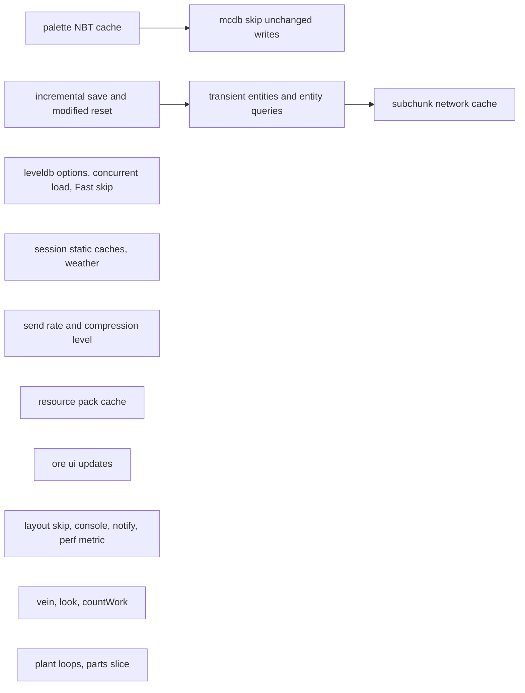

# perf/dev waves 4-6: save path, network, packs, Ore UI, rest

**Goal:** Waves 4-6 of the perf review plan: chunk save path (S2-df, S3, S1-df, S4, S5, S6, S7), session/network (N1-N9, T5), resource packs (R1, R2), Ore UI (O1-O4) and the remaining items (X1, X2, X3, F2, M9, M10, P8-P11).
**Architecture:** Go server; Dragonfly fork in `third_party/dragonfly` (own go.mod); Ore UI page in `web/oreui` (TypeScript, built into an embedded bundle).
**Tech stack:** Go 1.26, goleveldb, Node 22 + vitest for web.
**Spec:** docs/plans/2026-11-03-perf.spec.md
**Review plan:** docs/plans/2026-11-03-perf.review.md
**Detail:** contracts
**Target-min:** 11
**Ignore:** data/, .superlite/, web/oreui/node_modules/

## Global constraints

- Root tests `go build ./... && go vet ./... && go test ./...`; Dragonfly `cd third_party/dragonfly && go test ./server/...`; web `npm --prefix web/oreui test` and `npm --prefix web/oreui run build`, then commit the rebuilt bundle (`TestOreUIBundleFresh` in assets/ must pass).
- Save format stays readable by the old code and by vanilla (Flate kept). Behaviour and throughput unchanged.
- The machine/FlowHopper chunk marking from wave 1 (D1) is in place; never weaken it.
- Dragonfly edits: `// skygear patch` comment on every change. Do NOT edit `third_party/dragonfly.patch` or `third_party/README.md` (several tasks run at once; the coordinator regenerates the patch and a final docs task adds the README rows). List your patched files and a one-line description each in your DONE report.
- Report before/after numbers (`skygear_bench_test.go`, `content/skygear/bench_test.go`, `-benchtime 2s`). Add a benchmark where none measures your change.
- Never touch files outside your Owns list.

## Main diagram

```mermaid
%% schedule
gantt
  title Predicted schedule (mm:ss)
  dateFormat X
  axisFormat %M:%S
  section lane 1
  T30 Ore UI updates (O1  O2  O3) :t30, 0, 139s
  T26 subchunk network cache (N1  N2  N3) :t26, 235, 119s
  section lane 2
  T32 vein  look  countWork (X1  X3  M9) :t32, 0, 136s
  section lane 3
  T31 layout skip  console  notify  perf m :t31, 0, 132s
  section lane 4
  T29 resource pack cache (R1  R2) :t29, 0, 119s
  section lane 5
  T27 session static caches and weather (N :t27, 0, 116s
  section lane 6
  T28 chunk send rate and compression leve :t28, 0, 116s
  section lane 7
  T33 plant loops and parts slice (F2  M10 :t33, 0, 115s
  section lane 8
  T25 leveldb options  concurrent load  Fa :t25, 0, 114s
  section lane 9
  T23 incremental save and modified reset  :t23, 0, 94s
  T24 transient entities and entity querie :t24, 94, 140s
  section lane 10
  T21 palette NBT cache (S2) :t21, 0, 90s
  T22 mcdb skips unchanged writes (S3) :t22, 90, 93s
```

critical path: T23 → T24 → T26 (5.9 min) · peak width 10 · predicted build 5.9 min · predicted total ≈ 19.4 min (target ✗ 11.0)

## Section: save path (dragonfly)

### T21 palette NBT cache (S2) · Complexity 4 · Est. context 35k
**Owns:** third_party/dragonfly/server/world/chunk/encoding.go, third_party/dragonfly/server/world/block_registry.go, third_party/dragonfly/server/world/chunk/palette_cache_test.go
**Components:** 1
**LOC owned:** 80
**Tests:** fast
**Kind:** design
**Model:** sonnet
**Est. time:** 2.5 min
**Consumes:** none
**Produces:** none
**Review Focus:** encoding: `TestDiskEncodeDeterministic` — encoding the same column twice gives identical bytes; `TestDiskEncodeRoundTrip` — decode(encode(c)) equals c for mixed palettes incl. air-only subchunks; `BenchmarkSkygearDiskEncode` allocs drop
**Test code (contracts):** the tests above.
**Steps:** 1 failing tests, 2 run: FAIL, 3 implement, 4 run: PASS
**Notes:** `chunk/encoding.go:60-62` builds an `nbt.NewEncoder` and a fresh `EncodeBlock()` map per palette entry; NBT map order is random so bytes differ per save. Cache the encoded entry per runtime ID lazily (`[]atomic.Pointer[[]byte]` sized to the registry, used only after Finalize).

### T22 mcdb skips unchanged writes (S3) · Complexity 5 · Est. context 40k
**Owns:** third_party/dragonfly/server/world/mcdb/db.go, third_party/dragonfly/server/world/mcdb/skipwrite_test.go
**Components:** 1
**LOC owned:** 110
**Tests:** fast
**Kind:** design
**Model:** sonnet
**Est. time:** 3 min
**Consumes:** none
**Produces:** none
**Review Focus:** state: `TestSecondStoreNoPuts` — storing an unchanged column twice, the second batch has 0 Puts for subchunks/3D/version/finalisation; `TestEmptySubchunkDeleted` — an emptied subchunk key is deleted and reads back empty; block entities and entities are always written
**Test code (contracts):** the tests above (count batch operations through a small seam if needed).
**Steps:** 1 failing tests, 2 run: FAIL, 3 implement, 4 run: PASS
**Notes:** `db.go:368-383, 395-399, 418-430`. Keep an in-memory map key→xxhash of the last written value; skip equal Puts. Empty subchunks: Delete instead of Put (reads treat missing as empty, db.go:250-255). Cache the per-chunk entity ID list instead of `ldb.Get` on every store. Instance DBs are exclusive to one world.

### T23 incremental save and modified reset (S1, S5) · Complexity 6 · Est. context 45k
**Owns:** third_party/dragonfly/server/world/world.go, third_party/dragonfly/server/world/save_test.go
**Components:** 1
**LOC owned:** 120
**Tests:** fast
**Kind:** design
**Model:** sonnet
**Est. time:** 4 min
**Consumes:** none
**Produces:** none
**Review Focus:** state: `TestIncrementalSaveCoversAll` — with SaveInterval 60 s and K=16, every modified column is stored within one interval; `TestCloseSavesEverything` — Close stores all modified columns at once; `TestModifiedResetOnlyWithoutBlockEntities` — a saved column with no block entities and no entities is not re-stored next interval, one with block entities is
**Test code (contracts):** the tests above.
**Steps:** 1 failing tests, 2 run: FAIL, 3 implement, 4 run: PASS
**Notes:** `world.go:1197-1219, 1506-1526`: autoSave stores every modified chunk in one transaction each interval. Run it every second storing up to K=16 columns whose `lastSaved` is older than SaveInterval; `Close` and `World.Save()` stay full. S5: after storing, clear `modified` only for columns with no block entities and no entities.

### T24 transient entities and entity queries (S4, N7, N8) · Complexity 6 · Est. context 50k
**Owns:** third_party/dragonfly/server/world/world.go, third_party/dragonfly/server/world/entity.go, third_party/dragonfly/server/world/transient_test.go, content/skygear/storage/holder.go, content/skygear/conduit/conduitvisual.go, content/skygear/conduit/conduitplate.go, content/skygear/fairy/fairy.go, content/skygear/dimension/gateportal.go, content/skygear/dimension/marks.go, content/skygear/dimension/monster.go
**Components:** 3
**LOC owned:** 140
**Tests:** fast
**Kind:** design
**Model:** sonnet
**Est. time:** 4.5 min
**Consumes:** none
**Produces:** world.TransientEntityType.Transient() -> bool
**Review Focus:** state: `TestTransientNotStored` — a transient entity is absent from the stored column and adding/removing it does not set modified; vanilla item entities are still stored; `TestPlayersIndex` — `tx.Players()` yields exactly the players after add/remove/ChangeWorld; X2 monsters send movement only when position/rotation/onGround changed
**Test code (contracts):** the tests above; benchmark `entitiesWithin` with 200 items + 500 holders in one chunk.
**Steps:** 1 failing tests, 2 run: FAIL, 3 implement, 4 run: PASS
**Notes:** Optional interface on the entity type; `columnTo` skips them; `addEntity/removeEntity` (world.go:870, 896) skip `modified` for them. Content types: storage.HolderType, conduit.VisualType, conduit.PlateType, fairy.EntityType, dimension.GatePortalType, GemType/PopupType (marks.go), MonsterTypes (monster.go). N7 `entitiesWithin` (world.go:925-948) without `slices.Clone` per chunk. N8 a player handle set maintained on add/remove for `tx.Players()` (world.go:962-972). X2 monster.go:419.

### T25 leveldb options, concurrent load, Fast skip (S6, S7, P8) · Complexity 5 · Est. context 40k
**Owns:** third_party/dragonfly/server/world/conf.go, third_party/dragonfly/server/world/chunk_request.go, third_party/dragonfly/server/world/mcdb/conf.go, third_party/dragonfly/server/world/concurrent_test.go, platform/instance/instance.go
**Components:** 2
**LOC owned:** 100
**Tests:** fast
**Kind:** design
**Model:** sonnet
**Est. time:** 3 min
**Consumes:** none
**Produces:** world.ConcurrentProvider.Concurrent() -> bool
**Review Focus:** state: `TestConcurrentLoadSameColumns` — loading 200 columns with 4 workers through mcdb gives the same columns as 1 worker (run with -race); P8: when the previous Fast task has not finished, the next Fast is skipped and Second is never skipped
**Test code (contracts):** the tests above.
**Steps:** 1 failing tests, 2 run: FAIL, 3 implement, 4 run: PASS
**Notes:** S7: providers that implement `ConcurrentProvider` (mcdb does) are not wrapped in `lockedProvider` (conf.go:141-146); instances use `ChunkLoadWorkers` 4. S6: instance DB opens with BlockCacheCapacity 1 MiB, WriteBuffer 2 MiB, OpenFilesCacheCapacity 64 (Flate stays). P8 instance.go:101-125.

## Section: network (dragonfly session)

### T26 subchunk network cache (N1, N2, N3) · Complexity 6 · Est. context 50k
**Owns:** third_party/dragonfly/server/world/world.go, third_party/dragonfly/server/session/chunk.go, third_party/dragonfly/server/session/world.go, third_party/dragonfly/server/session/subchunk_cache_test.go
**Components:** 2
**LOC owned:** 140
**Tests:** fast
**Kind:** design
**Model:** sonnet
**Est. time:** 4.5 min
**Consumes:** none
**Produces:** none
**Review Focus:** state: `TestSubChunkCacheInvalidatedOnSetBlock` — after a block change the next request sends new bytes; also after biome change through `sghook.Column`; `BenchmarkSubChunkEntry` two viewers: second viewer does not re-encode
**Test code (contracts):** the test and benchmark above.
**Steps:** 1 failing tests, 2 run: FAIL, 3 implement, 4 run: PASS
**Notes:** Add `Column.version` bumped wherever `modified=true` is set; cache per subchunk (payload, hash, heightmap) keyed by version, read/written only inside the world transaction (session/chunk.go:72-138). N2 split block entities by subchunk once per column. N3 drop `slices.Clone(c.viewers)` in setBlock only if no viewer callback re-enters addViewer (world.go:403, 440-442).

### T27 session static caches and weather (N4, N6, T5) · Complexity 5 · Est. context 45k
**Owns:** third_party/dragonfly/server/session/player.go, third_party/dragonfly/server/world/tick.go, third_party/dragonfly/server/session/recipes_cache_test.go
**Components:** 2
**LOC owned:** 120
**Tests:** fast
**Kind:** design
**Model:** sonnet
**Est. time:** 3.5 min
**Consumes:** none
**Produces:** none
**Review Focus:** state: `TestRecipeFilterSameEntries` — filtered CraftingData equals the old output (same network IDs, same recipes) for nil and a sample filter; `BenchmarkSendRecipes`; weather LevelEvents are sent only when weather changes
**Test code (contracts):** the tests above.
**Steps:** 1 failing tests, 2 run: FAIL, 3 implement, 4 run: PASS
**Notes:** N4 `player.go:114-232`: build protocol recipe entries once (sync.Once, stable RecipeID instead of uuid.New per send, include creativeBlockFitter results); filter only selects. Cache creative content per registry. N6 `player.go:736-747` batch UI inventory sends within one transaction via tx.Defer. T5 `tick.go:88-97`: send weather only when it changed (new viewers already get it).

### T28 chunk send rate and compression level (N5, N9) · Complexity 4 · Est. context 35k
**Owns:** third_party/dragonfly/server/session/session.go, platform/config.go, platform/config_test.go, cmd/skygear/main.go, common/netcompress/flate.go, common/netcompress/flate_test.go
**Components:** 2
**LOC owned:** 120
**Tests:** fast
**Kind:** design
**Model:** sonnet
**Est. time:** 3 min
**Consumes:** none
**Produces:** none
**Review Focus:** encoding: `TestFlateLevelRoundTrip` — compressed with each level 1-9 decompresses with the standard decoder; `BenchmarkFlateLevels` over a recorded-like chunk batch prints ns/op and bytes for levels 1, 3, 6; default chosen from it and written in docs/tech/performance.md
**Test code (contracts):** the tests above; `TestDefaultConfigPerf` extended with the new key.
**Steps:** 1 failing tests, 2 run: FAIL, 3 implement, 4 run: PASS
**Notes:** N9: a `packet.Compression` implementation with the same ID as Flate and a configurable level (`platform.toml [Network] CompressionLevel`), passed via `server.Config.Compression`. N5 `session.go:509-517`: send up to 16 chunks per 50 ms while the client is loading (few open blob transactions), 4 otherwise.

## Section: packs and Ore UI

### T29 resource pack cache (R1, R2) · Complexity 5 · Est. context 40k
**Owns:** common/resourcepack/pack.go, common/resourcepack/protect.go, common/resourcepack/cache.go, common/resourcepack/cache_test.go
**Components:** 2
**LOC owned:** 140
**Tests:** fast
**Kind:** design
**Model:** sonnet
**Est. time:** 3.5 min
**Consumes:** none
**Produces:** none
**Review Focus:** file: `TestCachedPackSameChecksum` — cached and fresh build give the same pack UUID/version/checksum; `TestCacheKeyChanges` — changing options, secret or builder version misses; corrupt cache file falls back to a fresh build
**Test code (contracts):** the tests above; existing protect_test.go passes.
**Steps:** 1 failing tests, 2 run: FAIL, 3 implement, 4 run: PASS
**Notes:** Key = content hash + options + secret hash + builder version constant; cache under `data/packcache/<name>-<key>.mcpack`. Build packs concurrently (errgroup). Zip in memory (Store for png and ciphertext, Deflate otherwise). R2 cfb8 shift register as a ring buffer (protect.go:140-160).

### T30 Ore UI updates (O1, O2, O3) · Complexity 5 · Est. context 45k
**Owns:** web/oreui/src/runtime/doc.ts, web/oreui/src/App.tsx, web/oreui/src/components/Scroll.tsx, web/oreui/src/components/Canvas.tsx, web/oreui/test/perf.test.tsx, assets/oreui
**Components:** 3
**LOC owned:** 130
**Tests:** fast
**Kind:** design
**Model:** sonnet
**Est. time:** 3.5 min
**Consumes:** none
**Produces:** none
**Review Focus:** protocol: `same value publishes nothing` — two identical updates render once; Scroll writes styles only when display/height/top change; Canvas drag uses transform and reads layout only on resize; existing scroll/canvas tests and visual baseline pass
**Test code (contracts):** the tests above in vitest.
**Steps:** 1 failing tests, 2 run: FAIL, 3 implement, 4 run: PASS, 5 `npm run build`, commit the rebuilt bundle (find its path from scripts/build.mjs; adjust Owns note in the DONE report if it is not under assets/oreui)
**Notes:** O1 doc.ts:46-60 skip publish when unchanged, move the `updates` counter to a debug facet read only by Status. O2 Scroll.tsx:19-33 remember last values; poll 250 ms. O3 Canvas.tsx:164-180 `transform: translate() scale()` batched with rAF; check clampPan/tooltip math.

## Section: the rest

### T31 layout skip, console, notify, perf metric (O4, P9, P10, P11) · Complexity 3 · Est. context 30k
**Owns:** common/oreui/oreui.go, common/oreui/layout_skip_test.go, platform/console.go, platform/notify.go, common/perf/perf.go
**Components:** 3
**LOC owned:** 70
**Tests:** fast
**Kind:** design
**Model:** sonnet
**Est. time:** 2.5 min
**Consumes:** none
**Produces:** none
**Review Focus:** `TestSetLayoutSameBytesSkipped` — same JSON twice sends once, different JSON sends; notify map entry removed on leave
**Test code (contracts):** the tests above.
**Steps:** 1 failing tests, 2 run: FAIL, 3 implement, 4 run: PASS
**Notes:** O4 oreui.go:197-213 keep last bytes per form. P9 perf.go:45 use runtime/metrics heap bytes instead of ReadMemStats. P10 console.go:50-60 check for an open console before building textLine. P11 notify.go:67 delete `notifyInFriends` on disconnect.

### T32 vein, look, countWork (X1, X3, M9) · Complexity 4 · Est. context 35k
**Owns:** content/skygear/tinker/vein.go, content/skygear/island/island.go, content/skygear/look/look.go, content/skygear/machine/machinecount.go, content/skygear/rest_perf_test.go
**Components:** 3
**LOC owned:** 100
**Tests:** fast
**Kind:** design
**Model:** sonnet
**Est. time:** 3 min
**Consumes:** none
**Produces:** none
**Review Focus:** state: `TestOwnsAfterBuyChunk` — island chunk set cache sees a newly bought chunk; vein result reused only while target/tool/budget are unchanged; cycle achievements counted the same total (batched per second)
**Test code (contracts):** the tests above.
**Steps:** 1 failing tests, 2 run: FAIL, 3 implement, 4 run: PASS
**Notes:** X1 island.go:113 `CanBuild` uses a set rebuilt when `len(Chunks)` changes (only island.go:147 appends); vein.go:153-159 reuses the BFS for ~1 s. X3 look.go:115-127 skip when lastLook < 50 ms. M9 machinecount.go:27-43 batch per island, flush in TickMonitor.

### T33 plant loops and parts slice (F2, M10) · Complexity 4 · Est. context 35k
**Owns:** content/skygear/farm/magic.go, content/skygear/farm/barrel.go, content/skygear/farm/composter.go, content/skygear/core/part.go, content/skygear/core/saved.go, content/skygear/farm/loops_test.go
**Components:** 2
**LOC owned:** 110
**Tests:** fast
**Kind:** design
**Model:** sonnet
**Est. time:** 3 min
**Consumes:** none
**Produces:** none
**Review Focus:** state: a removed plant/barrel/composter stops being processed; grown plants are processed at the same times as before; `Part.Of`/`Saved.Of` return the same values (all core tests)
**Test code (contracts):** the tests above.
**Steps:** 1 failing tests, 2 run: FAIL, 3 implement, 4 run: PASS
**Notes:** F2 magic.go:411, barrel.go:670, composter.go:151: cache parsed positions (`map[string]cube.Pos`), schedule grown plants by ReadyAt like crops. M10 part.go:39, saved.go:56: `[]any` indexed by id instead of `map[int]any`.

## Review Focus

| Package | App type | Categories | Risks |
|---|---|---|---|
| dragonfly world/mcdb | file/state | state, file, encoding | lost writes, unreadable saves |
| dragonfly session | protocol | protocol, state | stale chunks sent |
| resourcepack | file | file, encoding | clients reject a cached pack |
| web/oreui | web UI | protocol | missed UI updates |

**Probe entry:** run=go test ./...

## Self-review

Wave 4-6 items map to T21-T33. Shared files: world.go (T23→T24→T26), mcdb/db.go only T22, the patch and README are regenerated by the coordinator after the wave.
