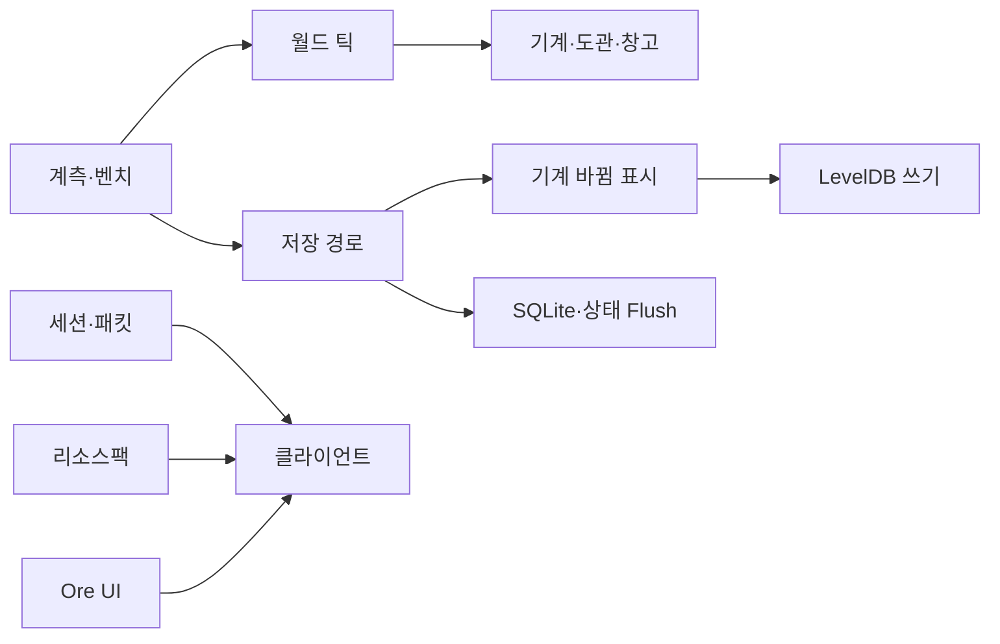
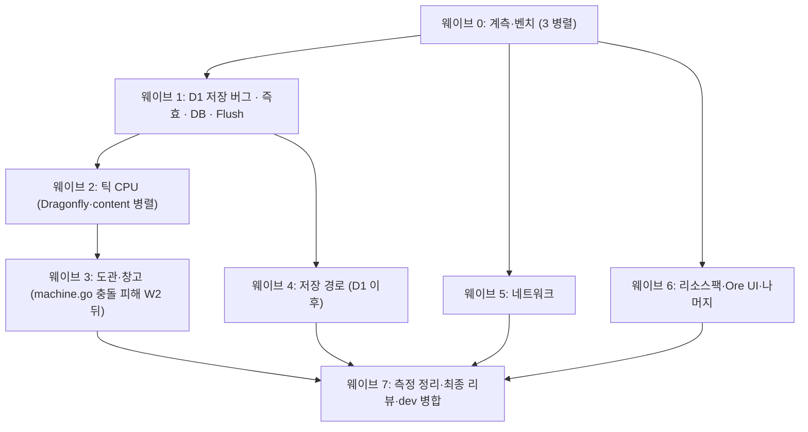

# perf/dev 성능 최적화: 구현 계획

**명세:** `docs/plans/2026-11-03-perf.spec.md`
**브랜치:** `perf/dev`(`dev` 에서 만듦). 끝나면 `dev` 에 먼저 병합합니다.

## Summary

두 감사에서 나온 최적화 약 60건을 **웨이브 7개, 커밋 약 30개**로 나눠 구현합니다. 순서는 이렇습니다.

1. 성능 측정 도구와 벤치마크를 먼저 넣습니다.
2. 기계 진행이 저장되지 않을 수 있는 버그를 고칩니다.
3. 효과가 크고 위험이 낮은 것부터 진행합니다.

커밋마다 build·vet·test 를 통과시키고, 전후 벤치마크 수치를 남깁니다. 측정해도 효과가 보이지 않는 작은 항목은 빼고, 뺐다는 사실을 기록합니다.

## What you will get

- 서버 쪽:
  - 섬의 평균 틱이 줄고, 1분마다 생기던 저장 튐과 매초 생기던 상태 저장 튐이 사라집니다.
  - 디스크 쓰기가 크게 줄고, 기계 진행 저장 손실 버그가 고쳐집니다.
- 접속 쪽:
  - 섬 입장과 첫 접속이 빨라집니다(청크 로드·전송, 레시피 목록 캐시).
  - 리소스팩 다운로드가 약 절반으로 줄고(암호화 기본 끔), 서버 시작이 빨라집니다(팩 캐시).
- 클라이언트 쪽: 서랍 라벨 패킷 폭주가 줄고, Ore UI 스크롤과 퀘스트 판이 부드러워집니다.
- 새 설정 4개(`platform.toml`):
  - `[Debug] Pprof`
  - `[Instance] StateFlushSeconds`(기본 10)
  - 네트워크 압축 레벨(측정해서 기본값 결정)
  - GC 메모리 한도
- `docs/tech/performance.md` 에 측정 결과를 추가합니다.

## What will be built

| 웨이브 | 묶음(커밋) | 하는 일 | 크기 | 담당 |
|---|---|---|---|---|
| 0 | W0-a 계측 | pprof 스위치, 테스트 헬퍼를 벤치에서도 쓸 수 있게(`testing.TB`) | S | 빠른 도우미 |
| 0 | W0-b 벤치(content) | 기계·저장 상태·번들·Grid·제어기 벤치 | M | 신중한 도우미 |
| 0 | W0-c 벤치(Dragonfly) | 틱 로더·블록 엔티티·청크 저장·서브청크·레시피 전송 벤치 | M | 신중한 도우미 |
| 1 | D1 저장 버그 | 기계·FlowHopper 를 바뀜으로 표시. 실패하는 재현 테스트를 먼저 작성 | M | 신중한 도우미 |
| 1 | Q1 즉효 묶음 | 수집기 dirty(A1), 판 제거 O(1)(C4), 멈춘 벌목기(F1) | S | 신중한 도우미 |
| 1 | Q2 DB | `synchronous=NORMAL`(P2), 인덱스 마이그레이션(P5), autosave 쓰기를 틱 밖으로(P1), 설정 N+1(P4) | S | 신중한 도우미 |
| 1 | Q3 상태 Flush | `StateFlushSeconds`(A3), marshalSaved 를 이어 붙이기로(A2), 로드 한 번만 파싱(A4) | M | 신중한 도우미 |
| 2 | T-a 틱 청크 캐시 | Dragonfly 틱 대상 청크 목록 캐시와 블록 엔티티 틱 할당 제거(T1, T2) | L | 신중한 도우미 |
| 2 | T-b 기계 표시 | 아무도 안 볼 때 표시 칸 갱신 생략(M1, M11) | M | 신중한 도우미 |
| 2 | T-c 할당 묶음 | Plain·Alloy·Fits·ItemID·CropKey·textfmt(M3~M7, F3, S4) | M | 신중한 도우미 |
| 2 | T-d 멈춘 기계 | 인벤토리 버전으로 입력 판정 캐시, 출력 막힘이면 바로 반환(M2) | M | 신중한 도우미 |
| 3 | C-a 번들·엇갈림 | 번들 Refresh 줄이기, 표시 엔티티·서랍 틱 주기화, 호퍼·게이지 위상 엇갈림(C1, C5, S3, M8) | M | 신중한 도우미 |
| 3 | C-b Grid 캐시 | 에너지·아이템·액체 네트워크 토폴로지 캐시와 무효화(C2, C3, C6) | L | 신중한 도우미 |
| 3 | C-c 창고 | 제어기 네트워크 캐시(S1), 서랍 라벨 모아 보내기(S2) | M | 신중한 도우미 |
| 4 | S-a 결정적 인코딩 | 팔레트 NBT 캐시(S2-df) | S | 신중한 도우미 |
| 4 | S-b mcdb 쓰기 | 빈 서브청크 Delete, 해시가 같으면 Put 생략, 엔티티 ID 캐시(S3) | M | 신중한 도우미 |
| 4 | S-c 나눠 저장 | 1분 전체 저장을 1초마다 K청크로(S1-df) | M | 신중한 도우미 |
| 4 | S-d 일회용 엔티티 | `TransientEntityType` 과 콘텐츠 엔티티 7종(S4) | M | 신중한 도우미 |
| 4 | S-e modified 해제 | 블록 엔티티가 없는 청크만 저장 뒤 해제(S5) | S | 신중한 도우미 |
| 4 | S-f LevelDB | 인스턴스 DB 옵션 축소, 동시 청크 로드(S6, S7) | M | 신중한 도우미 |
| 5 | N-a 서브청크 캐시 | Column 버전 + 서브청크 인코딩 캐시, 블록 엔티티 분할(N1, N2, N3) | L | 신중한 도우미 |
| 5 | N-b 세션 정적 캐시 | 레시피·창작 목록 캐시, 날씨는 바뀔 때만, UI 인벤토리 모아 보내기(N4, T5, N6) | M | 신중한 도우미 |
| 5 | N-c 엔티티 질의 | entitiesWithin 할당 제거, 플레이어 집합(N7, N8), 몬스터 이동 패킷(X2) | S | 신중한 도우미 |
| 5 | N-d 전송·압축 | 압축 레벨 설정(측정값 기본), 청크 전송 속도(N5, N9) | S | 신중한 도우미 |
| 6 | R-a 리소스팩 | 암호화 기본 끔, 팩 디스크 캐시 + 병렬 빌드, cfb8 링 버퍼(R1, R2, R3) | M | 신중한 도우미 |
| 6 | O-a Ore UI | 같은 값 publish 생략, Scroll 폴링 줄이기, Canvas transform, 번들 재빌드(O1~O3) | M | 신중한 도우미 |
| 6 | O-b SetLayout 생략 | 같은 JSON 재전송 생략(O4) | S | 빠른 도우미 |
| 6 | X-a 나머지 | vein 섬 청크 집합(X1), 1초 루프 키 캐시(F2), look 생략(X3), parts 슬라이스(M10), countWork 배치(M9), GC 설정, perf 메모리 지표(P9), console·notify(P10, P11), Fast 건너뛰기(P8) | M | 신중한 도우미 |
| 7 | 마무리 | 전체 벤치 전후 표를 performance.md 에, CHANGELOG, 최종 리뷰 | S | 신중한 도우미 |

## How it fits together

## How it gets built

같은 파일을 만지는 묶음은 이어서 하고, 나머지는 동시에 진행합니다. 같은 파일 예: `machine.go` 를 만지는 T-b → T-c → T-d → C-a, 그리고 `world.go` 를 만지는 S-c → S-d → S-e → N-a.

## Decisions you can change

- 상태 Flush 간격: **10초(기본)** | 5초 | 30초(autosave 와 같게)
- 나눠 저장: **1초마다 최대 16청크(기본)** | 틱마다 1청크
- 표시 지연 한도: **최대 1~2초(기본)** | 표시는 지연 없이(효과 감소)
- 네트워크 압축 기본 레벨: **측정 후 결정(기본, 1~3 예상)** | 지금처럼 6
- 효과가 안 보이는 L 항목: **빼고 기록(기본)** | 모두 넣기

## Risks

| 위험 | 대응 |
|---|---|
| 캐시 무효화 누락(틱 청크, Grid, 서브청크) → 멈춤이나 낡은 화면 | 주기적 강제 재계산 안전망, 캐시와 매번 계산한 결과가 같은지 비교하는 테스트, ok 형태 타입 단언 |
| 저장 최적화로 데이터 손실 | D1 을 먼저 넣고, 재현 테스트가 수정 전에는 실패하고 수정 후에는 통과하는지 확인. `Close` 는 전체 저장 유지 |
| Dragonfly 패치 관리 누락 | 커밋마다 `dragonfly.patch` 재생성과 README 표 확인 |
| 이미 생성된 `platform.toml` 은 암호화가 켜진 채 남음 | CHANGELOG·README 에 안내 |
| 실제 기기 체감(입장 시간, FPS)은 여기서 잴 수 없음 | 서버 쪽 수치로 증명하고, 기기 확인 항목은 목록으로 드림 |

## Out of scope

- 게임 밸런스·동작·저장 형식 변경, Dragonfly 업스트림 동기화
- 읽기 전용 두 번째 SQLite 커넥션(P3), 비동기 백업(P7). 측정한 뒤 별도 제안
- 예약 틱 큐 heap(T4), 무작위 틱 팔레트 건너뛰기(T3), Ore UI 번들 분리(O5). 효과가 작아 측정 후 판단

## How we will know it works

- 커밋마다 `go build ./... && go vet ./... && go test ./...` 가 녹색입니다. web 은 vitest 와 번들 신선도 테스트도 녹색입니다.
- D1 재현 테스트가 수정 전 커밋에서는 실패하고 수정 후에는 통과합니다.
- 바뀌지 않은 청크를 두 번째로 저장할 때 LevelDB Put 이 0개입니다.
- performance.md 에 벤치 전후 표가 있습니다(ns/op, allocs/op, dense 시나리오 MaxMSPT).
- 캐시를 써서 만든 리소스팩과 새로 빌드한 리소스팩의 체크섬이 같습니다.
- 직접 확인해 주실 것: 섬 입장 시간, 서랍이 많은 섬에서 클라이언트 렉, 퀘스트 판 끌기.

## Rough time and cost

대략적인 추정이고, 기계용 계획을 lint 하기 전 값입니다. 커밋 약 30개, 병렬 도우미 3~4개로 웨이브 7개, 예측 작업 시간 약 3~5시간입니다. 웨이브마다 도우미 3~4개를 동시에 돌리므로 토큰 사용량이 큽니다.
