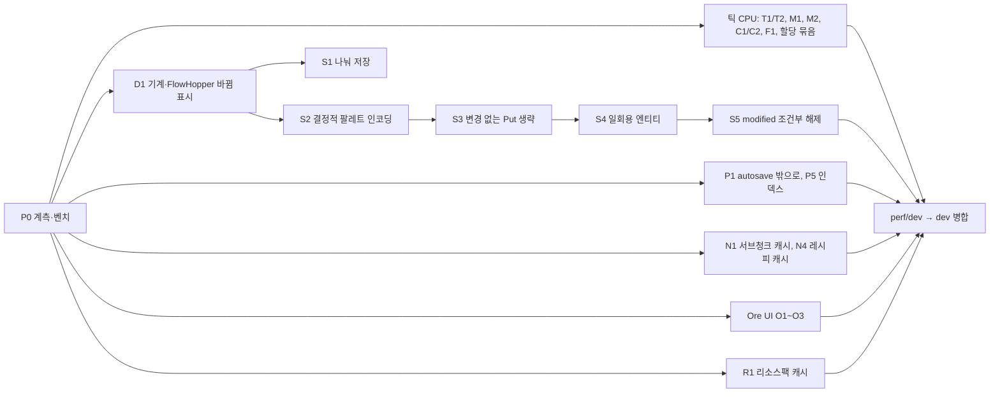

# Spec: perf/dev 성능 최적화

## Intent

섬(인스턴스) 하나의 평균 틱과 최대 틱 튐(max tick)을 줄입니다. 함께 줄일 것은 저장 I/O, 섬 입장 지연, 서버 시작 시간, 클라이언트 렉입니다. 게임 동작과 저장 데이터는 바뀌지 않아야 합니다. 지금 저장소에는 pprof 도, 벤치마크도 사실상 없습니다(`redstone_bench_test.go` 1개). 그래서 모든 개선은 **측정한 전후 수치**로 증명해야 합니다.

근거는 2026-11-03 감사 두 건입니다. 하나는 content·platform·common, 다른 하나는 Dragonfly·Ore UI·리소스팩입니다. 항목 ID(A1, T1, …)는 감사 보고서의 ID 를 그대로 씁니다.

## Goals

| # | 목표 | 대표 항목 |
|---|---|---|
| G0 | 계측 기반: pprof 스위치와 핫패스 벤치마크 | P0 |
| G1 | 저장 정합성 확인. 저장 최적화보다 먼저 합니다 | 기계 상태 저장 손실 의심(아래 Decided-1) |
| G2 | 월드 틱 CPU 절감 | T1, T2, M1, M2, C1, C2, F1, M3~M7, M10 |
| G3 | max tick 튐 제거 | S1(나눠 저장), A1, P1, M8 위상 엇갈림, C1 |
| G4 | 저장·DB I/O 절감 | S2, S3, S4, A2, A3, P2, P5 |
| G5 | 입장·접속 지연 절감 | S7, N1, N4, N5, P7 |
| G6 | 클라이언트·네트워크 부하 절감 | S2(서랍 라벨), T5, X2, N9, O1~O3 |
| G7 | 시작 시간·다운로드 절감 | R1, A4, R3(암호화 기본 끔) |
| G8 | GC 조정: 환경변수가 없으면 설정값으로 `SetMemoryLimit`·GOGC 지정(환경변수가 우선) | GC |

## Non-goals

- 게임 밸런스와 동작 변경. 처리량, 레시피, 확률, 타이밍 의미를 바꾸지 않습니다. 지연 허용 항목은 Decided-4 에 따로 적은 것만 허용합니다.
- 저장 형식 변경. 기존 세이브는 그대로 읽혀야 하고, 바닐라 호환(Flate)도 유지합니다.
- Dragonfly 업스트림 동기화와 대규모 리팩터링.
- 사람 없이도 섬이 도는 설계, Ore UI 루트 전체 재전송, 암호화 방식. 이것들은 `docs/tech/performance.md`·`oreui.md` 에서 이미 정한 것입니다.

## Constraints

- 브랜치: `dev` 에서 `perf/dev` 를 만들고, 끝나면 `dev` 에 먼저 병합합니다.
- 커밋: 패치 묶음 하나가 커밋 하나입니다. 작성자는 `debe3721@gmail.com` 이고 협업자 표기는 넣지 않습니다. 메시지 형식은 저장소 관례(`perf(scope): …`)를 따릅니다.
- Dragonfly 를 고치는 커밋은 모두 같은 커밋에 다음을 넣습니다.
  - `// skygear patch` 주석
  - `third_party/dragonfly.patch` 재생성
  - `third_party/README.md` 표 한 줄
- 모든 커밋에서 `go build ./...`, `go vet ./...`, `go test ./...` 가 통과해야 합니다. web 을 바꾸면 vitest 와 `TestOreUIBundleFresh` 도 통과해야 하고, 번들을 다시 빌드해 커밋합니다.
- 캐시를 쓰는 곳에는 무효화 누락이 생기지 않게 안전망을 둡니다. 예: 주기적 강제 재계산, ok 형태의 타입 단언.
- 측정값은 `docs/tech/performance.md` 에 추가합니다.

## Done looks like

| 영역 | 수락 기준 |
|---|---|
| 계측 | `platform.toml [Debug] Pprof` 를 지정했을 때만 pprof 가 켜지고, 기본값에서는 꺼져 있습니다. 벤치마크가 `go test -bench` 로 돕니다: TickLoaders, BlockEntityTick, SaveColumn/DiskEncode, SubChunkEntry, SendRecipes, MachineTick(정상·멈춤), MarshalSaved, BundleTick, GridStep, ControllerPeek |
| 정합성 | 디스크에서 읽은 기계 청크가 SetBlock 없이 상태만 바뀐 뒤 저장→재로드되면 진행도가 보존됩니다. 회귀 테스트로 확인합니다 |
| 틱 CPU | 각 패치의 벤치마크에서 ns/op 또는 allocs/op 가 줄어든 수치를 커밋 메시지나 performance.md 에 기록합니다. 기존 테스트는 전부 통과합니다 |
| 튐 | 1분 주기 전체 저장으로 생기는 max tick 튐이 사라집니다. dense 시나리오의 MaxMSPT 를 전후로 측정합니다. collector 섬은 값이 그대로면 `Dirty()==false` 입니다 |
| 저장 I/O | 바뀌지 않은 청크를 두 번째로 저장하면 LevelDB Put 이 0개입니다(테스트). 일회용 표시 엔티티는 디스크에 쓰이지 않고, 재시작 뒤에는 다시 생성됩니다 |
| DB | autosave 의 SQLite 쓰기가 `World.Do` 밖에서 일어납니다. 인덱스 마이그레이션은 `EXPLAIN QUERY PLAN` 테스트로 확인합니다 |
| 네트워크 | 같은 청크를 두 번째 뷰어에게 보낼 때는 다시 인코딩하지 않습니다. 블록이 바뀐 뒤에는 새 데이터를 보냅니다(테스트) |
| 시작 | 리소스팩 캐시가 맞을 때 만든 팩은 새로 빌드한 팩과 체크섬이 같습니다(테스트) |
| Ore UI | 같은 값으로 갱신하면 렌더가 0회입니다. scroll·canvas 테스트와 visual baseline 이 통과합니다 |
| 병합 | `perf/dev` 는 CI 녹색, 충돌 없이 `dev` 에 병합할 수 있습니다 |

## Decided

1. **G1(패치 D1)이 저장 최적화보다 먼저입니다.**
   - 원인(코드 경로로 확인, 재현은 아직): `saveChunk` 는 `c.modified` 가 참일 때만 저장합니다. 그런데 `Machine` 과 `FlowHopper` 는 포인터 상태(진행도·에너지·인벤토리·Boost·Charges·Fluid)만 바꾸고, 청크를 바뀜으로 표시하지 않습니다.
   - 지금 영향: 같은 청크에 다른 변경이 있으면 우연히 저장됩니다. 애니메이션이 없는 기계(체·판매함·창고 링크 등)나 쉬는 상태로 굳은 기계는 손실 후보입니다.
   - 위험: S4(일회용 엔티티)와 S5(modified 해제)가 들어가면 이 손실이 확실해집니다.
   - D1 내용: `machine.State` 와 `FlowHopper` 에 `dirty` 를 두고, 상태가 바뀌면 켭니다. 틱에서 위치 해시로 엇갈려 약 100틱마다 `tx.SetBlockEntity` 로 청크를 바뀜으로 표시합니다. 이웃 갱신과 패킷은 없습니다.
   - D1 이 들어간 뒤에 S3·S4·S5 를 진행합니다.
   - 바닐라 상자·호퍼도 같은 패턴인지 D1 에서 확인합니다.
   - 회귀 테스트: 체(또는 판매함)를 놓고 닫습니다 → 다시 열고 손대지 않은 채 N틱 돌립니다 → 닫고 다시 엽니다 → Progress·출력이 그대로여야 합니다. 이 테스트가 수정 전에는 실패하는 것부터 확인합니다.
2. **변경 감지 방식.**
   - 바이트가 같은지 비교하려면 결정적 인코딩이 먼저 있어야 합니다(S2). 팔레트 NBT 가 맵 순서 때문에 비결정적이기 때문입니다. 그래서 S3 는 S2 다음입니다.
   - 블록 엔티티 NBT 와 엔티티 NBT 는 비결정적이므로 항상 씁니다.
3. **일회용 엔티티 인터페이스.** `world.TransientEntityType{ Transient() bool }` 를 둡니다. 구현하는 것은 `EntityTypes()` 에 있는 콘텐츠 엔티티 전부입니다: `storage.HolderType`, `conduit.VisualType`, `conduit.PlateType`, `fairy.EntityType`, `dimension.GatePortalType`, `GemType`·`PopupType`, `MonsterTypes()`. 이 엔티티들은 모두 `EncodeNBT==nil` 이고 주인이 다시 만듭니다. 바닐라 엔티티(떨어진 아이템 등)는 계속 저장합니다. lostfound 로직이 이를 전제로 합니다.
4. **허용하는 표시 지연(최대 약 1~2초).** 처리량과 결과는 그대로이고 표시와 정리 시점만 늦어집니다.
   - 서랍 개수 라벨(S2)
   - 고아 표시 엔티티 정리(C5)
   - 기간제 만료(S3)
   - 번들 안전망 Refresh(C1)
   - 업적 cycle 카운트(M9)
   - 호퍼·게이지 위상 엇갈림(M8)
5. **전체 저장 경로는 그대로입니다.** `Close`·`World.Save()` 는 지금처럼 전부 저장합니다. 나눠 저장(S1)은 주기 저장에만 적용합니다.
6. 리소스팩 캐시 키에는 다음이 모두 들어갑니다: 내용 해시, 옵션, 비밀값 해시, 빌더 버전 상수.

## 사용자 결정 (2026-11-03 확정)

| ID | 결정 | 구현 기준 |
|---|---|---|
| A3 | 게임 상태는 적당한 간격으로 모아서 저장합니다. 너무 자주 할 필요는 없습니다 | `platform.toml [Instance] StateFlushSeconds`, 기본 10초. dirty 일 때만 Flush 합니다. autosave·`Close` 때는 항상 Flush 합니다. 손실이 치명적인 곳(kit.go 등 지금 바로 `Flush` 하는 곳)은 즉시 저장을 유지합니다 |
| P2 | SQLite `synchronous=NORMAL` 로 바꿉니다 | `fileDSN` 에 `_pragma=synchronous(NORMAL)` 를 넣습니다(WAL 에서 손상 위험이 없는 권장값). db_test 가 통과해야 합니다 |
| R3 | 오픈소스라 보호는 필요 없습니다. 최적화 쪽을 기본값으로 둡니다 | `ResourcePack.Encrypt` 설정은 남기고 기본값만 `false` 로 바꿉니다(평문은 Deflate 압축). 암호화를 껐을 때도 Ore UI 의 빈 `content.zipe` 동작은 유지합니다. 이미 생성된 `platform.toml` 은 값이 그대로 남습니다. 이 사실을 CHANGELOG·README 에 적습니다 |
| N9 | 네트워크 압축 레벨을 설정으로 두고 최적값을 기본값으로 합니다 | `platform.toml` 에 압축 레벨 설정을 추가합니다(Flate 1~9, 같은 압축 ID). 기본값은 P0 계측에서 레벨별 CPU·바이트를 측정해 고르고, 측정값을 performance.md 에 남깁니다 |

## Left to the builder / plan

- 커밋 순서와 묶음 크기, 벤치 픽스처 구조
- 캐시 자료구조. 예: 틱 청크 목록의 무효화 방식, Grid 캐시 TTL, 서브청크 캐시 키
- 엇갈림 주기 상수(10/20/40틱), 나눠 저장의 K
- P3(읽기 전용 커넥션)와 P7(비동기 백업) 진행 여부. 측정한 뒤 판단
- 효과가 측정되지 않는 L 항목은 빼도 됩니다(그 사실을 기록)

## Diagrams

