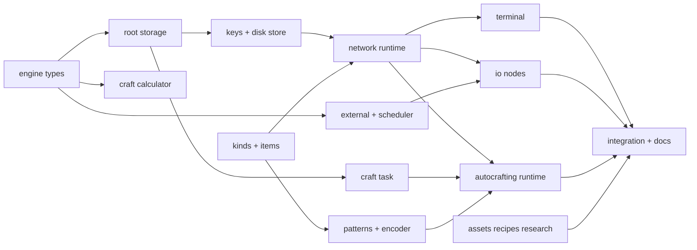

# Storage network (Refined Storage style)

**Goal:** Build docs/design/18-storage-network.md: engine `common/storagenet`, game side `content/skygear/netstore`.
**Architecture:** Go on Dragonfly. Engine is pure Go (no world); content wires it to machines, itemio, ui, saves.
**Tech stack:** Go 1.26.
**Spec:** docs/design/18-storage-network.md
**Detail:** contracts
**Target-min:** 20
**Ignore:** data/, .superlite/, .claude/settings.local.json, .gitignore

## Global constraints

- Checks: `go build ./... && go vet ./... && gofmt -l . && go test ./...` (scope to your packages while iterating).
- Clean room (spec §1): never download, open or paraphrase Applied Energistics 2 code. Refined Storage 2 (MIT) may be read; a file adapted from it starts with `// Adapted from Refined Storage 2 (MIT, refinedmods/refinedstorage2).`
- Amounts are int64. The engine imports no Dragonfly; `storagenet.Key` is an opaque string made by `netstore.KeyOf`.
- Texts: new keys only in your own `content/skygear/locales/{ko,en}.netstore-<area>.json` (same keys in both). No Korean literals in Go. Korean per the korean-humanizer skill.
- New machine kinds are appended to `machine.Order` only.
- Spec values bind: disk caps 1024/4096/16384/65536, drive 8 slots, autocrafter 9 patterns, node cap 512, energy 8+1/node (drive 2, autocrafter 4), io 8 items/op, interval 4..64 ticks, terminal 240 slots, 8 tasks/network, calc budget 100000.
- Steps for every task: failing tests, run FAIL, implement, run PASS. Tests named below with their asserted values are required.
- Never touch files outside your Owns list.

## Main diagram

```mermaid
%% schedule
gantt
  title Predicted schedule (mm:ss)
  dateFormat X
  axisFormat %M:%S
  section lane 1
  T0 engine types :t0, 0, 385s
  T1 root storage :t1, 385, 385s
  T4 craft task :t4, 771, 385s
  T8 network runtime :t8, 1156, 385s
  T9 terminal :t9, 1542, 385s
  T13 integration + docs :t13, 1927, 385s
  section lane 2
  T5 kinds + items :t5, 0, 385s
  T2 external storage + scheduler :t2, 385, 385s
  T7 keys + disk store :t7, 771, 385s
  T10 io nodes :t10, 1542, 385s
  section lane 3
  T6 assets  recipes  research :t6, 0, 385s
  T3 craft calculator :t3, 385, 385s
  T12 autocrafting runtime :t12, 1542, 385s
  section lane 4
  T11 patterns + encoder :t11, 385, 385s
```

critical path: T0 → T1 → T7 → T8 → T9 → T13 (38.5 min) · peak width 4 · predicted build 38.5 min · predicted total ≈ 43.9 min (target ✗ 20.0)

## Section: engine (`common/storagenet`)

App type: library. Categories: deep, numeric, state. Risks: totals drifting from sources, calc overflow and cycles, task losing items on cancel or reload.
**Probe entry:** call=storagenet.Root.Insert · call=storagenet.Calculate

### T0 engine types · Complexity 2 · Est. context 25k
**Owns:** common/storagenet/types.go, common/storagenet/doc.go, common/storagenet/types_test.go
**Components:** 1
**LOC owned:** 90
**Tests:** fast
**Kind:** mechanical
**Model:** haiku
**Consumes:** none
**Produces:** storagenet.Key · storagenet.Stack · storagenet.Storage · storagenet.Ingredient · storagenet.Pattern · storagenet.Step · storagenet.Plan · storagenet.Plan.OK() -> bool
  e.g. (&Plan{}).OK() -> true
  e.g. (&Plan{Missing: map[Key]int64{"a": 1}}).OK() -> false
**Review Focus:** none
**Test code (contracts):** `TestPlanOK` asserts the two e.g. lines.
**Notes:** exact shapes: `type Key string`; `Stack{Key Key; Count int64}`; `Storage interface{Insert(k Key, n int64, sim bool) int64; Extract(k Key, n int64, sim bool) int64; Count(k Key) int64; Each(fn func(Key, int64))}`; `Ingredient{Count int64; Options []Key}`; `Pattern{ID string; Processing bool; Inputs []Ingredient; Outputs []Stack}`; `Step{PatternID string; Times int64}`; `Plan{Want Stack; Steps []Step; Use, Missing map[Key]int64}`; vars `ErrCycle, ErrBudget, ErrNoPattern, ErrShort` (errors.New). Doc comments on all.

### T1 root storage · Complexity 6 · Est. context 32k
**Owns:** common/storagenet/disk.go, common/storagenet/root.go, common/storagenet/root_test.go
**Components:** 2
**LOC owned:** 260
**Tests:** fast
**Kind:** design
**Model:** sonnet
**Consumes:** storagenet.Storage (T0)
**Produces:** storagenet.NewDisk(capacity int64) -> *Disk · Disk.Stored() -> int64 · Disk.Contents() -> map[Key]int64 · Disk.Load(m map[Key]int64) · storagenet.NewRoot() -> *Root · Root.Add(id string, s Storage, priority int, filter func(Key) bool) · Root.Remove(id string) · Root.Resync(id string) · Root.Totals() -> map[Key]int64 · Root.Listen(fn func(k Key, delta int64)) -> func()
  e.g. NewRoot() -> *Root with Totals() {} ; NewDisk(10) -> *Disk with Stored() 0
  e.g. disk A cap 10 prio 0, disk B cap 10 prio 5: root.Insert("a",15,false) -> 15; B has 10, A has 5
  e.g. then root.Extract("a",3,false) -> 3, taken from A; Totals()["a"] -> 12
  e.g. then root.Insert("b",30,true) -> 8 and nothing changes
**Review Focus:** state: `TestHolderFirst` (same priority, A holds "x": insert goes to A before empty C); `TestFilterSkips`; `TestListenDeltas` (Insert 15 fires ("a",+15) once; Remove(id) fires the negatives of its contents); `TestResyncDiff` (source changed behind the root: Resync emits only differences); `TestTotalsMatchFresh` (1000 random ops, Totals equals the sum of sources).
**Test code (contracts):** the e.g. lines and the Review Focus tests.
**Notes:** keep `holders map[Key]map[string]struct{}` and a per-source count cache for Resync (spec §7-2, §7-3). Insert: priority desc, holders first; Extract: priority asc. Totals returns a copy. Root implements Storage.

### T2 external storage + scheduler · Complexity 5 · Est. context 31k
**Owns:** common/storagenet/external.go, common/storagenet/sched.go, common/storagenet/external_test.go, common/storagenet/sched_test.go
**Components:** 2
**LOC owned:** 220
**Tests:** fast
**Kind:** design
**Model:** sonnet
**Consumes:** storagenet.Storage (T0)
**Produces:** storagenet.Source · storagenet.NewExternal(src Source) -> *External · External.Poll() -> bool · storagenet.NewScheduler() -> *Scheduler · Scheduler.Add(id string, min, max, now int64, fn func(now int64) bool) · Scheduler.Remove(id string) · Scheduler.Wake(id string, now int64) · Scheduler.Run(now int64) -> int
  e.g. Add("i",4,64,0,idleFn) then Run at every tick: fn runs at 0, 8, 24, 56, 120, 184
  e.g. a run returning true resets the interval to 4: next run at now+4
  e.g. NewExternal(src) over a source listing {"a":2} -> Count("a") 2
  e.g. NewExternal(src).Poll() after src gained 3 "a" -> true and Count("a") is 3; unchanged -> false
**Review Focus:** state: `TestWakeRunsNow`; `TestRemoveDuringRun` (fn removes itself or another id); `TestExternalInsertUpdatesCache` (Insert through External changes Count without Poll).
**Test code (contracts):** the e.g. lines and the Review Focus tests.
**Notes:** `Source interface{List() map[Key]int64; Insert(k Key, n int64, sim bool) int64; Extract(k Key, n int64, sim bool) int64}`; External implements Storage over its cached List (spec §4, §7-4). Scheduler: container/heap of due ticks.

### T3 craft calculator · Complexity 8 · Est. context 32k
**Owns:** common/storagenet/calc.go, common/storagenet/calc_test.go
**Components:** 2
**LOC owned:** 280
**Tests:** fast
**Kind:** design
**Model:** sonnet
**Consumes:** storagenet.Pattern (T0) · storagenet.Plan (T0)
**Produces:** storagenet.NewRepo() -> *Repo · Repo.Add(p Pattern) · Repo.Remove(id string) · Repo.ByOutput(k Key) -> []Pattern · Repo.Get(id string) -> (Pattern, bool) · Repo.Outputs() -> []Key · storagenet.Calculate(repo *Repo, stock func(Key) int64, want Key, n int64, budget int) -> (*Plan, error)
  e.g. plank{log×1 -> plank×4}, stick{plank×2 -> stick×4}, stock log=1: Calculate(stick,4) -> Steps [{plank,1},{stick,1}], Use {log:1}, Missing {}
  e.g. same, Calculate(stick,12) -> Missing {log:1}, err nil
  e.g. a{b×1 -> a×1}, b{a×1 -> b×1}, empty stock: Calculate(a,1) -> ErrCycle
  e.g. Get("plank") -> (plank pattern, true); Get("nope") -> (Pattern{}, false)
**Review Focus:** deep: `TestOptionCycle` (options [x,y], x missing with no pattern, y in stock: uses y); `TestSecondPatternFallback`; `TestLeftoverReuse` (leftover plank of one step feeds a later ingredient); numeric: `TestOverflow` (n=1<<62 through a ×4 chain: error, no panic); `TestBudget` (budget 10 on a 20-node tree: ErrBudget).
**Test code (contracts):** the e.g. lines and the Review Focus tests.
**Notes:** spec §6. Port the RS2 CraftingTree idea (header comment): per ingredient fill from leftovers, then stock, then child patterns in ByOutput order on a copied state, then the next option. Times = ceil(need / output count). Steps children first, merged by pattern id. No world access.

### T4 craft task · Complexity 7 · Est. context 39k
**Owns:** common/storagenet/task.go, common/storagenet/task_test.go
**Components:** 2
**LOC owned:** 280
**Tests:** fast
**Kind:** design
**Model:** sonnet
**Consumes:** storagenet.Storage (T0) · Repo.Get(id string) -> (Pattern, bool) (T3)
**Produces:** storagenet.Env · storagenet.NewTask(id string, plan *Plan, repo *Repo, root *Root) -> (*Task, error) · Task.Tick(env Env) · Task.Receive(k Key, n int64) -> int64 · Task.Done() -> bool · Task.Finish(root *Root) -> []Stack · Task.Cancel(root *Root) -> []Stack · Task.Status() -> TaskStatus · Task.Data() -> TaskData · storagenet.LoadTask(d TaskData, repo *Repo) -> (*Task, error)
  e.g. storagenet.NewTask("t1", plan, repo, root) with plan.Use {log:1}, root log=1 -> *Task, nil and root log 0
  e.g. plank/stick plan, root log=1: NewTask -> root log 0; Tick with Crafts 1 -> plank step done; Tick -> stick done; Done() true; Finish -> root stick 4, plank 2
  e.g. processing step pushed: Status().Waiting {ingot:1}; Receive("ingot",3) -> 1
  e.g. root log=0: NewTask -> ErrShort, root unchanged
**Review Focus:** state: `TestCancelReturnsBuffer`; `TestCancelRootFull` (returns what did not fit); `TestDataRoundTrip` (LoadTask(Data()) mid-run ends the same); `TestPushRefused` (Push false keeps inputs).
**Test code (contracts):** the e.g. lines and the Review Focus tests.
**Notes:** `Env interface{Crafts(patternID string) int; Push(patternID string, in []Stack) bool}`; `TaskStatus{Want Stack; Steps []StepStatus{PatternID string; Done, Total int64}; Waiting map[Key]int64}`; TaskData is JSON plain data. Reserve Use at start (spec §6, §7-7).

## Section: content (`content/skygear/netstore`)

App type: game integration. Categories: state, encoding. Risks: stale topology after a break, duplication through external storage over a drawer controller, disks and tasks lost on reload.
**Probe entry:** call=netstore.At

### T5 kinds + items · Complexity 5 · Est. context 31k
**Owns:** content/skygear/machine/machine.go, content/skygear/machine/netkinds_test.go, content/skygear/quickbar_test.go, content/skygear/netstore/doc.go, content/skygear/netstore/items.go, content/skygear/catalog/creative.go, content/skygear/admin.go, content/skygear/game.go
**Components:** 2
**LOC owned:** 220
**Tests:** fast
**Kind:** design
**Model:** sonnet
**Consumes:** none
**Produces:** machine.KindNetController · machine.Def.Accepts · netstore.Disk · netstore.Pattern · netstore.DiskCaps · netstore.DiskID(st item.Stack) -> string · netstore.WithDiskID(st item.Stack, id string) -> item.Stack
  e.g. DiskID(WithDiskID(item.NewStack(Disk{Tier: 1}, 1), "d1")) -> "d1"
  e.g. DiskID(item.NewStack(Disk{Tier: 1}, 1)) -> ""
**Review Focus:** state: `TestNetKindsRegistered` (all nine ids resolve, appended after old kinds in Order); `TestDriveAcceptsOnlyDisks` (drive slot takes Disk, refuses dirt; slots 0-7 persist through Encode/DecodeNBT).
**Test code (contracts):** the e.g. lines and the Review Focus tests.
**Notes:** spec §2. Kinds `KindNetController, KindNetCable, KindDiskDrive, KindNetTerminal, KindNetImporter, KindNetExporter, KindNetExternal, KindPatternEncoder, KindNetAutocrafter` (ids `skygear:net_controller`, `net_cable`, `disk_drive`, `net_terminal`, `net_importer`, `net_exporter`, `net_external`, `pattern_encoder`, `net_autocrafter`). Items `skygear:storage_disk_{1k,4k,16k,64k}` (`Disk{Tier 0..3}`), `skygear:pattern`. `Def.Accepts func(slot int, st item.Stack) bool`. Windows use Input slots (drive 8, autocrafter 9, encoder 9 + 3 samples). Controller has Use and ConsumerBuffer and reaches `Def.Run`.

### T6 assets, recipes, research · Complexity 4 · Est. context 30k
**Owns:** tools/modtex/main.go, assets/resourcepack/skygear/textures/**, assets/resourcepack/skygear/texts/ko_KR.lang, assets/resourcepack/skygear/texts/en_US.lang, content/skygear/catalog/recipes.go, content/skygear/catalog/research.go, content/skygear/advancement/advancement.go, content/skygear/locales/ko.json, content/skygear/locales/en.json, content/skygear/locales/en.research.json, docs/tech/asset-credits.md, NOTICE.md, third_party/licenses/RefinedStorage2-MIT.txt
**Components:** 2
**LOC owned:** 200
**Tests:** slow
**Kind:** design
**Model:** sonnet
**Consumes:** none
**Produces:** research ids storage_network, network_logistics, network_autocrafting
**Review Focus:** `TestPackHasBlockAssets`, `TestPackHasItemAssets`, `TestResearchTreeIsValid`, `TestEveryGameRecipeResultIsCreative` pass with the new ids.
**Test code (contracts):** existing pack, research, advancement and locale tests pass.
**Notes:** spec §1, §8. RS2 textures through modtex (controller, cable, disk drive, grid, importer, exporter, external storage, pattern grid, autocrafter, disks, pattern); credit rows and license file. Uses T5's ids by name; run the full tests after T5 is in.

### T7 keys + disk store · Complexity 5 · Est. context 30k
**Owns:** content/skygear/netstore/keys.go, content/skygear/netstore/diskstore.go, content/skygear/netstore/keys_test.go
**Components:** 2
**LOC owned:** 200
**Tests:** fast
**Kind:** design
**Model:** sonnet
**Consumes:** storagenet.Storage (T0)
**Produces:** netstore.KeyOf(st item.Stack) -> storagenet.Key · netstore.Proto(s *core.Session, k storagenet.Key) -> item.Stack · netstore.Disks(s *core.Session) -> *DiskStore · DiskStore.Open(id string, capacity int64) -> *storagenet.Disk · DiskStore.NewID() -> string · DiskStore.Flush()
  e.g. KeyOf(stone×5) == KeyOf(stone×1); KeyOf(stone named "x") != KeyOf(stone)
  e.g. Proto(s, KeyOf(x)) -> x with count 1
  e.g. netstore.Disks(s) -> the session's *DiskStore (same pointer on every call)
  e.g. Disks(s).Open("d1",1024) twice -> the same *Disk
**Review Focus:** encoding: `TestKeyComparable` (Comparable iff same key, incl. values, enchantments, name); state: `TestDiskStorePersists` (Open, insert, Flush, reload doc: same contents).
**Test code (contracts):** the e.g. lines and the Review Focus tests.
**Notes:** contents in a `core.NewSaved` doc keyed by disk id, items via `core.EncodeItem`; protos cached per session.

### T8 network runtime · Complexity 8 · Est. context 36k
**Owns:** content/skygear/netstore/network.go, content/skygear/netstore/nodes.go, content/skygear/netstore/network_test.go, content/skygear/handler.go
**Components:** 2
**LOC owned:** 300
**Tests:** fast
**Kind:** design
**Model:** sonnet
**Consumes:** netstore.Disks(s *core.Session) -> *DiskStore (T7) · machine.KindNetController (T5)
**Produces:** netstore.At(tx *world.Tx, pos cube.Pos) -> *Network · Network.Online() -> bool · Network.Nodes(kind string) -> []cube.Pos · netstore.Invalidate(tx *world.Tx, pos cube.Pos) · netstore.Config(s *core.Session, pos cube.Pos) -> *NodeConfig
  e.g. controller+cable+drive, 1k disk with 5 stone: At(tx, cablePos).Root.Count(KeyOf(stone)) -> 5
  e.g. two controllers on one net: At(tx, p).Online() -> false
  e.g. At(tx, posWithNoNode) -> nil
  e.g. netstore.At(tx, controllerPos) -> *Network with Controller == controllerPos
**Review Focus:** state: `TestBreakCableSplits`; `TestNoEnergyOffline`; `TestCacheMatchesFresh` (50 random place/break, cached topology equals fresh BFS); `TestNodeCap` (513 nodes: offline).
**Test code (contracts):** the e.g. lines and the Review Focus tests.
**Notes:** spec §3, §7-1. Network fields `Root *storagenet.Root`, `Sched *storagenet.Scheduler`, `Controller cube.Pos`. `NodeConfig{Priority int; Filter []string; Allow bool}` in a saved doc keyed by pos. Rebuild only when Invalidate hits a member or neighbour (handler place/break arms for every new kind) plus a 200-tick position check. Controller `Def.Run` spends energy and runs Sched. Drive disks join Root as `drive@x,y,z#slot`.

### T9 terminal · Complexity 6 · Est. context 31k
**Owns:** content/skygear/netstore/terminal.go, content/skygear/netstore/terminal_test.go, content/skygear/locales/ko.netstore-terminal.json, content/skygear/locales/en.netstore-terminal.json
**Components:** 2
**LOC owned:** 240
**Tests:** fast
**Kind:** design
**Model:** sonnet
**Consumes:** netstore.At(tx *world.Tx, pos cube.Pos) -> *Network (T8)
**Produces:** netstore.ShowTerminal(s *core.Session, p *player.Player, tx *world.Tx, pos cube.Pos) · netstore.CraftableHook · netstore.RequestHook · netstore.MonitorHook
**Review Focus:** state: `TestTerminalDeposit` (click deposits held; double click deposits inventory kinds the net holds); `TestTerminalCap240` (300 kinds: 240 slots and the hint); `TestTerminalTake` (press gives one stack, Root drops by it); `TestControllerItemIO` (hopper Insert/Peek/Extract on the controller go through Root).
**Test code (contracts):** the Review Focus tests.
**Notes:** spec §5. Mirror `storage.Show`/`UseController` (search, 4 orders, deposit-all bar option, offline text). Hooks are package vars T12 sets: `CraftableHook func(n *Network) []storagenet.Key`, `RequestHook func(s *core.Session, p *player.Player, n *Network, k storagenet.Key)`, `MonitorHook func(s *core.Session, p *player.Player, n *Network)`. Redraw at most every 10 ticks, only after a Listen change.

### T10 io nodes · Complexity 7 · Est. context 36k
**Owns:** content/skygear/netstore/io.go, content/skygear/netstore/external.go, content/skygear/netstore/filterui.go, content/skygear/netstore/io_test.go, common/itemio/lister.go, content/skygear/storage/list.go, content/skygear/locales/ko.netstore-io.json, content/skygear/locales/en.netstore-io.json
**Components:** 2
**LOC owned:** 300
**Tests:** fast
**Kind:** design
**Model:** sonnet
**Consumes:** netstore.At(tx *world.Tx, pos cube.Pos) -> *Network (T8) · External.Poll() -> bool (T2)
**Produces:** itemio.Lister · itemio.List(tx *world.Tx, pos cube.Pos, face cube.Face) -> []item.Stack
  e.g. chest with 3 stone and 2×64 dirt: List -> [stone 3, dirt 128]
**Review Focus:** state: `TestImporterBackoff` (idle source: interval grows to 64); `TestExporterWakesOnInsert`; `TestExternalDrawerController` (drawer controller behind external storage shows in Root, extract works, no duplication); `TestFilterDeny`.
**Test code (contracts):** the e.g. line and the Review Focus tests.
**Notes:** spec §2, §4, §7-4. `Lister interface{ListItems(tx *world.Tx, pos cube.Pos, face cube.Face) []item.Stack}`; vanilla containers fallback; drawer and drawer controller listers in storage/list.go. Act on the block in front, 8 items/op; external polls 20..200 ticks. Filter UI toggles inventory kinds, consumes nothing.

### T11 patterns + encoder · Complexity 6 · Est. context 35k
**Owns:** content/skygear/netstore/pattern.go, content/skygear/netstore/encoder.go, content/skygear/netstore/pattern_test.go, content/skygear/locales/ko.netstore-pattern.json, content/skygear/locales/en.netstore-pattern.json
**Components:** 2
**LOC owned:** 260
**Tests:** fast
**Kind:** design
**Model:** sonnet
**Consumes:** netstore.Pattern (T5)
**Produces:** netstore.EncodeCrafting(st item.Stack, crafterID string) -> item.Stack · netstore.EncodeProcessing(st item.Stack, in, out []item.Stack) -> item.Stack · netstore.PatternOf(st item.Stack, keysFor func(recipe.Item) []storagenet.Key) -> (storagenet.Pattern, bool)
  e.g. PatternOf(EncodeCrafting(blank, "oak_planks#0"), kf) -> Pattern{Inputs [{1,[oak_log]}], Outputs [{oak_planks,4}]}, true
  e.g. PatternOf(blank, kf) -> false
  e.g. netstore.PatternOf(EncodeProcessing(blank, [iron_ore×1], [iron_ingot×1]), kf) -> Pattern{Processing:true, Inputs [{1,[iron_ore]}], Outputs [{iron_ingot,1}]}, true
**Review Focus:** encoding: `TestTagIngredientOptions` (tag input becomes keysFor's keys); `TestPatternIDStable`.
**Test code (contracts):** the e.g. lines and the Review Focus tests.
**Notes:** spec §6. Encoder window: research-filtered crafting recipe picker like `machine.showCrafterRecipes`; processing reads samples from its slots (samples stay).

### T12 autocrafting runtime · Complexity 8 · Est. context 40k
**Owns:** content/skygear/netstore/craft.go, content/skygear/netstore/craftui.go, content/skygear/netstore/craft_test.go, content/skygear/locales/ko.netstore-craft.json, content/skygear/locales/en.netstore-craft.json
**Components:** 2
**LOC owned:** 320
**Tests:** fast
**Kind:** design
**Model:** sonnet
**Consumes:** netstore.At(tx *world.Tx, pos cube.Pos) -> *Network (T8) · storagenet.NewTask(id string, plan *Plan, repo *Repo, root *Root) -> (*Task, error) (T4) · netstore.PatternOf(st item.Stack, keysFor func(recipe.Item) []storagenet.Key) -> (storagenet.Pattern, bool) (T11)
**Produces:** none
**Review Focus:** state: `TestRequestCraftsSticks`; `TestProcessingReceive` (output entering Root goes to the waiting task first); `TestTasksSurviveReload`; `TestCalcOffThread` (goroutine on a Totals snapshot, applied on the tick, one recalc if reservation fails); `TestTaskLimit8`.
**Test code (contracts):** the Review Focus tests.
**Notes:** spec §5, §6, §7-5..7. Sets T9's hooks. Repo rebuilt from autocrafter slots on invalidate; Env.Crafts = autocrafters holding the pattern, one per 10 ticks; Push inserts in front of such an autocrafter. Request UI 1/8/64/input, preview Use/Steps/Missing; monitor with cancel.

### T13 integration + docs · Complexity 4 · Est. context 29k
**Owns:** content/skygear/netstore/integration_test.go, docs/tech/storagenet.md, docs/features.md, docs/design/README.md, docs/design/open-questions.md, docs/design/08-storage-gear-magic.md, assets/resourcepack/skygear/textures/, .claude/settings.local.json, content/skygear/netflush_test.go, content/skygear/achievement/catalog.go, content/skygear/layers_test.go, content/skygear/locales/en.achievements-a.json
**Components:** 2
**LOC owned:** 180
**Tests:** slow
**Kind:** design
**Model:** sonnet
**Consumes:** netstore.At(tx *world.Tx, pos cube.Pos) -> *Network (T8)
**Produces:** none
**Review Focus:** state: `TestEndToEnd` (controller, cable, drive, terminal, importer from a chest, exporter to a chest, autocrafter: items flow, a request completes); `BenchmarkRootInsert` (64 disks, 5000 kinds).
**Test code (contracts):** the Review Focus tests.
**Notes:** spec §1, §9: tech doc (engine, AE2 ideas in own words, RS2 credit, future work), features, design README row 18, open-questions numbers, link from 08 §4.

## Rulings

- Ruling: sequential - Go needs the producer's code to compile a consumer in the same or a dependent package, and plan stubs are not generated for Go, so compile edges stay (T7→T8→T9/T10/T12, T4/T11→T12) even though examples exist - cost: about 10 min longer critical path.
- Ruling: T1 e.g. third line meant a fresh state (insert 15 leaves 5 free); after the extract it is 8 - T1's tests assert both - cost: none.
- Ruling: a storage filter applies to Insert only; Extract may take from any holder (as RS2) - cost: a filtered storage can still be emptied through the network, which is wanted.
- Ruling: T13's Owns also lists T6's texture folder (the checkpoint glob misses `textures/**`) and the plugin's machine-local `.claude/settings.local.json`; T13 never edits them, and the settings file is dropped before anything is pushed - cost: none.
- Ruling: tasks sharing package netstore keep the package compiling at every step (write a compiling skeleton of your files first) - cost: none.

## Self-review

Coverage: §1 → T6/T13, §2 → T5/T6, §3 → T8, §4 → T1/T2/T7/T10, §5 → T9/T12, §6 → T3/T4/T11/T12, §7 → T1/T2/T8/T12, §8 → T6, §9 → T13.
