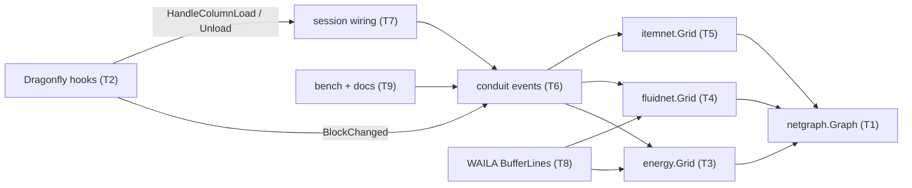
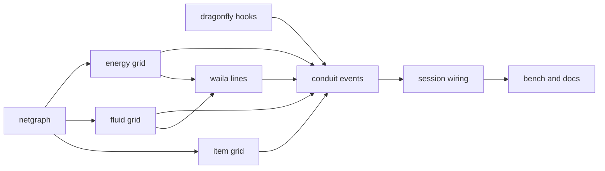

# Plan: 도관 네트워크 그래프화(perf/mekanism)

**Goal:** 도관 망을 이벤트로만 고치는 그래프로 바꾸고, 에너지·액체 망에 Mekanism식 버퍼를 둔다.
**Architecture:** `common/netgraph`(위치→망, 합치기·쪼개기, 망 버퍼 Store) 위에 세 Grid를 얹는다. Dragonfly 패치 훅 두 개(블록 변경, 칼럼 로드·언로드)가 이벤트를 준다. 번들은 `Tick`을 잃고, 버퍼 몫을 포인터 셀에 담아 NBT로 저장한다.
**Tech stack:** Go 1.26, Dragonfly 포크(`third_party/dragonfly`), 테스트는 `go test`.
**Spec:** docs/plans/2026-11-08-netgraph.spec.md
**Detail:** contracts
**Target-min:** 14

## Global constraints

- 브랜치 `perf/mekanism`, 이 체크아웃에서 바로 작업한다(Ruling 1). 커밋 작성자 `debe3721@gmail.com`, 협업자 표기 없음.
- 언어 Go. 빠른 테스트: `go test ./<pkg>/`. 전체: `go build ./... && go vet ./... && go test ./...`. Dragonfly 테스트: `cd third_party/dragonfly && go test ./server/world/`.
- 버퍼 용량(도관 하나): 에너지 `energy.RateOf(tier)/40`(200/1200/4800 RE), 액체 `fluidnet.RateOf(tier)*5`(1000/5000/40000 mB). 망 용량은 도관 용량의 합.
- 처리량은 그대로: 한 Step에 싱크로 나가는 양과 소스에서 들어오는 양은 각각 `RateOf(망 최저 단계) × 틱`을 넘지 않는다.
- 쪼갤 때는 용량 비율로 나누고 나머지는 가장 큰 조각에 준다. 합칠 때는 더한 뒤 용량에서 자른다. 태그(액체 종류)가 다르면 양이 많은 쪽이 남는다. 양이 0이면 태그도 0이다.
- 검증: 약 60초에 모든 망을 한 번씩 본다. Step 하나는 `max(1, 도관 수 / (60초 동안의 Step 수))`개 도관까지만 다시 BFS한다.
- 새 NBT 키: `EBuf`(int32), `FKind`(int32), `FBuf`(int32). 없으면 0.
- `Counters{Scans, Visited int64}`는 유지한다. `Scans`는 전체 재구성 횟수, `Visited`는 BFS가 지난 도관 수(증분·검증 포함).
- Dragonfly 수정에는 `// skygear patch` 주석을 달고, `third_party/dragonfly.patch`를 다시 만들고, `third_party/README.md`에 한 줄을 더한다.

## Main diagram

## File structure

각 작업의 Owns가 파일과 책임을 정한다. 새 파일은 `common/netgraph/graph.go`, `world/skygear_hooks.go`, `conduit/events.go`, `conduit/bufferlines.go`, `content/skygear/conduitload.go`다.

## Task graph

Ruling: sequential [chain-ca2f] - Go 패키지는 스텁 없이 실제 netgraph·Grid·훅 위에서만 컴파일·테스트되고, T9는 전체를 잰다 - 늦어지면 T6이 임계 경로다. T3~T5는 T1 위에 짓는다(간선).

## Package common (library)

**Probe entry:** call=netgraph.Graph.Add · call=energy.Grid.Step

### T1 netgraph · Complexity 6 (O-1) · Est. context 34k
**Owns:** common/netgraph/graph.go, common/netgraph/graph_test.go
**Components:** 1
**LOC owned:** 280
**Tests:** fast
**Kind:** design
**Model:** sonnet
**Consumes:** nothing
**Produces:** netgraph.New() -> *netgraph.Graph · Graph.Add(pos cube.Pos, weight int, share netgraph.Store, links netgraph.Links) netgraph.NetID · Graph.Remove(pos cube.Pos, links netgraph.Links) (netgraph.Store, []netgraph.NetID) · Graph.SetWeight(pos cube.Pos, weight int) · Graph.NetOf(pos cube.Pos) (netgraph.NetID, bool) · Graph.Nodes(id netgraph.NetID) []cube.Pos · Graph.Nets() []netgraph.NetID · Graph.Store(id netgraph.NetID) netgraph.Store · Graph.SetStore(id netgraph.NetID, s netgraph.Store) · Graph.Capacity(id netgraph.NetID) int · Graph.Len() int · Graph.Verify(id netgraph.NetID, links netgraph.Links, isNode func(cube.Pos) (int, bool)) bool · Graph.Shares(yield func(pos cube.Pos, s netgraph.Store)) · Graph.Visited() int64 · Graph.Rebuilds() int64
e.g. 직선 (0,0,0),(1,0,0)을 weight 10, share {0,5}·{0,7}로 Add → Nets()==1개, Store=={0,12}, Capacity==20
e.g. (0..2,0,0) 직선 Store {0,30}, weight 10씩, (1,0,0) Remove → share {0,10}, parts 2개, 각 Store {0,10}
e.g. Store {1,100}과 {2,40}인 두 망을 잇는 노드 Add → Store {1,140}(용량 안이면)
**Notes:** `type Store struct{ Tag byte; Amount int }`, `type Links func(pos cube.Pos) []cube.Pos`(pos와 이어지는 이웃 노드), `type NetID uint32`. Add는 작은 망을 큰 망에 붙인다. Remove는 남은 이웃마다 그 망 안에서만 BFS한다. SetStore는 용량에서 자르고 Amount 0이면 Tag 0. Shares는 weight 비율로 나누고, 나머지는 망의 첫 노드에 주며, 합이 정확히 Store다. Verify는 isNode가 거짓인 노드를 몫과 함께 빼고, 끊겼으면 쪼개고, 무엇이 바뀌었으면 true다. Nets()는 오름차순이다.
**Review Focus:** `TestRemoveSplitConserves`: 무작위 트리 200개 노드에서 Remove를 반복해도 Σ조각 Store + Σ제거 몫 == 처음 Store · `TestRandomOpsMatchPartition`: 무작위 Add/Remove 500회 뒤 망 분할 == 처음부터 BFS한 분할 · `TestRemoveVisitsOnlyItsNet`: 망 16개 × 64개 중 하나에서 Remove 한 번 → Visited 증가 ≤ 64 · `TestMergeClampsAndTags`: 용량 20에 {0,15}+{0,15} → {0,20}; {1,3}+{2,9} → {2,12}
**Steps:** 1 failing test, 2 run: FAIL, 3 implement, 4 run: PASS

### T2 dragonfly hooks · Complexity 5 (O-1) · Est. context 40k
**Owns:** third_party/dragonfly/server/world/skygear_hooks.go, third_party/dragonfly/server/world/skygear_hooks_test.go, third_party/dragonfly/server/world/world.go, third_party/dragonfly/server/world/tx.go, third_party/dragonfly/server/world/chunk_request.go, third_party/dragonfly.patch, third_party/README.md
**Components:** 2
**LOC owned:** 130
**Tests:** fast
**Kind:** design
**Model:** sonnet
**Consumes:** nothing
**Produces:** world.BlockChangeHook interface { BlockChanged(tx *world.Tx, pos cube.Pos, before, after world.Block) } · world.ColumnHandler interface { HandleColumnLoad(tx *world.Tx, pos world.ChunkPos, blockEntities map[cube.Pos]world.Block); HandleColumnUnload(tx *world.Tx, pos world.ChunkPos, blockEntities map[cube.Pos]world.Block) }
e.g. Bundle가 있던 칸에 tx.SetBlock(pos, Air) → before.BlockChanged(tx, pos, Bundle, Air) 한 번
e.g. 칼럼이 디스크에서 로드되면 → Handler().(ColumnHandler).HandleColumnLoad(tx, 칼럼 위치, 그 칼럼의 BlockEntities)
**Notes:** SetBlock이 블록을 저장한 뒤 호출한다. before가 훅을 구현하면 before에, 아니면 after가 구현하면 after에 한 번만 부른다. before와 after가 값으로 같으면 부르지 않는다. 칼럼 로드는 `addChunk`를 부르는 두 곳 모두(tx가 있는 곳)에서 부르고, 언로드는 `closeChunk`에서 `saveChunk`보다 먼저 부른다. 핸들러가 `ColumnHandler`가 아니면 아무것도 하지 않는다.
**Review Focus:** `TestBlockChangedOnce`: 같은 값으로 다시 SetBlock하면 0회, 다른 블록이면 1회 · `TestColumnUnloadBeforeSave`: 언로드 훅이 블록 엔티티에 쓴 값이 디스크에 저장된다 · `TestHookPanicRecovered`: 훅 안의 panic이 월드를 죽이지 않는다(기존 tx 복구 경로)
**Steps:** 1 failing test, 2 run: FAIL, 3 implement, 4 run: PASS, 5 패치·README 갱신

### T3 energy grid · Complexity 6 (O-1) · Est. context 42k
**Owns:** common/energy/grid.go, common/energy/grid_test.go, common/energy/energy_test.go
**Components:** 1
**LOC owned:** 300
**Tests:** fast
**Kind:** design
**Model:** sonnet
**Consumes:** nothing
**Produces:** energy.Grid.Place(w energy.World, pos cube.Pos, share int) · energy.Grid.Remove(w energy.World, pos cube.Pos) int · energy.Grid.Changed(w energy.World, pos cube.Pos) · energy.Grid.Step(w energy.World, ticks int) energy.Stats · energy.Grid.Shares(yield func(pos cube.Pos, share int)) · energy.Grid.Buffer(pos cube.Pos) (amount, capacity int, ok bool) · energy.Grid.Counters() energy.Counters · energy.Grid.Conduits() int · energy.BufferOf(tier int) int
e.g. BufferOf(1)==200, BufferOf(3)==4800
e.g. 도관 3개(1단계) + 소스만 있음, Step(w,4) 반복 → Buffer == (600, 600, true)
e.g. 버퍼 600인 망, 소스 끊김, 싱크가 1000 원함 → Step 한 번에 600 전달, Buffer amount 0
**Notes:** `AddConduit`, `AddConduitSig`, `Invalidate`, TTL, rescanSteps를 지운다. `AddSource`와 직접 전송은 그대로 둔다. Place가 이미 있는 위치면 단계 변경(SetWeight, 최저 단계 다시 계산)이다. Changed(pos)는 pos에 닿은 망들의 그 면 끝점만 다시 읽는다. 망마다 끝점과 최저 단계를 캐시하고, 이벤트가 닿은 망만 다시 계산한다. Step 순서: 직접 전송(min(처리량, 공급, 수요), 지금의 물 채우기) → 남는 공급은 버퍼로 → 남는 수요는 버퍼에서. 입출 각각 처리량 이하. 끝에 검증량만큼 Verify한다. 기존 테스트는 새 API로 옮긴다(`TestRegistrationsExpire`는 지우고, 그 자리에 `TestVerifyDropsVanishedConduit`).
**Review Focus:** `TestBufferNeverExceedsRate`: 1단계 망, 소스 1e6 공급, 싱크 1e6 수요, 버퍼 가득 → 한 Step 전달 ≤ 8000×4 · `TestFullDemandSameAsBefore`: 버퍼 0에서 싱크가 다 받으면 이전 구현과 같은 양 · `TestChangedIgnoresSameRole`: 이웃 기계의 Active만 바뀐 Changed → Visited 증가 0 · `TestSplitShares`: 버퍼 600(도관 3개) 가운데 Remove → 반환 200, 두 조각 300·100 아닌 200·200 · `TestVerifyDropsVanishedConduit`: 이벤트 없이 사라진 외톨이 도관이 60초 분량의 Step 안에 빠진다
**Steps:** 1 failing test, 2 run: FAIL, 3 implement, 4 run: PASS

### T4 fluid grid · Complexity 6 (O-1) · Est. context 38k
**Owns:** common/fluidnet/fluidnet.go, common/fluidnet/fluidnet_test.go, common/fluidnet/grid_test.go
**Components:** 1
**LOC owned:** 260
**Tests:** fast
**Kind:** design
**Model:** sonnet
**Consumes:** nothing
**Produces:** fluidnet.Grid.Place(w fluidnet.World, pos cube.Pos, k fluidnet.Kind, mB int) · fluidnet.Grid.Remove(w fluidnet.World, pos cube.Pos) (fluidnet.Kind, int) · fluidnet.Grid.Changed(w fluidnet.World, pos cube.Pos) · fluidnet.Grid.Step(w fluidnet.World) int · fluidnet.Grid.Shares(yield func(pos cube.Pos, k fluidnet.Kind, mB int)) · fluidnet.Grid.Buffer(pos cube.Pos) (k fluidnet.Kind, amount, capacity int, ok bool) · fluidnet.Grid.Counters() fluidnet.Counters · fluidnet.Grid.Conduits() int · fluidnet.BufferOf(tier int) int
e.g. BufferOf(1)==1000, BufferOf(2)==5000
e.g. 물 탱크(소스)만 있는 도관 2개 망, Step 반복 → Buffer == (Water, 2000, 2000, true)
e.g. 물 버퍼 망에 용암 소스 → 용암은 버퍼로 가지 않는다
**Notes:** T3과 같은 구조이고, Store.Tag가 Kind다. 직접 전송은 지금의 라운드 로빈(`turn` 유지)이고, 남는 것만 버퍼(같은 종류)로 가고 모자라면 버퍼에서 싱크로 간다. 각각 `RateOf × StepTicks` 이하다.
**Review Focus:** `TestMergeKindsLargerWins`: 물 3000 망과 용암 1000 망을 이으면 → (Water, 3000) · `TestBufferKeepsOneKind`: 버퍼가 물일 때 용암 싱크는 버퍼에서 받지 않는다 · `TestSplitConservesFluid`
**Steps:** 1 failing test, 2 run: FAIL, 3 implement, 4 run: PASS

### T5 item grid · Complexity 5 (O-1) · Est. context 36k
**Owns:** common/itemnet/itemnet.go, common/itemnet/itemnet_test.go
**Components:** 1
**LOC owned:** 200
**Tests:** fast
**Kind:** design
**Model:** sonnet
**Consumes:** nothing
**Produces:** itemnet.Grid.Place(tx *world.Tx, pos cube.Pos) · itemnet.Grid.Remove(tx *world.Tx, pos cube.Pos) · itemnet.Grid.Changed(tx *world.Tx, pos cube.Pos) · itemnet.Grid.Step(tx *world.Tx) int · itemnet.Grid.Counters() itemnet.Counters · itemnet.Grid.Conduits() int
**Notes:** 버퍼가 없다(weight 0, Store 미사용). Changed(pos)가 도관 자신이면 그 도관의 면 설정(모드·채널)을 다시 읽는다. 아니면 pos에 닿은 끝점을 다시 읽는다. `turn`과 `next`는 망이 그대로인 동안 유지된다. 라운드 로빈, 채널, 속도는 바꾸지 않는다. 기존 테스트는 새 API로 옮긴다.
**Review Focus:** `TestModeChangeReadsSettings`: 면 모드를 Off로 바꾸고 Changed(도관) → 다음 Step에 그 면으로 안 간다 · `TestRemoveKeepsTurnOfOtherNets`
**Steps:** 1 failing test, 2 run: FAIL, 3 implement, 4 run: PASS

## Package content (game integration)

**Probe entry:** run=go test ./content/skygear/...

### T6 conduit events · Complexity 7 (O-1) · Est. context 52k
**Owns:** content/skygear/conduit/events.go, content/skygear/conduit/events_test.go, content/skygear/conduit/bundle.go, content/skygear/conduit/refresh_test.go
**Components:** 2
**LOC owned:** 280
**Tests:** slow
**Kind:** design
**Model:** sonnet
**Consumes:** world.BlockChangeHook (T2) · energy.Grid.Place/Remove/Changed/Shares (T3) · fluidnet.Grid.Place/Remove/Changed/Shares (T4) · itemnet.Grid.Place/Remove/Changed (T5) · conduit.BufferLines(lang string, s *core.Session, pos cube.Pos, b conduit.Bundle) []string (T8)
**Produces:** conduit.LoadColumn(s *core.Session, tx *world.Tx, blockEntities map[cube.Pos]world.Block) · conduit.UnloadColumn(s *core.Session, tx *world.Tx, blockEntities map[cube.Pos]world.Block) · conduit.WriteShares(s *core.Session, tx *world.Tx)
**Notes:** `Bundle.Tick`, `posPhase`(다른 곳에서 안 쓰면), `invalidateNets`를 지운다. `Bundle`에 `Buf *BufCell`(`type BufCell struct{ Energy, FluidKind, Fluid int }`)을 더하고 NBT 키 `EBuf`·`FKind`·`FBuf`로 저장한다. `Bundle.BlockChanged`는 종류별로 단계 0→t면 Place(셀의 몫과 함께), t→0이면 Remove, t→t'이면 Place(단계 변경)이고, 아이템 설정 서명이 바뀌면 Items.Changed(pos)를 부른다. `NeighbourUpdateTick(pos, changed)`는 refresh를 하고 세 Grid의 Changed(changed)를 부른다. LoadColumn은 칼럼의 번들마다 Place(셀 몫)과 표시 엔티티(showConduit)를 만든다. UnloadColumn은 Remove가 돌려준 몫을 셀에 쓰고 `tx.MarkModified`를 부른다. WriteShares는 Shares를 셀에 쓰고 값이 바뀐 칸만 MarkModified한다. BundleLines 끝에 BufferLines를 붙인다.
**Review Focus:** `TestPlaceBreakByAnyCause`: SetBlock으로 놓고 Air로 바꾸면 다음 Step에 Grid.Conduits()가 맞다(플레이어 없이) · `TestNBTOldSaveZero`: `EBuf` 없는 NBT → Buf 0 · `TestUnloadReloadConserves`: 버퍼 600인 망의 칼럼을 내렸다 다시 올리면 600 · `TestNoTicker`: `Bundle`이 `world.TickerBlock`이 아니다
**Steps:** 1 failing test, 2 run: FAIL, 3 implement, 4 run: PASS

### T7 session wiring · Complexity 4 (O-1) · Est. context 36k
**Owns:** content/skygear/conduitload.go, content/skygear/conduitload_test.go, content/skygear/game.go, content/skygear/lostfound.go, content/skygear/machine_test.go
**Components:** 1
**LOC owned:** 110
**Tests:** slow
**Kind:** design
**Model:** sonnet
**Consumes:** conduit.LoadColumn (T6) · conduit.UnloadColumn (T6) · conduit.WriteShares (T6) · world.ColumnHandler (T2)
**Produces:** worldHandler.HandleColumnLoad(tx *world.Tx, pos world.ChunkPos, blockEntities map[cube.Pos]world.Block) · worldHandler.HandleColumnUnload(tx *world.Tx, pos world.ChunkPos, blockEntities map[cube.Pos]world.Block)
**Notes:** worldHandler가 ColumnHandler를 구현해 conduit.LoadColumn/UnloadColumn을 부른다. `Autosave`와 `Close`는 conduit.WriteShares를 먼저 부른다. `machine_test.go:586`의 `AddConduit`은 SetBlock 경로로 바꾼다. 테스트 세션(`helpers_test.go`)이 worldHandler를 쓰지 않으면 그 사실을 보고하고 conduitload_test.go 안에서 설치한다.
**Review Focus:** `TestRestartKeepsBuffer`: 버퍼를 채우고 Autosave, 월드를 닫고 다시 열면 같은 양 · `TestVisualsAfterReload`: 다시 로드한 칼럼의 번들에 표시 엔티티가 있다
**Steps:** 1 failing test, 2 run: FAIL, 3 implement, 4 run: PASS

### T8 waila lines · Complexity 2 (O-1) · Est. context 24k
**Owns:** content/skygear/conduit/bufferlines.go, content/skygear/conduit/bufferlines_test.go, content/skygear/locales/ko.json, content/skygear/locales/en.json
**Components:** 1
**LOC owned:** 60
**Tests:** fast
**Kind:** design
**Model:** sonnet
**Consumes:** energy.Grid.Buffer(pos cube.Pos) (amount, capacity int, ok bool) (T3) · fluidnet.Grid.Buffer(pos cube.Pos) (k fluidnet.Kind, amount, capacity int, ok bool) (T4)
**Produces:** conduit.BufferLines(lang string, s *core.Session, pos cube.Pos, b conduit.Bundle) []string
e.g. 에너지 망 버퍼 (300, 600) → ko ["§7망 저장량 300 / 600 RE"]
e.g. 액체 망 (Water, 0, 2000) → ko ["§7망 저장량 0 / 2000 mB"]
**Notes:** 키 `conduit.lines.buffer.energy`(ko "§7망 저장량 %d / %d RE", en "§7Network buffer %d / %d RE"), `conduit.lines.buffer.fluid`(ko "§7망 저장량 %d / %d mB", en "§7Network buffer %d / %d mB"). 종류가 없거나 ok가 거짓이면 그 줄은 없다.
**Review Focus:** `TestBufferLinesKo`, `TestBufferLinesEmptyBundle`(빈 번들 → nil)
**Steps:** 1 failing test, 2 run: FAIL, 3 implement, 4 run: PASS

### T9 bench and docs · Complexity 3 (O-1) · Est. context 40k
**Owns:** content/skygear/netgraph_bench_test.go, docs/plans/2026-11-08-netgraph-baseline.md, docs/tech/conduits.md, docs/design/06-power-and-conduits.md, docs/tech/performance.md
**Components:** 1
**LOC owned:** 140
**Tests:** slow
**Kind:** design
**Model:** sonnet
**Consumes:** energy.Grid.Counters (T3) · conduit.LoadColumn (T6)
**Produces:** nothing
**Notes:** `register`·`Invalidate`를 지운다. GridStep의 rescan은 "도관 하나 놓고 부수기 + Step", OneChange는 Remove+Place 한 번으로 바꾼다. 기준선 문서 표에 "후" 열을 더하고 스펙 Done 수치를 확인한다(못 미치면 DONE_WITH_CONCERNS와 수치). 문서는 한국어로 쓴다.
**Review Focus:** `TestMeasureNetworkScans`에 단언 추가: idle 경우 Scans 증가 0, machine 경우 Scans 증가 0
**Steps:** 1 측정, 2 단언 추가, 3 문서

## Review Focus

| Package | App type | Categories | Specific risks |
|---|---|---|---|
| common | library | state, numeric, deep | 보존, 나머지, 증분≠전체 |
| third_party | library | state, protocol | 훅 재진입, 저장 순서 |
| content | data pipeline | state, file | 구 세이브, 버퍼 손실·복제 |

## Rulings

- Ruling 1: worktree 대신 `perf/mekanism` - 사용자 지정 - 겹치면 충돌.
- Ruling 2: 몫은 번들 포인터 셀 + MarkModified - SetBlock은 패킷·이웃 갱신을 부른다 - 셀 공유 버그면 몫이 섞인다.
- Ruling 3: 블록 변경은 SetBlock 훅 - 폭발·명령·테스트도 한 경로 - SetBlock마다 타입 단언 하나.

## Self-review

스펙 대응: Intent와 Goals(G1~G6)는 T1~T8, Non-goals(아이템 동작·처리량 유지)는 T5·T3 Notes, Constraints는 Global constraints, 이벤트와 흐름은 T2·T6·T7, Done looks like는 각 작업 Review Focus와 T9, Decided는 Global constraints, Left to the builder / plan은 Notes와 Rulings가 맡는다. 플레이스홀더는 없다.
