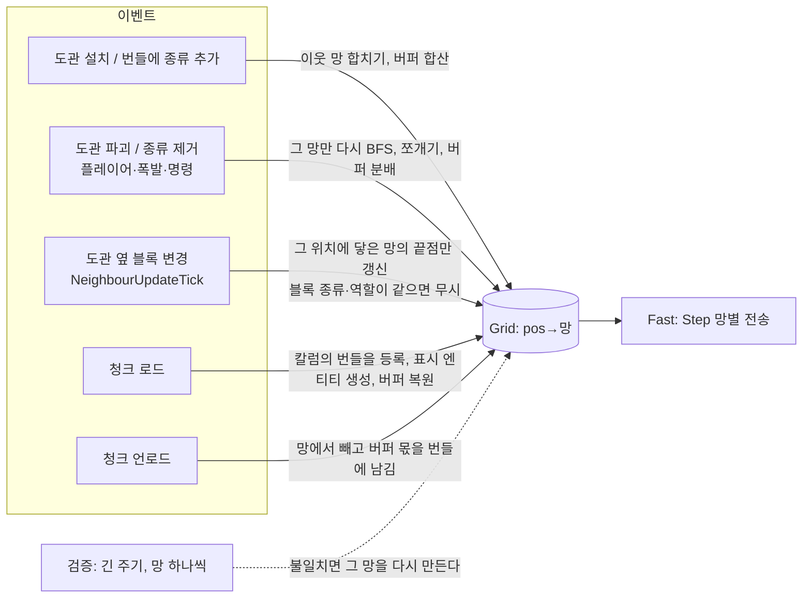
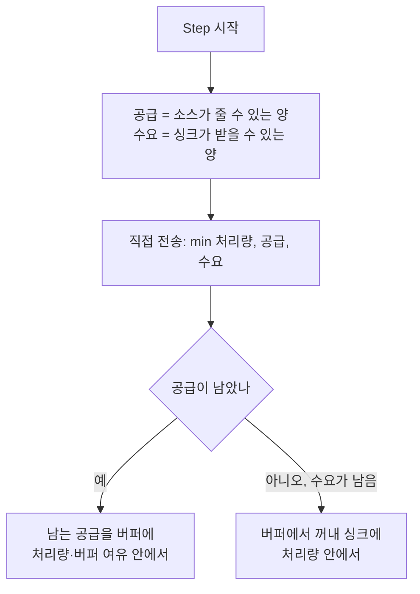

# Spec: 도관 네트워크 그래프화(perf/mekanism)

## Intent

에너지·아이템·액체 도관이 블록마다 일하는 구조를 없앤다. 이어진 도관은 그래프 하나(망)로 묶고, 도관을 놓거나 부수거나 청크가 오르내릴 때만 그 망을 고친다. 지금은 도관이 4틱마다 Grid에 자기를 등록하고(하트비트와 TTL), 변경이 하나만 있어도 월드의 세 Grid를 통째로 다시 스캔하며, 변화가 없어도 4~20초마다 전체를 다시 스캔한다. 기준선([2026-11-08-netgraph-baseline.md](2026-11-08-netgraph-baseline.md))에서 도관 1,024개일 때 무효화 한 번은 약 3.2ms를 쓰고, 기계 작동 표시가 한 번 바뀌는 것만으로도 전체 재스캔이 일어난다.

함께 Mekanism처럼 **에너지·액체 망에 버퍼**를 둔다. 망은 남는 에너지와 액체를 도관 안에 담아 두고, 망이 합쳐지면 버퍼를 더하고 쪼개지면 나눈다. 아이템 망은 버퍼 없이 그래프화만 한다.

## Goals

| # | 목표 |
|---|---|
| G1 | **이벤트 기반 그래프.** Grid가 `위치 → 망`과 망마다 도관 집합·끝점·최저 단계를 들고, 아래 이벤트가 생길 때만 고친다 |
| G2 | **국소 갱신.** 설치는 이웃 망과 합치고, 파괴는 그 망만 다시 찾아 쪼갠다. 끝점 변경은 그 위치에 닿은 망의 끝점만 고친다. 다른 종류와 다른 망은 건드리지 않는다 |
| G3 | **번들 `Tick` 제거.** `Bundle`은 `Tick`을 구현하지 않는다. 등록, 모양 갱신, 표시 엔티티 복구는 모두 이벤트로 옮긴다 |
| G4 | **망 버퍼(에너지·액체).** 남는 공급을 버퍼에 담고, 모자랄 때 버퍼에서 꺼낸다. 합치기·쪼개기·저장·재로드를 거쳐도 총량이 보존된다 |
| G5 | **안전망.** 운영에서는 긴 주기로 망 하나씩 돌아가며 검증하고, 테스트에서는 증분 결과가 전체 재계산 결과와 같은지 비교한다 |
| G6 | **가시성.** WAILA가 도관 망의 버퍼 양과 용량을 보여 준다(ko·en) |

## Non-goals

- 아이템 망의 동작 변경: 라운드 로빈, 채널, 면 모드, 속도는 그대로 둔다. Mekanism의 물류 운반관처럼 아이템이 실제로 이동하는 방식은 하지 않는다.
- 단계별 처리량(`Rates`) 변경. 망의 처리량은 지금처럼 **가장 낮은 단계의 값**이다.
- 기계 사이 직접 전송(`AddSource`, `DirectRate`), 창고 망(`netstore`, `storagenet`), 표시 엔티티 틱(`ConduitVisual.Tick`)의 비용.
- 도관의 모양·연결 규칙·설정 창 UX.

## Constraints

- 브랜치는 `perf/mekanism`이다. 커밋 작성자는 `debe3721@gmail.com`이고 협업자 표기는 넣지 않는다. 메시지는 `perf(network): …` 같은 저장소 관례를 따른다.
- 커밋마다 `go build ./...`, `go vet ./...`, `go test ./...`가 통과해야 한다.
- Dragonfly를 고치면(청크 로드·언로드 훅 등) 같은 커밋에 `// skygear patch` 주석, `third_party/dragonfly.patch` 재생성, `third_party/README.md` 표 한 줄을 넣는다.
- **기존 세이브와 호환**한다. 버퍼 필드가 없는 번들 NBT는 버퍼 0으로 읽는다. 지금의 NBT 키는 바꾸지 않고 새 키만 더한다.
- 상태만 바꾸고 `SetBlock`을 하지 않는 경우에도 저장이 빠지면 안 된다. 버퍼 값이 바뀐 청크는 저장 대상으로 표시한다(perf 스펙 D1과 같은 문제).
- 월드 트랜잭션 안에서만 Grid를 바꾼다. 세이브(세션)마다 Grid가 하나씩이라는 구조(`content/skygear/network`)는 유지한다.
- 측정은 기준선 문서와 같은 벤치마크로 한다. 결과는 기준선 문서의 표 옆에 "후" 열로 더하고, 요약은 `docs/tech/performance.md`에 둔다.

## 이벤트와 흐름

## Done looks like

| 영역 | 수락 기준 |
|---|---|
| 그래프 정확성 | 무작위로 설치·파괴·청크 언로드/로드를 섞은 시퀀스마다, 증분 Grid의 망 분할(도관 집합, 끝점, 최저 단계)이 전체 `Discover` 재계산 결과와 같다(속성 테스트, 세 종류 모두) |
| 파괴 원인 | 플레이어 파괴, 폭발, `SetBlock` 교체 모두 다음 Step에 반영된다. 이웃 도관이 하나도 없는 외톨이 도관이 이벤트 없이 사라진 경우는 검증 주기 안에 반영된다 |
| 국소성 | 기준선 `BenchmarkOneChange`(망 16개 × 64)에서 하나가 바뀌면 지나는 도관이 **64개 이하**다(`Counters().Visited`). 다른 종류의 Grid는 일을 하지 않는다 |
| 기계 표시 | `TestMeasureNetworkScans`의 "기계" 경우에서 작동 표시 변경으로 생기는 재스캔이 **0번**이다 |
| 주기 재스캔 | 같은 테스트의 "아무 변화 없음" 경우에서 2분 동안 전체 재스캔이 **0번**이다. 검증이 지난 도관 수는 검증 주기로 정한 양을 넘지 않는다 |
| Step 비용 | `BenchmarkGridStep` cached(도관 1,024개)가 에너지 **30µs 이하**다(기준선 약 75µs). 아이템·액체도 기준선보다 줄어든다 |
| 도관 틱 | `BenchmarkConduitTick/n=1024`가 **기준선(약 258µs)의 절반 이하**다. `Bundle`은 `world.TickerBlock`이 아니다 |
| 표시 엔티티 | 청크를 다시 로드하거나 서버를 재시작하면 도관의 표시 엔티티와 연결부 판이 다시 생긴다. 이웃 블록이 바뀌면 모양이 맞게 갱신된다(테스트) |
| 버퍼 동작 | 싱크가 없으면 공급이 버퍼 용량까지 찬다. 공급이 끊기면 싱크가 버퍼를 비운다. 버퍼가 있어도 틱당 처리량은 처리량 한도를 넘지 않는다. 싱크가 다 받을 수 있으면 지금과 같은 양이 전달된다(테스트) |
| 보존 | 합치기, 쪼개기, 저장 후 재로드, 청크 언로드 후 로드를 거쳐도 버퍼 총량이 보존된다. 쪼갤 때 생기는 나머지는 한 조각에 몰아 정수 합이 정확히 같다. 부서진 도관에 들어 있던 몫만 사라진다(테스트) |
| 액체 종류 | 버퍼에는 한 종류만 담긴다. 다른 종류는 버퍼에 들어가지 않는다. 종류가 다른 두 망이 합쳐지면 양이 많은 쪽의 종류가 남고 다른 쪽은 사라진다(테스트) |
| 호환 | 기준선 커밋에서 저장한 월드(버퍼 키 없음)를 읽으면 버퍼 0으로 동작한다. 기존 에너지·아이템·액체 테스트는 전부 통과한다 |
| WAILA | 에너지·액체 도관을 보면 "망 저장량 x / y"가 보인다(ko·en, i18n 검사 통과) |
| 문서 | `docs/tech/conduits.md`, `docs/design/06-power-and-conduits.md`(버퍼), `docs/tech/performance.md`, 기준선 문서의 "후" 열이 갱신된다 |

## Decided

1. **버퍼 용량은 도관마다 더한다(Mekanism처럼).** 도관 하나의 용량은 Mekanism의 비율(기본 케이블 : 기본 에너지 큐브 = 1 : 500, 기본 파이프 : 기본 탱크 = 1 : 16)을 우리 에너지 셀(100,000 RE)과 탱크(16,000 mB)에 맞추고, 단계는 처리량 비율로 올린다.

   | 단계 | 에너지 RE/도관 | 액체 mB/도관 |
   |---|---|---|
   | 1 | 200 | 1,000 |
   | 2 | 1,200 | 5,000 |
   | 3 | 4,800 | 40,000 |

   식으로는 에너지가 `RateOf(tier)/40`, 액체가 `RateOf(tier)×5`다. 도관 500개(1단계)가 에너지 셀 하나와 같아서, 도관이 셀보다 싼 저장소가 되지 않는다.
2. **처리량은 바꾸지 않는다.** 한 Step에 싱크로 가는 양과 소스에서 들어오는 양은 각각 `처리량 × 틱`을 넘지 않는다. 처리량은 지금처럼 망에서 가장 낮은 단계의 값이다. 버퍼는 남는 공급을 담고 모자란 수요를 메울 뿐이고, 직접 전송을 막지 않는다. 싱크에 나눠 주는 규칙(에너지는 물 채우기, 액체는 라운드 로빈)도 그대로다.
3. **합치기는 더하고, 쪼개기는 용량 비율로 나눈다.** 합칠 때 합이 새 용량을 넘으면 넘는 만큼 버린다. 쪼갤 때는 각 조각의 용량 합에 비례해 나누고 나머지는 가장 큰 조각에 준다. 부서진 도관의 몫(전체 × 그 도관 용량 / 망 용량)은 사라진다.
4. **저장은 도관마다 몫으로 한다(Mekanism처럼).** 각 번들이 자기 몫을 NBT(새 키)에 지니고, 로드할 때 망이 몫을 더해 버퍼를 만든다. 버퍼는 월드 파일과 함께 다닌다(백업·세이브 복사와 일치).
5. **아이템 망은 버퍼가 없다.** 그래프화와 이벤트 갱신만 한다.
6. **안전망은 긴 주기로 망 하나씩 검증한다.** 운영에서는 약 60초 주기로, Step마다 망 하나(또는 정해진 도관 수까지)를 다시 BFS해 캐시와 비교하고, 다르면 그 망만 다시 만든다. 한 틱에 전체 재스캔하는 일은 없다. 테스트에서는 증분 결과와 전체 재계산 결과를 비교한다.
7. **계측 카운터는 유지한다.** `Counters()`의 `Scans`는 Grid 전체를 다시 찾은 횟수, `Visited`는 BFS가 지난 도관 수(증분·검증 포함)다. 증분 작업의 횟수를 세는 필드는 더해도 된다.
8. **지휘는 AI다.** 위 항목은 AI 지휘의 결정(Ruling)이고, 사용자가 다른 값을 원하면 이 표를 고친다.

## Left to the builder / plan

- Grid 자료구조(망 ID, 합치기 방식. 예: 작은 망을 큰 망에 붙이기), 쪼갤 때의 BFS 범위, 세 Grid가 공통 그래프 코드를 나눌지 여부.
- 청크 로드·언로드를 받는 방법(Dragonfly 패치 훅 또는 기존 섬 청크 유지 경로)과 칼럼에서 번들을 찾는 방법(블록 엔티티 목록 등).
- 번들의 버퍼 몫을 들고 있는 방식(포인터 상태, 세션 쪽 표 등)과 청크를 저장 대상으로 표시하는 방법.
- 번들 `Tick`이 하던 일(40틱 주기 모양 갱신 안전망, 표시 엔티티 복구)을 이벤트·검증으로 어떻게 나눌지.
- 검증 주기와 Step당 검증량의 정확한 값(60초 안팎, 튐이 없을 만큼).
- 작업 순서와 커밋 나누기.
