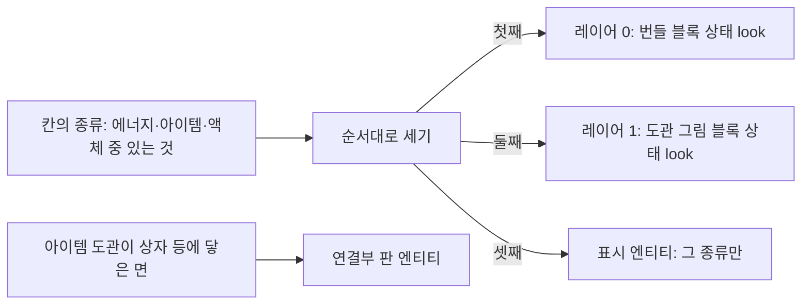

# Spec: 도관을 블록으로 그리기(perf/mekanism)

## Intent

도관 모양을 표시 엔티티 대신 **블록(저장 레이어 0과 1)**으로 그린다. 같은 모양 12,083칸을 그린 실험(`/sgdebug fill 11 … pair|entity|block`, RX 580)에서 엔티티는 7~20 FPS, 블록은 약 195 FPS였다. 서버 쪽에서도 표시 엔티티 틱(도관 틱의 약 26%)이 사라진다. 블록 상태를 늘리면 접속 로딩이 길어지므로, permutation이 적은 `bone_visibility` 방식을 쓴다. 상태 약 1,150개에 permutation 18개일 때 `client_load_ms`는 4,005ms에서 4,322ms로 늘었다(+8%). 모양마다 permutation을 둔 방식(1,154개)은 4,688ms(+17%)였다.

## 실험으로 확인한 것

| 사실 | 근거 |
|---|---|
| 클라이언트는 레이어 0과 1만 그린다. 레이어 2 이상은 그리지 않는다 | `/sgdebug layers a·c` |
| 레이어 1은 레이어 0에 **보이는** 블록이 있을 때만 그린다(공기나 보이지 않는 모양이면 그리지 않는다) | `layers b·d` |
| 레이어 1에서도 상태에 따라 모양이 바뀐다 | `layers alt1` |
| 문자열로 보낸 `bone_visibility`(Molang)가 동작한다 | `SKYGEAR_STATE_PROBE=bones` |
| 서버의 청크 전송 경로는 모든 레이어를 실어 보낸다 | F-LP-1 점검 |

## Goals

| # | 목표 |
|---|---|
| G1 | 칸의 도관이 두 종류 이하이면 **모양에 상관없이** 엔티티 없이 블록으로 그린다 |
| G2 | 그리는 자리는 종류에 고정하지 않는다. 칸에 든 종류를 정해진 순서(에너지, 아이템, 액체)로 세어, 첫째는 레이어 0(번들), 둘째는 레이어 1에 그린다. 셋째는 표시 엔티티로 그린다 |
| G3 | 도관 블록은 하나처럼 다룬다. 어느 쪽을 부수든 칸의 도관을 모두 부수고 모두 떨어뜨리며, 레이어 1도 함께 비운다. 레이어 0의 종류가 빠지면 레이어 1의 종류를 레이어 0으로 옮긴다 |
| G4 | 아이템 도관의 연결부 판은 지금처럼 엔티티로 그린다 |
| G5 | Dragonfly `setBlock`은 레이어 1을 **액체일 때만** 레이어 0으로 내리거나 지운다 |

## Non-goals

- 도관의 연결 규칙, 설정 창, 이동 규칙(이전 스펙의 그래프·버퍼) 변경.
- 세 종류가 모두 든 칸을 블록만으로 그리는 것(레이어가 둘뿐이다).
- 연결부 판을 블록으로 옮기는 것.

## Constraints

- 브랜치는 `perf/mekanism`이다. 커밋 작성자는 `debe3721@gmail.com`이고 협업자 표기는 넣지 않는다. 커밋마다 `go build ./...`, `go vet ./...`, `go test ./...`가 통과해야 한다(`TestOreUIBundleFresh`는 이번 일과 무관하게 이미 실패한다).
- 블록 이름 하나에 상태 속성은 하나다(`pack_test.go`). 모양 값은 정수 상태 하나에 담는다.
- 기존 세이브와 호환한다. 상태가 없던 번들은 로드할 때(`LoadColumn`) 모양을 계산해 다시 그린다. NBT 키는 바꾸지 않는다.
- Dragonfly를 고치면 `// skygear patch` 주석을 달고, `dragonfly.patch`를 다시 만들고, `third_party/README.md`에 한 줄을 더한다.
- 그래프·버퍼 동작과 그 테스트는 그대로 통과해야 한다.

## 그리기와 배치

- 상태 값: `look = 0`(없음) 또는 `1 + kind*192 + (tier-1)*64 + faces`(`faces`는 `conduit.Faces` 순서의 6비트). 레이어 0과 레이어 1의 블록 이름에 각각 577개다.
- 지오메트리: 종류별 1개(차선 −3/0/+3을 지오메트리에 넣는다. 코어 3×3×3px, 팔 2×2px, 팔은 칸 경계까지). 엔티티 모델과 크기·UV가 같다(F-LP-4에서 맞춤).
- permutation: 블록마다 (종류 × 단계) 9개. 텍스처를 고르고, 팔 부위는 `bone_visibility`로 켜고 끈다.
- 레이어 0이 보이는 블록이어야 레이어 1이 그려진다. 도관이 있는 칸의 레이어 0은 늘 실제 도관 모양이다(G2가 이를 보장한다).

## Done looks like

| 영역 | 수락 기준 |
|---|---|
| 그리기 | 종류가 두 개 이하인 칸에는 표시 엔티티가 없다. 레이어 0과 1의 상태가 그 칸의 종류·단계·연결 면과 같다(테스트) |
| 세 종류 | 세 종류가 든 칸은 셋째 종류만 표시 엔티티로 그린다(테스트) |
| 배치 규칙 | 레이어 0의 종류를 빼면 레이어 1의 종류가 레이어 0으로 옮겨진다. 어느 종류든 넣고 빼는 순서에 상관없이 결과가 "있는 종류를 순서대로 센 배치"와 같다(속성 테스트) |
| 부수기 | 번들을 부수면 칸의 모든 도관 아이템이 떨어지고 레이어 0과 1이 모두 공기다. 레이어 0에 그림 블록이 남지 않는다(테스트) |
| Dragonfly | 레이어 1이 액체가 아니면, 레이어 0을 공기로 바꿔도 내려오지 않고, 다른 블록을 둬도 지워지지 않는다. 액체(물에 잠긴 블록)는 지금처럼 동작한다(테스트) |
| 모양 갱신 | 이웃이 바뀌어 연결 면이 바뀌면 두 레이어의 상태가 함께 바뀐다. 번들 갱신(`refresh`)이 레이어 1을 지우지 않는다(테스트) |
| 호환 | 상태가 없던 번들 세이브를 로드하면 올바른 모양으로 그려진다(테스트) |
| 서버 성능 | `BenchmarkConduitTick/n=1024`(두 종류 번들)이 **129µs 이하**(이전 스펙의 미달 목표) |
| 클라이언트 | 사용자가 같은 조건(반경 11, 같은 시점)으로 실제 도관을 깔았을 때 FPS가 `fill block` 수준이고, `client_load_ms`가 기준선 대비 +10% 안이다 |
| 문서 | `docs/tech/conduits.md`(레이어 그리기, 배치 규칙, 실험 결과), `docs/tech/performance.md` 갱신 |

## Decided

1. **`bone_visibility` 방식.** permutation을 모양마다 두는 방식보다 접속 로딩이 절반 정도만 늘고 그리기 성능은 같거나 낫다.
2. **종류 순서는 에너지, 아이템, 액체.** 레이어는 종류에 고정하지 않고 이 순서로 앞에서부터 채운다.
3. **레이어 1은 별도 블록 이름(그림 전용)이다.** 선택·충돌·부수기·NBT는 레이어 0의 번들이 맡는다.
4. **실험 장치(`/sgdebug layers`, `/sgdebug fill`, `SKYGEAR_STATE_PROBE`)는 남겨 둔다.** 이후 측정에 다시 쓴다. 다만 상태 실험 블록은 기본으로 꺼져 있다.

## Left to the builder / plan

- 레이어 1 쓰기를 `Tx.SetBlockLayer`로 할지, 번들 훅 안에서 할지. 순서(레이어 1을 먼저 지우고 레이어 0 갱신 등).
- 표시 엔티티를 셋째 종류만 그리게 하는 방법(기존 Variant 인코딩 재사용).
- 지오메트리 생성기를 `tools/stateprobegeo`에서 옮길지, `tools/conduitgeo`에 합칠지.
- 작업 순서와 커밋 나누기.
