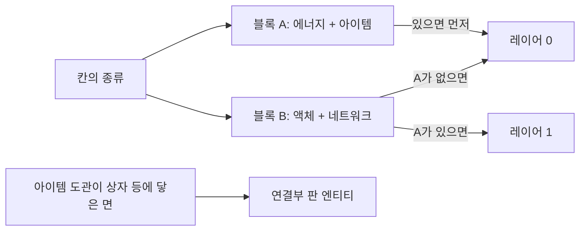

# Spec: 도관을 블록으로 그리기(pair2)

## Intent

도관 모양을 표시 엔티티 대신 **블록(저장 레이어 0과 1)**으로 그린다. 같은 모양 1만 2천 칸을 그린 실험에서 엔티티는 7~20 FPS, 블록은 약 184 FPS였다. 도관 네 종류(에너지, 아이템, 액체, 네트워크)를 **어떤 조합이든 엔티티 없이** 그리는 것이 조건이다. 이 문서는 실험으로 정한 구성이고, 구현은 다음 작업이다.

## 실험으로 확인한 것

| 사실 | 근거 |
|---|---|
| 클라이언트는 저장 레이어 0과 1만 그린다. 레이어 2 이상은 그리지 않는다 | 레이어 실험 블록(제거됨) a·c |
| 레이어 1은 레이어 0에 **보이는** 블록이 있을 때만 그린다(공기나 보이지 않는 모양이면 그리지 않는다) | 레이어 실험 b·d |
| 레이어 1에서도 상태에 따라 모양이 바뀐다 | 레이어 실험 alt1 |
| 문자열로 보낸 `bone_visibility`(Molang)가 동작한다 | `SKYGEAR_STATE_PROBE=bones`(제거됨) |
| 블록 이름 하나에서 클라이언트가 아는 상태는 처음 **65,536개**까지다. 넘는 상태는 보이지도 부딪히지도 않는다 | all4(제거됨): 블록당 221,953 상태 → 대부분 안 보임. 나눈 all4split은 모두 보임 |
| 접속 로딩(`client_load_ms`)은 **상태 수에 거의 비례**한다(상태당 약 55~70µs). Molang을 단순하게 해도 거의 줄지 않고, 상태 속성 수가 많으면 오히려 늘어난다 | 아래 표 |
| 서버의 청크 전송은 모든 저장 레이어를 실어 보낸다 | F-LP-1 점검 |
| Dragonfly는 블록 ID에 해시를 쓰지 않는다. 상태가 여럿이면 속성 이름 정렬 순서가 클라이언트와 맞아야 한다(Dragonfly가 정렬해 보내도록 패치함) | F-LP-8 |

### 측정(RX 580, 반경 11, 같은 모양)

| 구성 | 상태 합 | 블록당 상태 속성 | `client_load_ms` | FPS (1% Low) |
|---|---|---|---|---|
| 기존(엔티티로 그림) | 0 | — | 4,005 | 7~20 (5~19) |
| 한 레이어에 한 종류, 3종류 (bones) | 1,154 | 1 | 4,322 | 195 (92) |
| 모양마다 permutation (perm) | 1,154 | 1 | 4,688 | 193 (81) |
| 4종류, 짝은 연결 면이 같을 때만 (same4) | 4,994 | 1 | 4,388 | 98 (58) |
| 4종류, 모든 짝 6쌍 (all4split) | 443,906 | 1 | 32,725~37,946 | 87 (34) |
| **고정 짝 2개 (pair2)** | **74,498** | 1 | **9,019** | **184 (60)** |
| 고정 짝 2개, 정수 상태 2개 (pair2ab) | 74,498 | 2 | 8,022 | 177 (60) |
| 고정 짝 2개, 단계 + 면 플래그 (pair2bits) | 131,072 | 14 | 17,902 | — |

같은 구성을 한 번씩만 잰 값이라 접속 시간은 ±0.4초쯤 흔들린다. FPS는 바라본 방향에 따라 다르다.

## 결정: pair2

- **블록 두 개, 짝 고정**: A = 에너지 + 아이템, B = 액체 + 네트워크. 각 블록은 두 종류를 아무 단계·아무 모양으로 그린다.
- **상태**: 블록마다 정수 하나, `value = a*193 + b`. `a`, `b`는 0(없음) 또는 `1 + (단계-1)*64 + 연결 면`(연결 면은 `conduit.Faces` 순서의 6비트). 블록마다 37,249개로 65,536 상한 아래다. 합은 74,498개다.
- **배치**: 칸에 있는 블록을 레이어 0부터 채운다. A가 있으면 A가 레이어 0이다. B만 있으면 B가 레이어 0이다. 레이어 0이 늘 보이므로 레이어 1이 그려진다.
- **그리기**: 블록마다 지오메트리 하나(두 종류의 코어·팔 부위, 차선은 지오메트리에 넣는다. 에너지 (−3,−3,−3), 아이템 0, 액체 (+3,+3,+3), 네트워크 (+6,−6,+6) px). 종류마다 `material_instance`를 둔다. permutation은 (a의 단계 또는 없음) × (b의 단계 또는 없음) − 1 = 15개. 팔은 `bone_visibility`로 켜고 끈다.
- **엔티티**: 아이템 도관의 연결부 판만 남는다. 도관 모양을 그리는 표시 엔티티는 없어진다.
- **확장 한계**: 레이어가 둘이라 다섯째 종류는 짝 블록에 셋을 담아야 해서(193³) 불가능하다. 네 종류가 한계다.

### 고르지 않은 것

| 구성 | 이유 |
|---|---|
| 레이어당 한 종류 | 세 종류 이상인 칸에 엔티티가 남는다 |
| same4 | 연결 면이 다른 짝은 엔티티가 남는다 |
| all4split | 로딩 +30초 |
| pair2ab | 측정 오차 안에서 pair2와 비슷하고, 상태 속성이 여럿이면 순서 위험이 있다 |
| pair2bits | 상태가 늘고 상태당 비용도 늘어 로딩 +14초 |
| 단계를 텍스처에서 빼기(상태 8,450, 약 +0.5초) | 단계를 눈으로 구분할 수 없게 된다. 나중에 로딩을 줄여야 하면 다시 검토한다 |

## 구현할 때 지킬 것

- Dragonfly `setBlock`은 레이어 1을 **액체일 때만** 레이어 0으로 내리거나 지우게 고친다. 지금은 종류를 가리지 않아, 번들을 갱신하면 레이어 1이 지워지고 부수면 레이어 1 블록이 레이어 0으로 내려온다.
- 어느 레이어를 부수든 칸의 도관을 모두 부수고 떨어뜨리며, 두 레이어를 비운다.
- 블록 이름을 정할 때 네트워크 해시가 바닐라·다른 커스텀 블록과 겹치지 않는지 테스트로 확인한다(실험 중 `poplar_hanging_sign`, `auto_sieve`와 겹친 적이 있다).
- 커스텀 블록 이름 하나가 65,536 상태를 넘으면 시작 로그가 경고한다(이미 있음).
- 기존 세이브는 로드할 때(`LoadColumn`) 모양을 다시 계산해 그린다.
- 측정 도구: `SKYGEAR_STATE_PROBE=pair2`와 `/sgdebug fill <반경> <초> entity|block`, 접속 시간 로그(`join timing`).
