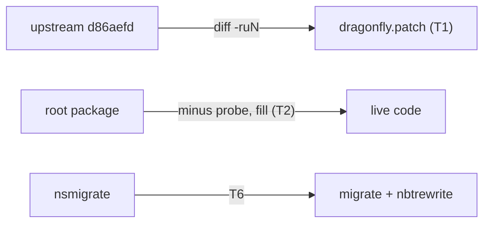
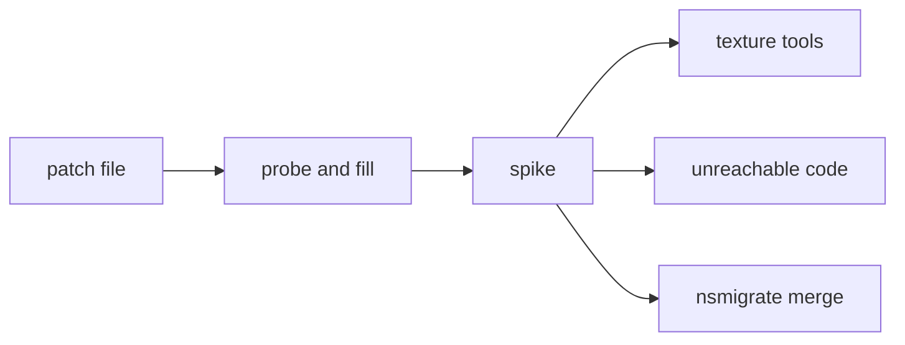

# Plan: cleanup phase 1a (patch tracking, dead code, nsmigrate)

**Review plan:** docs/plans/2026-11-10-cleanup-restructure.review.md
**Goal:** Review parts 1-1, 1-2 and the nsmigrate half of 1-4: the patch file matches the patched tree, dead code is gone, nsmigrate lives in `migrate`.
**Architecture:** Deletions and one merge in an existing tree; no new feature. Phase 1 runs as three plans in order: p1a (this), p1b (save-format removals), p1c (text and docs).
**Tech stack:** Go 1.26, patched Dragonfly in `third_party/dragonfly` (own go.mod), tests with `go test`.
**Spec:** none (the review plan binds)
**Detail:** contracts
**Target-min:** 30
**Ignore:** .superlite/

## Global constraints

- Language Go. Checkout `/home/user/SkyGear`, branch `superlite/sessions/cleanup-restructure`. One commit per task with the subject given, English, no attribution lines; never push.
- Green at every commit: `go build ./... && go vet ./... && go test ./...` (the full suite takes minutes) and `gofmt -l` clean on touched files. Never skip, disable or weaken a test; only the tests a task names are deleted.
- No player-visible change. Docs lines are Korean and state the current design only (CONTRIBUTING.md).
- Line numbers are from commit 0e50466: grep again before editing. If a stated fact no longer holds, report BLOCKED.
- Ruling: no Wave 0 - an existing tree needs no skeleton or stubs - an unused brief. Ruling: single checkout, no worktree - the owner works on this branch - none.
- `TD` is the to-do document `docs/{TOD}O.md`. `AUD` is `/tmp/claude-0/-home-user-SkyGear/a71fa8d5-6f20-5c3f-ba20-eeb27e13ad8a/scratchpad/audit` (may be gone).

## Main diagram

## File structure

The Owns lines name every file. New: `content/skygear/migrate/namespace.go`, `namespace_test.go`.

## Task graph

Edges order tasks that edit the same files (`third_party/README.md`, `cmd/skygear/main.go`, docs). T4, T5 and T6 are parallel.

## Predicted schedule

From `plan_tools schedule`: critical path T1 -> T2 -> T3 -> T6, 8.8 min; peak width 3; predicted total about 22 min.

## third_party

**Probe entry:** run=diff -r

### T1 sync dragonfly.patch and its README · Complexity 3 · Est. context 29k
**Owns:** third_party/dragonfly.patch, third_party/README.md
**Components:** 1
**LOC owned:** 100
**Tests:** fast
**Kind:** design
**Model:** sonnet
**Est. time:** 1.5 min
**Consumes:** none
**Produces:** none
**Steps:**
- Base = upstream commit `d86aefd9ff9b6a357d6dfadab2093af811545256` without `.github`. A copy is `AUD/upstream/base` (verified equal to a fresh fetch). Otherwise: `git init -q df && cd df && git fetch -q --depth 1 https://github.com/df-mc/dragonfly d86aefd9ff9b6a357d6dfadab2093af811545256 && mkdir ../base && git archive FETCH_HEAD | tar -x -C ../base && rm -rf ../base/.github`. `refs/pull/1481/head` moved to 1f4c85d: never fetch it.
- Verified drift: the file has 66 diffs, the tree differs in 68 text files plus `pack_icon.png`. Missing: `server/listener.go` and `conf.go` (NetherNet `LocalIP`, `PublicIP`), `blockinternal/components.go` `toolTags` with `tooltags_test.go`, `item/digger.go` `TagDigger`/`TagSpeed`, `session/world.go` `FloatingText`.
- Regenerate outside the repo, same format: `cp -r base a; cp -r <repo>/third_party/dragonfly b; diff -ruN -x pack_icon.png a b > dragonfly.patch`.
- Accept: `cp -r base c; (cd c && patch -p1 -s < ../dragonfly.patch); diff -r -x pack_icon.png c <repo>/third_party/dragonfly` prints nothing, and `grep -c '^diff ' dragonfly.patch` is 68.
- README: `common/dfhook`, `dfhook.` -> `common/sghook`, `sghook.` (lines 13-19); the base line and upgrade step 1 name the full hash; step 5 gives the two commands above; add rows for NetherNet, tool tags with `item.TagDigger`, `FloatingText()`, `item.Usable` (`minecraft:use_modifiers`), `tooltags_test.go`, `weather_leak_test.go`; `BoneVisibility` and `CollisionBoxes` are used by `machine/sieve.go` and `machine/netshape.go`; `internal/itemio` -> `common/itemio`; "감염된 나뭇잎" -> 누에 나뭇잎; say the patch tests run with `cd third_party/dragonfly && go test ./server/...`. Read the `dirt.go`, `tick.go` (weather) and `composter.go` rows against the patched source and reword what is wrong.
- Commit `chore(third_party): sync dragonfly.patch and README with the patched tree`.

## root package and tools

**Probe entry:** run=go test ./content/skygear/

### T2 remove the state probe and /sgdebug fill · Complexity 4 · Est. context 28k
**Owns:** content/skygear/{stateprobe.go,stateprobe_test.go,stateprobe_pair2_test.go,debug_fill.go,debug_fill_test.go,blockcounts.go,blockcounts_test.go,debug.go}, assets/{stateprobe.go,stateprobe_test.go,assets.go}, tools/stateprobegeo/, assets/resourcepack/skygear/models/blocks/state_probe_four.geo.json, cmd/skygear/main.go, common/sghook/{jointiming.go,jointiming_test.go}, content/skygear/locales/{en.json,ko.json}, docs/tech/performance.md, third_party/README.md
**Components:** 2
**LOC owned:** 90
**Tests:** slow
**Kind:** design
**Model:** sonnet
**Est. time:** 2.4 min
**Consumes:** none
**Produces:** none
**Steps:**
- Delete whole: `stateprobe.go`, `stateprobe_test.go`, `stateprobe_pair2_test.go`, `debug_fill.go`, `debug_fill_test.go`, `assets/stateprobe.go`, `assets/stateprobe_test.go`, `tools/stateprobegeo/`, the geo file (about 2,590 Go lines). Their tests go with them: 8 in `debug_fill_test.go`, `TestStateProbeOff`, `Registered`, `NetworkHashes`, the 5 `TestStateProbePair2*`, 2 in assets, 3 in the tool.
- All outside references (verified): `debug.go:39` (`debugFill`, `debugFillStop`); `cmd/skygear/main.go:164-166`; `assets/assets.go:32-41` (`Pack` returns `fs.Sub(files, "resourcepack/"+name)`); `jointiming.go:17,35-37,69,76,152` (`JoinProbe` and the `probe` attribute) with `jointiming_test.go:23`; 9 `skygear.debug.fill.*` keys in each catalog; `performance.md:104` (`probe=`) and `:106` (history sentence); README rows `skygear_layers.go` (no caller left; the file stays for phase 2) and `BoneVisibility`.
- `blockcounts.go` stays without the probe: `CustomBlockCounts`, the INFO line `custom blocks` and the WARN for a name over 65,536 states (move the cap constant in from `stateprobe.go`); drop the `state probe block` line. `blockcounts_test.go`: drop the probe branch and take over `TestStateProbeCapWarning` as `TestBlockNameCapWarning` (same assertion on the WARN).
- Accept: `grep -rniE 'state_?probe|debugFill|JoinProbe|debug\.fill' --include=*.go --include=*.json --include=*.md . | grep -v -e third_party/dragonfly -e docs/plans -e change_logs` prints nothing.
- Commit `refactor(skygear): remove the state count probe and /sgdebug fill`.

### T3 remove the scenario bot · Complexity 2 · Est. context 27k
**Owns:** spike/, README.md, CONTRIBUTING.md, docs/tech/{chestui,timed-items,performance,machines,waila,recipes}.md, docs/design/11-research-essences.md, docs/{TOD}O.md, third_party/README.md, go.mod, go.sum
**Components:** 1
**LOC owned:** 40
**Tests:** slow
**Kind:** design
**Model:** sonnet
**Est. time:** 2.0 min
**Consumes:** none
**Produces:** none
**Steps:**
- `spike/` is 31 files: `cmd/platformbot/main.go` (523 lines), 29 scenarios and `run.sh`. Nothing imports it. The bot reads JSON UI forms only and no code sends a form, so no scenario runs.
- References to rewrite (verified complete): `README.md:94,105-117`; `CONTRIBUTING.md:19-21` (delete the bullet); `chestui.md:38`, `timed-items.md:50`, `performance.md:3`, `machines.md:70`, `waila.md:10`, `recipes.md:11`; `11-research-essences.md:144`; TD line 22 becomes one item: build a bot that reads DDUI screens (drop "팩 암호화는 늘 켬", the default is off); `third_party/README.md` upgrade step 4.
- Run `go mod tidy`; commit `go.mod`/`go.sum` only if they change.
- Accept: `grep -rn 'spike/' --include=*.md --include=*.go --include=*.yml . | grep -v -e docs/plans -e third_party/dragonfly` prints nothing.
- Commit `chore(spike): remove the scenario bot and its scenarios`.

### T4 remove the placeholder texture tools · Complexity 1 · Est. context 26k
**Owns:** tools/metaltex/, tools/tiertex/, tools/essencetex/, tools/machinetex/, tools/texdedup/main.go, docs/design/11-research-essences.md, docs/tech/asset-credits.md
**Components:** 1
**LOC owned:** 15
**Tests:** slow
**Kind:** design
**Model:** sonnet
**Est. time:** 1.9 min
**Consumes:** none
**Produces:** none
**Steps:**
- Verified by running each on a copy of the pack: `metaltex`, `tiertex`, `essencetex`, `machinetex` (474 lines) repaint 19, 11, 5 and 36 committed PNGs (machinetex adds 24) with placeholder art. No procedure uses them. Delete the four folders.
- Fix `11-research-essences.md:143` (the pictures are PNGs kept by hand) and the comment `tools/texdedup/main.go:3`.
- Keep `animtex` and `tierblocks`: they are steps of the documented regeneration (`asset-credits.md:70-76`, `tools/modtex/main.go:10-12`). They fail only when run without `modtex` first, which writes the files `texdedup` later merges (`blocks/lava_generator_side.png`). Add that one sentence under "다시 만들 때".
- Accept: the full suite passes; `grep -rnE 'metaltex|tiertex|essencetex|machinetex' --include=*.go --include=*.md . | grep -v docs/plans` prints nothing.
- Commit `chore(tools): remove the placeholder texture generators`.

### T5 remove unreachable code · Complexity 3 · Est. context 28k
**Owns:** common/sghook/{view.go,sghook.go}, common/ui/window_test.go, content/skygear/look/look.go, content/skygear/preview/preview.go, content/skygear/dimension/{gateportal.go,monster.go}, content/skygear/conduit/{bundle.go,conduitform.go,conduitplate.go}, content/skygear/netstore/{terminal.go,terminalui.go}, content/skygear/commands.go, third_party/README.md
**Components:** 2
**LOC owned:** 70
**Tests:** slow
**Kind:** design
**Model:** sonnet
**Est. time:** 2.4 min
**Consumes:** none
**Produces:** none
**Steps:**
- Zero references outside their own definition (`grep -rnw`, repo without `third_party/dragonfly`): `sghook.MoveInput` (`view.go:208-218`) with its feed (`view.go:42-44`) and field (`sghook.go:35`), also named in `third_party/README.md`; `look.stackLine` (`look.go:391`); `preview.GlassVanillaTexture` (`preview.go:45`); `dimension.dirYaw` (`gateportal.go:94`); `dimension.MobTypes` (`monster.go:177`); test helper `childWithClass` (`window_test.go:96`); variables `conduitKinds` (`bundle.go:400`; the comments `conduitform.go:67` and `conduitplate.go:24` cite it: state the indices without the name) and `orderKeys` (`terminal.go:288`; comment `terminalui.go:233`).
- `commands.go`: five `Run` methods repeat "player? session? else `menu.needSave`". Add `func (g *Game) playerSession(src cmd.Source, o *cmd.Output, tx *world.Tx) (*player.Player, *session, bool)` and use it where the preamble is identical; same messages.
- Left alone: `state.go` (registers a saved part), `db.RoleCohost` (planned co-host), every test hook.
- Accept: each symbol greps to nothing.
- Commit `refactor: remove unreachable code and share the command session lookup`.

## migrate

**Probe entry:** call=migrate.Namespace

### T6 merge nsmigrate into migrate · Complexity 6 · Est. context 33k
**Owns:** content/skygear/nsmigrate/, content/skygear/migrate/{namespace.go,namespace_test.go,run.go,patch.go}, common/nbtrewrite/{nbtrewrite.go,nbtrewrite_test.go}, cmd/skygear/main.go, content/skygear/layers_test.go, content/skygear/README.md, docs/{TOD}O.md
**Components:** 2
**LOC owned:** 300
**Tests:** slow
**Kind:** design
**Model:** sonnet
**Est. time:** 2.8 min
**Consumes:** none
**Produces:** migrate.Namespace(log *slog.Logger, dataDir string, backupDir string) -> error · nbtrewrite.NBTKeys(b []byte, rep func(string) string, key func(string) string) -> ([]byte, error)
- e.g. NBTKeys(b, strings.ToUpper, strings.ToLower) -> tag names and string values upper case, item stack value keys lower case
- e.g. Namespace(log, "data", "data/backups") -> nil, and `data/skygear-namespace.done` exists
**Steps:**
- nsmigrate is 937 lines (4 files and a test); its only caller is `cmd/skygear/main.go:34,76`. Verified: `nsmigrate/nbt.go` equals `nbtrewrite.go:116-320` except that item stack value keys go through `replaceKey` (also `df_` -> `sg_`) while names and strings go through the caller's function; `world.go` equals `nbtrewrite.IsSubChunkKey`/`SubChunk` and `migrate.rewriteWorld`; `db.go` equals `rewriteTable`, `rewriteValue`, `rewriteBytes`, `rewriteJSON`, `walkJSON` (`run.go:303-429`).
- First, on the old code, add `TestNamespaceWorldStackKeys`: a world value holding an item with stack values `{"df_card": "dragonfactory:x"}` and a tag named `df_tag` -> key `sg_card`, value `skygear:x`, tag name still `df_tag`.
- Then: `NBT(b, rep)` = `NBTKeys(b, rep, rep)`; `renamer` becomes `{rep, key func(string) string; mentions func([]byte) bool}`; `namespace.go` keeps the names, flag file, `<dataDir>.before-skygear` copy, new-server shortcut, lobby world, the `save_state` key update and `Run` as `Namespace`. World values use `replaceOld` with `replaceKey` for stack keys; database rows use `replaceKey` for all; every table and row is scanned.
- Move the four tests (`TestPlayerState`, `TestSubChunk`, `TestJSON`, `TestRunNewServer`) to `namespace_test.go` with their assertions unchanged; add `TestNBTKeys`.
- Update `main.go`, `layers_test.go:15`, the `nsmigrate` row of `content/skygear/README.md:25`, TD line 19 (new path).
- Commit `refactor(migrate): merge nsmigrate into migrate and nbtrewrite`.

## Review Focus

- migrate: encoding, file, state. Bytes other than renamed strings stay identical; a second run is a no-op.
- third_party: file. The patch applies with no reject.
- skygear: state. Startup logs keep `custom blocks`; no registered block or item changes in p1a.

## Self-review

Coverage: 1-1 T1; 1-2 T2-T5; 1-4 T6. Not here: `common/sghook/form.go` (phase 2-2), the A6 test hooks (phase 3-5), the Ore UI probe, GatePortal, chestui switches.
