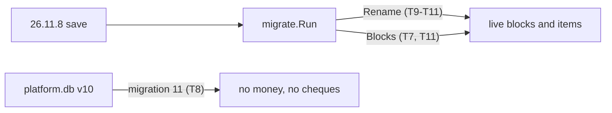
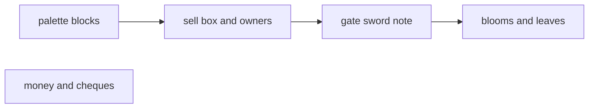

# Plan: cleanup phase 1b (shop leftovers and retired blocks and items)

**Review plan:** docs/plans/2026-11-10-cleanup-restructure.review.md
**Goal:** Review part 1-3: the shop's leftovers and the retired blocks and items leave code and pack; 26.11.8 saves load through one 26.11.9 patch and one database migration.
**Architecture:** `migrate.Patches` gets one entry `Version: "26.11.9"` that every task here extends (`TestPatchesAreOrdered` wants strictly rising versions; unreleased, so it may grow). A retired thing is renamed to the closest live thing; nothing is dropped. Runs after p1a.
**Tech stack:** Go 1.26, patched Dragonfly (`third_party/dragonfly`), SQLite, `go test`.
**Spec:** none (review plan)
**Detail:** contracts
**Target-min:** 32
**Ignore:** .superlite/

## Global constraints

- Language Go. Checkout `/home/user/SkyGear`, branch `superlite/sessions/cleanup-restructure`. One commit per task, subject as given, no attribution lines; never push.
- Green at every commit: `go build ./... && go vet ./... && go test ./...` (minutes), `gofmt -l` clean. Never skip, disable or weaken a test; only the tests a task names are deleted.
- No player-visible change beyond the removals. The 26.11.3 patch and database migrations 1-10 are never edited; `Version` stays 26.11.8.
- Line numbers are from commit 0e50466 (p1a moved some): grep again. A fact that no longer holds: report BLOCKED.
- Ruling: no Wave 0 - an existing tree needs no stubs - an unused brief. Ruling: single checkout, no worktree - the owner's branch - none.
- Verified Dragonfly facts: an item whose name is not registered reads as an empty stack (`item/nbt.go:191`); a palette entry whose block is not registered fails the chunk (`world/chunk/encoding.go:151`); missing palette properties are filled from the block's first registered state (`fillDefaults`); a block entity is decoded by the block now at its position (`world/world.go:1694`).

## Main diagram

## File structure

New: `content/skygear/migrate_retired_test.go`. Owns lines name the rest.

## Task graph

T9-T11 share files; T8 is parallel.

## Predicted schedule

From `plan_tools schedule`: critical path T7 -> T9 -> T10 -> T11, 11.1 min; peak width 2; predicted total about 23 min.

## migrate

**Probe entry:** call=migrate.Run

### T7 replace whole palette entries in a patch · Complexity 6 · Est. context 30k
**Owns:** content/skygear/migrate/{patch.go,run.go,migrate_test.go}, common/nbtrewrite/{nbtrewrite.go,nbtrewrite_test.go}
**Components:** 2
**LOC owned:** 180
**Tests:** slow
**Kind:** design
**Model:** sonnet
**Est. time:** 2.6 min
**Consumes:** none
**Produces:** Patch.block(name string) -> (Block, bool)
- e.g. Patch.block("skygear:infested_leaves") -> Block{Name: "skygear:infesting_leaves", States: {"skygear:infest_stage": "10"}}, true
- e.g. Patch.block("minecraft:stone") -> Block{}, false
**Steps:**
- Why: a renamed entry without states gets the first registered state, so the old infested leaves would become 0% silkworm leaves.
- `type Block struct{ Name string; States map[string]any }`, `Patch.Blocks map[string]Block`: a sub chunk palette entry whose `name` is a key is replaced by Name and States (its `version` kept), before `Rename`. Everywhere else only `Rename` applies. `mentions` also looks for the Blocks keys.
- nbtrewrite: `SubChunkBlocks(b, rep, block func(name string) (string, map[string]any, bool))`; `SubChunk(b, rep)` calls it with nil. An entry is one little endian NBT compound `{name, states, version}`; other bytes are copied.
- Tests: `TestSubChunkBlocksReplacesEntry` (palette `[minecraft:air, a:old{}]`, hook `a:old` -> `a:new{"s":"10"}`: the entries decode to air and `a:new` with `s` = "10", the index words are identical); `TestSubChunkBlocksNilIsSubChunk` (same bytes as `SubChunk`); `TestRunAppliesBlocks` (an old save's entry is replaced, a save at the patch version is untouched); `TestBlocksBeforeRename` (a name in both: the palette gets Blocks, item NBT gets Rename).
- Commit `feat(migrate): replace whole palette entries in a patch`.

## platform

**Probe entry:** call=db.Open

### T8 drop the wallet and the cheque table · Complexity 4 · Est. context 28k
**Owns:** platform/db/{db.go,save.go,db_test.go}, platform/instance/manager.go, platform/invsee.go
**Components:** 1
**LOC owned:** 90
**Tests:** slow
**Kind:** design
**Model:** sonnet
**Est. time:** 2.1 min
**Consumes:** none
**Produces:** DB.PlayerState(saveID int64, accountID string) -> ([]byte, error)
- e.g. PlayerState(1, "h") -> []byte{1}, nil
**Steps:**
- Verified: `DB.Money` (`save.go:252`) and `DB.AddMoney` (`:271`) have no caller; `DB.SetMoney` (`:263`) only `db_test.go:191`; both product callers of `PlayerState` discard the money (`instance/manager.go:278`, `invsee.go:272`); `save.go:140-141` copies `money` with a save; nothing reads or writes table `cheques` (`db.go:100`); `invSeeMain` (`invsee.go:28`) has no reference.
- Append migration 11: `DROP TABLE cheques; ALTER TABLE save_players DROP COLUMN money;`. Delete the three wallet methods and `invSeeMain`; fix the copy query and every `PlayerState(` caller (grep, tests too).
- Tests: `TestSetPlayerStatesKeepsMoney` (`db_test.go:186`) loses its wallet half and becomes `TestSetPlayerStates` (both blobs stored). New `TestMigrationDropsWallet`: apply `migrations[:10]`, set `user_version` 10, insert a `save_players` row (money 7, state 0x01) and a `cheques` row; `Open` -> `user_version` 11, no `cheques` in `sqlite_master`, no `money` in `PRAGMA table_info(save_players)`, state still 0x01.
- Commit `refactor(db): drop the wallet column and the cheque table`.

## game and pack

**Probe entry:** run=go test ./content/skygear/

### T9 remove the sell box and machine owners · Complexity 6 · Est. context 33k
**Owns:** content/skygear/, assets/resourcepack/skygear/ui/sg_machine.json, assets/resourcepack/inventoryui/ui/chest_screen.json, assets/resourcepack/skygear/texts/{en_US,ko_KR}.lang, assets/resourcepack/skygear/textures/terrain_texture.json, assets/resourcepack/skygear/textures/blocks/sell_box_*.png
**Components:** 2
**LOC owned:** 260
**Tests:** slow
**Kind:** design
**Model:** sonnet
**Est. time:** 2.8 min
**Consumes:** none
**Produces:** machine.New(kind string) -> Machine
- e.g. New(KindCrusher) -> Machine{Kind: "crusher", State: blank}
**Steps:**
- Sell box (verified): in `machine.Order` (`machine.go:499`), block and item `skygear:sell_box`, no states, slots 9-17, kept so its items can be taken out. Patch entry: `{Version: "26.11.9", Name: "retired blocks and items", Rename: {"skygear:sell_box": "minecraft:chest"}}`. The chest's `DecodeNBT` reads the machine's `Items` by `Slot`, so the nine stacks stay.
- Remove: `KindSellBox` (`machine.go:148`), `idSellBox` (`:209`; ids are not saved), its `Kinds` entry (`:488`), `Order`, `frontMachines` (`:1308`), the sell cycle (`:1164`, comment `:1229`; `look/look.go:331`), guards `catalog/creative.go:61` and `counterhooks_test.go:118`, `quickbar_test.go:18` (`§d§m§4`); `sell_box_slots` and `sell_box_panel` in `sg_machine.json`, the `§d§m§4` entry in `chest_screen.json:161`; 5 atlas keys `skygear_sell_box_*` and 5 PNGs; lang lines `item.`/`tile.skygear:sell_box`; catalog keys `machine.sellbox.name`, `.help.1`, `.help.2`, `look.machine.sellCycle`, `machine.progress.sellCycle`, `machine.info.owner`.
- Owners: `State.Owner`, `ownerName` (`:572`), lore (`:807`), NBT keys `Owner`, `OwnerName` (`:1470`, `:1479`). `New(kind, owner, ownerName)` becomes `New(kind)`: about 65 call sites, nearly all `New(k, "", "")`; real values only at `machine.go:1949`, `debug_factory.go:72-80,208`, `netstore/testnet.go:16-27`. No patch: `DecodeNBT` ignores the old keys. `machine_test.go:226` stops asserting the owner.
- Tests in new `content/skygear/migrate_retired_test.go`. `TestRetiredSellBox`: a temp data folder, a save at `skygear.version` 26.11.8 whose world holds a sub chunk entry `skygear:sell_box` and whose player state holds that item (builders: `migrate/migrate_test.go`, `nbtrewrite_test.go`); after `migrate.Run` the entry resolves with `world.BlockByName` to `block.Chest`, `block.Chest{}.DecodeNBT` of `{"Items": [5 cobblestone, Slot 9]}` has them in slot 9, the item reads as a chest. `TestMachineNBTIgnoresOwner`: NBT with both keys decodes, and `EncodeNBT` has neither. `TestPatchTargetsExist`: every `minecraft:`/`skygear:` value of the 26.11.9 entry is a registered item or block.
- Commit `refactor(machine): remove the sell box and machine owners`.

### T10 remove the dimension gate, tinker sword and research note · Complexity 6 · Est. context 32k
**Owns:** content/skygear/, assets/resourcepack/skygear/texts/{en_US,ko_KR}.lang, assets/resourcepack/skygear/textures/{terrain_texture,item_texture}.json, assets/resourcepack/skygear/textures/items/tool_sword_*.png, assets/resourcepack/skygear/textures/items/research_note.png
**Components:** 3
**LOC owned:** 220
**Tests:** slow
**Kind:** design
**Model:** sonnet
**Est. time:** 3.0 min
**Consumes:** none
**Produces:** none
**Steps:**
- Gate (verified): `machine.Retired` (`machine.go:494`) keeps block and item `skygear:dimension_gate` (no states) registered; `dimension/retired.go` breaks a placed gate into materials on its first tick and `RetireItems` (`game.go:174`, `second.go:36`) converts carried ones, so gates remain only in never-loaded chunks. Patch: `-> "minecraft:obsidian"`. Remove `KindGate` (`:166`), `idGate` (`:218`, `:1734`), its `Kinds` entry (`:413`), `Retired` (`:50`), `look/look.go:339`, `retired.go` (move `monsterGone` to `run.go`; `RetireItems` keeps the `sgitem.FixRelic` loop and `farm.RetireSeeds` until T11), `dimension/doc.go:7`, `TestRetiredGate` (`dimension_test.go:522`), `dimension_test.go:730`, keys `machine.gate.name`, `machine.gate.help.1`, 2 lang lines, 3 atlas keys `skygear_dimension_gate_*` (they name vanilla `portal_placeholder`: there is no PNG; drop `pack_test.go:111` if nothing else uses it), the example in `content/skygear/README.md:13`.
- Sword: `tinker.ToolKinds` registers 21 items `skygear:tool_sword_<head>_<handle>` (7 heads, 3 handles) so old ones load; the table makes only `MadeKinds`. Patch: each to one of its head material: flint `minecraft:flint`, iron `minecraft:iron_ingot`, diamond `minecraft:diamond`, bronze, electrum, invar, steel `skygear:ingot_<metal>`. Remove `ToolSword` (`tinker.go:26,36,41,175`), fold `MadeKinds` into `ToolKinds` (`admin.go:117`, `table.go:61`, `tinker_test.go:24`), 21 PNGs, 21 atlas keys, 21 lang lines (317-337), key `tool.sword`.
- Note: `sgitem.ResearchNote` (`sgitem/fairy.go:11-26`, registered `fairy/fairy.go:28`) only says it is unused. Patch: `-> "minecraft:paper"`. Remove it with `TestOldResearchNoteIsKept` (`fairy_test.go:20`), keys `fairy.researchNote.unused`, `name.ResearchNote`, its lang line, atlas key and PNG.
- `admin.go:212` `giveSkip` loses `dimension_gate` and `tool_sword_`.
- Test `TestRetiredGateSwordNote` (T9's test file): entry `skygear:dimension_gate` -> `block.Obsidian`; items gate x2 -> obsidian x2, `skygear:tool_sword_steel_blaze` with tag NBT -> one `skygear:ingot_steel`, note -> paper.
- Commit `refactor(skygear): remove the dimension gate, tinker sword and research note`.

### T11 remove the essence blooms and the old infested leaves · Complexity 6 · Est. context 32k
**Owns:** content/skygear/, assets/resourcepack/skygear/texts/{en_US,ko_KR}.lang, assets/resourcepack/skygear/textures/{terrain_texture,item_texture}.json, assets/resourcepack/skygear/textures/items/seed_ess_*.png, assets/resourcepack/skygear/textures/blocks/plant_ess_*.png
**Components:** 2
**LOC owned:** 220
**Tests:** slow
**Kind:** design
**Model:** sonnet
**Est. time:** 2.7 min
**Consumes:** Patch.block(name string) -> (Block, bool) (T7)
**Produces:** none
**Steps:**
- Blooms (verified): `farm/magic.go:57` registers 7 kinds `ess_<mob>` (`sgitem.FlowerMobKinds`) with `Retired: "gem_redstone"`; `TickPlants` (`:473`) and `RetireSeeds` (`:120`) turn them into redstone blooms at run time. Saved as block `skygear:magic_plant` state `skygear:plant` = `ess_<mob>_0` or `_1`, item `skygear:seed_ess_<mob>`, session JSON `plants[..].kind`. Patch per mob: `ess_<mob>_0` -> `gem_redstone_0`, `ess_<mob>_1` -> `gem_redstone_1`, `ess_<mob>` -> `gem_redstone`, `skygear:seed_ess_<mob>` -> `skygear:seed_gem_redstone` (28 renames; no other saved string equals `ess_<mob>`).
- Remove the loop, `PlantKind.Retired`, `LivePlantKinds`, `LivePlantSeeds` (callers use `PlantKinds`, `PlantSeeds`: `catalog/creative.go:130`, `codex/` x4, `admin.go:129`, `magic_test.go:97,108,113`), `RetireSeeds` and its call, `FlowerMobKinds`, `giveSkip` `seed_ess_`, keys `pseed.ess_*` (7), lang lines 431-437, 7 `seed_ess_*.png` and 14 `plant_ess_*.png` with their atlas keys. `TestRetiredEssenceBlooms` (`magic_test.go:149`) keeps its recipe and sieve half as `TestNoEssenceBloomRecipes`.
- Leaves: `farm/infest.go:54-58` registers `legacyInfested` (`skygear:infested_leaves`, no states), which becomes `SilkwormLeaves{Cocoon: 10}` on a tick. Patch: `Blocks: {"skygear:infested_leaves": {Name: "skygear:infesting_leaves", States: {"skygear:infest_stage": "10"}}}` and the same rename for the item. Remove the type (`:264-300`), `:91`, the comment `:43-45`, the name in `crook_test.go:92`, the legacy half of `TestOldInfestedLeavesUpgrade` (`silkworm_test.go:254`; the "0" to "3" half stays), lang lines 149-150.
- Keep `textures/blocks/infested_leaves.png` and its atlas key: `cocoonTexture` (`infest.go:117`) draws 100% leaves with it.
- Test `TestRetiredBloomsAndLeaves` (T9's test file): entry `magic_plant{skygear:plant: "ess_zombie_1"}` -> `farm.MagicPlant{Kind: "gem_redstone", Bloom: true}`; JSON kind `ess_blaze` -> `gem_redstone`; 3 `seed_ess_slime` -> 3 redstone bloom seeds; entry `skygear:infested_leaves` -> `farm.SilkwormLeaves{Cocoon: 10}`, not persistent.
- Commit `refactor(farm): remove the essence blooms and the old infested leaves`.

## Review Focus

- migrate: encoding, state, file. Many-to-one renames must not break a UNIQUE row (only `skygear:` names and plant kinds are renamed); a second run changes nothing.
- db: state. Migration 11 on a database with rows.
- machine: state. A machine item with old NBT stacks with a new one.

## Self-review

Coverage: 1-3 T7-T11. Left in place (a rename cannot move items between slots; removal would lose items): `State.Legacy` (`machine.go:598`), `fixKit` (`dimension/kit.go:135`), `FixRelic`. A leftover gate's block entity under obsidian logs a Dragonfly ERROR per load until its chunk is saved.
