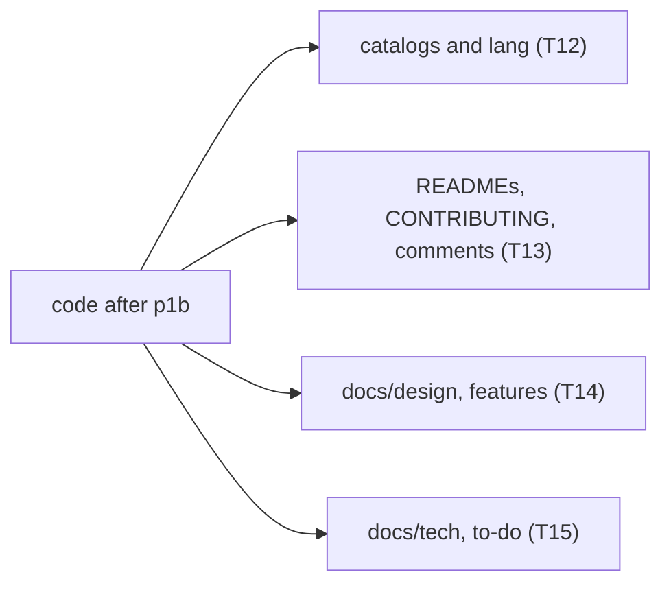
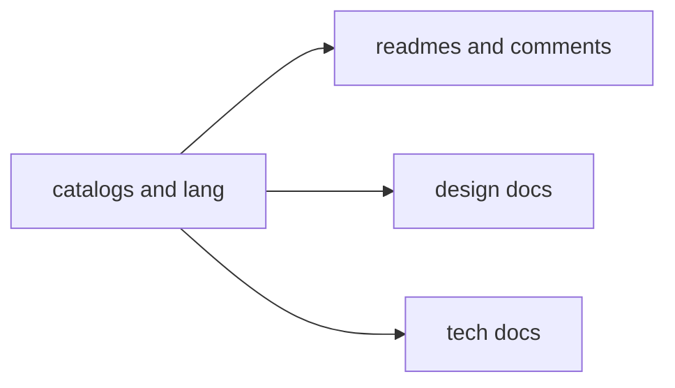

# Plan: cleanup phase 1c (catalogs, comments and documents)

**Review plan:** docs/plans/2026-11-10-cleanup-restructure.review.md
**Goal:** Review part 1-5: catalogs, READMEs, CONTRIBUTING, comments and `docs/` say what the code does after p1a and p1b.
**Architecture:** Text only, plus `gofmt` on three files. Runs last: p1a and p1b changed what the documents must say.
**Tech stack:** Go 1.26 (catalog and pack tests with `go test`), Markdown, JSON catalogs, Bedrock `.lang` files.
**Spec:** none (the review plan binds)
**Detail:** contracts
**Target-min:** 25
**Ignore:** .superlite/

## Global constraints

- Language Go. Checkout `/home/user/SkyGear`, branch `superlite/sessions/cleanup-restructure`. One commit per task with the subject given, English, no attribution lines; never push.
- Green at every commit: `go build ./... && go vet ./... && go test ./...` (minutes) and `gofmt -l` clean. Never skip, disable or weaken a test.
- No behaviour change. `docs/` and the Korean catalogs are Korean (load the repo skill `korean-humanizer` for new sentences); a document states the current design and future direction only: no history, no "not implemented" (CONTRIBUTING.md). `docs/plans/` is left alone.
- Line numbers are from commit 0e50466 (p1a and p1b moved some): grep again. If a stated fact no longer holds, report BLOCKED.
- Removed by p1a and p1b, so no text may present them as existing: the state probe and `/sgdebug fill`, `spike/`, `nsmigrate` (now `migrate/namespace.go`), the sell box, wallet and cheques, machine owners, the dimension gate, tinker sword, research note, essence blooms.
- Ruling: no Wave 0 - an existing tree needs no skeleton or stubs - an unused brief. Ruling: single checkout, no worktree - the owner works on this branch - none.
- Docs sweep (T14, T15): (1) list every backticked path and Go identifier in the owned documents; a path must exist, an identifier must be found by `grep -rnw` in the code, else write the current name (packages were split: `machineKinds` is `machine.Kinds`, `tierSpecs` is `machine.TierSpecs`, `tickMonitor` is `machine.TickMonitor`, `instance.FastTicker` is `instance.Session.Fast`); vanilla, mod and Dragonfly names are fine. The auditor's 270 references are in `AUD/doc_refs.txt`. (2) Rewrite history and "not yet" sentences as the current state. (3) Add the network conduit.
- `TD` is the to-do document `docs/{TOD}O.md`. `AUD` is `/tmp/claude-0/-home-user-SkyGear/a71fa8d5-6f20-5c3f-ba20-eeb27e13ad8a/scratchpad/audit` (may be gone).

## Main diagram

## File structure

No new file. The Owns lines name what each task edits.

## Task graph

T13, T14 and T15 own disjoint files and run in parallel; they quote the help text T12 settles.

## Predicted schedule

From `plan_tools schedule`: critical path T12 -> T13, 4.5 min; peak width 3; predicted total about 18 min.

## catalogs

**Probe entry:** run=go test ./common/i18n/... ./content/skygear/

### T12 remove unused text and fix the conduit help · Complexity 2 · Est. context 27k
**Owns:** content/skygear/locales/{en.json,ko.json}, platform/locales/{en.json,ko.json}, assets/resourcepack/skygear/texts/{en_US,ko_KR}.lang
**Components:** 1
**LOC owned:** 50
**Tests:** slow
**Kind:** design
**Model:** sonnet
**Est. time:** 2.0 min
**Consumes:** none
**Produces:** none
**Steps:**
- Seven keys no code reads (verified by grep of the literal; check that none is built from a prefix): game `storage.depositAll`, `wand.current`, `storage.order.countDesc`, `.countAsc`, `.nameAsc`, `.nameDesc` (their only user was `orderKeys`, removed in T5); platform `platform.invite.code.checking`. Remove from both languages.
- Thirteen lang lines per file name ids nothing registers (around lines 174-188): `item.` and `tile.` of `skygear:energy_conduit_1..3` and `skygear:item_conduit_1..3`, and `tile.skygear:conduit_bundle`. The registered ids are `skygear:conduit_energy_N`, `skygear:conduit_item_N` and block `skygear:conduit_node`: confirm with `world.ItemByName` in a throwaway test before deleting.
- `help.conduit.text` (`en.json:895`, `ko.json:3533`) lists energy, item and fluid and says one block holds "all three kinds". There are four: the network conduit (`conduit/bundle.go:30`, `conduit/conduitvisual.go:29`, one tier). Name it and say four; read `conduit/` and `netstore/` for how it is made and what it joins.
- Accept: both languages keep equal key sets (the catalog tests check it); the pack tests pass.
- Commit `chore(locales): remove unused text and name the network conduit in the help`.

## readmes and comments

**Probe entry:** run=gofmt -l common content platform cmd assets tools

### T13 READMEs, CONTRIBUTING and stale comments · Complexity 3 · Est. context 29k
**Owns:** README.md, CONTRIBUTING.md, content/skygear/README.md, common/README.md, content/skygear/conduit/doc.go, content/skygear/itemlink.go, common/resourcepack/pack.go, content/skygear/storage/holder.go, content/skygear/dimension/{monster.go,collector.go}, common/ui/{ui.go,home.go}, content/skygear/machine/screen.go, tools/slotdecotex/main.go
**Components:** 2
**LOC owned:** 120
**Tests:** slow
**Kind:** design
**Model:** sonnet
**Est. time:** 2.5 min
**Consumes:** none
**Produces:** none
**Steps:**
- `content/skygear/README.md`: the table lacks `migrate`, `netshape`, `netstore` (4,196 lines, the second largest); place them in the layer order of `layers_test.go`. Every directory that is a package must have a row.
- `common/README.md`: the table lacks `invclick`, `nbtrewrite`, `netcompress`, `netgraph`, `storagenet`, `internal/slottext`; the `docs/tech/` list lacks storagenet, conduits, itemio.
- `README.md:38`: the `platform.toml` row lacks `[ChestUI]`, `[Experimental]` and `[Network] CompressionLevel` (`platform/config.go:65-76,139-157`); the `common/` summary (`:83-86`) lacks the storage network and the net graph.
- `CONTRIBUTING.md`: line 3 and line 99 stop mid-sentence (end the first; drop the second bullet, no document lists reference repositories); `:32-33` change logs are English from 26.11.7 on (`change_logs/26.11.7.md` and `26.11.8.md` are; older ones stay Korean); `:93` the product loads packs with `resourcepack.LoadFS`.
- Comments: `conduit/doc.go:1-3` (four kinds; the network conduit has one tier); `itemlink.go:15-16` (the code is in `hopper/hopper.go`); the marker `skygear patch` belongs to `third_party/dragonfly` only, reword it at `common/resourcepack/pack.go:83`, `storage/holder.go:163`, `dimension/monster.go:77,220,388`; `common/ui/ui.go:366` (the text comes from key `ui.confirm.cancel`); `tools/slotdecotex/main.go:3` (run from the repository root).
- `gofmt -w` on `common/ui/home.go`, `content/skygear/dimension/collector.go`, `content/skygear/machine/screen.go`: `gofmt -l` lists exactly these three today.
- Accept: `gofmt -l common content platform cmd assets tools` prints nothing; `for d in content/skygear/*/ common/*/; do grep -q "\`$(basename $d)\`" $(dirname $d)/README.md || echo $d; done` prints only non-packages.
- Commit `docs: bring READMEs, CONTRIBUTING and comments in line with the code`.

## docs

**Probe entry:** run=grep -rn

### T14 design documents and the feature list · Complexity 5 · Est. context 32k
**Owns:** docs/features.md, docs/design/
**Components:** 2
**LOC owned:** 260
**Tests:** fast
**Kind:** design
**Model:** sonnet
**Est. time:** 2.2 min
**Consumes:** none
**Produces:** none
**Steps:**
- Do the docs sweep of the Global constraints, then these known items.
- `features.md`: `:38` conduits are four kinds; `:47` the kit is 4 armour and 4 relic slots (`dimension/kit.go:29-37`); `:30` settings also has autofill and four advancement notices (`content/skygear/settings.go:11-15`, `progress/doc.go:33-37`); the command table (`:62-67`) lacks `/uidebug` (`platform/platform.go:324`).
- `design/06-power-and-conduits.md` (`:39,86,91,140`) knows three kinds: add a section for the network conduit (what it joins, one tier, shares the bundle block; `conduitvisual.go:29`: `MarkVariant` is the fluid code plus 193 times the network code).
- `design/03-architecture.md`: the table of section 2 lists a stored invite code (none is stored, `platform/db/db.go:184-190`) and lacks `counters`, `account_settings`, `data_versions`, `save_invites`; section 3 `Session` lacks `OpenScreen` and `Relocator` (`platform/instance/game.go:23-64`).
- Missing files: `01-platform.md:111` `achievements.go`; `02-skygear.md:154` and `open-questions.md:34` `researchreward.go` (now `progress/rewards.go`; the reward is a controller and two drawer trims, `rewards.go:51`); `08-storage-gear-magic.md:21` `tinkerform.go` (now `tinker/table.go`); `14-config-copier.md:50` `storeConduitSide`.
- History to rewrite: `02-skygear.md:35,43`; `17-dimension.md` sections 10 (`:163-182`) and 12 (`:196-202`), section 11's "지금의 `wave.Monster`", the names `GateTier` and `wave_level_N` (`:168,181`); `19-construction-wand.md:13,81`.
- Accept: no backticked path in the owned files is missing; `grep -rn '네트워크 도관' docs/design docs/features.md` finds the new text.
- Commit `docs(design): bring the design documents in line with the code`.

### T15 technical documents and the to-do list · Complexity 5 · Est. context 32k
**Owns:** docs/tech/, docs/{TOD}O.md
**Components:** 2
**LOC owned:** 260
**Tests:** fast
**Kind:** design
**Model:** sonnet
**Est. time:** 2.2 min
**Consumes:** none
**Produces:** none
**Steps:**
- Do the docs sweep of the Global constraints, then these known items.
- `conduits.md:3,7,8,15,17-19`: four kinds; `BundleSelection`, block `Bundle`, `Faces`; `MarkVariant` is the fluid code plus 193 times the network code (`conduit/conduitvisual.go:29`); drop "다음 종류가 생기면".
- `resourcepack.md:7,22`: `Encrypt` is off by default (`platform/config.go:68-71,139-157`).
- `achievements.md:3,22,27,37,39,55,56`: `collect.go`, `counterhooks.go`, `achievements.go`, `tinkerform.go` are gone (`achievement/counter.go` `GrantCollection`, `CountBreak`, `CountWalk`; `platform/accounts_ach.go`; `tinker/table.go`).
- `admin.md:20-47`: the `/sgdebug` table lacks `net` (`debug.go`); the code list names files that exist; `sidebar.go` is `content/skygear/screens/sidebar.go`.
- Names: `recipes.md:12`; `block-animation.md:41,46` (`machine/animate.go` `AnimatedKinds`); `monitor.md:10,15`; `codex-jei.md:52,53`; `oreui.md:25`; `waila.md:34` and `performance.md:16` (`instance.Session.Fast`, `Second`); `machines.md:24,63,88`; `ui-style.md:23` (`ui.ItemGridSections` has no product caller); `asset-credits.md:12` (`third_party/licenses/`).
- `json-ui.md:12`: the tools run from the repository root; `:44-46` is a history section: remove. `performance.md` history sentence if p1a left one. `storagenet.md:73` says "아직 없다": state the design.
- TD: `:28` names `common/ui/theme.go` (colours live in `web/oreui/src/text/Rich.tsx` and `oui-mc.css`); add under the real-client checks: a 26.11.8 sell box opens as a chest with its items; an old gate chunk loads as obsidian.
- Accept: no backticked path in the owned files is missing.
- Commit `docs(tech): bring the technical documents in line with the code`.

## Review Focus

- locales: encoding. Both languages keep the same keys; colour codes and `%` verbs survive the edit.
- docs: file. Every backticked path resolves; no sentence describes a removed feature.

## Self-review

Coverage: 1-5 T12-T15. Not here: `docs/plans/` (the review plan removes these documents before the merge), renaming `farm/infest.go`, `formicon`, `boards2.tsx` (phase 3).
