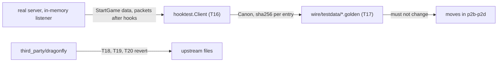
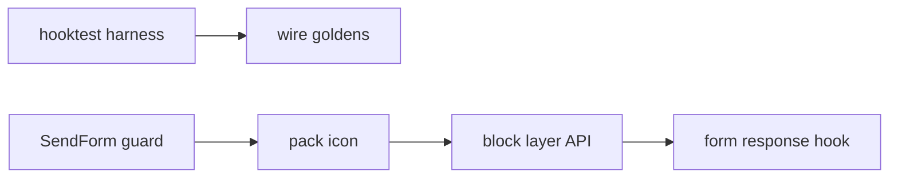

# Plan: patch reduction phase 2a (equivalence harness, unused patches)

**Review plan:** docs/plans/2026-11-10-cleanup-restructure.review.md
**Goal:** Review parts 2-1 and 2-2: a harness that records what a joining client is sent, golden files of it from the patched tree, and the three patch items nothing uses reverted.
**Architecture:** Phase 2 is four plans run in order: p2a (this), p2b (shutdown kick, command panic, floating text), p2c (item data), p2d (block data, documents). An item moves only behind a test that passes before and after.
**Tech stack:** Go 1.26, patched Dragonfly in `third_party/dragonfly` (own go.mod), tests with `go test`.
**Spec:** none (the review plan binds)
**Detail:** contracts
**Target-min:** 25
**Ignore:** .superlite/

## Phase 2 scope (40 audited items, checked at 783c21e)

| Verdict | Items | Why |
|---|---|---|
| Remove, 3 | P20 `SendForm` guard, P14 pack icon, P40 block layer API | no user in code, tests, tools or docs (P40's went with `/sgdebug fill`) |
| Move, 6 | P09 shutdown kick, P08 command panic (behaviour pin) · P24 floating text, P13 `Texture()`, P12 item components, P11 block components (wire golden) | public API or `common/sghook`, proven by test |
| Keep, real client needed, 5 | P23 fake chunks, P26 and P27 `Activate`, P28 custom block breaking, P07 grass | P07: no event in `Grass.RandomTick`; a revert changes grass under glass. P26 covers vanilla blocks too. P27: one missed `SetHeldItems` duplicates items |
| Keep, no provable patch-free form, 7 | P04, P06, P10, P16, P17, P22, P32 | P04: a cancelled click also stops placing a block against the composter (today `Activate` returns false and the click goes on). P06: decay rebuilt outside Dragonfly, testable only statistically. P10: a 120-line listener copy, untestable without NetherNet. P16, P17: inside the P18 cache (C), whose slices sessions share; no file returns. P22: timing only. P32: a per-connection filter cannot rebuild the rain and thunder pair or the send on world entry |
| Keep, class C, 19 | P01-P03, P05, P15, P18, P19, P21, P25, P29-P31, P33-P39 | inside Dragonfly |

Result: 14 text files and the icon return to upstream (68 diffs to 54; non-test 51 to 41), `dragonfly.patch` 4,961 lines to about 4,170, non-test added lines 1,693 to about 1,400.

## Global constraints

- Language Go. Checkout `/home/user/SkyGear`, branch `superlite/sessions/cleanup-restructure`. Implementers do not commit or push; the coordinator commits each task with its subject (English, no attribution lines).
- Green at every commit: `go build ./... && go vet ./... && go test ./...` and `gofmt -l` clean. Never skip, disable or weaken a test; only the tests a task names are deleted. No player-visible change.
- Facts are from 783c21e: grep again. If one no longer holds, report BLOCKED; the item then stays patched.
- `BASE` is pristine upstream `d86aefd9ff9b6a357d6dfadab2093af811545256` without `.github`: `AUD/upstream/base` (verified: the patch applied to it equals the tree). If gone, fetch it by hash with the command in `third_party/README.md` upgrade step 1. `AUD` is `/tmp/claude-0/-home-user-SkyGear/a71fa8d5-6f20-5c3f-ba20-eeb27e13ad8a/scratchpad/audit`.
- PATCHSYNC, by every task that edits `third_party/dragonfly`, in its own commit: (1) revert only the named hunks, so `diff BASE/<f> third_party/dragonfly/<f>` shows nothing or only the hunks named as staying; (2) regenerate `third_party/dragonfly.patch` outside the repo with the `diff -ruN` command of `third_party/README.md` upgrade step 5, `BASE` as `base`; (3) the round trip of that step prints nothing and `grep -c '^diff ' dragonfly.patch` is the count the task gives; (4) rewrite or delete the item's row in `third_party/README.md`; (5) `cd third_party/dragonfly && go build ./... && go test` on the changed packages.
- Patch lock: tasks that edit `third_party/dragonfly`, its patch file or its README form one chain: one checkout, the module compiles into every package, and the patch file is a function of the whole tree. Other tasks run beside it.
- Only `common/sghook` reaches Dragonfly internals. Leave `.gitignore` alone.
- Ruling: no Wave 0 - an existing tree needs no stubs - an unused brief. Ruling: single checkout, no worktree - the owner's branch - none.
- Ruling: [scope] of review rows 2-3 and 2-4 the composter, leaves, weather, recipe filter and creative fit stay patched - see the table - about 170 added lines stay.

## Main diagram

## File structure

New: `common/sghook/hooktest/`, `content/skygear/wire/`. Deleted: `skygear_layers.go` and its test, `common/sghook/form.go`.

## Task graph

T16 -> T17 runs beside the patch lock chain (T21 edits the README). Ids continue after phase 1's T1-T15.

## Predicted schedule

From `plan_tools schedule`: critical path T18 -> T21, 7.6 min; peak width 2.

## sghook

**Probe entry:** call=hooktest.Join

### T16 packet capture harness · Complexity 6 · Est. context 34k
**Owns:** common/sghook/hooktest/{doc.go,hooktest.go,canon.go,golden.go,hooktest_test.go}
**Components:** 3
**LOC owned:** 380
**Tests:** slow
**Kind:** design
**Model:** sonnet
**Est. time:** 3.4 min
**Consumes:** none
**Produces:** hooktest.Join(t testing.TB, conf server.Config, setup func(*server.Server)) -> *Client · Client.Server() -> *server.Server · Client.Handle() -> *world.EntityHandle · Client.GameData() -> minecraft.GameData · Client.Packets() -> []packet.Packet · Client.Wait(match func(packet.Packet) bool) -> packet.Packet · hooktest.Canon(v any) -> string · hooktest.Golden(t testing.TB, path string, entries map[string]string)
- e.g. Join(t, server.Config{}, nil).GameData().WorldName -> "Dragonfly Server"
- e.g. Canon(map[string]any{"b": int32(1), "a": []any{uint8(2), "x"}}) -> "{\n  a: [\n    uint8(2)\n    \"x\"\n  ]\n  b: int32(1)\n}"
- e.g. Golden(t, "testdata/x.golden", map[string]string{"a": "text"}) -> passes when the file is the line "a", a tab, sha256("text") in hex
**Steps:**
- Prototyped at 783c21e (0.5 s): a fake `server.Listener` in `conf.Listeners`, `sghook.Wrap(&conf)`, `conf.New()`, `srv.Listen()`, one fake `session.Conn`; `srv.Accept()` yields the player. This is the product path (`makeBlockEntries`, `makeItemComponents`, `StartGameContext`, `ItemRegistry`, `CreativeContent`, `CraftingData`), through sghook's server hooks.
- `Join`: a discard `Log` if nil, `DisableResourceBuilding` true, a `NopGenerator` if `Generator` is nil, `Listeners` replaced; runs `setup(srv)` between `New` and `Listen`; calls `sghook.Attach`; returns once the player spawned; `t.Cleanup` closes the server. The fake conn: a new UUID, name `tap`, language `ko_KR`, chunk radius 4, no client cache; `ReadPacket` blocks until `Close`; `WritePacket` appends under a mutex; `StartGameContext` keeps the data.
- `Packets` copies in write order. `Wait` returns the first matching packet not yet returned; it fails the test after 5 s.
- `Canon`: maps by sorted key, slices in order, struct fields by name (unexported ones through `fmt`), pointers and interfaces followed, strings quoted, byte slices hex, other scalars as `type(value)`: equal content gives equal text whatever the map order.
- `Golden`: `name<TAB>sha256(text)` lines sorted by name. A mismatch fails, naming up to 20 added, removed and changed entries. `SKYGEAR_GOLDEN=update` rewrites the file. `SKYGEAR_GOLDEN_DUMP=<dir>` also writes each entry's text to `<dir>/<file base>/<name>.txt` (name path-escaped) so two trees can be compared with `diff -r`.
- Tests: `TestJoinCapturesStartData` (`GameData().Items` not empty; `Packets()` holds one each of `*packet.ItemRegistry`, `*packet.CraftingData`, `*packet.CreativeContent`); `TestJoinPacketsPassHooks` (a hook drops `*packet.SetTime`: none captured); `TestCanonMapOrder` (the example, 50 runs, one text); `TestCanonTypes` (`int32(1)` and `uint8(1)` differ); `TestGoldenUpdateAndMismatch` (update writes; another text fails a fake `testing.TB`); `TestShutdownDisconnects` (`Server().Close()` gives one `*packet.Disconnect`).
- Commit `test(sghook): add a harness that captures what a joining client is sent`.

## game data

**Probe entry:** run=go test ./content/skygear/wire/

### T17 golden files of the client data · Complexity 5 · Est. context 32k
**Owns:** content/skygear/wire/{doc.go,wire_test.go}, content/skygear/wire/testdata/{blocks,items,recipes,creative}.golden, content/skygear/README.md, CONTRIBUTING.md
**Components:** 2
**LOC owned:** 230
**Tests:** slow
**Kind:** design
**Model:** sonnet
**Est. time:** 2.7 min
**Consumes:** none
**Produces:** none
**Steps:**
- Uses T16's harness, in its own package so no other test changes the registries (recipes and creative items register at init, in `conf.New()` and in `skygear.New`).
- One shared join in `main.go` order: `conf.Entities` from `skygear.EntityTypes()`; setup calls `skygear.EditItemEntries(srv)` then `skygear.New(log, db, nil, "test")` with a database in a temp folder.
- `TestWireBlocks`: `GameData().CustomBlocks`, one entry per name. Before `Canon`: sort `permutations` by `condition`; check that the `vanilla_block_data.block_id` values of the custom blocks are exactly 10000 to 10000+n-1, then set each to 0 (both follow map order per process: measured). 205 entries, 4.3 MB of text, hence digests.
- `TestWireItems`: the `ItemRegistry` packet as `registry/<name>` (349 entries) and `GameData().Items` as `start/<name>`.
- `TestWireRecipes`: `CraftingData`, each recipe as `<kind>/<RecipeNetworkID>`, potion entries as `<kind>/<index>`. `TestWireCreative`: `CreativeContent`, `group/<index>` and `item/<CreativeItemNetworkID>`.
- Record with `SKYGEAR_GOLDEN=update go test ./content/skygear/wire/`, then run `go test -count=1 ./content/skygear/wire/` three times: all pass.
- Sensitivity, not committed: without the `minecraft:fuel` lines of Dragonfly's `iteminternal/components.go`, `TestWireItems` fails naming the bark fiber's `registry/` entry; restore the file.
- `doc.go` and a paragraph under "Patched Dragonfly" in `CONTRIBUTING.md`: what the files pin, the two environment variables, and that a golden changes only in a commit meant to change what clients get. A `content/skygear/README.md` row.
- Later tasks never re-record: a mismatch means a move is not equivalent (fix or report BLOCKED).
- Commit `test(skygear): pin the client data a joining player is sent`.

## third_party

**Probe entry:** run=diff -r

### T18 drop the SendForm guard · Complexity 2 · Est. context 27k
**Owns:** third_party/dragonfly/server/session/player.go, third_party/dragonfly.patch, third_party/README.md
**Components:** 1
**LOC owned:** 10
**Tests:** slow
**Kind:** design
**Model:** sonnet
**Est. time:** 1.9 min
**Consumes:** none
**Produces:** none
**Steps:**
- Evidence (verified): `grep -rnE 'SendForm|form\.New' --include=*.go . | grep -v third_party/` finds nothing; in Dragonfly only `Player.SendForm` calls it.
- Revert the three guard lines (`if s == Nop {` in `SendForm`, about line 543). The file's other hunks stay (P15, P18, P19).
- PATCHSYNC; the count stays 68. Delete the README row "Nop 세션의 `SendForm` 무시".
- Commit `refactor(third_party): drop the unused SendForm guard`.

### T19 restore the upstream pack icon · Complexity 1 · Est. context 26k
**Owns:** third_party/dragonfly/server/internal/packbuilder/pack_icon.png, third_party/dragonfly.patch, third_party/README.md
**Components:** 1
**LOC owned:** 6
**Tests:** slow
**Kind:** design
**Model:** sonnet
**Est. time:** 1.9 min
**Consumes:** none
**Produces:** none
**Steps:**
- Evidence (verified): `cmd/skygear/main.go:154` sets `DisableResourceBuilding`; only `packbuilder.BuildResourcePack` reads the icon.
- Copy `BASE/server/internal/packbuilder/pack_icon.png` over the file; `diff -rq BASE third_party/dragonfly` then lists only text files.
- README: delete the icon sentence under the table and `-x pack_icon.png` in both commands of upgrade step 5, so PATCHSYNC runs without it from here on. The patch file does not change (count 68).
- Commit `chore(third_party): restore the upstream pack icon`.

### T20 remove the unused block layer API · Complexity 2 · Est. context 27k
**Owns:** third_party/dragonfly/server/world/{skygear_layers.go,skygear_layers_test.go}, third_party/dragonfly.patch, third_party/README.md
**Components:** 1
**LOC owned:** 8
**Tests:** slow
**Kind:** design
**Model:** sonnet
**Est. time:** 1.9 min
**Consumes:** none
**Produces:** none
**Steps:**
- Evidence (verified): `grep -rnE 'SetBlockLayer|\.BlockLayer\(|SubChunkLayers' --include=*.go . | grep -v skygear_layers` finds nothing (`sghook.ViewFakeBlockLayer` sends its own packet). The README row says so too.
- Delete both files; the test covers only removed code. PATCHSYNC with `go test ./server/world/`; the count becomes 66. Delete the README row.
- Commit `refactor(third_party): remove the unused block layer API`.

### T21 remove the form response hook · Complexity 3 · Est. context 28k
**Owns:** common/sghook/{form.go,sghook.go,sghook_test.go}, third_party/README.md, common/README.md
**Components:** 1
**LOC owned:** 30
**Tests:** slow
**Kind:** design
**Model:** sonnet
**Est. time:** 2.0 min
**Consumes:** none
**Produces:** none
**Steps:**
- Evidence (verified): the hook serves Dragonfly forms and no code sends one (T18's grep); `ModalForm` is only in `form.go` and `sghook_test.go`.
- Delete `form.go` (53 lines), `TestFormResponse`, and in `TestInternals` the `handlers` check and the two `ModalFormResponseHandler` fields with the imports left unused. `Attach`'s comment no longer names forms. `third_party/README.md` loses "폼 응답 정리(...)"; so does the `sghook` row of `common/README.md` if it names forms.
- Ruling: a client that sends a form response with no form open was ignored and is now handled by Dragonfly, which ends its session - a vanilla client never does this - a modified client is disconnected.
- Commit `refactor(sghook): remove the form response hook no form uses`.

## Review Focus

- sghook (library): state, encoding. `Canon` ignores map order and tells NBT types apart; `Join` leaves no goroutine.
- wire (data pipeline): encoding, state. Goldens are equal across processes; a changed component fails with its entry's name.
- third_party (file): the patch applies to `BASE` and gives the tree.

## Self-review

Coverage: 2-1 T16, T17; 2-2 T18-T20 and the sghook leftover T21. P07 and P04's hopper half stay: one changes behaviour, the other guards it while `block.HopperTransfer` is unset.
