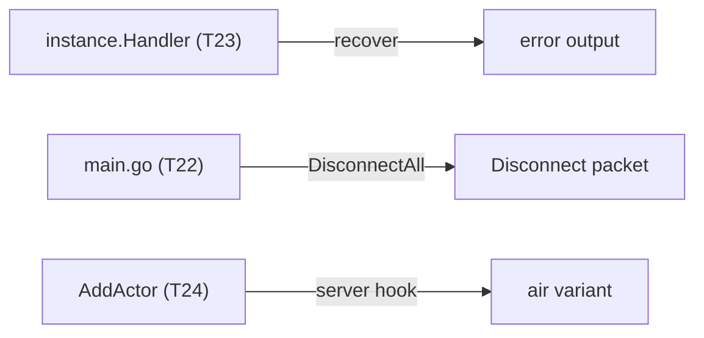
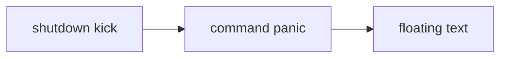

# Plan: patch reduction phase 2b (shutdown kick, command panic, floating text)

**Review plan:** docs/plans/2026-11-10-cleanup-restructure.review.md
**Goal:** Review part 2-3 and the first item of 2-4: three patch items leave Dragonfly, each behind a test that passes before and after its move.
**Architecture:** Runs after p2a (harness `common/sghook/hooktest`, goldens in `content/skygear/wire/testdata`; its scope table lists all 40 items). Server behaviour moves to public handlers, the floating text to a packet hook. p2c (item data) and p2d (block data, documents) follow.
**Tech stack:** Go 1.26, patched Dragonfly in `third_party/dragonfly` (own go.mod), tests with `go test`.
**Spec:** none (the review plan binds)
**Detail:** contracts
**Target-min:** 25
**Ignore:** .superlite/

## Global constraints

- Language Go. Checkout `/home/user/SkyGear`, branch `superlite/sessions/cleanup-restructure`. Implementers do not commit or push; the coordinator commits each task with its subject (English, no attribution lines).
- Green at every commit: `go build ./... && go vet ./... && go test ./...` and `gofmt -l` clean. Never skip, disable or weaken a test; only the tests a task names are deleted or moved. No player-visible change beyond the rulings below.
- Facts are from 783c21e plus p2a: grep again. If one no longer holds, or a pin or golden cannot be kept, report BLOCKED; the item then stays patched.
- `BASE` is pristine upstream `d86aefd9ff9b6a357d6dfadab2093af811545256` at `/tmp/claude-0/-home-user-SkyGear/a71fa8d5-6f20-5c3f-ba20-eeb27e13ad8a/scratchpad/audit/upstream/base`, else fetched by hash (`third_party/README.md` upgrade step 1). PATCHSYNC (p2a): each task, in its own commit, reverts only its hunks to `BASE`, regenerates `third_party/dragonfly.patch` and runs the round trip (README upgrade step 5), gets the `grep -c '^diff '` count given, fixes its README row, and runs `go build ./...` and the changed packages' tests inside `third_party/dragonfly`.
- Pin first: write the test, see it pass before the change (the patched behaviour), then move; the same assertions pass after. A task's golden is recorded before its move with `SKYGEAR_GOLDEN=update`, never after; `content/skygear/wire/testdata` is never re-recorded.
- Harness (p2a T16): `hooktest.Join(t, conf, setup) *Client` joins a fake client (`tap`, `ko_KR`) through the real server and sghook; `Client.Server()`, `Handle()` (the player's `*world.EntityHandle`), `GameData()`, `Packets()`, `Wait(match)`; `hooktest.Canon(v) string`; `hooktest.Golden(t, path, entries)`.
- Only `common/sghook` reaches Dragonfly internals, generically. Leave `.gitignore` alone.
- Ruling: no Wave 0 - an existing tree needs no stubs - an unused brief. Ruling: single checkout, no worktree - the owner's branch - none.

## Main diagram

## File structure

New: `platform/shutdown.go`, `common/sghook/entity.go`. Back to upstream: `server/server.go`, `server/cmd/command.go`.

## Task graph

One chain: every task edits `third_party/dragonfly` (patch lock, p2a).

## Predicted schedule

From `plan_tools schedule`: critical path T22 -> T23 -> T24, 6.9 min; peak width 1; predicted total about 20 min.

## platform

**Probe entry:** run=go test ./platform/...

### T22 move the shutdown kick text out of Dragonfly · Complexity 3 · Est. context 29k
**Owns:** platform/{shutdown.go,shutdown_test.go}, cmd/skygear/main.go, third_party/dragonfly/server/{server.go,conf.go}, third_party/dragonfly.patch, third_party/README.md
**Components:** 1
**LOC owned:** 70
**Tests:** slow
**Kind:** design
**Model:** sonnet
**Est. time:** 2.0 min
**Consumes:** none
**Produces:** platform.DisconnectAll(players iter.Seq[*player.Player], text func(*player.Player) string)
- e.g. DisconnectAll(srv.Players(nil), func(*player.Player) string { return "bye" }) -> each client gets one Disconnect{Message: "bye"}
**Steps:**
- Mechanism (verified): upstream `Server.close` loops `srv.Players(nil)` calling `p.Disconnect(msg)`. That call is guarded by `p.once` and runs in the player's transaction, where the session closes and the player leaves `srv.p`: the same loop just before `srv.Close()` sends the one packet and `close` finds nobody.
- Pin (before the change): `TestShutdownKick` in package `platform`: `hooktest.Join` with a `conf.ShutdownKick` returning "bye", then `Server().Close()`: `Packets()` holds exactly one `*packet.Disconnect`, `Message` "bye", `HideDisconnectionScreen` false.
- Move: `main.go:101` goes; the shutdown goroutine calls `platform.DisconnectAll(srv.Players(nil), ...)` with the same `i18n.T(i18n.Of(p), "platform.shutdown")` text right before `srv.Close()` (still after `m.CloseAll()`, `account.Flush()`, `close(stopBackup)`). The test drops `ShutdownKick` and calls `DisconnectAll` then `Close`: same assertions.
- Revert `server/server.go` whole and the `ShutdownKick` field of `server/conf.go` (the NetherNet `LocalIP`, `PublicIP` hunk stays). PATCHSYNC; count 65. Delete the README row `Config.ShutdownKick`.
- Commit `refactor(platform): kick players with the shutdown text before closing the server`.

### T23 recover command panics in the player handler · Complexity 5 · Est. context 31k
**Owns:** platform/instance/{handler.go,command_panic_test.go}, platform/instance/testdata/command_panic.golden, platform/command_panic_test.go, platform/locales/{en.json,ko.json}, third_party/dragonfly/server/cmd/command.go, third_party/dragonfly.patch, third_party/README.md
**Components:** 2
**LOC owned:** 110
**Tests:** slow
**Kind:** design
**Model:** sonnet
**Est. time:** 2.5 min
**Consumes:** none
**Produces:** none
**Steps:**
- Mechanism (verified): `Player.ExecuteCommand` (`player.go:345`) calls `Handler().HandleCommandExecution(ctx, command, args)` and, unless cancelled, `command.Execute(strings.Join(args[1:], " "), p, p.tx)`. `instance.Handler` (`handler.go:252`) wraps every player's handler, lobby and saves. Nothing else calls `Execute` but `platform/command_panic_test.go:24`.
- Pin (before the change): `TestCommandPanicRecovered` in package `instance`: a registered command `sgpanictest` whose `Run` panics; `hooktest.Join`; in the player's transaction set a `Handler` with inner `player.NopHandler{}` and call `p.ExecuteCommand("/sgpanictest")`. Assert: no panic escapes; `Wait` gives one `*packet.CommandOutput` whose `Canon` equals the golden (one message, `Success` false, `명령어를 처리하다 오류가 났습니다.`); the default `slog` handler saw one ERROR record `command panicked` with a `stack`.
- Move: after the inner handler, if not cancelled, `ctx.Cancel()` and run `command.Execute(strings.Join(args, " "), p, p.Tx())` under `recover`; on a panic `slog.Error("command panicked", "command", command.Name(), "panic", v, "stack", string(debug.Stack()))` and send a `cmd.Output` with one error, `i18n.T(i18n.Of(p), "platform.command.failed")`. The key is new in both catalogs: ko the sentence above, en `The command failed with an error.`
- Delete `platform/command_panic_test.go` (it pins `Execute` itself recovering; the new test replaces it). Revert `server/cmd/command.go` whole. PATCHSYNC with `go test ./server/cmd/`; count 64. Delete the README row.
- Ruling: [scope] on a command panic only: lines printed before it are not sent, the log names the command not its Go type, English clients read English - the handler cannot reach the output - a bug path; the server still survives it (P29).
- Commit `refactor(instance): recover command panics in the player handler`.

## sghook and dimension

**Probe entry:** run=go test ./common/sghook/ ./content/skygear/dimension/

### T24 give floating text its air variant in a packet hook · Complexity 4 · Est. context 30k
**Owns:** common/sghook/{entity.go,entity_test.go}, content/skygear/dimension/{marks.go,popup_wire_test.go}, content/skygear/dimension/testdata/popup.golden, third_party/dragonfly/server/session/world.go, third_party/dragonfly.patch, third_party/README.md
**Components:** 2
**LOC owned:** 110
**Tests:** slow
**Kind:** design
**Model:** sonnet
**Est. time:** 2.5 min
**Consumes:** none
**Produces:** none
**Steps:**
- Today (verified): `session/world.go` sets `EntityDataKeyVariant` to the air runtime ID for entity types with a `FloatingText()` method; the only one is `dimension.popupType` (`marks.go:115`), sent as `minecraft:falling_block`. Dragonfly always sets the variant for its own `TextType` and `FallingBlockType`.
- Pin (before the change): `TestPopupAddActor` in package `dimension`: `hooktest.Join` with `PopupType` in `conf.Entities`; in the player's transaction a `Run` shows a popup one block above the player (`(*Run).popup`, `marks.go:129`); `Wait` for the `*packet.AddActor` of type `minecraft:falling_block`; `hooktest.Golden` on `testdata/popup.golden` with the entry `addactor` = `Canon(pk)`; its variant is `int32` of the air runtime ID.
- Move: `entity.go` adds in `init` an `OnServerPacket` hook: an `*packet.AddActor` of type `minecraft:falling_block` whose `EntityMetadata` has no `EntityDataKeyVariant` gets `int32(br.BlockRuntimeID(block.Air{}))`, `br` being the session's (`field[world.BlockRegistry](s, "br")`, in `TestInternals`) or `world.DefaultBlockRegistry` without a session. The packet is built per session, so it is changed in place.
- `TestFallingBlockVariant` (sghook, fake conn): no variant -> the air ID; variant 7 stays 7; another entity type gets none.
- Delete `popupType.FloatingText` and its comment. Revert the five-line `FloatingText` hunk; the file's fake chunk hunks stay. PATCHSYNC with `go test ./server/session/`; count 64. Delete the README row `FloatingText()`.
- An upstream change shows as a failing golden or `TestInternals` (`br`).
- Commit `refactor(sghook): draw floating text entities with a packet hook`.

## Review Focus

- platform, instance (service): protocol, state. One Disconnect per client; a cancelled command is not run; other commands print as before.
- sghook (library): encoding. Only falling blocks without a variant change.
- third_party (file): the patch applies to `BASE` and gives the tree.

## Self-review

Coverage: 2-3 T22, T23; 2-4 T24. Not moved (reasons in p2a): composter, leaves, weather.
