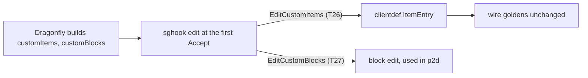
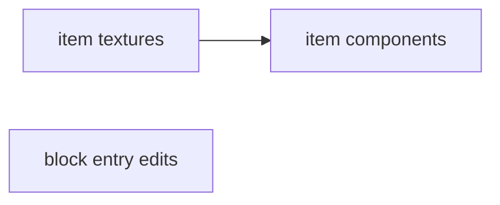

# Plan: patch reduction phase 2c (item data, block entry edits)

**Review plan:** docs/plans/2026-11-10-cleanup-restructure.review.md
**Goal:** Review part 2-4, item half: the custom item patches leave Dragonfly with the wire goldens unchanged, and `common/sghook` learns to edit custom block entries for p2d.
**Architecture:** Runs after p2b. Item components are added to the entries Dragonfly builds, through `sghook.EditCustomItems` and the new generic package `common/clientdef`. p2a holds the scope table of all 40 items; p2d (block data, documents) follows.
**Tech stack:** Go 1.26, patched Dragonfly in `third_party/dragonfly` (own go.mod), tests with `go test`.
**Spec:** none (the review plan binds)
**Detail:** contracts
**Target-min:** 25
**Ignore:** .superlite/

## Global constraints

- Language Go. Checkout `/home/user/SkyGear`, branch `superlite/sessions/cleanup-restructure`. Implementers do not commit or push; the coordinator commits each task with its subject (English, no attribution lines).
- Green at every commit: `go build ./... && go vet ./... && go test ./...` and `gofmt -l` clean. Never skip, disable or weaken a test; only the tests a task names are deleted or moved. No player-visible change.
- Facts are from 783c21e plus p2a and p2b: grep again. If one no longer holds, or a golden cannot be kept, report BLOCKED; the item then stays patched.
- `BASE` is pristine upstream `d86aefd9ff9b6a357d6dfadab2093af811545256` at `/tmp/claude-0/-home-user-SkyGear/a71fa8d5-6f20-5c3f-ba20-eeb27e13ad8a/scratchpad/audit/upstream/base`, else fetched by hash (`third_party/README.md` upgrade step 1). PATCHSYNC (p2a): each task that edits `third_party/dragonfly`, in its own commit, reverts only its hunks to `BASE`, regenerates `third_party/dragonfly.patch` and runs the round trip (README upgrade step 5), gets the `grep -c '^diff '` count given, fixes its README rows, and runs `go build ./...` and the changed packages' tests inside `third_party/dragonfly`.
- Patch lock (p2a): tasks that edit `third_party/dragonfly`, its patch file or its README are chained; T27 edits none of them and runs beside the chain.
- Proof of a move: `go test ./content/skygear/wire/` passes with `testdata/*.golden` untouched (recorded from the patched tree in p2a; `TestWireItems` compares the `ItemRegistry` packet and the StartGame item list entry by entry, `TestWireBlocks` the block entries). Never set `SKYGEAR_GOLDEN=update` here. `SKYGEAR_GOLDEN_DUMP=<dir>` writes the full text of each entry, to compare two trees with `diff -r`.
- Only `common/sghook` reaches Dragonfly internals, generically; `common/clientdef` uses public registries only and knows no SkyGear feature. Leave `.gitignore` alone.
- Ruling: no Wave 0 - an existing tree needs no stubs - an unused brief. Ruling: single checkout, no worktree - the owner's branch - none.

## Main diagram

## File structure

New: `texture.go` in eleven packages, `content/skygear/wire/textured_test.go`, `common/clientdef/{doc.go,items.go,items_test.go}`. Back to upstream: `server/world/item.go`, `server/internal/packbuilder/items.go`, `server/internal/iteminternal/components.go`; deleted: `server/item/digger.go`, `iteminternal/fuel_test.go`.

## Task graph

T27 has no edge: it owns `common/sghook/{sghook.go,sghook_test.go}` only.

## Predicted schedule

From `plan_tools schedule`: critical path T25 -> T26, 5.1 min; peak width 2; predicted total about 19 min.

## items

**Probe entry:** run=go test ./content/skygear/wire/ ./common/clientdef/

### T25 give custom items the upstream Texture method · Complexity 4 · Est. context 31k
**Owns:** content/skygear/{conduit,elevator,fairy,farm,hopper,machine,netstore,progress,sgitem,storage,tinker}/texture.go, content/skygear/wire/textured_test.go, third_party/dragonfly/server/world/item.go, third_party/dragonfly/server/internal/packbuilder/items.go, third_party/dragonfly.patch, third_party/README.md
**Components:** 2
**LOC owned:** 130
**Tests:** slow
**Kind:** design
**Model:** sonnet
**Est. time:** 2.6 min
**Consumes:** none
**Produces:** none
**Steps:**
- Today (verified): the patch drops `Texture() image.Image` from `world.CustomItem`. Upstream requires it; a type without it is silently no custom item: missing from `world.CustomItems()` and the client's registry, unseen by `naming/itemname.go:18,38`. 60 `Category() category.Category` methods in eleven packages (35 files) mark the types, blocks with an item form included.
- Add first: one `texture.go` per package with `func (T) Texture() image.Image { return nil }` for each such type (receiver as its `Category`), under one comment: the pictures come from the resource pack; Dragonfly calls the method only when it builds its own pack, which is off (`main.go:154`, `hooktest.Join`).
- Guard `TestCustomItemsTextured` (package `wire`): every value of `world.Items()` with `Name() string` and `Category() category.Category` is a `world.CustomItem` (true before the revert too).
- Revert `world/item.go` and `packbuilder/items.go` whole. Proof: the four wire goldens pass unchanged (a type without the method loses its `registry/` and `item/` entries and its block's `menu_category`).
- PATCHSYNC with `go test ./server/world/ ./server/internal/...`; count 62. Delete the README row `world.CustomItemTextured`.
- Commit `refactor(skygear): implement the upstream Texture method on custom items`.

### T26 send item components from clientdef · Complexity 6 · Est. context 33k
**Owns:** common/clientdef/{doc.go,items.go,items_test.go}, common/README.md, content/skygear/names.go, content/skygear/sgitem/{hammer.go,crook.go}, content/skygear/tinker/tinker.go, third_party/dragonfly/server/internal/iteminternal/{components.go,fuel_test.go}, third_party/dragonfly/server/item/digger.go, third_party/dragonfly.patch, third_party/README.md
**Components:** 2
**LOC owned:** 190
**Tests:** slow
**Kind:** design
**Model:** sonnet
**Est. time:** 2.8 min
**Consumes:** none
**Produces:** clientdef.ItemEntry(e protocol.ItemEntry) -> protocol.ItemEntry
- e.g. ItemEntry(entry of sgitem.BarkFiber) -> Data["components"]["minecraft:fuel"] = {"duration": float32(FuelInfo().Duration.Seconds())}
- e.g. ItemEntry(entry of a vanilla item) -> the entry unchanged
**Steps:**
- Mechanism (verified): `sghook.EditCustomItems` rewrites `server.customItems` before the first client reads it; `names.go:21` already chains `localItemName` and `sgitem.ClipWoodenBucket`. Components are under `Data["components"]`.
- `clientdef` (generic, no SkyGear knowledge): `Digger{DestroySpeeds() map[string]int}`, `TagDigger{DestroySpeedsByTag() []TagSpeed}`, `TagSpeed{Tags string; Speed int}` replace `item.Digger`, `item.TagDigger`, `item.TagSpeed`. `ItemEntry` finds the item of `e.Name` among `world.CustomItems()` (by `EncodeItem` name) and adds, on cloned maps, what the three patch hunks add, value for value: `minecraft:use_modifiers` (`use_duration` float32 0.05, `movement_modifier` float32 1) for an `item.Usable` that is no `item.Consumable`; `minecraft:digger` (`use_efficiency` true; `destroy_speeds`: `Digger` blocks by sorted name, then `TagDigger` entries in order, speeds int32); `minecraft:fuel` (`duration` float32 seconds) for an `item.Fuel` with `Duration > 0`. A needed `components` map that is missing panics with the item name.
- `EditItemEntries` applies `clientdef.ItemEntry` first, then the two existing edits. `hammer.go`, `crook.go`, `tinker.go` name the `clientdef` types and no longer say "Dragonfly patch".
- Tests: `TestFuelComponent` moves from `iteminternal/fuel_test.go` (same assertion on an entry); `TestDiggerComponent` (names sorted, tags after, int32 speeds); `TestUseModifiers` (usable yes, consumable no).
- Revert `iteminternal/components.go` whole; delete `item/digger.go` and `fuel_test.go`. Proof: `TestWireItems` passes unchanged.
- PATCHSYNC with `go test ./server/internal/... ./server/item/`; count 59. Delete the three README rows (`minecraft:digger`, `minecraft:use_modifiers`, `minecraft:fuel`). A `clientdef` row in `common/README.md`.
- Commit `refactor(clientdef): send custom item components without a Dragonfly patch`.

## sghook

**Probe entry:** call=sghook.EditCustomBlocks

### T27 edit custom block entries in sghook · Complexity 4 · Est. context 29k
**Owns:** common/sghook/{sghook.go,sghook_test.go}
**Components:** 1
**LOC owned:** 70
**Tests:** fast
**Kind:** design
**Model:** sonnet
**Est. time:** 1.8 min
**Consumes:** none
**Produces:** sghook.EditCustomBlocks(srv *server.Server, edit func(protocol.BlockEntry) protocol.BlockEntry)
- e.g. EditCustomBlocks(srv, func(e protocol.BlockEntry) protocol.BlockEntry { e.Name += "!"; return e }) -> after the first accepted connection an entry "a" is "a!", edited once
- e.g. EditCustomBlocks(nil, nil) -> no edit is made (as `EditCustomItems(nil, nil)` in tests)
**Steps:**
- Target (verified): `server.Server` field `customBlocks []protocol.BlockEntry` (`third_party/dragonfly/server/server.go:50`), built by `makeBlockEntries` in `startListening` beside `customItems` and read for every join by `defaultGameData` (`CustomBlocks: srv.customBlocks`). It is the same moment and reach as `EditCustomItems` (`sghook.go:229`): `field[[]protocol.BlockEntry](srv, "customBlocks")`, edited at the first `listener.Accept`.
- Mirror `EditCustomItems`: one stored edit per server, made once. `applyItemEdits` becomes `applyEntryEdits` and makes both edits; the doc comment says the entries go out in StartGame, which passes no packet hook.
- `TestInternals` gains `field[[]protocol.BlockEntry](&server.Server{}, "customBlocks")`: a renamed or retyped field fails this test after an upgrade. `TestEditCustomBlocks` mirrors `TestEditCustomItems` (`sghook_test.go:165`): not edited before a connection, `a!` after two `applyEntryEdits` calls, one edit call.
- Entries built at another time or in another shape show in `TestWireBlocks` once p2d uses the edit.
- Commit `feat(sghook): edit the custom block entries a server sends`.

## Review Focus

- clientdef (data pipeline): encoding, numeric. NBT types (float32, int32) and list order are the patch's; maps are cloned, not shared with Dragonfly's.
- sghook (library): state. The edit is made once, before the first client reads the entries.
- third_party (file): the patch applies to `BASE` and gives the tree.

## Self-review

Coverage: 2-4 item half T25, T26; the block edit API T27. Recipe filter and creative fit stay patched (p2a).
