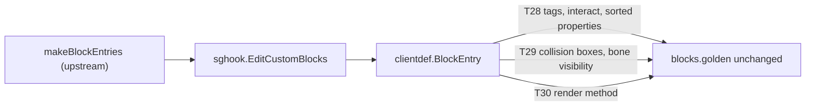
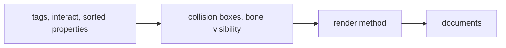

# Plan: patch reduction phase 2d (block data, documents)

**Review plan:** docs/plans/2026-11-10-cleanup-restructure.review.md
**Goal:** Review part 2-4, block half: the six custom block additions leave Dragonfly with `TestWireBlocks` unchanged, and the documents name what stays patched and what needs a real client.
**Architecture:** Runs after p2c (`sghook.EditCustomBlocks`, `common/clientdef`). The additions are made on the entries Dragonfly builds, in three steps that each revert their own hunks. p2a holds the scope table of all 40 items.
**Tech stack:** Go 1.26, patched Dragonfly in `third_party/dragonfly` (own go.mod), tests with `go test`.
**Spec:** none (the review plan binds)
**Detail:** contracts
**Target-min:** 30
**Ignore:** .superlite/

## Global constraints

- Language Go. Checkout `/home/user/SkyGear`, branch `superlite/sessions/cleanup-restructure`. Implementers do not commit or push; the coordinator commits each task with its subject (English, no attribution lines).
- Green at every commit: `go build ./... && go vet ./... && go test ./...` and `gofmt -l` clean. Never skip, disable or weaken a test; only the tests a task names are deleted or moved. No player-visible change.
- Facts are from 783c21e plus p2a-p2c: grep again. If one no longer holds, or the golden cannot be kept, report BLOCKED; the item then stays patched.
- `BASE` is pristine upstream `d86aefd9ff9b6a357d6dfadab2093af811545256` at `/tmp/claude-0/-home-user-SkyGear/a71fa8d5-6f20-5c3f-ba20-eeb27e13ad8a/scratchpad/audit/upstream/base`, else fetched by hash (`third_party/README.md` upgrade step 1). PATCHSYNC (p2a): each task that edits `third_party/dragonfly`, in its own commit, reverts only its hunks to `BASE`, regenerates `third_party/dragonfly.patch` and runs the round trip (README upgrade step 5), gets the `grep -c '^diff '` count given, fixes its README rows, and runs `go build ./...` and `go test ./server/internal/... ./server/block/...` inside `third_party/dragonfly`.
- Proof of a move: `go test ./content/skygear/wire/` passes with `testdata/blocks.golden` untouched (about 205 entries recorded from the patched tree; permutations sorted by condition, `block_id` zeroed, NBT types kept). Never set `SKYGEAR_GOLDEN=update`. `SKYGEAR_GOLDEN_DUMP=<dir>` writes each entry's full text, to compare two trees with `diff -r`.
- Entry shape (verified, `blockinternal/builder.go`): `Properties["components"]` map, `["properties"]` a `[]map[string]any` of `{name, enum}`, `["permutations"]` a `[]map[string]any` of `{condition, components}`. `clientdef.BlockEntry` clones what it changes and panics, naming the block, when a shape it needs is missing: the wire test runs the same path, so an upstream change fails there first.
- Only `common/sghook` reaches Dragonfly internals; `common/clientdef` uses public registries and knows no SkyGear feature. Leave `.gitignore` alone.
- `TD` is the to-do document `docs/{TOD}O.md`.
- Ruling: no Wave 0 - an existing tree needs no stubs - an unused brief. Ruling: single checkout, no worktree - the owner's branch - none.

## Main diagram

## File structure

New: `common/clientdef/{blocks.go,blocks_test.go}`. Back to upstream: `server/internal/blockinternal/components.go`, `server/block/customblock/{permutations.go,render_method.go}`; deleted: `blockinternal/{components_test.go,tooltags_test.go}`.

## Task graph

One chain: T28-T30 share `blockinternal/components.go` and `clientdef/blocks.go`; T31 describes their result and edits `third_party/README.md`.

## Predicted schedule

From `plan_tools schedule`: critical path T28 -> T29 -> T30 -> T31, 9.8 min; peak width 1; predicted total about 22 min.

## blocks

**Probe entry:** run=go test ./content/skygear/wire/ ./common/clientdef/

### T28 tool tags, interact flag and sorted properties from clientdef · Complexity 6 · Est. context 34k
**Owns:** common/clientdef/{blocks.go,blocks_test.go}, content/skygear/names.go, content/skygear/sgitem/woodenbucket.go, content/skygear/tinker/tinker.go, content/skygear/wire/wire_test.go, cmd/skygear/main.go, docs/tech/i18n.md, third_party/dragonfly/server/internal/blockinternal/{components.go,components_test.go,tooltags_test.go}, third_party/dragonfly.patch, third_party/README.md
**Components:** 2
**LOC owned:** 200
**Tests:** slow
**Kind:** design
**Model:** sonnet
**Est. time:** 2.8 min
**Consumes:** none
**Produces:** clientdef.BlockEntry(e protocol.BlockEntry) -> protocol.BlockEntry
- e.g. BlockEntry(entry of a block whose BreakInfo is effective for a pickaxe and needs stone) -> components gain "tag:minecraft:is_pickaxe_item_destructible": {} and "tag:stone_pick_diggable": {}
- e.g. BlockEntry(entry with properties named "b", "a") -> properties in the order "a", "b"
- e.g. BlockEntry(entry of a data-driven block) -> the entry unchanged
**Steps:**
- `BlockEntry` finds the block as the server does: `world.CustomBlocks()[e.Name]` is the value `makeBlockEntries` hands to `blockinternal.Components`; no such block, no change.
- Three additions, value for value as the patch hunks: (1) for a `block.Breakable`, `components["tag:"+tag] = map[string]any{}` for each tag of `toolTags(BreakInfo())` (move the function from `blockinternal/components.go`, about 45 lines); (2) for a `block.Activatable`, `components["minecraft:custom_components"]` = `hasPlayerInteract` uint8 1, `hasPlayerPlacing` uint8 0, `isV1Component` uint8 1; (3) the `properties` list sorted by `name` (upstream sends map order).
- Wiring: `skygear.EditItemEntries` becomes `skygear.EditEntries` and also calls `sghook.EditCustomBlocks(srv, clientdef.BlockEntry)`; callers `cmd/skygear/main.go:165` and `wire_test.go`, comment `woodenbucket.go:96`, `docs/tech/i18n.md:24`. One function keeps the server and the wire test on the same edits.
- Tests move to `blocks_test.go` with their assertions: `TestToolTags` (`tooltags_test.go`) and `TestPropertiesSortedByName` (`components_test.go`, now on an entry with unsorted properties). New `TestInteractFlag` (activatable yes, plain block no).
- Revert in `blockinternal/components.go`: the tag loop, the `custom_components` block, the sorted loop (back to `for name, values := range permutable.States()`), `toolTags`. The `CollisionBoxes` and `BoneVisibility` hunks stay for T29. Delete `tooltags_test.go`; `components_test.go` keeps its three bone tests.
- Proof: `TestWireBlocks` passes unchanged. PATCHSYNC; count 58. Delete the README rows of the tool tags, `minecraft:custom_components` and the sorted `properties`. `tinker.go:162` no longer says "a Dragonfly patch".
- Commit `refactor(clientdef): add block tool tags, interact flag and property order without a patch`.

### T29 collision boxes and bone visibility from clientdef · Complexity 7 · Est. context 36k
**Owns:** common/clientdef/{blocks.go,blocks_test.go}, content/skygear/machine/{machine.go,sieve.go,netshape.go,netshape_test.go}, content/skygear/farm/barrel.go, content/skygear/pack_test.go, third_party/dragonfly/server/internal/blockinternal/{components.go,components_test.go}, third_party/dragonfly/server/block/customblock/permutations.go, third_party/dragonfly.patch, third_party/README.md
**Components:** 3
**LOC owned:** 260
**Tests:** slow
**Kind:** design
**Model:** sonnet
**Est. time:** 3.3 min
**Consumes:** none
**Produces:** clientdef.Extras{CollisionBoxes []cube.BBox; BoneVisibility map[string]string} · ExtraProperties.ClientExtras() -> (base Extras, permutations map[string]Extras)
- e.g. farm.Barrel{}.ClientExtras() -> Extras{CollisionBoxes: tubBoxes}, nil
- e.g. the sieve's ClientExtras() -> Extras{BoneVisibility: sieveBones(0)}, one Extras per permutation condition
**Steps:**
- Today (verified): the patch adds the two fields to `customblock.Properties`. Users: `machine/sieve.go:144,163`, `machine/netshape.go:163` (base and each permutation through `netProperties`), `farm/barrel.go:254` (base only); `machine.Machine.Properties` and `Permutations` (`machine.go:1305-1332`) return them. Tests read the field at `machine/netshape_test.go:46` and `pack_test.go:155`.
- `clientdef`: a custom block that implements `ExtraProperties` gets, in its base `components` and in the `components` of the permutation with the same `condition`: `minecraft:collision_box` = `{"enabled": true, "boxes": [...]}` with one `{minX, minY, minZ, maxX, maxY, maxZ}` map per box, each value float32 of the coordinate times 16 (the patch's `collisionBoxComponent`), replacing any single box; and `bone_visibility` (bone to expression) inside `minecraft:geometry`. Bone visibility without a geometry component, or a condition with no permutation, panics with the block name.
- Blocks: `Machine` (sieve and network kinds) and `Barrel` implement `ClientExtras` from the same helpers (`sieveBones`, `netVisible`, `netBoxes`, `tubBoxes`); their `Properties` and `Permutations` drop the two fields. The two tests read the extras instead, same assertions.
- Tests move from `components_test.go` to `blocks_test.go` with their assertions on an edited entry: `TestBoneVisibilityEncoded`, `TestBoneVisibilityAbsentByDefault`, `TestBoneVisibilityInPermutations`; new `TestCollisionBoxes` (two boxes, float32, `enabled` true).
- Revert `blockinternal/components.go` and `customblock/permutations.go` whole; delete `components_test.go`.
- Proof: `TestWireBlocks` passes unchanged. PATCHSYNC; count 55. Delete the README rows `Properties.CollisionBoxes` and `Properties.BoneVisibility`.
- Commit `refactor(clientdef): send collision boxes and bone visibility without a patch`.

### T30 single-sided alpha test from clientdef · Complexity 4 · Est. context 30k
**Owns:** common/clientdef/{blocks.go,blocks_test.go}, content/skygear/farm/infest.go, third_party/dragonfly/server/block/customblock/render_method.go, third_party/dragonfly.patch, third_party/README.md
**Components:** 1
**LOC owned:** 90
**Tests:** slow
**Kind:** design
**Model:** sonnet
**Est. time:** 2.2 min
**Consumes:** none
**Produces:** RenderMethods.ClientRenderMethods() -> map[string]string
- e.g. farm.SilkwormLeaves{}.ClientRenderMethods() -> {"alpha_test": "alpha_test_single_sided"}
**Steps:**
- Today (verified): the patch adds `customblock.AlphaTestSingleSidedRenderMethod()` (`Method{4}`); `Method`'s field is unexported, so no package can build it. Its only user is `leafMaterial` (`farm/infest.go:103`), with `.WithAmbientOcclusion()`; every material of the silkworm leaves, base and permutations, is one.
- `clientdef`: for a custom block that implements `RenderMethods`, every material under `minecraft:material_instances` -> `materials`, in the base and in each permutation, whose `render_method` is a key of the map is sent with the mapped value. Other fields stay (`ambient_occlusion` is already true through `WithAmbientOcclusion`).
- `leafMaterial` uses `customblock.AlphaTestRenderMethod()`; `SilkwormLeaves` implements `ClientRenderMethods`. The comment keeps why (back faces fought with the neighbours' faces).
- Test `TestRenderMethods`: an entry with an `alpha_test` and an `opaque` material, base and one permutation: only `alpha_test` changes, in both places.
- Revert `customblock/render_method.go` whole. Proof: `TestWireBlocks` passes unchanged. PATCHSYNC; count 54. Delete the README row `AlphaTestSingleSidedRenderMethod`.
- Commit `refactor(clientdef): send the single-sided alpha test method without a patch`.

## documents

**Probe entry:** run=diff -r

### T31 documents after the patch reduction · Complexity 3 · Est. context 30k
**Owns:** docs/{TOD}O.md, docs/design/02-skygear.md, docs/tech/{i18n,storagenet,recipes}.md, common/README.md, content/skygear/README.md, CONTRIBUTING.md, third_party/README.md
**Components:** 1
**LOC owned:** 70
**Tests:** slow
**Kind:** design
**Model:** sonnet
**Est. time:** 2.1 min
**Consumes:** none
**Produces:** none
**Steps:**
- Check first: `grep -c '^diff ' third_party/dragonfly.patch` is 54, `diff -rq BASE third_party/dragonfly` lists the same 54 files, the round trip prints nothing, and every listed file is in a row of the README table (and no row names a file that is upstream again).
- `third_party/README.md` intro: the entries a client gets at StartGame are edited with `sghook.EditCustomItems` and `EditCustomBlocks`, the additions live in `common/clientdef`, and `content/skygear/wire` pins the result. `CONTRIBUTING.md` "Patched Dragonfly": client components belong in `common/clientdef`, not in a patch. `common/README.md`: the `clientdef` row covers blocks, the `sghook` row names `hooktest` and the entry edits.
- `grep -rnE 'Dragonfly patch|Dragonfly 패치' --include=*.go --include=*.md . | grep -v -e third_party/dragonfly -e docs/plans -e change_logs`: a line about a moved item (`alpha_test_single_sided` at `docs/design/02-skygear.md:42`, `minecraft:fuel`, `minecraft:digger`, tool tags, `bone_visibility`) says where it lives now; lines about kept items stay.
- TD, under "실기 확인", a new group for the patches kept because only a real client can judge a replacement, one line each with what to look at: fake chunks of the island map (`ViewFakeChunk`), the block resend after `Activate` (no ghost block on a click with a block in hand), the held item re-read after `Activate` (no duplicate at drawers and barrels), server-side breaking of custom blocks (break time, no double break), grass under a solid block. Korean, with the repo skill `korean-humanizer`; current state only, no history.
- Commit `docs: describe the reduced Dragonfly patch and the checks that need a real client`.

## Review Focus

- clientdef (data pipeline): encoding, numeric, deep. float32 box values, uint8 flags, list order; base and every permutation; cloned maps; a missing shape panics with the block name.
- machine, farm (library): state. The server-side models (`Model()` boxes) are untouched; only what the client is told moves.
- third_party (file): the patch applies to `BASE` and gives the tree; 54 files.

## Self-review

Coverage: 2-4 block half T28-T30; documents and the real-client list T31. After p2d: 14 text files and the icon are upstream again; P04, P06, P07, P10, P16, P17, P22, P23, P26, P27, P28, P32 and the 19 class C items stay patched (reasons in p2a).
