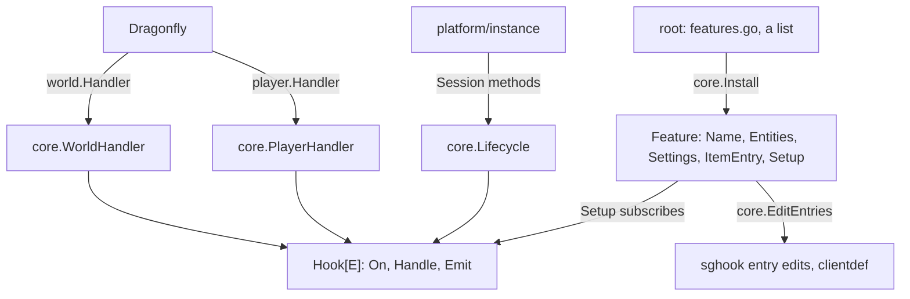
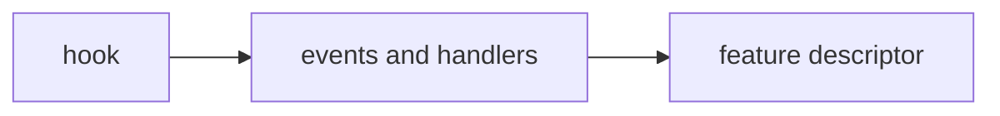

# Plan: structural rework phase 3a (the feature kernel)

**Review plan:** docs/plans/2026-11-10-cleanup-restructure.review.md
**Goal:** Review part 3-1, first half: `content/skygear/core` gains the one way a feature plugs into the server (a typed event hook with explicit priorities, the handlers that emit it, the feature descriptor), with no caller yet, so nothing a player sees changes.
**Architecture:** Three layers stay: the Dragonfly patch, `common/sghook` (session internals), `core` (the feature kernel). p3b pins today's dispatch order, p3c turns each handler method into subscriptions held by the root package, p3d and p3e move them into the features. `docs/plans/2026-11-10-cleanup-restructure-p3-order.md` (ORDER) is the step table all five parts share.
**Tech stack:** Go 1.26, patched Dragonfly in `third_party/dragonfly`, tests with `go test`.
**Spec:** none (the review plan binds)
**Detail:** contracts
**Target-min:** 25
**Ignore:** .superlite/

## Size and risk

- 27 tasks for 3-1 and 3-2 (the review plan guessed 20 to 30 for all of phase 3; parts 3-3 to 3-5, outlined in `-p3-outline.md`, add an estimated 15 to 25). 3-1 is T32-T39: kernel T32-T34 (here), pins T35-T38 and the feature list T39 (p3b). 3-2 is T40-T58: the bridge by handler method T40-T45 (p3c); features T46 achievement, T47 elevator, network, climate, look, T48 handwork, copier, wand, fairy, T49 tinker, autofill, kernel steps, T50 farm, T51 progress (p3d), T52 machine, conduit, T53 storage, netstore, T54 expand, island, T55 dimension, T56 screens; T57 root check, T58 documents (p3e).
- Where the risk sits: in the bridge (T41, T44, T45 cut methods with early returns into steps) and in the hand-placed marks of T35-T38, which is why those carry a review of every golden line. A feature task cannot reorder anything: names and priorities are pinned by `order.golden`.
- Risky orderings, each written as priorities in ORDER: the 17 steps of `UseOnBlock` (12 can stop; the build guard runs after the menu item and the teleport stone, the stick before the composter, fairy time before the crop); the machine case of break and place (storage, netstore, machine on break; storage, machine, netstore on place, where netstore's deferred call must be registered after `machine.Place` defers the block); `Second` (the inventory snapshot before items are retired, the flush last); `Leave` (dimension before the per-player parts are dropped); `Close` (displays, shares, disks, then the state).
- Registration time: `core.Install` runs in the root package's `init` and registers no block or item. `content/skygear/hopper.go` (the root `init` that registers the hopper blocks, drawing block hashes in call order) is not dispatch and is not touched in 3-2.
- Not verifiable without a real client: how a cancelled click resyncs (ghost blocks) and how the 500 ms screen debounce meets a real client's repeated use packets. The pins see only the cancel flag and the steps reached. T58 lists both for a real-client pass.

## Global constraints

- Language Go. Checkout `/home/user/SkyGear`, branch `superlite/sessions/cleanup-restructure`. Implementers do not commit or push; the coordinator commits each task with its subject (English, no attribution lines).
- Green at every commit: `go build ./... && go vet ./... && go test ./...` (51 packages) and `gofmt -l` clean. Never skip, disable or weaken a test. No player-visible change. `content/skygear/wire/testdata` is never re-recorded (`SKYGEAR_GOLDEN=update` is forbidden there).
- Facts are from 541f654: grep again. If one no longer holds, report BLOCKED.
- The kernel API of T32-T34 is frozen when p3a is committed. A later task changes no signature; only T45 removes `core.Mark`.
- Hot paths: `Emit` uses no reflection, no interface boxing of the event and allocates nothing. Events are passed by value: a pointer handed to a function value escapes to the heap, a value does not, and everything a step may change is already a pointer Dragonfly made (`*player.Context`, `*[]item.Stack`, `*int`).
- Subscribe only at startup (as `sghook.OnClientPacket`): hooks are read without a lock by every world.
- Only `core` and `common/sghook` intercept; feature packages use Dragonfly's public API, `sghook`'s functions and `core`. Leave `.gitignore` alone.
- One task at a time through p3a-p3e: the tasks share the `core` and root packages (a half-edited file breaks another task's build and pins) and the speed rule needs a quiet machine. Planning 3-3 to 3-5 in detail may run beside them.
- Ruling: no Wave 0 - an existing tree needs no stubs - an unused brief. Ruling: single checkout, no worktree - the owner's branch - none.
- Ruling: [scope] numbered priorities per hook, not the audit's five global bands - today's order does not fit bands (the build guard runs after two held-item steps) - a new feature picks a number between two neighbours and the order golden shows the result.
- Ruling: [scope] the descriptor holds only what 3-1 and 3-2 register (entities, settings, the item entry edit, subscriptions); blocks, items, commands, look lines and locales join it in 3-3 when their lists are derived - an unused field is a guess - 3-3 widens the struct.

## Main diagram

## File structure

New in `content/skygear/core`: `hook.go` (the hook and its registry), `events.go` (event types and the 35 hooks), `handler.go` (`PlayerHandler`, `WorldHandler`), `lifecycle.go` (`Lifecycle`), `feature.go` (`Feature`, `Install`, the entry edits), with their tests. `common/sghook/sghook.go` exports the entry edit application.

## Task graph

One at a time: T33 and T34 edit the same package, and a half-written file breaks the other's build.

## Predicted schedule

From `plan_tools schedule`: one chain, T32, T33, T34.

## kernel

**Probe entry:** run=go test ./content/skygear/core/ ./common/sghook/

### T32 typed event hook with priorities · Complexity 6 · Est. context 36k
**Owns:** content/skygear/core/hook.go, content/skygear/core/hook_test.go, content/skygear/core/export_test.go
**Components:** 1
**LOC owned:** 300
**Tests:** fast
**Kind:** design
**Model:** sonnet
**Est. time:** 2.0 min
**Consumes:** none
**Produces:** core.NewHook[E any](name string) -> *Hook[E] · Hook.On(prio int, name string, f func(E)) · Hook.Handle(prio int, name string, f func(E) bool) · Hook.Emit(e E) -> bool · core.Subscriptions() -> []Subscription · core.Mark(name string)
- e.g. core.Subscriptions() after h.On(20, "b.x", f); h.On(10, "a.x", g) -> [{Hook: "T", Prio: 10, Name: "a.x"}, {Hook: "T", Prio: 20, Name: "b.x"}]
- e.g. h.Handle(10, "a.x", func(E) bool { return true }); h.On(20, "b.x", f); h.Emit(e) -> true, f not called, core.Trace got "a.x" only
- e.g. h.On(10, "a.x", f); h.On(10, "b.x", g) -> panic naming the hook, the priority and both names
**Review Focus:** `TestEmitAllocatesNothing`: `testing.AllocsPerRun` of `Emit` with a 96-byte event and four steps is 0; `TestStopSkipsLaterSteps`; `TestSamePriorityPanics`; `TestSameNamePanics`; `TestTraceNamesInOrder`
**Steps:**
- `Hook[E]` keeps its steps sorted by priority in one slice of `{prio int, name, feature string, on func(E), handle func(E) bool}`. `Emit` walks it: `Trace` (if set) gets the name, then `on(e)`, or `handle(e)` whose true ends the walk; `Emit` returns whether a step stopped it. Two fields, not a wrapped closure, so `On` costs one indirect call.
- `On` and `Handle` panic on a priority or a name the hook already has (no order by registration), and when `installing` (an unexported string `Install` sets in T34) is set and the name does not start with it plus a dot.
- `NewHook` adds the hook to a package list; `Subscriptions` returns every step as `Subscription{Hook, Name, Feature string; Prio int}`, hooks in declaration order, steps by priority.
- `var Trace func(name string)` is nil outside tests. `Mark(name)` calls it when set: the legacy code of p3b writes its steps there.
- `export_test.go`: `ResetHooks()` empties every hook and the feature list for this package's tests.
- `BenchmarkEmit` (four steps, `ReportAllocs`).
- Commit `feat(core): add a typed event hook with explicit priorities`.

### T33 events, player and world handlers, lifecycle · Complexity 6 · Est. context 52k
**Owns:** content/skygear/core/events.go, content/skygear/core/handler.go, content/skygear/core/lifecycle.go, content/skygear/core/handler_test.go, content/skygear/core/doc.go
**Components:** 3
**LOC owned:** 620
**Tests:** slow
**Kind:** design
**Model:** sonnet
**Est. time:** 4.1 min
**Consumes:** core.NewHook[E any](name string) -> *Hook[E] (T32) · Hook.Emit(e E) -> bool (T32)
**Produces:** core.PlayerHandler{S *Session} · core.WorldHandler{S *Session} · core.Lifecycle{*Session} · Lifecycle.Second(tx *world.Tx) · Lifecycle.Close(tx *world.Tx) · Actor.Cancel()
- e.g. (&PlayerHandler{S: s}).HandleToggleSneak(ctx, false) -> no hook emitted; with true -> core.Sneak emits PlayerEvent{Actor{S: s, P: ctx.Player(), Tx: p.Tx(), Ctx: ctx}}
- e.g. Lifecycle{s}.Second(tx) -> core.Second emits Tick{S: s, Tx: tx}, then s.FlushIfDue(time.Now())
- e.g. Lifecycle{s}.Close(tx) -> core.Close emits Tick{S: s, Tx: tx}, then s.Session.Close(), then Unregister(s.Session)
**Review Focus:** `TestEveryHandlerMethodEmitsItsHook`: one row per method of ORDER section 2, the event's fields equal the arguments; `TestSneakAndSprintEmitOnStartOnly`; `TestLifecycleKernelStepsRunLast` (flush after `Second`'s steps, store after `Close`'s)
**Steps:**
- `events.go`: `Actor{S *Session; P *player.Player; Tx *world.Tx; Ctx *player.Context}` (`Ctx` nil for `Jump`, `Death`, `Respawn`; `Cancel` does nothing then) embedded by `StartBreakEvent{Pos}`, `BlockBreakEvent{Pos, Block, Held, Drops *[]item.Stack, XP *int}`, `BlockPlaceEvent{Pos, Block, Held}`, `UseOnBlockEvent{Pos, Face, Click, Held}`, `EntityEvent{Target}`, `UseEvent{Held, Off}`, `MoveEvent{Pos, Rot}`, `PlayerEvent{}`, `ItemEvent{Item}`, `ItemDamageEvent{Item, Damage *int}`, `HurtEvent{Damage *float64}`, `RespawnEvent{Pos *mgl64.Vec3}`; and `Tick{S, Tx}`, `DayEvent{S, Tx, Day}`, `Presence{S, P, Tx, First}`, `ColumnEvent{S, Tx, Blocks}`, `DespawnEvent{S, Tx, Entity}`. The 35 hook variables (23 player, 12 session and world) carry the names of ORDER sections 2 and 3, declared in that order.
- `handler.go`: `PlayerHandler` embeds `player.NopHandler` and has the 23 methods `content/skygear/handler.go` has; each builds its event once (ORDER rule R4) and emits. `WorldHandler` embeds `world.NopHandler`, implements `world.ColumnHandler` and emits `EntityDespawn`, `ColumnLoad`, `ColumnUnload`.
- `lifecycle.go`: `Lifecycle` has `Join`, `Leave`, `Handler`, `NewDay`, `Second`, `Fast`, `Autosave`, `Close` with the signatures of `instance.Session`. Its `Leave` and `Close` shadow the session's own (`Session.Leave`, `Session.Close()` keep their names: the root session embeds `Lifecycle` in p3c and calls reach the shallower method).
- No step is subscribed here. `doc.go` gains the paragraph on hooks and features.
- Tests use a synchronous world and a player built as `content/skygear/helpers_test.go` does.
- Commit `feat(core): emit player, world and session events through hooks`.

### T34 feature descriptor and the entry edits · Complexity 5 · Est. context 40k
**Owns:** content/skygear/core/feature.go, content/skygear/core/feature_test.go, common/sghook/sghook.go, common/sghook/sghook_test.go
**Components:** 2
**LOC owned:** 280
**Tests:** slow
**Kind:** design
**Model:** sonnet
**Est. time:** 2.8 min
**Consumes:** Hook.On(prio int, name string, f func(E)) (T32) · core.Subscriptions() -> []Subscription (T32)
**Produces:** core.Install(fs ...*Feature) · core.Features() -> []*Feature · core.EntityTypes() -> []world.EntityType · core.EditEntries(srv *server.Server) · core.CheckEntries() · sghook.ApplyEntryEdits()
- e.g. Install(&Feature{Name: "a", Setup: func() { h.On(10, "a.x", f) }}); Subscriptions() -> [{Hook: "T", Prio: 10, Name: "a.x", Feature: "a"}]
- e.g. Install(&Feature{Name: "a", Setup: func() { h.On(10, "b.x", f) }}) -> panic: step b.x does not belong to feature a
- e.g. Install(a, b) with a.Entities = [X], b.Entities = [Y, Z]; EntityTypes() -> [X, Y, Z]
**Review Focus:** `TestInstallTwicePanics`; `TestDuplicateFeatureNamePanics`; `TestSettingsRegisteredInListOrder`; `TestItemEditsComposeInListOrder`: `clientdef.ItemEntry` first, then each feature's `ItemEntry` in list order; `TestApplyEntryEditsOnce` (sghook)
**Steps:**
- `Feature{Name string; Entities []world.EntityType; Settings []account.Setting; ItemEntry func(protocol.ItemEntry) protocol.ItemEntry; Setup func()}`. `Install` runs once per process: for each feature in order it registers the settings (`account.RegisterSetting`) and runs `Setup` with `installing` set to the name.
- `EditEntries` is the only caller of `sghook.EditCustomItems` and `EditCustomBlocks` (each keeps only its last call): items get `clientdef.ItemEntry` and then every installed feature's `ItemEntry`; blocks get `clientdef.BlockEntry`.
- `sghook.ApplyEntryEdits` exports `applyEntryEdits` (it already runs once). `CheckEntries` calls it: called after `Listen`, a block declaration `clientdef.BlockEntry` rejects stops the server at startup with the block's name, not at the first join.
- Commit `feat(core): add the feature descriptor and compose the client entry edits`.

## Review Focus

- core (library): state, deep. Order by priority only; a stop ends the walk; zero allocations; no step outside its feature's name.
- sghook (library): state. The edit is applied once whichever of accept and `ApplyEntryEdits` comes first.

## Self-review

Coverage: 3-1's foundation is T32-T34; its pins and the feature list are p3b. Hazards: entry edits composed in one place (T34), block declarations checked at startup (T34, wired in T39), registration time (Size and risk). The three tasks run in a chain.
