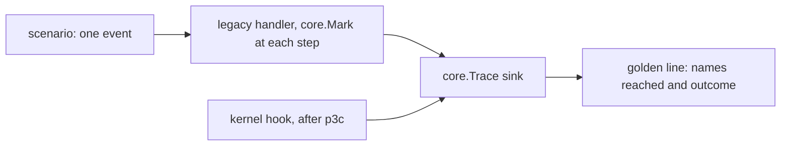
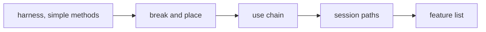

# Plan: structural rework phase 3b (dispatch pins, feature list)

**Review plan:** docs/plans/2026-11-10-cleanup-restructure.review.md
**Goal:** Review part 3-1, second half: the order in which today's code reaches the features is recorded from the current code into golden files, per handler method and per session path, and every feature has a descriptor in one root list.
**Architecture:** Runs after p3a (the kernel in `content/skygear/core`). The legacy code writes a mark at each step (`core.Mark`), the kernel's hooks write the same names when they later run the step; a golden line is the names one event reached plus its outcome. ORDER is `docs/plans/2026-11-10-cleanup-restructure-p3-order.md`: steps and priorities (sections 2, 3), mark rule R2, golden files and scenarios (section 4), feature list (section 5).
**Tech stack:** Go 1.26, patched Dragonfly in `third_party/dragonfly`, tests with `go test`.
**Spec:** none (the review plan binds)
**Detail:** contracts
**Target-min:** 30
**Ignore:** .superlite/

## Global constraints

- Language Go. Checkout `/home/user/SkyGear`, branch `superlite/sessions/cleanup-restructure`. Implementers do not commit or push; the coordinator commits each task with its subject (English, no attribution lines).
- Green at every commit: `go build ./... && go vet ./... && go test ./...` and `gofmt -l` clean. Never skip, disable or weaken a test. No player-visible change. `content/skygear/wire/testdata` is never re-recorded.
- Facts are from 541f654 plus p3a: grep again. If one no longer holds, report BLOCKED.
- Marks change no behaviour: a mark is one `core.Mark("<name>")` line, a nil test outside the pins. No statement of `handler.go`, `second.go` or `game.go` moves, and no condition changes, except the two the mark rule names (the suffix parameter of `deny`, the `if after` around a mark).
- A golden under `content/skygear/testdata/pin/` is recorded once, by its task, from the code as it is before any dispatch change, with `SKYGEAR_GOLDEN=update go test ./content/skygear -run <its test>`. After that it is nobody's to change (ORDER rule R6).
- The pins never join a server (a second join in one test process doubles the recipes and the creative list): they call `s.Handler(p)` and the session's methods on `testSession`.
- Speed rule R7 of ORDER applies to T35 (it adds the two benchmarks first), T36, T37 and T38.
- Leave `.gitignore` alone. Ruling: no Wave 0 - an existing tree needs no stubs - an unused brief. Ruling: single checkout, no worktree - the owner's branch - none.

## Main diagram

## File structure

New in `content/skygear`: `pin_test.go` (sink, runner, golden compare), `pin_bench_test.go`, `pin_simple_test.go`, `pin_blocks_test.go`, `pin_use_test.go`, `pin_lifecycle_test.go`, `testdata/pin/*.golden`, `features.go`; `core/kernel.go`; `feature.go` in 20 feature packages.

## Task graph

One at a time: T35-T37 share `handler.go`, T38 and T39 share `game.go`, all share the root package's test binary, and a golden is recorded on a tree no other task is editing.

## Predicted schedule

From `plan_tools schedule`: one chain, T35 to T39.

## pins

**Probe entry:** run=go test ./content/skygear -run 'TestPin'

### T35 pin harness and the simple handler methods · Complexity 7 · Est. context 58k
**Owns:** content/skygear/handler.go, content/skygear/pin_test.go, content/skygear/pin_bench_test.go, content/skygear/pin_simple_test.go, content/skygear/testdata/pin/handler-simple.golden
**Components:** 3
**LOC owned:** 600
**Tests:** slow
**Kind:** design
**Model:** sonnet
**Est. time:** 4.0 min
**Consumes:** none
**Produces:** pinRun(t *testing.T, lines map[string]string, scenario string, outcome func() string, call func()) · pinGolden(t *testing.T, file string, lines map[string]string)
- e.g. pinRun for "Jump/elevator" -> lines["Jump/elevator"] = "achievement.jump elevator.up | "
- e.g. pinRun for "Move/expanding" -> lines["Move/expanding"] = "look.update expand.hold | cancelled=true"
- e.g. pinGolden with one line changed -> the test fails and prints the scenario, the wanted line and the line it got
**Review Focus:** every `plain`, `walk` and `start` line equals its hook's row in ORDER section 2; `Sneak/end` and `Sprint/end` are empty; `Hurt/frozen` is `dimension.frozen | cancelled=true`; `Sneak/elevator` ends at `elevator.down`
**Steps:**
- First, `pin_bench_test.go`: `BenchmarkHandleMove` (one player, `s.Handler(p).HandleMove` to a position one block away, `ReportAllocs`) and `BenchmarkSecond` (one player, `s.Second(tx)`). Run rule R7's command and keep the output for the report.
- `pin_test.go`: the sink (a mutex and a slice; `core.Trace` is set for the length of one `pinRun` and reset to nil), `pinRun`, `pinGolden` (a text file, one `scenario: names | outcome` line per scenario sorted by scenario; `SKYGEAR_GOLDEN=update` writes it).
- Marks in the 16 methods of `handler.go` from `HandleMove` down (ORDER section 2 rows `Move` to `Command`), by rule R2.
- `pin_simple_test.go`, `TestPinSimple`: the scenarios ORDER section 4 lists for those hooks (30), each on a fresh session and player; fixtures as the named root tests build them. Outcomes: `cancelled`, `damage`, `food`.
- Record the golden, run R7 again. Commit `test(skygear): pin the dispatch order of the simple player events`.

### T36 pin block break and place · Complexity 7 · Est. context 52k
**Owns:** content/skygear/handler.go, content/skygear/pin_blocks_test.go, content/skygear/testdata/pin/handler-blocks.golden
**Components:** 2
**LOC owned:** 480
**Tests:** slow
**Kind:** design
**Model:** sonnet
**Est. time:** 3.3 min
**Consumes:** none
**Produces:** none
**Review Focus:** `BlockBreak/stone` and `BlockPlace/dirt` equal their rows; `BlockBreak/drawerFront` has all nine names and `cancelled=true`; `*/outside` end at `island.guard`, `*/expanding` at `expand.guard`; `BlockBreak/hammerCobble` carries the hammer's drop
**Steps:**
- `deny` takes the mark suffix (five call sites; `"guardSide"` at line 218, `"guard"` elsewhere) and writes its two marks (rule R2).
- Marks in `HandleStartBreak`, `HandleBlockBreak`, `HandleBlockPlace`: straight-line steps before their statement, the switch's steps before the `switch` in priority order.
- `TestPinBlocks`: the 28 scenarios of ORDER section 4, outcome `cancelled` and for `BlockBreak` the drops.
- Record the golden; R7. Commit `test(skygear): pin the dispatch order of block break and place`.

### T37 pin the use chain · Complexity 8 · Est. context 56k
**Owns:** content/skygear/handler.go, content/skygear/pin_use_test.go, content/skygear/testdata/pin/handler-use.golden
**Components:** 2
**LOC owned:** 560
**Tests:** slow
**Kind:** design
**Model:** sonnet
**Est. time:** 3.5 min
**Consumes:** none
**Produces:** none
**Review Focus:** `UseOnBlock/plain` has all 17 names; each of the 12 stopping scenarios ends at its step with `cancelled=true`; `UseOnBlock/cropSneaking` passes `farm.crop` and reaches `island.guardSide`; `Use/menuItemHunting` ends at `screens.menuItem`; `AttackEntity/monster` ends at `dimension.hunter`
**Steps:**
- Marks in `HandleItemUseOnBlock`, `HandleItemUse`, `HandleItemUseOnEntity`, `HandleAttackEntity` (the mark of `fairy.touch` at the call of `touchFairy`, of `dimension.stone` at the call of `useStone`, of `screens.menuItem` before its `if`).
- `TestPinUse`: the 35 scenarios of ORDER section 4. Every one of the chain's 12 stops has its scenario; a fixture that cannot be built is reported, not dropped.
- Record the golden; R7. Commit `test(skygear): pin the dispatch order of the use chain`.

### T38 pin the session paths · Complexity 6 · Est. context 50k
**Owns:** content/skygear/second.go, content/skygear/game.go, content/skygear/lostfound.go, content/skygear/conduitload.go, content/skygear/pin_lifecycle_test.go, content/skygear/testdata/pin/lifecycle.golden, content/skygear/testdata/pin/settings.golden
**Components:** 2
**LOC owned:** 380
**Tests:** slow
**Kind:** design
**Model:** sonnet
**Est. time:** 3.1 min
**Consumes:** none
**Produces:** none
**Review Focus:** `Second` has its 12 names in ORDER's order; `Leave` has `dimension.leave` before `core.parts`; `Close` is `storage.displays conduit.close netstore.flush`; the `Start` line is `farm.loadCrops island.keepLoaded climate.apply`; `EntityDespawn/pickedUp` reaches `island.lost` and stores nothing
**Steps:**
- Marks in `Second`, `Fast` (`second.go`), `Join`, `Leave`, `NewDay`, `Autosave`, `Close`, `Start` (`game.go`), the three world handler methods: ORDER section 3, one mark per step before its first statement.
- `TestPinLifecycle`: the session scenarios of ORDER section 4 on `testSession` with one player, in the order join, second, fast, new day, autosave, leave, close.
- `TestPinStart`: one `instance.NewManager` over a temporary directory with `&Game{log, db}`, one player entering a new save (`platform/instance/manager_test.go` shows the fixture); the sink keeps only the three names of `Game.Start` (ORDER rows `Load` and `Start`); `CloseAll` before the sink is reset. If the manager cannot run inside this test binary, report it: `Start` is then pinned by review only.
- `TestPinSettings`: the keys of `account.Settings()` in order, as `settings.golden`.
- Record both goldens; R7. Commit `test(skygear): pin the order of the session paths`.

## feature list

**Probe entry:** run=go test ./content/skygear ./content/skygear/wire ./content/skygear/core

### T39 feature descriptors and the root list · Complexity 5 · Est. context 54k
**Owns:** content/skygear/features.go, content/skygear/game.go, content/skygear/names.go, content/skygear/layers_test.go, content/skygear/core/kernel.go, content/skygear/{achievement,progress,island,climate,network,tinker,machine,conduit,storage,farm,fairy,dimension,handwork,expand,copier,wand,netstore,elevator,look,screens}/feature.go, content/skygear/sgitem/woodenbucket.go, content/skygear/wire/wire_test.go, cmd/skygear/main.go, third_party/README.md, docs/tech/dragonfly.md, CONTRIBUTING.md
**Components:** 3
**LOC owned:** 330
**Tests:** slow
**Kind:** design
**Model:** sonnet
**Est. time:** 3.4 min
**Consumes:** none
**Produces:** skygear.Features []*core.Feature
- e.g. Features[0] -> core.KernelFeature; the order is ORDER section 5
- e.g. skygear.EntityTypes() -> the default types plus core.EntityTypes(), the same set of names as before
**Review Focus:** `TestWire` passes with its goldens untouched; `TestPinSettings` unchanged; `TestFeatureSiblings` fails on a sibling import that is not in its table and on a table row that no import uses
**Steps:**
- Each of the 20 packages gets `feature.go`: `var Feature = &core.Feature{Name: "<package>"}`. Five carry the entity types `EntityTypes()` lists today (storage, fairy, conduit, dimension with `MonsterTypes()`, machine). `core/kernel.go`: `KernelFeature` (name `core`) and `AutofillFeature` (name `autofill`; `core.Autofill` is already a function), empty for now.
- `features.go`: `Features` in ORDER section 5's order, `func init() { core.Install(Features...) }`, and the root's own `items` feature whose `ItemEntry` is `sgitem.ClipWoodenBucket(localItemName(e))`. `skygear.EditEntries` goes; `cmd/skygear/main.go` and `wire_test.go` call `core.EditEntries(srv)`, and `main.go` calls `core.CheckEntries()` right after `srv.Listen()`.
- `EntityTypes()` in `game.go` returns the default registry's types plus `core.EntityTypes()` (the registry is a map by name: order is free).
- `layers_test.go`: `TestFeatureSiblings`, the table of ORDER section 5: a package of the feature layer imports a sibling only if the table says so. The layer list itself does not change.
- The three documents and the comment in `woodenbucket.go` name `core.EditEntries`.
- Commit `refactor(core): list the game's features in one place`.

## Review Focus

- pins (library): state, protocol. A mark sits where its step begins; a stopped scenario shows no later name; goldens come from unchanged control flow.
- feature list (library): state. Same entity names, same item and block entries (`TestWire`), same settings order.

## Self-review

Coverage: 3-1's pins T35-T38 (handler methods, per-second, fast tick, join, quit, new day, save, close, start, world events), the feature list T39. Hazards: one join per process (no join in the pins), `Start` needs an instance (T38 says how, and what if not), registration time (`features.go` registers no block). Speed baselines come from T35's benchmarks.
