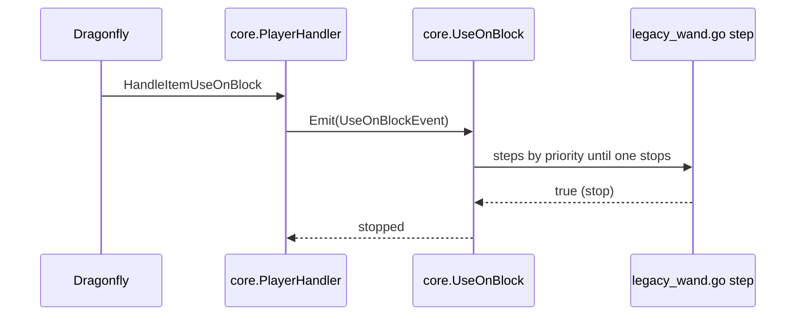
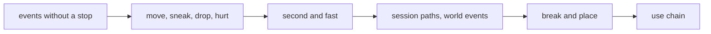

# Plan: structural rework phase 3c (the bridge: handler methods become subscriptions)

**Review plan:** docs/plans/2026-11-10-cleanup-restructure.review.md
**Goal:** Review part 3-2, first half: every hand-written dispatch of `handler.go`, `second.go`, `game.go`, `lostfound.go` and `conduitload.go` runs through the kernel's hooks, one handler method group per task, with the pins of p3b unchanged. The steps still live in the root package, one file per feature, ready to move.
**Architecture:** Runs after p3b. A bridged method's body is cut into the steps of ORDER (`docs/plans/2026-11-10-cleanup-restructure-p3-order.md`, sections 2 and 3) and subscribed from `content/skygear/legacy_<feature>.go`; the root method is deleted, so the kernel's handler (embedded) emits the hook. Legacy code and subscriptions coexist per method: a method is wholly one or the other. p3d and p3e move each `legacy_<feature>.go` into its feature.
**Tech stack:** Go 1.26, patched Dragonfly in `third_party/dragonfly`, tests with `go test`.
**Spec:** none (the review plan binds)
**Detail:** contracts
**Target-min:** 35
**Ignore:** .superlite/

## Global constraints

- Language Go. Checkout `/home/user/SkyGear`, branch `superlite/sessions/cleanup-restructure`. Implementers do not commit or push; the coordinator commits each task with its subject (English, no attribution lines).
- Green at every commit: `go build ./... && go vet ./... && go test ./...` and `gofmt -l` clean. Never skip, disable or weaken a test. No player-visible change. `content/skygear/wire/testdata` is never re-recorded.
- The pin of every task: `go test ./content/skygear -run 'TestPin'` passes with `content/skygear/testdata/pin/handler-simple.golden`, `handler-blocks.golden`, `handler-use.golden`, `lifecycle.golden` and `settings.golden` byte for byte as p3b recorded them. No task here owns them. A pin that fails means the step, its priority or its stop is wrong; fix the code. If a golden line itself contradicts the legacy code, report BLOCKED with the line.
- Names, priorities and `H` come from ORDER sections 2 and 3, unchanged. Rules R3 (stop exactly where the legacy code returns early), R4 (use the event's `Block`, `Held`, `Off`) and R5 (file per owner; `init` subscribes with `core.<Hook>.On` or `.Handle`) apply. A step's body is the legacy statements moved as they are, with `h.s.Session` read as `e.S`, `ctx.Player()` as `e.P`, `ctx.Player().Tx()` as `e.Tx`, `ctx.Cancel()` as `e.Cancel()`. The marks of a bridged method go with its body.
- The existing behaviour tests are the second proof: they change only where a call site's form changes, and the task says which.
- Speed rule R7 of ORDER applies to every task here. `Move`, `Second` and `Fast` are the hot paths.
- One task at a time owns the central files (`handler.go`, `second.go`, `game.go`) and the legacy files: the six tasks are a chain.
- Leave `.gitignore` alone. Ruling: no Wave 0 - an existing tree needs no stubs - an unused brief. Ruling: single checkout, no worktree - the owner's branch - none.

## Main diagram

## File structure

New: `content/skygear/legacy_{achievement,autofill,climate,conduit,copier,core,dimension,elevator,expand,fairy,farm,handwork,island,look,machine,netstore,network,progress,screens,storage,tinker,wand}.go` (22), `pin_order_test.go`, `testdata/pin/order.golden`. Deleted: `handler.go`, `second.go`, `lostfound.go`, `conduitload.go`.

## Task graph

Order by risk: no stop first, the chain with 12 stops last.

## Predicted schedule

From `plan_tools schedule`: one chain, T40 to T45.

## bridge

**Probe entry:** run=go test ./content/skygear -run 'TestPin'

### T40 bridge the player events that never stop · Complexity 5 · Est. context 50k
**Owns:** content/skygear/handler.go, content/skygear/game.go, content/skygear/legacy_{achievement,elevator,tinker,autofill,dimension}.go, content/skygear/{crook,cropinfo,crops,drawer,energy,fairy,hammer,screens,wand}_test.go
**Components:** 2
**LOC owned:** 260
**Tests:** slow
**Kind:** design
**Model:** sonnet
**Est. time:** 2.9 min
**Consumes:** none
**Produces:** none
**Review Focus:** `TestPinSimple` unchanged; `TestDeathKeepsFood` (`hammer_test.go`) passes with the food kept in a per-player part; `Sprint` and `Jump` steps are not called with `after` false
**Steps:**
- `handler` becomes `struct { core.PlayerHandler; s *session }`; `session.Handler` builds it with `core.PlayerHandler{S: s.Session}`. The 12 test call sites that build `&handler{s: s}` (nine files) call `s.Handler(p)` instead: same handler, no assertion changes.
- Bridge the 12 methods of the rows `Sprint`, `Jump`, `ItemDamage`, `ItemConsume`, `ItemPickup`, `Death`, `Respawn`, `PunchAir`, `Chat`, `BlockPick`, `HeldSlot`, `Command`: 18 steps (achievement 10, tinker 3, autofill 2, dimension 2, elevator 1).
- `sameItemName` moves to `legacy_autofill.go` with `autofill.broken`.
- The food kept through death becomes `core.NewPlayers[int]()` in `legacy_tinker.go`; the `diedFood` field and its `delete` in `session.Leave` go (`Session.Leave`, one line earlier, drops every per-player part).
- Commit `refactor(core): dispatch the simple player events through hooks`.

### T41 bridge move, sneak, item drop and hurt · Complexity 6 · Est. context 44k
**Owns:** content/skygear/handler.go, content/skygear/legacy_{achievement,elevator,dimension,look,expand,island,farm}.go
**Components:** 2
**LOC owned:** 170
**Tests:** slow
**Kind:** design
**Model:** sonnet
**Est. time:** 2.5 min
**Consumes:** none
**Produces:** none
**Review Focus:** `Move/expanding` still ends at `expand.hold`; `Sneak/elevator` ends at `elevator.down` after `achievement.sneak`; `Hurt/frozen` counts nothing; `BenchmarkHandleMove` keeps its allocs/op
**Steps:**
- Bridge `HandleMove` (4 steps), `HandleToggleSneak` (4), `HandleItemDrop` (2), `HandleHurt` (3). Stops: `expand.hold`, `expand.show`, `elevator.down`, `dimension.hunting`, `dimension.frozen`. `island.void` and `dimension.fallen` cancel and stop nothing.
- `HandleMove` runs per movement packet: no closure captures, no `fmt`, nothing built per call in the four steps.
- Commit `refactor(core): dispatch move, sneak, item drop and hurt through hooks`.

### T42 bridge the per-second and fast ticks · Complexity 5 · Est. context 44k
**Owns:** content/skygear/second.go, content/skygear/game.go, content/skygear/helpers_test.go, content/skygear/persist_test.go, content/skygear/legacy_{farm,progress,fairy,climate,dimension,tinker,machine,screens,achievement,network,look}.go
**Components:** 2
**LOC owned:** 210
**Tests:** slow
**Kind:** design
**Model:** sonnet
**Est. time:** 2.6 min
**Consumes:** none
**Produces:** none
**Review Focus:** `lifecycle.golden` lines `Second` and `Fast` unchanged; the snapshot handed to `achievement.GrantCollection` is the one taken at `progress.checkHeld` (a test: an item retired by `dimension.second` in the same second still counts); items step every `itemnet.StepTicks/4` fast ticks, fluids every `fluidnet.StepTicks/4`; `BenchmarkSecond` and `BenchmarkEnergyStep` within R7
**Steps:**
- `session` embeds `core.Lifecycle` in place of `*core.Session` (three literals: `game.go`, `helpers_test.go`, `persist_test.go`); `s.Session` still reads the core session.
- `second.go` goes: 12 `Second` steps and 3 `Fast` steps. The kernel's `Lifecycle.Second` runs `FlushIfDue` after them.
- The snapshot is a `core.NewPart` in `legacy_progress.go`; the fast tick counter a `core.NewPart[int]` in `legacy_network.go`; the `fastCount` field goes.
- Commit `refactor(core): run the per-second and fast ticks through hooks`.

### T43 bridge join, leave, day, save, close, start and the world events · Complexity 6 · Est. context 48k
**Owns:** content/skygear/game.go, content/skygear/lostfound.go, content/skygear/conduitload.go, content/skygear/helpers_test.go, content/skygear/persist_test.go, content/skygear/legacy_{screens,fairy,climate,core,island,progress,dimension,expand,look,netstore,conduit,storage,farm}.go
**Components:** 3
**LOC owned:** 280
**Tests:** slow
**Kind:** design
**Model:** sonnet
**Est. time:** 3.1 min
**Consumes:** none
**Produces:** none
**Review Focus:** `lifecycle.golden` unchanged, `TestPinStart` included; `netflush_test.go` passes (`Autosave` and `Close` with a nil transaction); a player's per-player parts are still there when `dimension.leave` runs and gone after `core.parts`; the state is stored after `netstore.flush` on close
**Steps:**
- Root `Join`, `Leave`, `NewDay`, `Autosave` go (28 steps with `Start` and the world events); `Close` stays as `s.Lifecycle.Close(tx)` then `s.g.sessions.Delete(s.World)`.
- `Game.Start` keeps the platform glue (`core.New`, `island.SetKeep`, the session map, `core.Register`) and the order of its statements: it emits `core.Load` (no transaction) where `farm.LoadCrops` is called and `core.Start` inside its `World.Do`, which it still does not wait for.
- `lostfound.go` and `conduitload.go` go: the world is handled by `&core.WorldHandler{S: c}` (`game.go` and the two test helpers); `island.lost` holds the test of `lostfound.go`.
- Commit `refactor(core): run the session paths and world events through hooks`.

### T44 bridge block break and place · Complexity 7 · Est. context 52k
**Owns:** content/skygear/handler.go, content/skygear/project.go, content/skygear/project_test.go, content/skygear/legacy_{expand,island,achievement,tinker,farm,storage,netstore,machine,conduit,autofill,progress}.go
**Components:** 3
**LOC owned:** 300
**Tests:** slow
**Kind:** design
**Model:** sonnet
**Est. time:** 3.2 min
**Consumes:** none
**Produces:** none
**Review Focus:** `handler-blocks.golden` unchanged; breaking a network node invalidates after the block is gone, placing one invalidates after `machine.Place`'s deferred set (`terminal_test.go`, `netflush_test.go`); a drawer hit on its front is cancelled and keeps its display (`drawer_test.go`); hammer drops then composter drops keep their order in `*drops`
**Steps:**
- `deny` becomes four steps: `expand.guard` and `island.guard` on `StartBreak`, `BlockBreak`, `BlockPlace` (the `UseOnBlock` pairs stay in `deny` until T45).
- Bridge `HandleStartBreak` (3 steps), `HandleBlockBreak` (9), `HandleBlockPlace` (10). The switches fall apart into steps that test the block type themselves.
- `tx.Defer` calls run in the order they are made: `netstore.place` (80) is after `machine.place` (70), as the comment at `handler.go:141` requires.
- `completeDragon` takes the core session (`project.go`, one test call site) and is the body of `progress.dragonEgg`.
- Commit `refactor(core): dispatch block break and place through hooks`.

### T45 bridge the use chain and close the handler · Complexity 8 · Est. context 58k
**Owns:** content/skygear/handler.go, content/skygear/game.go, content/skygear/pin_order_test.go, content/skygear/testdata/pin/order.golden, content/skygear/core/hook.go, content/skygear/core/hook_test.go, content/skygear/legacy_{dimension,screens,expand,island,machine,copier,wand,storage,conduit,handwork,farm,fairy,autofill,tinker}.go
**Components:** 3
**LOC owned:** 380
**Tests:** slow
**Kind:** design
**Model:** sonnet
**Est. time:** 3.4 min
**Consumes:** none
**Produces:** none
**Review Focus:** `handler-use.golden` unchanged, all 12 stops; `Debounced` is called exactly where it was (it records the opening: once per menu or stone use, not at all for other items); the sneaking tests of `conduit.plate`, `farm.composter` and `farm.crop` are inside their steps; `order.golden` has 124 lines and each hook's lines equal its row in ORDER
**Steps:**
- Bridge `HandleItemUseOnBlock` (17 steps), `HandleItemUse` (7), `HandleItemUseOnEntity` (2), `HandleAttackEntity` (2). `useHeldScreen` moves to `legacy_screens.go`, `useStone` to `legacy_dimension.go`, `touchFairy` to `legacy_fairy.go`.
- `handler.go` goes; root `session.Handler` goes (`core.Lifecycle.Handler` serves it).
- `core.Mark` and its test go: no caller is left.
- `TestPinOrder`: `core.Subscriptions()` as lines `<Hook> <priority> <name>` (no feature column: it changes when a step moves) against `order.golden`, recorded here once.
- Commit `refactor(core): dispatch the use chain through hooks and drop the root handler`.

## Review Focus

- bridge (library): state, protocol. A step stops exactly where the legacy code returned; cancel without stop where it fell through; deferred calls in registration order; per-player state dropped at `core.parts`.
- hot paths (library): numeric. R7 on `Move`, `Second`, `Fast`.

## Self-review

Coverage: all dispatch of the three central files and the two world handler files, T40-T45; `Spawn`, `Relocate`, `MenuBack`, `OpenScreen` and `Game.Start`'s setup stay as platform glue. Each task deletes the legacy code it replaces. After T45 no golden may change in p3d or p3e, `order.golden` included.
