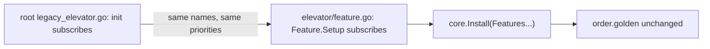
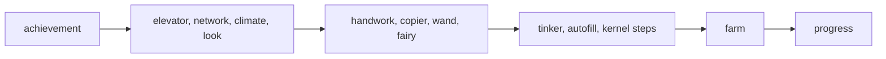

# Plan: structural rework phase 3d (features take their subscriptions, first half)

**Review plan:** docs/plans/2026-11-10-cleanup-restructure.review.md
**Goal:** Review part 3-2, second half: each feature subscribes to its own events from its own package, starting with the features whose steps stop nothing or stop only their own chain link. The root file that held a feature's steps is deleted in the task that moves them.
**Architecture:** Runs after p3c, where every step already runs through a hook from `content/skygear/legacy_<feature>.go`. A move puts the same steps, with the same names and priorities, into the `Setup` of `<feature>/feature.go` (the descriptor p3b listed in `content/skygear/features.go`). ORDER is `docs/plans/2026-11-10-cleanup-restructure-p3-order.md`.
**Tech stack:** Go 1.26, patched Dragonfly in `third_party/dragonfly`, tests with `go test`.
**Spec:** none (the review plan binds)
**Detail:** contracts
**Target-min:** 30
**Ignore:** .superlite/

## Global constraints

- Language Go. Checkout `/home/user/SkyGear`, branch `superlite/sessions/cleanup-restructure`. Implementers do not commit or push; the coordinator commits each task with its subject (English, no attribution lines).
- Green at every commit: `go build ./... && go vet ./... && go test ./...` and `gofmt -l` clean. Never skip, disable or weaken a test. No player-visible change. `content/skygear/wire/testdata` is never re-recorded.
- The pin of every task: `go test ./content/skygear -run 'TestPin'` passes with all six files of `content/skygear/testdata/pin/` byte for byte as recorded (`order.golden` proves the names and priorities, the other five the order reached and the outcomes). No task here owns them.
- A move changes no step: same hook, priority, name, `On` or `Handle`, and the same statements; only package qualifiers change (`elevator.Up` becomes `Up`). Helpers that lived in the legacy file move with the steps, unexported unless a root test calls them. `core.Install` checks that each name starts with the feature's name.
- A move adds no import of a sibling feature (`TestFeatureSiblings` keeps its table) and none of the root package. Imports of lower layers are named in the task.
- Speed rule R7 of ORDER applies to every task.
- One task at a time (the chain below): the tasks share the root package's pins, and a half-moved feature subscribes a name twice or not at all.
- Leave `.gitignore` alone. Ruling: no Wave 0 - an existing tree needs no stubs - an unused brief. Ruling: single checkout, no worktree - the owner's branch - none.

## Main diagram

## File structure

Changed: `feature.go` of achievement, elevator, network, climate, look, handwork, copier, wand, fairy, tinker, farm, progress; `core/kernel.go`; `hopper/itemlink.go`. New: `progress/project.go`. Deleted from `content/skygear`: the twelve matching `legacy_*.go` plus `legacy_core.go` and `legacy_autofill.go`, `settings.go`, `itemlink.go`, `project.go`.

## Task graph

Order: steps that only count first, then leaf features, then features whose steps stop a chain link of their own.

## Predicted schedule

From `plan_tools schedule`: one chain, T46 to T51.

## features

**Probe entry:** run=go test ./content/skygear -run 'TestPin'

### T46 achievement counts its own events · Complexity 4 · Est. context 40k
**Owns:** content/skygear/achievement/feature.go, content/skygear/legacy_achievement.go
**Components:** 1
**LOC owned:** 150
**Tests:** slow
**Kind:** design
**Model:** sonnet
**Est. time:** 2.0 min
**Consumes:** none
**Produces:** none
**Review Focus:** pins unchanged; `counter_test.go`, `counterhooks_test.go` and `achievements_test.go` pass untouched; `achievement.break` gets the hammer flag from the event's `Held`
**Steps:**
- 17 steps (ORDER: every `achievement.*` name) move to `achievement.Feature.Setup`. New import: `sgitem` (`IsHammer`), a lower layer.
- Commit `refactor(achievement): subscribe to the events it counts`.

### T47 elevator, network, climate and look subscribe · Complexity 4 · Est. context 42k
**Owns:** content/skygear/{elevator,network,climate,look}/feature.go, content/skygear/legacy_{elevator,network,climate,look}.go
**Components:** 2
**LOC owned:** 140
**Tests:** slow
**Kind:** design
**Model:** sonnet
**Est. time:** 2.4 min
**Consumes:** none
**Produces:** none
**Review Focus:** pins unchanged; `network.step` keeps its counter part and both beats (`energy_test.go`); `look.update` on `Move` allocates no more than before (R7, `BenchmarkHandleMove`)
**Steps:**
- 10 steps: elevator 2 (`up`, `down`), network 1, climate 4 (`apply`, `showWeather`, `newDay`, `tick`), look 3 (`update`, `clear`, `updateAll`).
- The fast tick counter part moves into `network`.
- Commit `refactor(skygear): elevator, network, climate and look subscribe to their events`.

### T48 handwork, copier, wand and fairy subscribe · Complexity 5 · Est. context 44k
**Owns:** content/skygear/{handwork,copier,wand,fairy}/feature.go, content/skygear/legacy_{handwork,copier,wand,fairy}.go
**Components:** 2
**LOC owned:** 170
**Tests:** slow
**Kind:** design
**Model:** sonnet
**Est. time:** 2.5 min
**Consumes:** none
**Produces:** none
**Review Focus:** pins unchanged (`UseOnBlock/copier`, `/wand`, `/stickChest`, `/stick`, `/fiber`, `/fairyTime`, `Use/wandSneak`, both `*/fairy` lines); `copier_test.go`, `wand_test.go`, `handwork_test.go`, `stickchest_test.go`, `fairy_test.go`, `fairytime_test.go` pass untouched
**Steps:**
- 11 steps: handwork 2 (`stick`, `gather`), copier 2 (`use`, `clear`), wand 2 (`use`, `options`), fairy 5 (`time`, `touch` on two hooks, `backfillDust`, `tick`).
- `wand.options` keeps `Sneaking() && !Debounced(p)` in that order (the second records the opening).
- Commit `refactor(skygear): handwork, copier, wand and fairy subscribe to their events`.

### T49 tinker, autofill and the kernel's own steps · Complexity 5 · Est. context 44k
**Owns:** content/skygear/tinker/feature.go, content/skygear/core/kernel.go, content/skygear/legacy_{tinker,core,autofill}.go, content/skygear/settings.go
**Components:** 2
**LOC owned:** 200
**Tests:** slow
**Kind:** design
**Model:** sonnet
**Est. time:** 2.6 min
**Consumes:** none
**Produces:** none
**Review Focus:** `settings.golden` unchanged (vein diagonal, auto tool, autofill, after the settings of `progress`); `TestDeathKeepsFood` passes; a player's kept food is dropped at `core.parts`; `autoequip_test.go`, `autotool_test.go`, `quickbar_test.go` pass untouched
**Steps:**
- tinker 7 steps (`autoTool`, `break`, `veinToggle`, `ironHammer`, `keepFood`, `restoreFood`, `effects`) with the kept-food part; `core.KernelFeature` 3 (`parts`, `shapes` on join and on leave); `core.AutofillFeature` 4 (`place`, `use`, `broken`, `consume`) with `sameItemName`.
- `settings.go` goes: `tinker.Feature.Settings` holds the two tinker settings, `core.AutofillFeature.Settings` the autofill setting, same fields. `Install` registers them in list order, which is today's order.
- Commit `refactor(skygear): tinker and autofill declare their settings and steps`.

### T50 farm subscribes and owns the composter adapter · Complexity 5 · Est. context 46k
**Owns:** content/skygear/farm/feature.go, content/skygear/legacy_farm.go, content/skygear/itemlink.go, content/skygear/hopper/itemlink.go, content/skygear/game.go, content/skygear/helpers_test.go, content/skygear/persist_test.go, content/skygear/composter_test.go
**Components:** 2
**LOC owned:** 230
**Tests:** slow
**Kind:** design
**Model:** sonnet
**Est. time:** 2.6 min
**Consumes:** none
**Produces:** none
**Review Focus:** pins unchanged; `hopper_test.go`, `crops_test.go`, `crook_test.go`, `barrel_test.go`, `sapling_test.go` pass untouched; `TestHopperFeedsComposter` passes before and after; `TestDrawerHopperAndDisplay` (`drawer_test.go`, the vanilla hopper hook) passes untouched
**Steps:**
- First, on the unchanged tree, add `TestHopperFeedsComposter` to `composter_test.go`: a vanilla hopper holding wheat seeds above a composter empties into it within 240 ticks (no test reaches the adapter today). It must pass before anything moves.
- 9 steps: `break`, `plant`, `composter`, `crop`, `crouchGrow`, `loadCrops`, `growCrops`, `barrels`, `plants`.
- `itemlink.go` goes. The composter adapter is registered in `farm.Feature.Setup` and finds its session with `core.At(tx)`; `block.HopperTransfer` is set in `hopper`'s own `init` (it needs no session). `hopper.RegisterItemIOOnce`, `registerItemIO`, `activeGameSession` and, if nothing else reads it, `activeGame` go, with their three call sites.
- `content/skygear/hopper.go` stays as it is (block registration time, p3a "Size and risk").
- Commit `refactor(farm): subscribe to its events and register the composter adapter`.

### T51 progress subscribes and owns the dragon egg · Complexity 4 · Est. context 40k
**Owns:** content/skygear/progress/feature.go, content/skygear/progress/project.go, content/skygear/legacy_progress.go, content/skygear/project.go, content/skygear/project_test.go
**Components:** 2
**LOC owned:** 130
**Tests:** slow
**Kind:** design
**Model:** sonnet
**Est. time:** 2.3 min
**Consumes:** none
**Produces:** none
**Review Focus:** pins unchanged; `project_test.go` passes with its one call site renamed; the inventory snapshot part is taken at `progress.checkHeld` and read at `progress.collection`
**Steps:**
- 5 steps: `dragonEgg`, `sendRecipes`, `recipes`, `checkHeld`, `collection`.
- `completeDragon` and the comment above it move to `progress/project.go` as `CompleteDragon`; `project.go` goes.
- Commit `refactor(progress): subscribe to its events and own the dragon egg`.

## Review Focus

- features (library): state. Same names and priorities (`order.golden`), same order reached and outcomes (five goldens), no new sibling import, per-player and per-session parts move with their steps.

## Self-review

Coverage: 14 owners of ORDER's 22 are moved here (achievement, elevator, network, climate, look, handwork, copier, wand, fairy, tinker, autofill, core, farm, progress); the other 8 are p3e. Root registrations that go home: settings (T49), the item mover links (T50). Each task deletes the legacy file it replaces.
