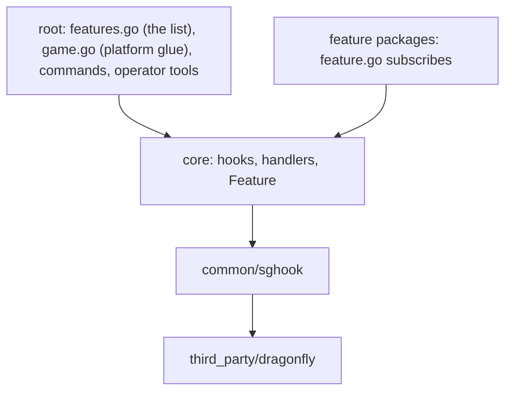
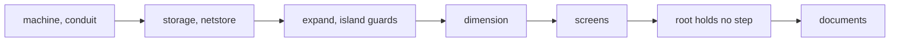

# Plan: structural rework phase 3e (features that order or cancel others, documents)

**Review plan:** docs/plans/2026-11-10-cleanup-restructure.review.md
**Goal:** Review part 3-2, end: the features whose steps order each other (the machine case of break and place) or cancel everything after them (build guards, the hunt, the menu item) take their subscriptions; the root package is then a feature list plus platform glue, a test keeps it so, and the documents describe the foundation.
**Architecture:** Runs after p3d, with the same move as there: `content/skygear/legacy_<feature>.go` becomes the `Setup` of `<feature>/feature.go`, names and priorities unchanged. ORDER is `docs/plans/2026-11-10-cleanup-restructure-p3-order.md`.
**Tech stack:** Go 1.26, patched Dragonfly in `third_party/dragonfly`, tests with `go test`.
**Spec:** none (the review plan binds)
**Detail:** contracts
**Target-min:** 35
**Ignore:** .superlite/

## Global constraints

- Language Go. Checkout `/home/user/SkyGear`, branch `superlite/sessions/cleanup-restructure`. Implementers do not commit or push; the coordinator commits each task with its subject (English, no attribution lines).
- Green at every commit: `go build ./... && go vet ./... && go test ./...` and `gofmt -l` clean. Never skip, disable or weaken a test. No player-visible change. `content/skygear/wire/testdata` is never re-recorded.
- The pin of every code task: `go test ./content/skygear -run 'TestPin'` passes with all six files of `content/skygear/testdata/pin/` byte for byte as recorded. No task here owns them.
- A move changes no step: same hook, priority, name, `On` or `Handle`, same statements; only package qualifiers change. Helpers move with their steps. No new import of a sibling feature (`TestFeatureSiblings` keeps its table) or of the root package; imports of other layers are named in the task.
- The priorities that order features against each other are written in each task and must be found unchanged in `order.golden`.
- Speed rule R7 of ORDER applies to T52-T56. One task at a time (the chain below).
- Documents: Korean, the current state only (no history, no "was"), written with the repo skill `korean-humanizer`; `CONTRIBUTING.md` and Go comments in English. `TD` is the to-do document `docs/{TOD}O.md`.
- Leave `.gitignore` alone. Ruling: no Wave 0 - an existing tree needs no stubs - an unused brief. Ruling: single checkout, no worktree - the owner's branch - none.

## Main diagram

## File structure

Changed: `feature.go` of machine, conduit, storage, netstore, expand, island, dimension, screens. Deleted: the eight matching `content/skygear/legacy_*.go`. New: `docs/tech/extension.md`.

## Task graph

## Predicted schedule

From `plan_tools schedule`: one chain, T52 to T58.

## features

**Probe entry:** run=go test ./content/skygear -run 'TestPin'

### T52 machine and conduit subscribe · Complexity 5 · Est. context 46k
**Owns:** content/skygear/{machine,conduit}/feature.go, content/skygear/legacy_{machine,conduit}.go
**Components:** 2
**LOC owned:** 170
**Tests:** slow
**Kind:** design
**Model:** sonnet
**Est. time:** 2.5 min
**Consumes:** none
**Produces:** none
**Review Focus:** pins unchanged; `BlockBreak` 80 machine.break, 90 conduit.break; `BlockPlace` 70 machine.place, 90 conduit.place; `Close` 20 conduit.close; `machine_test.go`, `monitor_test.go`, `energy_test.go`, `conduitload_test.go` pass untouched
**Steps:**
- machine 4 steps (`break`, `place`, `noteFace`, `monitor`); conduit 7 (`break`, `place`, `plate`, `shares`, `close`, `load`, `unload`). New import: conduit uses `achievement` (the `conduit_place` count), a lower layer.
- `conduit.break` still removes the visual a second time after the block change hook did (a duplicate today; removing it is a behaviour question for 3-4).
- Commit `refactor(skygear): machine and conduit subscribe to their events`.

### T53 storage and netstore subscribe · Complexity 5 · Est. context 44k
**Owns:** content/skygear/{storage,netstore}/feature.go, content/skygear/legacy_{storage,netstore}.go
**Components:** 2
**LOC owned:** 150
**Tests:** slow
**Kind:** design
**Model:** sonnet
**Est. time:** 2.4 min
**Consumes:** none
**Produces:** none
**Review Focus:** pins unchanged; `BlockBreak` 60 storage.break before 70 netstore.break before 80 machine.break; `BlockPlace` 60 storage.place before 70 machine.place before 80 netstore.place; `Close` 10 storage.displays, 30 netstore.flush; `drawer_test.go`, `drawer_reload_test.go`, `holder_test.go`, `terminal_test.go`, `netflush_test.go` pass untouched
**Steps:**
- storage 4 steps (`break`, `place`, `sneakUse`, `displays`); netstore 4 (`break`, `place`, `flush` on autosave and on close).
- `netstore.place` keeps `Forget` before its deferred `Invalidate`; its deferred call is registered after `machine.place` made its own.
- Commit `refactor(skygear): storage and netstore subscribe to their events`.

### T54 expand and island own the build guards · Complexity 6 · Est. context 46k
**Owns:** content/skygear/{expand,island}/feature.go, content/skygear/legacy_{expand,island}.go
**Components:** 2
**LOC owned:** 190
**Tests:** slow
**Kind:** design
**Model:** sonnet
**Est. time:** 2.6 min
**Consumes:** none
**Produces:** none
**Review Focus:** pins unchanged: every `*/expanding` line ends at `expand.guard` (or `expand.hold`, `expand.show`), every `*/outside` and `*/arena` line at `island.guard`, `UseOnBlock/sideOutside` at `island.guardSide`; the tip is not sent in the hunting ground; `screens_test.go`, `island_test.go` pass untouched
**Steps:**
- expand 8 steps: `guard` on `StartBreak`, `BlockBreak`, `BlockPlace` (10) and `UseOnBlock` (40), `guardSide` (160), `hold`, `show`, `stop`. island 10: `guard` on the same four hooks (20, 20, 20, 50), `guardSide` (170), `void`, `purgeLost` on join and new day, `keepLoaded`, `lost`.
- The guards stop every step after them: they stay the first two of the three block hooks and sit after `dimension.stone` (30) in `UseOnBlock`.
- Commit `refactor(skygear): expand and island own the build guards`.

### T55 dimension subscribes · Complexity 6 · Est. context 46k
**Owns:** content/skygear/dimension/feature.go, content/skygear/legacy_dimension.go
**Components:** 1
**LOC owned:** 170
**Tests:** slow
**Kind:** design
**Model:** sonnet
**Est. time:** 2.1 min
**Consumes:** none
**Produces:** none
**Review Focus:** pins unchanged: `UseOnBlock/hunting` is `dimension.hunting` alone, `Use/hunting` passes `autofill.use` and `screens.menuItem` first, `Hurt/frozen` counts nothing, `AttackEntity/monster` stops at `dimension.hunter`; `Leave` has `dimension.leave` at 10, before `core.parts`; `dimension_test.go` passes untouched
**Steps:**
- 15 steps: `hunting` on `UseOnBlock` (10), `UseOnEntity` (10), `Use` (30), `ItemDrop` (10); `hunter`; `stone` on `UseOnBlock` (30) and `Use` (40) with `useStone`; `died`, `respawned`, `frozen` (10), `fallen` (30), `joined`, `leave`, `second`, `watchdog`.
- Commit `refactor(dimension): subscribe to its events`.

### T56 screens owns the menu item and the boards · Complexity 5 · Est. context 42k
**Owns:** content/skygear/screens/feature.go, content/skygear/legacy_screens.go
**Components:** 1
**LOC owned:** 110
**Tests:** slow
**Kind:** design
**Model:** sonnet
**Est. time:** 1.9 min
**Consumes:** none
**Produces:** none
**Review Focus:** pins unchanged: `UseOnBlock/menuItem` and `Use/menuItem` end at `screens.menuItem` cancelled, `Use/menuItemHunting` opens the run menu; `Join/first` gives the menu item at step 10 and draws the board at 70; `screens_test.go`, `sidebar_test.go` pass untouched
**Steps:**
- 6 steps: `menuItem` on `UseOnBlock` (20), `Use` (20) and `Join` (10), `board` on join (70) and leave (60), `boards` on `Second` (100), with `useHeldScreen`.
- New import: screens uses `dimension` (the run and watch menus). `screens` is the top layer of `layers_test.go`, so the list does not change.
- Commit `refactor(screens): subscribe to the menu item and the boards`.

### T57 the root package holds no step · Complexity 3 · Est. context 34k
**Owns:** content/skygear/pin_order_test.go, content/skygear/game.go
**Components:** 1
**LOC owned:** 70
**Tests:** slow
**Kind:** design
**Model:** sonnet
**Est. time:** 1.8 min
**Consumes:** none
**Produces:** none
**Review Focus:** `TestRootHoldsNoStep`: every `core.Subscriptions()` entry has a feature, that feature is in `Features`, and the count is 124; `TestEveryFeatureListed`: each directory of `content/skygear` with a `feature.go` has its `Feature` in `Features`
**Steps:**
- Check first: `ls content/skygear/legacy_*.go` and `handler.go`, `second.go`, `lostfound.go`, `conduitload.go`, `settings.go`, `itemlink.go`, `project.go` are gone; `grep -n 'core\.[A-Z][A-Za-z]*\.\(On\|Handle\)(' content/skygear/*.go` finds nothing outside tests. If not, report which feature task left it.
- Add the two tests. `game.go`: the comments of `Game.sessions` and `session` say what the type still holds (the platform glue `Spawn`, `Relocate`, `MenuBack`, `OpenScreen`, `Close`).
- Commit `test(skygear): keep the root package a feature list`.

## documents

**Probe entry:** run=go test ./content/skygear -run 'TestLayers|TestFeature'

### T58 describe the extension foundation · Complexity 4 · Est. context 46k
**Owns:** docs/tech/extension.md, docs/tech/dragonfly.md, docs/design/03-architecture.md, content/skygear/README.md, content/skygear/core/doc.go, CONTRIBUTING.md, docs/{TOD}O.md
**Components:** 2
**LOC owned:** 260
**Tests:** slow
**Kind:** design
**Model:** sonnet
**Est. time:** 2.8 min
**Consumes:** none
**Produces:** none
**Steps:**
- `docs/tech/extension.md` (new), from the code as built: the three layers and what belongs in each (patch, `common/sghook`, `core`); the hook (`On`, `Handle`, stop, priorities, where the order is pinned: `content/skygear/testdata/pin/order.golden`, and how to pick a priority between two neighbours); the 35 hooks with their event fields; the descriptor's fields and `Install`; the entry edits (`core.EditEntries` is the one composition, `core.CheckEntries` at startup); how to add a feature (the package with `feature.go`, one line in `content/skygear/features.go`); how a feature keeps data (`Part`, `Players`, `Saved`); what a feature may import (`TestLayers`, `TestFeatureSiblings`); the central lists a feature still touches (creative list, recipes, research, look lines, commands, locales).
- `docs/tech/dragonfly.md` "층": the game row points to `core` and `extension.md`. `docs/design/03-architecture.md` lines 100-106: the root package holds the feature list and the platform glue; events reach features through hooks. `content/skygear/README.md`: the structure paragraph (features subscribe; function variables remain for single services such as `core.ShowMenu`), the `core` and `skygear` rows. `core/doc.go`: hooks and features. `CONTRIBUTING.md` "Code structure": a feature registers through its `core.Feature`; the root package dispatches nothing.
- TD, under "실기 확인": a cancelled click (expansion mode, outside the island, the menu item) leaves no ghost block; the menu and the teleport stone open once while the use button is held.
- Check: every identifier a document names exists (`grep`), and `go test ./...` is green.
- Commit `docs: describe the extension foundation and the feature list`.

## Review Focus

- features (library): state. Guards and hunt steps keep their places ahead of what they stop; the machine case keeps its two orders.
- root (library): state. No step without a feature; no feature outside the list.
- documents (file): encoding. Names match the code; Korean reads naturally; no history.

## Self-review

Coverage: the last 8 owners (T52-T56), the success check "no direct calls from a handler, one central list" (T57), the foundation's documents (T58). Left for the outline: commands, operator tools, creative list, look lines, the duplicate `Game.sessions` map.
