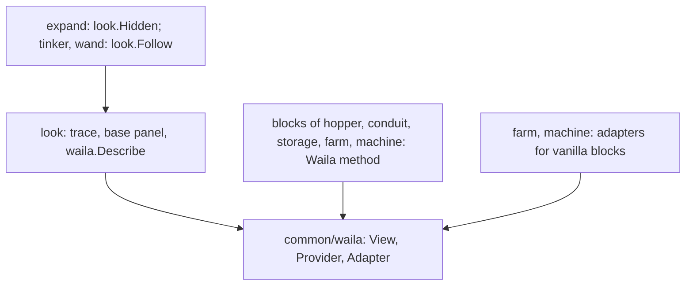
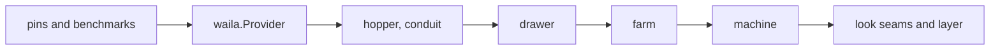

# Plan: structural rework phase 3f (look: blocks describe their own panel)

**Review plan:** docs/plans/2026-11-10-cleanup-restructure.review.md
**Goal:** Review part 3-3, first third: the WAILA panel (`look`) stops listing the block types of nine features and of `hopper`. A block fills its own panel through `waila.Provider`, and `look` imports no feature.
**Architecture:** REF is `docs/plans/2026-11-10-cleanup-restructure-p3-capabilities.md`: the inventory (section 1), the decisions (2), every new name (3), the imports before and after (4), the measured numbers (5) and each task's code (7, one heading per task). The code of REF was built and run; a task copies its blocks and designs nothing.
**Tech stack:** Go 1.26, patched Dragonfly in `third_party/dragonfly`, tests with `go test`.
**Spec:** none (the review plan binds)
**Detail:** contracts
**Target-min:** 35
**Ignore:** .superlite/

## Global constraints

- Language Go. Checkout `/home/user/SkyGear`, branch `superlite/sessions/cleanup-restructure`. Developers do not commit or push; the coordinator commits each task with its subject (English, no attribution lines).
- Who decides: the developer implements the task text and its REF section exactly. A name, a signature, a place or a behaviour the text leaves open, a REF block that does not fit the code found, a fact of the task that is false: stop, change nothing more, return `NEEDS_CONTEXT` with the question. No refactoring beside the task.
- Green at every commit: `go build ./... && go vet ./... && go test ./...` (51 packages) and `gofmt -l` clean. No test is skipped, deleted or weakened; a test file changes only where the task names the line.
- Goldens: the six files of `content/skygear/testdata/pin/` at HEAD and the four of `content/skygear/wire/testdata` stay byte for byte. `SKYGEAR_GOLDEN=update` is allowed in T59 only, for its two new files; from T60 on `look.golden` and `creative.golden` are frozen as well. A red golden means the change is wrong.
- Every task from T60 runs `go test ./content/skygear/ -run 'TestPin|TestLayers|TestFeature|TestEvery|TestRoot|TestLook' -count=1`, `go test ./content/skygear/wire/`, then the full suite, and the benchmarks `go test -run xxx -bench 'LookMachine|LookInfo|HandleMove' -benchmem -count 5 ./content/skygear`: B/op and allocs/op equal T59's report, ns/op within 15 percent (REF 5).
- Scope: only the files of Owns. One task at a time, in id order. Go comments in English, saying what the code does now.
- Leave `.gitignore` alone. Ruling: no Wave 0 - an existing tree needs no stubs - an unused brief. Ruling: single checkout, no worktree - the owner's branch - none.
- Ruling: [scope] the panel capability is in `common/waila`, not a descriptor field - `hopper` is below `core` - a block of another module could implement it too.
- Ruling: [scope] `look` moves to the core layer and gets `Hidden` and `Follow` instead of new hooks - `order.golden` may not change in this part - two seams outside the hook list, pinned by `TestLookFollowers`.

## Main diagram

## File structure

New: `common/waila/provider.go` (+ test), `look.go` in `hopper`, `conduit`, `storage`, `farm`, `machine`; `content/skygear/pin_look_test.go`, `pin_creative_test.go`, two goldens. Changed: `look/look.go` (420 lines to about 240), `subscribe.go` of `farm`, `machine`, `expand`, `tinker`, `wand`; `machine/machine.go`, `storage/storage.go`, `fairy/fairytime.go`; `layers_test.go` and four root tests' call sites.

## Task graph

## Predicted schedule

From `plan_tools schedule`: one chain, T59 to T65 (every task edits `look/look.go` or is its pin).

## look

**Probe entry:** run=go test ./content/skygear -run 'TestPinLook|TestLayers'

### T59 pin the panels and the creative order · Complexity 4 · Est. context 40k
**Owns:** content/skygear/pin_look_test.go, content/skygear/pin_creative_test.go, content/skygear/pin_bench_test.go, content/skygear/testdata/pin/look.golden, content/skygear/testdata/pin/creative.golden
**Components:** 2
**LOC owned:** 390
**Tests:** slow
**Kind:** design
**Model:** sonnet
**Est. time:** 3.5 min
**Consumes:** none
**Produces:** pinInfo(info waila.Info) -> string
- e.g. pinInfo of an empty oak barrel -> `name="참나무 배럴" key="tile.skygear:barrel_oak.name" icon=skygear:barrel_oak:0 lines=["§7비어 있음"] line=- container=- tools=[baz] marks={Lock:false Multiplier:0 Void:false} source=""`
- e.g. creative.golden line `0000` -> `anon_sg_construction skygear:research_table:0`
**Review Focus:** `TestPinLook` records 143 scenarios (72 `machine/<kind>` and `/sneak`, 20 `state/`, 6 drawer, 3 composter, 3 bundle, 2 leaves, 7 barrel, 4 hopper, 4 plant, 13 crop, 9 vanilla); `TestPinCreative` 243 lines; both pass in 5 processes, under `-race`, and inside the whole package (the test loads the pack's names itself)
**Steps:**
1. No code but tests changes. Copy the three REF T59 blocks.
2. Record once: `SKYGEAR_GOLDEN=update go test ./content/skygear/ -run 'TestPinLook$|TestPinCreative$' -count=1`; `wc -l` gives 143 and 243.
3. Run the three look benchmarks and `HandleMove` with `-count 5`; report mean ns/op, B/op, allocs/op (REF 5 has the expected numbers; a different allocation count is reported, not fixed).
4. Commit `test(look): pin every block's panel and the creative order`.

### T60 the panel capability · Complexity 4 · Est. context 34k
**Owns:** common/waila/provider.go, common/waila/provider_test.go, content/skygear/look/look.go
**Components:** 1
**LOC owned:** 130
**Tests:** slow
**Kind:** design
**Model:** sonnet
**Est. time:** 2.0 min
**Consumes:** none
**Produces:** waila.Describe(v View, b world.Block, info Info) -> Info · waila.RegisterAdapter(a Adapter) · Provider.Waila(v View, info Info) -> Info
- e.g. Describe(View{Lang: "ko"}, described{}, Info{Name: "n"}) with adapters a1, a2 -> Lines ["own:ko", "a1", "a2"], Name "n"
- e.g. Describe(View{}, block.Stone{}, Info{Name: "n"}) with no adapter -> the same Info
- e.g. Provider.Waila(View{Lang: "ko"}, Info{Name: "n"}) on the test block `described` -> Info{Name: "n", Lines: ["own:ko"]}
- e.g. testing.AllocsPerRun of Describe on block.Stone{} with two adapters -> 0
**Review Focus:** `TestDescribeProviderThenAdapters`, `TestDescribePlainBlock`, `TestDescribeAllocatesNothing` as in REF; `look.golden` unchanged
**Steps:**
1. Write `provider_test.go` (REF T60), see it fail to build, write `provider.go`.
2. `look.go`: the two edits of REF T60 (the `view` variable; the `default:` clause that calls `waila.Describe`). No clause is removed yet.
3. Commit `refactor(look): let a block describe its own panel`.

### T61 hoppers and conduit bundles · Complexity 2 · Est. context 30k
**Owns:** content/skygear/hopper/look.go, content/skygear/conduit/look.go, content/skygear/look/look.go
**Components:** 2
**LOC owned:** 40
**Tests:** slow
**Kind:** design
**Model:** sonnet
**Est. time:** 1.6 min
**Consumes:** none
**Produces:** none
**Review Focus:** `look.golden` lines `hopper/*` (4) and `bundle/*` (3) unchanged
**Steps:**
1. Add the two files of REF T61.
2. `look.go`: delete the clauses `case conduit.Bundle:` and `case hopper.FlowHopper:` and the two imports.
3. Commit `refactor(look): hoppers and conduit bundles fill their own panel`.

### T62 the drawer · Complexity 2 · Est. context 30k
**Owns:** content/skygear/storage/look.go, content/skygear/look/look.go
**Components:** 1
**LOC owned:** 50
**Tests:** slow
**Kind:** design
**Model:** sonnet
**Est. time:** 1.6 min
**Consumes:** none
**Produces:** none
**Review Focus:** `look.golden` lines `drawer/*` (6) unchanged; `TestLookInfo` passes untouched
**Steps:**
1. Add `storage/look.go` (REF T62): `Drawer.Waila` and `drawerDetail`.
2. `look.go`: delete `case storage.Drawer:`, `drawerDetail`, the imports `math` and `sgitem`; `storage` stays imported.
3. Commit `refactor(look): the drawer fills its own panel`.

### T63 the farm's blocks and crops · Complexity 4 · Est. context 28k
**Owns:** content/skygear/farm/look.go, content/skygear/farm/subscribe.go, content/skygear/look/look.go, content/skygear/look_test.go
**Components:** 2
**LOC owned:** 130
**Tests:** slow
**Kind:** design
**Model:** sonnet
**Est. time:** 2.2 min
**Consumes:** none
**Produces:** look.CropHeight(b world.Block) -> (float64, bool)
- e.g. look.CropHeight(block.WheatSeeds{}) -> 0.125, true
- e.g. look.CropHeight(farm.WithGrowth(block.WheatSeeds{}, 7)) -> 1, true
- e.g. look.CropHeight(block.Stone{}) -> 0, false
**Review Focus:** `look.golden` lines `leaves/*`, `barrel/*`, `plant/*`, `composter/*`, `crop/*` (29) unchanged; `TestLookCropsMatchFarm` (REF T63); `TestLookedAt`, `TestUsingCrops`, `TestMagicPlantLifecycle` pass untouched
**Steps:**
1. Append `TestLookCropsMatchFarm` to `look_test.go`; it fails to build until step 3.
2. Add `farm/look.go`: three `Waila` methods and `registerLook` (one adapter: the composter, then the crops); `subscribe()` calls `registerLook()` last.
3. `look.go`: the edits of REF T63 (four clauses and the crop block out, `CropHeight` in, `LookedAt` uses it, import `farm` out).
4. Commit `refactor(look): the farm fills the panels of its blocks and crops`.

### T64 the machine · Complexity 6 · Est. context 36k
**Owns:** content/skygear/machine/look.go, content/skygear/machine/machine.go, content/skygear/machine/subscribe.go, content/skygear/storage/storage.go, content/skygear/fairy/fairytime.go, content/skygear/look/look.go, content/skygear/autoequip_test.go, content/skygear/look_test.go, content/skygear/fairytime_test.go
**Components:** 2
**LOC owned:** 260
**Tests:** slow
**Kind:** design
**Model:** sonnet
**Est. time:** 3.0 min
**Consumes:** none
**Produces:** machine.MachineLines(lang string, m Machine) -> ([]string, *waila.ItemLine) · machine.BoostLine(lang string, st *State) -> string · machine.FurnaceArrow(b world.Block) -> item.Stack
- e.g. machine.BoostLine("ko_KR", &State{Boost: 400}) -> "요정의 모래시계 §f0분 20초"; with Boost 0 or a nil state -> ""
- e.g. machine.FurnaceArrow(block.NewFurnace(cube.North)) -> a stack of ProgressArrow{Step: 0}; of block.Stone{} -> the empty stack
**Review Focus:** `look.golden` lines `machine/*` (72), `state/*` (20), `vanilla/*` (9) unchanged: the hourglass line stays before the sneak details, a controller's lines replace all others, the furnaces keep `progress=skygear:progress_0:0x1`; `TestMachineStatusLines`, `TestFurnaceArrow`, `TestLookDetailWhileSneaking`, the test at `fairytime_test.go:117` pass with only the renamed call
**Steps:**
1. `machine/look.go` whole from REF T64; `Def.Lines`; `registerLook()` last in `machine`'s `subscribe()`; `def.Lines = Lines` in `storage`'s `init`.
2. Delete `fairy.HourglassLine`; `look.go` per REF T64 (the switch becomes one `return waila.Describe(...)`, six functions and six imports go, `PeekRange` leaves `showLook`, `containerOf` sets no `Progress`).
3. The three test call sites of REF T64.
4. Commit `refactor(look): the machine fills its own panel`.

### T65 look knows no feature · Complexity 5 · Est. context 30k
**Owns:** content/skygear/look/look.go, content/skygear/expand/subscribe.go, content/skygear/tinker/subscribe.go, content/skygear/wand/subscribe.go, content/skygear/layers_test.go
**Components:** 2
**LOC owned:** 140
**Tests:** slow
**Kind:** design
**Model:** sonnet
**Est. time:** 2.3 min
**Consumes:** none
**Produces:** look.Follow(name string, f func(Target)) · look.Followers() -> []string · look.Hidden
- e.g. look.Followers() after core.Install(Features...) -> ["tinker.vein", "wand.preview"]
- e.g. look.Hidden(s, p) for a player in expansion mode -> true, otherwise false
**Review Focus:** `TestCapabilityImports` (row `look`: core, naming), `TestLookFollowers`, `TestLayers` with `look` in the core group; `Move/expanding` and the `Fast` lines of the pins unchanged; in `Update` an expanding player returns before the followers, in `UpdateAll` the followers run after `updateLookAt` whatever it did
**Steps:**
1. `layers_test.go`: move `look` in `layers`; add `onlyImports` (the `look` row), `TestCapabilityImports`, `TestLookFollowers` (REF T65). They fail.
2. `look.go` becomes the file of REF T65; `expand`, `tinker`, `wand` get `hideLook` and `followLook` from REF T65, each called last in `subscribe()`.
3. `go list -f '{{join .Imports "\n"}}' ./content/skygear/look | grep content/skygear/` prints `core` and `naming` only.
4. Commit `refactor(look): import no feature; features hide and follow the panel`.

## Review Focus

- look (library): state, encoding. Every `look.golden` line byte for byte; the order inside the machine panel; no allocation added (REF 5).
- layers (library): state. `look` below the features; `expand`, `tinker`, `wand` are its only feature importers.

## Self-review

Coverage: inventory rows R1, R2, R3 (REF 1). Left to p3g: decor (R4), the creative list (R5). Left to p3h: commands (R6), names (R8), autofill (R17), documents.
