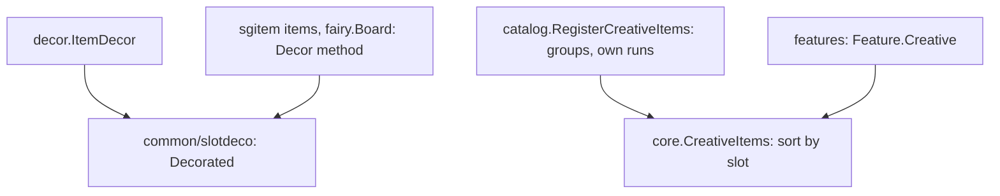
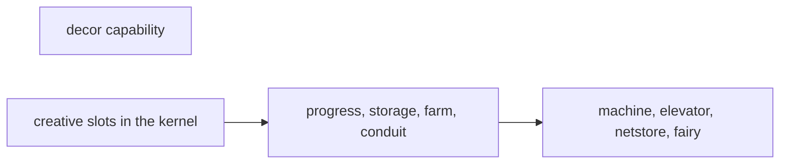

# Plan: structural rework phase 3g (items say their decoration, features list their creative items)

**Review plan:** docs/plans/2026-11-10-cleanup-restructure.review.md
**Goal:** Review part 3-3, second third: `decor` stops switching over twelve item types (an item says its own rarity and tier), and the creative list is put together from what each feature declares, in exactly today's order.
**Architecture:** Runs after p3f. REF is `docs/plans/2026-11-10-cleanup-restructure-p3-capabilities.md`: the inventory (section 1), the decisions (2), the new names (3), the creative slots (6) and each task's code (7). The code of REF was built and run; a task copies its blocks and designs nothing.
**Tech stack:** Go 1.26, patched Dragonfly in `third_party/dragonfly`, tests with `go test`.
**Spec:** none (the review plan binds)
**Detail:** contracts
**Target-min:** 35
**Ignore:** .superlite/

## Global constraints

- Language Go. Checkout `/home/user/SkyGear`, branch `superlite/sessions/cleanup-restructure`. Developers do not commit or push; the coordinator commits each task with its subject (English, no attribution lines).
- Who decides: the developer implements the task text and its REF section exactly. A name, a signature, a place or a behaviour the text leaves open, a REF block that does not fit the code found, a fact of the task that is false: stop, change nothing more, return `NEEDS_CONTEXT` with the question. No refactoring beside the task.
- Green at every commit: `go build ./... && go vet ./... && go test ./...` (51 packages) and `gofmt -l` clean. No test is skipped, deleted or weakened; a test file changes only where the task names the line.
- Goldens: every file of `content/skygear/testdata/pin/` (the six of HEAD, `look.golden` and `creative.golden` of T59) and the four of `content/skygear/wire/testdata` stay byte for byte. No task here may set `SKYGEAR_GOLDEN=update`. A red golden means the change is wrong.
- Every task runs `go test ./content/skygear/ -run 'TestPin|TestLayers|TestFeature|TestCapability|TestEvery|TestRoot' -count=1`, `go test ./content/skygear/wire/`, then the full suite.
- Item registration order is in the wire goldens: no task moves a `world.RegisterItem` or `world.RegisterBlock` call or adds an `init`. If `TestWire` is red after an import change, restore the tree and report the two import lists.
- Scope: only the files of Owns. One task at a time, in id order. Go comments in English, saying what the code does now.
- Leave `.gitignore` alone. Ruling: no Wave 0 - an existing tree needs no stubs - an unused brief. Ruling: single checkout, no worktree - the owner's branch - none.
- Ruling: [scope] the creative list is declared with slots, not derived from `Category()` - 45 of 243 entries are in another tab than their category and 106 of 349 custom items are not listed - a new item is added to its owner's list by hand.
- Ruling: [scope] an item is listed by the package that declares its Go type; the runs of `sgitem` and `hopper` types stay in `catalog` - they are no feature - `catalog` shrinks further only when `sgitem` is thinned.

## Main diagram

## File structure

New: `sgitem/decor.go`, `core/creative.go` (+ test), `creative.go` in `progress`, `storage`, `farm`, `conduit`, `machine`, `elevator`, `netstore`, `fairy`, `content/skygear/decor_test.go`. Changed: `common/slotdeco/slotdeco.go`, `decor/decor.go`, `fairy/fairymagic.go`, `core/feature.go`, `catalog/creative.go`, eight `feature.go`, `layers_test.go`, `creative_test.go`.

## Task graph

## Predicted schedule

From `plan_tools schedule`: T66 beside the chain T67 to T69 (they share no file); the coordinator still runs one task at a time.

## decor

**Probe entry:** run=go test ./content/skygear -run 'TestItemDecor|TestPack'

### T66 an item says its own decoration · Complexity 4 · Est. context 30k
**Owns:** common/slotdeco/slotdeco.go, content/skygear/sgitem/decor.go, content/skygear/fairy/fairymagic.go, content/skygear/decor/decor.go, content/skygear/decor_test.go, content/skygear/layers_test.go
**Components:** 2
**LOC owned:** 140
**Tests:** slow
**Kind:** design
**Model:** sonnet
**Est. time:** 2.2 min
**Consumes:** none
**Produces:** Decorated.Decor() -> (Rarity, int) · decor.ItemDecor(it world.Item) -> (slotdeco.Rarity, int)
- e.g. sgitem.TierKit{Level: 2}.Decor() -> slotdeco.Rare, 2
- e.g. sgitem.Mesh{Tier: "string"}.Decor() -> slotdeco.Common, 0; Mesh{Tier: "gold"} -> slotdeco.Rare, 0
- e.g. decor.ItemDecor(fairy.Board{}) -> slotdeco.Rare, 0; decor.ItemDecor(item.Stick{}) -> slotdeco.Common, 0
**Review Focus:** `TestItemDecor` (13 items, REF T66) green before and after; `TestPackHasItemAssets` (every custom item's name in the pack carries the marks of its decoration) untouched and green; `TestCapabilityImports` row `decor`: naming, tinker; `go run ./tools/slotmarks assets/resourcepack/skygear` prints `0 lines changed` twice and leaves `git status --short assets` empty
**Steps:**
1. Write `decor_test.go` (REF T66). It passes on the current switch: that is the pin.
2. `slotdeco.Decorated`; `sgitem/decor.go` (twelve methods: `TierAlloy`, `TierKit`, `Circuit`, `Mesh`, `Ingot`, `CompactBlock`, `ResearchEssence`, `Essence`, `Relic`, `FairyEmerald`, `FairyHourglass`, `DimensionStone`); `fairy.Board.Decor`.
3. `decor.ItemDecor` becomes the four lines of REF T66 (the switch and the `skygear:fairy_board` name check go; the `sgitem` import goes; `TipName` is not touched).
4. `layers_test.go`: add the row `"decor": {"naming", "tinker"},` to `onlyImports`.
5. Commit `refactor(decor): let an item say its own slot decoration`.

## creative

**Probe entry:** run=go test ./content/skygear -run 'TestPinCreative|TestCreative'

### T67 creative slots in the kernel · Complexity 5 · Est. context 36k
**Owns:** content/skygear/core/creative.go, content/skygear/core/creative_test.go, content/skygear/core/feature.go, content/skygear/catalog/creative.go
**Components:** 2
**LOC owned:** 290
**Tests:** slow
**Kind:** design
**Model:** sonnet
**Est. time:** 3.0 min
**Consumes:** none
**Produces:** core.CreativeItems(own []CreativeItem) -> []CreativeItem · core.CreativeItem{Slot int, Category creative.Category, Item world.Item} · Feature.Creative
- e.g. feature a with slots 30, 10, 30 (stick, diamond, apple), feature c with 20 (coal), own 40 (stone), 15 (dirt); CreativeItems(own) -> diamond, dirt, coal, stick, apple, stone
- e.g. features a and b both with slot 20 -> panic `core: creative slot 20 is used by feature a and by feature b`
- e.g. own with slot 20 and feature a with slot 20 -> panic naming `the content list` and `feature a`
**Review Focus:** `TestCreativeItemsSortBySlot`, `TestCreativeSlotOfTwoOwnersPanics` (REF T67); `creative.golden` (243 lines) and `wire/testdata/creative.golden` unchanged; `Install` is not changed (the field is read by `CreativeItems`)
**Steps:**
1. `core/creative_test.go`, then `core/creative.go` and the `Creative` field (REF T67).
2. `catalog/creative.go` becomes the REF T67 block: the groups as before, then every item of `core.CreativeItems(ownCreative())`; `ownCreative` holds all 16 runs, each under its `slot = N` line (REF 6). No feature has `Creative` yet.
3. Commit `refactor(catalog): order the creative list by slots`.

### T68 progress, storage, farm and conduit list their items · Complexity 3 · Est. context 32k
**Owns:** content/skygear/progress/creative.go, content/skygear/progress/feature.go, content/skygear/storage/creative.go, content/skygear/storage/feature.go, content/skygear/farm/creative.go, content/skygear/farm/feature.go, content/skygear/conduit/creative.go, content/skygear/conduit/feature.go, content/skygear/catalog/creative.go
**Components:** 2
**LOC owned:** 110
**Tests:** slow
**Kind:** design
**Model:** sonnet
**Est. time:** 2.0 min
**Consumes:** none
**Produces:** none
**Review Focus:** `creative.golden` lines 0000 to 0013 (research table, drawer, two barrels, ten conduits) and the silkworm and seed lines unchanged; `wire` creative unchanged; slots 10, 20, 30, 40, 90, 150 are no longer in `catalog/creative.go`
**Steps:**
1. For each of the four features: add `creative.go` from REF T68 and the field `Creative: creativeItems` before `Setup: subscribe` in `feature.go`; delete that feature's runs from `ownCreative` (progress 10; storage 20; farm 30, 90, 150; conduit 40) and the imports of `progress`, `storage`, `farm`, `conduit` in `catalog/creative.go`.
2. One feature at a time, with `go test ./content/skygear/ -run TestPinCreative -count=1` after each.
3. Commit `refactor(catalog): progress, storage, farm and conduit list their creative items`.

### T69 machine, elevator, netstore and fairy list their items · Complexity 3 · Est. context 32k
**Owns:** content/skygear/machine/creative.go, content/skygear/machine/feature.go, content/skygear/elevator/creative.go, content/skygear/elevator/feature.go, content/skygear/netstore/creative.go, content/skygear/netstore/feature.go, content/skygear/fairy/creative.go, content/skygear/fairy/feature.go, content/skygear/catalog/creative.go, content/skygear/creative_test.go
**Components:** 2
**LOC owned:** 130
**Tests:** slow
**Kind:** design
**Model:** sonnet
**Est. time:** 2.1 min
**Consumes:** none
**Produces:** none
**Review Focus:** `TestCreativeListNamesNoFeature` (REF T69): `catalog/creative.go` imports only core, hopper, machine, sgitem of the game, and the features' slots are 10 progress, 20 storage, 30 farm, 40 conduit, 50 machine, 70 elevator, 90 farm, 110 netstore, 130 fairy, 150 farm; `creative.golden` and `wire` unchanged; `recipes.golden` unchanged although `catalog` no longer imports `fairy`
**Steps:**
1. As T68 for machine (50), elevator (70), netstore (110), fairy (130); the imports of `elevator`, `netstore`, `fairy` leave `catalog/creative.go`, `machine` stays (`machine.MaxTier`).
2. `catalog/creative.go` now equals the last block of REF "T68 and T69" (six runs: 60, 80, 100, 120, 140, 160).
3. Append `TestCreativeListNamesNoFeature` to `creative_test.go`.
4. Commit `refactor(catalog): machine, elevator, netstore and fairy list their creative items`.

## Review Focus

- decor (library): encoding. Every custom item's pack name keeps its marks.
- creative (library): state, protocol. The order of all 243 entries; a slot has one owner.

## Self-review

Coverage: inventory rows R4 and R5 (REF 1). Left to p3h: commands (R6), names (R8), autofill (R17), documents.
