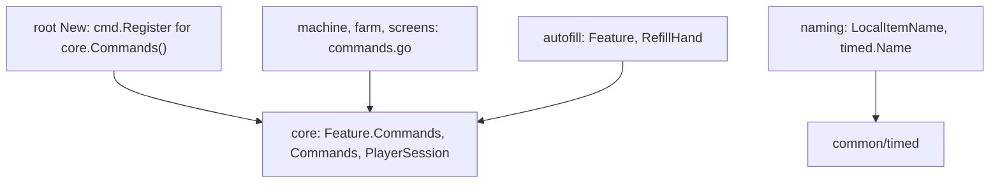
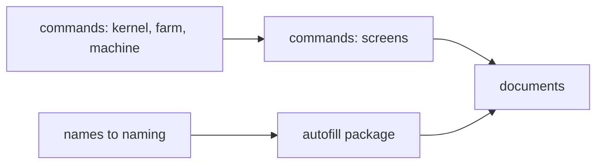

# Plan: structural rework phase 3h (commands, names and autofill leave the root and the kernel; documents)

**Review plan:** docs/plans/2026-11-10-cleanup-restructure.review.md
**Goal:** Review part 3-3, last third: a feature registers its own commands, the root's `names.go` goes to `naming`, the autofill feature leaves the kernel, and the documents describe the capabilities. The root package is then the feature list, the platform glue and the operator tools.
**Architecture:** Runs after p3g. REF is `docs/plans/2026-11-10-cleanup-restructure-p3-capabilities.md`: the inventory (section 1), the decisions (2), the new names (3), the imports before and after (4) and each task's code (7). The code of REF was built and run; a task copies its blocks and designs nothing.
**Tech stack:** Go 1.26, patched Dragonfly in `third_party/dragonfly`, tests with `go test`.
**Spec:** none (the review plan binds)
**Detail:** contracts
**Target-min:** 35
**Ignore:** .superlite/

## Global constraints

- Language Go. Checkout `/home/user/SkyGear`, branch `superlite/sessions/cleanup-restructure`. Developers do not commit or push; the coordinator commits each task with its subject (English, no attribution lines).
- Who decides: the developer implements the task text and its REF section exactly. A name, a signature, a place or a behaviour the text leaves open, a REF block that does not fit the code found, a fact of the task that is false: stop, change nothing more, return `NEEDS_CONTEXT` with the question. No refactoring beside the task.
- Green at every commit: `go build ./... && go vet ./... && go test ./...` (51 packages) and `gofmt -l` clean. No test is skipped, deleted or weakened; a test file changes only where the task names the line.
- Goldens: every file of `content/skygear/testdata/pin/` (eight after T59) and the four of `content/skygear/wire/testdata` stay byte for byte. No task here may set `SKYGEAR_GOLDEN=update`. A red golden means the change is wrong.
- Every code task runs `go test ./content/skygear/ -run 'TestPin|TestLayers|TestFeature|TestCapability|TestEvery|TestRoot' -count=1`, `go test ./content/skygear/wire/`, then the full suite.
- A move changes no statement: bodies are copied, only package qualifiers and the names REF lists change. No task moves a `world.RegisterItem` or `world.RegisterBlock` call.
- Left as they are, by decision (REF 1, rows R7, R8, R9, R10, R18): `giveItems` and the operator tools of the root, `itemsFeature`, the root's `hopper.go`, `core.InArena`, `core.ShowMenu`, `core.UpdateBoard`.
- Scope: only the files of Owns. One task at a time, in id order. Go comments in English; documents under `docs/` and the READMEs in Korean, the current state only (no history, no "was"), written with the repo skill `korean-humanizer`; `CONTRIBUTING.md` in English.
- Leave `.gitignore` alone. Ruling: no Wave 0 - an existing tree needs no stubs - an unused brief. Ruling: single checkout, no worktree - the owner's branch - none.
- Ruling: [scope] autofill becomes the package `content/skygear/autofill` in the core layer - the kernel must name no feature and `machine` and `wand` call it - one more package.

## Main diagram

## File structure

New: `core/commands.go` (+ test), `commands.go` in `farm`, `machine`, `screens`, `naming/entry.go`, `autofill/refill.go`, `autofill/feature.go`, `content/skygear/commands_test.go`. Deleted: `content/skygear/commands.go`, `content/skygear/names.go`, `core/refill.go`. Changed: `core/feature.go`, `core/kernel.go`, `game.go`, `features.go`, three `feature.go`, `machine/sieve.go`, `wand/use.go`, `layers_test.go`, `locales/locales_test.go`, two root tests' call sites, eleven documents.

## Task graph

## Predicted schedule

From `plan_tools schedule`: two chains (T70, T71 and T72, T73), then T74; the coordinator still runs one task at a time.

## root

**Probe entry:** run=go test ./content/skygear -run 'TestFeatureCommands|TestLayers|TestFeature'

### T70 features own their commands: kernel, farm, machine · Complexity 5 · Est. context 34k
**Owns:** content/skygear/core/commands.go, content/skygear/core/commands_test.go, content/skygear/core/feature.go, content/skygear/farm/commands.go, content/skygear/farm/feature.go, content/skygear/machine/commands.go, content/skygear/machine/feature.go, content/skygear/game.go, content/skygear/commands.go, content/skygear/commands_test.go, content/skygear/locales/locales_test.go
**Components:** 2
**LOC owned:** 210
**Tests:** slow
**Kind:** design
**Model:** sonnet
**Est. time:** 2.6 min
**Consumes:** none
**Produces:** core.Commands() -> []cmd.Command · core.PlayerSession(src cmd.Source, o *cmd.Output, tx *world.Tx) -> (*player.Player, *Session, bool) · Feature.Commands
- e.g. features a (commands a1, a2), b (none), c (c1); core.Commands() names -> ["a1", "a2", "c1"]
- e.g. core.PlayerSession(nil, o, nil) -> nil, nil, false and o has no error
- e.g. core.PlayerSession(p, o, tx) in a world without a session -> false and o holds the text of `menu.needSave`
**Review Focus:** `TestCommandsInListOrder`, `TestPlayerSessionWithoutPlayer` (REF T70); root `TestFeatureCommands` with `want` = the four names `"통계", "stats", "묘목", "sapling"`; `TestNoKoreanInCode` green with the allow list of REF T70; the root still registers the other eight commands itself
**Steps:**
1. `core/commands_test.go`, then `core/commands.go` and the `Commands` field (REF T70).
2. `farm/commands.go`, `machine/commands.go` (REF T70: `saplingCmd` and `statsCmd` with `core.Of` and `core.PlayerSession` in place of the root's session lookup; the texts and their order unchanged); `Commands: commands` in both `feature.go`.
3. Root: `New` registers `core.Commands()` right after `registerCommands(g)`; `commands.go` loses the four registrations and the two types; `locales_test.go` allow list; `commands_test.go`.
4. Commit `refactor(skygear): farm and machine register their own commands`.

### T71 the screens own their commands · Complexity 4 · Est. context 32k
**Owns:** content/skygear/screens/commands.go, content/skygear/screens/feature.go, content/skygear/commands.go, content/skygear/game.go, content/skygear/commands_test.go, content/skygear/locales/locales_test.go
**Components:** 1
**LOC owned:** 130
**Tests:** slow
**Kind:** design
**Model:** sonnet
**Est. time:** 2.1 min
**Consumes:** none
**Produces:** none
**Review Focus:** `TestFeatureCommands` with the twelve names of REF T70 in order (machine 2, farm 2, screens 8); the root has no `commands.go`; `grep -n 'cmd.New' content/skygear/*.go` finds only `admin.go` and `debug*.go`; `screens_test.go` passes untouched
**Steps:**
1. `screens/commands.go` (REF T71): `menuCmd`, `helpCmd`, `menuItemCmd`, `codexCmd`, `openCodex` (unexported, the body of the root's `session.openCodex` with `s` as `*core.Session`); `Commands: commands` in `screens/feature.go`.
2. Delete `content/skygear/commands.go` and the line `registerCommands(g)` in `game.go`; `commands_test.go` gets the twelve names; `locales_test.go` allow list and comment as REF T71.
3. Commit `refactor(screens): register the menu, codex and help commands`.

### T72 the root's names go to naming · Complexity 2 · Est. context 28k
**Owns:** content/skygear/naming/entry.go, content/skygear/names.go, content/skygear/features.go, content/skygear/names_test.go
**Components:** 1
**LOC owned:** 45
**Tests:** slow
**Kind:** design
**Model:** sonnet
**Est. time:** 1.6 min
**Consumes:** none
**Produces:** naming.LocalItemName(e protocol.ItemEntry) -> protocol.ItemEntry
- e.g. an entry of `skygear:research_essence_engineering` with a `minecraft:display_name` component -> its value is `item.skygear:research_essence_engineering.name`
- e.g. an entry that is not component based -> returned unchanged
**Review Focus:** `wire/testdata/items.golden` unchanged (the edit is still `sgitem.ClipWoodenBucket(naming.LocalItemName(e))`, last in the feature list); `names_test.go` and `timed_test.go` pass with only the renamed call; `itemsFeature` stays in `features.go`
**Steps:**
1. `naming/entry.go` (REF T72): `init` sets `timed.Name = ItemName`; `LocalItemName` is the body of `localItemName`.
2. Delete `content/skygear/names.go`; `features.go` and `names_test.go` call `naming.LocalItemName`.
3. Commit `refactor(naming): own the item name edit and the timed item name`.

### T73 autofill is its own package · Complexity 4 · Est. context 32k
**Owns:** content/skygear/autofill/refill.go, content/skygear/autofill/feature.go, content/skygear/core/refill.go, content/skygear/core/kernel.go, content/skygear/machine/sieve.go, content/skygear/wand/use.go, content/skygear/wand_test.go, content/skygear/features.go, content/skygear/layers_test.go
**Components:** 1
**LOC owned:** 150
**Tests:** slow
**Kind:** design
**Model:** sonnet
**Est. time:** 2.2 min
**Consumes:** none
**Produces:** autofill.RefillHand(p *player.Player, proto item.Stack) -> bool · autofill.Feature
- e.g. autofill.RefillHand(p, stone) with an empty hand and stone in slot 12 -> true, the stone is in the hand
- e.g. the same after account.Toggle(p, autofill.Setting) turned it off -> false
**Review Focus:** `settings.golden` and `order.golden` unchanged (the feature is still named `autofill`, eighth in the list, with its four subscribers `autofill.broken`, `autofill.consume`, `autofill.place`, `autofill.use`); `TestFeatureNames` not edited; `TestEveryFeatureListed` sees `autofill/feature.go`; `grep -rn 'Autofill\|Refill' content/skygear/core/` finds nothing; `TestAutofill`, `TestAutofillPlace` pass with only the renamed calls
**Steps:**
1. `git mv content/skygear/core/refill.go content/skygear/autofill/refill.go` and the four renames of REF T73.
2. `autofill/feature.go` (REF T73) from the three declarations cut out of `core/kernel.go`.
3. Call sites of REF T73; `layers_test.go` core group gets `"autofill"` after `"look"`.
4. Commit `refactor(autofill): move the autofill feature out of the kernel`.

## documents

**Probe entry:** run=go test ./content/skygear -run 'TestLayers|TestFeature'

### T74 describe the capabilities · Complexity 4 · Est. context 32k
**Owns:** docs/tech/extension.md, docs/tech/waila.md, docs/tech/slotdeco.md, docs/tech/recipes.md, docs/tech/monitor.md, docs/design/03-architecture.md, docs/design/19-construction-wand.md, docs/design/open-questions.md, content/skygear/README.md, common/README.md, CONTRIBUTING.md, content/skygear/core/doc.go
**Components:** 2
**LOC owned:** 220
**Tests:** slow
**Kind:** design
**Model:** sonnet
**Est. time:** 2.7 min
**Consumes:** none
**Produces:** none
**Steps:**
1. `docs/tech/extension.md`, from the code as built. "새 기능 더하기" step 2 lists the fields `Name`, `Entities`, `Settings`, `ItemEntry`, `Creative`, `Commands`, `Setup`. New steps after the subscriptions, each with the file name and a short example taken from `hopper/look.go`, `farm/look.go`, `fairy/fairymagic.go`, `elevator/creative.go`, `farm/commands.go`: a block's panel lines (`waila.Provider`; a vanilla block through `waila.RegisterAdapter` from `Setup`; a session through `core.At(v.Tx)`), an item's decoration (`slotdeco.Decorated`), creative items (`creative.go`, a free slot between two neighbours of REF 6, then `creative.golden` and the wire golden are re-recorded on purpose), commands (`commands.go`, `core.PlayerSession`, a Korean command name needs the file in the allow list of `locales_test.go`), hiding or following the panel (`look.Hidden`, `look.Follow`). The section "기능이 아직 손대는 중앙 목록" keeps recipes, research and locales only. The layer list: `look` and `autofill` are in the core layer. The rules table gains `TestCapabilityImports`, `TestLookFollowers`, `TestCreativeListNamesNoFeature`, `TestFeatureCommands`; the pins table gains `look.golden` (`TestPinLook`) and `creative.golden` (`TestPinCreative`); the benchmark line gains `LookMachine|LookInfo`. The root row of the layer table no longer says commands.
2. `docs/tech/waila.md`: `common/waila` holds `View`, `Provider`, `Adapter`, `Describe`; `look/look.go` traces and builds the base panel; the lines of a block are in its package (`machine/look.go`, `storage/look.go`, `farm/look.go`, `hopper/look.go`, `conduit/look.go`); the furnaces' arrow is an adapter of `machine`; expansion mode hides the panel through `look.Hidden`; checks: `pin_look_test.go`.
3. One sentence each: `slotdeco.md` line 22 (the rule is each item's `Decor()`, shared items in `sgitem/decor.go`, read by `decor.ItemDecor`); `recipes.md` line 22 and `CONTRIBUTING.md` lines 113-115 (a new item is listed in its feature's `creative.go`, a shared item in `catalog/creative.go`); `monitor.md` line 11 (`machine/commands.go`); `19-construction-wand.md` lines 104 and 108 (`content/skygear/autofill/refill.go`; the preview follows the panel through `look.Follow`); `open-questions.md` line 48 (`sgitem/decor.go`); `03-architecture.md` line 108 (the root holds no player command); `common/README.md` rows `waila` and `slotdeco`; `core/doc.go` (the descriptor's fields).
4. `content/skygear/README.md`: `look` moves to the 핵심 rows ("WAILA 패널: 시선 추적과 기본 정보, 블록이 자기 줄을 채운다"), a new 핵심 row `autofill`, the `catalog` row says it lists the shared items' creative entries, the `skygear` row loses 명령어; the structure paragraph gains one sentence on the capabilities.
5. Check: every identifier a document names exists (`grep`), no document names `commands.go` of the root, `names.go`, `core/refill.go`, `look.MachineLines`; `go test ./...` green.
6. Commit `docs: describe the capabilities a feature provides`.

## Review Focus

- root (CLI): protocol. The twelve command names and their texts; a player without a save gets `menu.needSave` (the sapling: `sapling.needIsland`).
- kernel (library): state. `core` names no feature; the settings order.
- documents (file): encoding. Names match the code; Korean reads naturally; no history.

## Self-review

Coverage: inventory rows R6, R8 (the part that moves), R17 and the documents. Rows R7, R9, R10, R11 to R16, R18 are left by decision (REF 1). Part 3-3 ends here; 3-4 and 3-5 are outlined in `2026-11-10-cleanup-restructure-p3-outline.md`.
