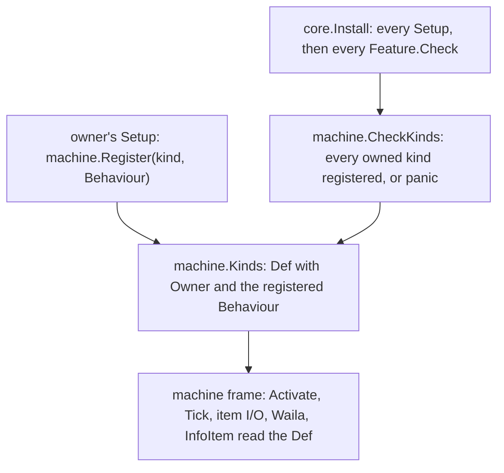
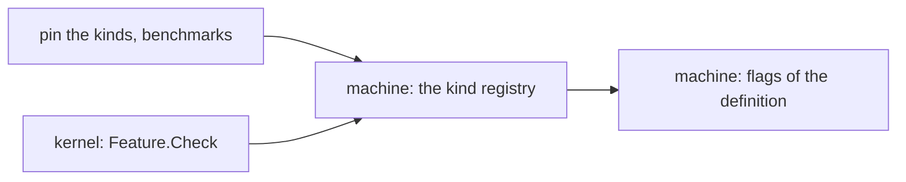

# Plan: structural rework phase 3i (machine kinds: pins, the kernel's check, the kind registry, the frame's flags)

**Review plan:** docs/plans/2026-11-10-cleanup-restructure.review.md
**Goal:** Review part 3-4, first third: the behaviour of the sixteen machine kinds that belong to other features is pinned, `machine` gets a registry an owner fills from its `Setup` (`machine.Register`), the kernel refuses to start with a kind nobody registered, and the frame's code stops naming foreign kinds where a flag of the definition says the same.
**Architecture:** REF is `docs/plans/2026-11-10-cleanup-restructure-p3-machine.md`: the inventory (section 1), the decisions (2), every new name (3), imports and layers (4), the measured numbers and what pins each kind (5), the order (6) and each task's code (7, one heading per task). The code of REF was built and run task by task; a task copies its blocks and designs nothing. Kind identity (names, ids, `Order`, block and item registration, tier and shape tables) stays in `machine` by the owner's decision; only behaviour goes to the owners (p3j, p3k).
**Tech stack:** Go 1.26, patched Dragonfly in `third_party/dragonfly`, tests with `go test`.
**Spec:** none (the review plan binds)
**Detail:** contracts
**Target-min:** 35
**Ignore:** .superlite/

## Global constraints

- Language Go. Checkout `/home/user/SkyGear`, branch `superlite/sessions/cleanup-restructure`. Developers do not commit or push; the coordinator commits each task with its subject (English, no attribution lines).
- Who decides: the developer implements the task text and its REF section exactly. A name, a signature, a place or a behaviour the text leaves open, a REF block that does not fit the code found, a fact of the task that is false: stop, change nothing more, return `NEEDS_CONTEXT` with the question. No refactoring beside the task. The prototype patch named in REF is a reference for the task's own part only; the task text and REF win over it.
- Green at every commit: `go build ./... && go vet ./... && go test ./...` (51 packages) and `gofmt -l` clean. No test is skipped, deleted or weakened; a test file changes only where the task names it.
- Goldens: the eight files of `content/skygear/testdata/pin/` at HEAD, the four of `content/skygear/wire/testdata` and `content/skygear/dimension/testdata/popup.golden` stay byte for byte. `SKYGEAR_GOLDEN=update` is allowed in T75 only, for `kinds.golden`; from T76 on that file is frozen too. A red golden means the change is wrong.
- No task moves a `world.RegisterBlock` or `world.RegisterItem` call, changes `machine.Order` or a kind's name, or adds an import between two packages that REF 4 does not list (package initialisation order decides the item ids the wire goldens pin).
- Every task from T77 runs `go test ./content/skygear/ -run 'TestPin|TestKind|TestLayers|TestFeature|TestCapability|TestEvery|TestRoot|TestMachine' -count=1`, `go test ./content/skygear/machine/ ./content/skygear/wire/`, then the full suite, and the benchmarks `go test -run xxx -bench 'TickHarvester|TickDrawerController|MachineTick$|Second|EnergyStep|LookMachine|LookInfoMachine' -benchmem -count 6 ./content/skygear`: B/op and allocs/op equal T75's report, median ns/op within 15 percent (REF 5).
- Scope: only the files of Owns. T75 and T76 may run at the same time; from T77 one task at a time, in id order. Go comments in English, saying what the code does now. Disk: binaries and scratch worktrees only under the scratchpad's `<task id>/`, deleted before the report; never `go clean -cache`.
- Leave `.gitignore` alone. Ruling: no Wave 0 - an existing tree needs no stubs - an unused brief. Ruling: single checkout, no worktree - the owner's branch - none.
- Ruling: [scope] the kernel gets `Feature.Check`, run at the end of `Install` - only then is "an owner did not register" knowable, and the root stays a list - one more descriptor field.
- Ruling: [scope] owners register from `Setup`, not `init` - a capability exists when its feature is installed (as the panel adapters of 3-3) - two feature-package test binaries set an owner up themselves (REF 2.2, 3).
- Ruling: [scope] `NoDisplay`, `NoWindow` and `Cycle` are flags of `machine.Def`, not hooks - they describe the kind and the frame reads them - the harvester's cycle texts stay in `machine`.

## Main diagram

## File structure

New: `content/skygear/pin_kinds_test.go`, `testdata/pin/kinds.golden`, `content/skygear/kinds_test.go`, `machine/kinds.go`, `machine/kinds_test.go`. Changed: `pin_bench_test.go`, `core/feature.go`, `core/feature_test.go`, `machine/machine.go`, `machine/feature.go`, `machine/look.go`, `machine/tier.go`.

## Task graph

## Predicted schedule

From `plan_tools schedule`: T75 and T76 side by side, then T77, then T78.

## root

**Probe entry:** run=go test ./content/skygear -run 'TestPinKinds|TestForeignKindsRoundTrip|TestKindOwners'

### T75 pin what a kind does outside its panel · Complexity 4 · Est. context 34k
**Owns:** content/skygear/pin_kinds_test.go, content/skygear/pin_bench_test.go, content/skygear/testdata/pin/kinds.golden
**Components:** 2
**LOC owned:** 240
**Tests:** slow
**Kind:** design
**Model:** sonnet
**Est. time:** 3.0 min
**Consumes:** none
**Produces:** pinScreens(call func()) -> string
- e.g. `kinds.golden` line `click/drawer_trim` -> `activate=true screens=-`
- e.g. `click/net_cable` -> `activate=false screens=-`; `click/tinker_table` -> `activate=true screens=tinker.ShowTable`; `click/pattern_encoder/sneak` -> `activate=true screens=netstore.showEncoder`
- e.g. `slots/pattern_encoder` starts `roles=IIIIIIIIIIIII-O------------`; `slots/disk_drive` -> `roles=IIIIIIII------------------- takes=[disk@0,1,2,3,4,5,6,7/true]`
**Review Focus:** `TestPinKinds` records 145 lines (72 `click/`, 37 `info/`, 36 `slots/`) from the unchanged code; it passes in 5 separate processes and under `-race`; `TestForeignKindsRoundTrip` passes for the 16 kinds of REF 1.1; no production file changes
**Steps:**
1. Tests only. Copy the REF T75 blocks: `pin_kinds_test.go` (`pinScreens`, `pinKindSamples`, `TestPinKinds`, `TestForeignKindsRoundTrip`) and the two benchmarks appended to `pin_bench_test.go`.
2. Record once: `SKYGEAR_GOLDEN=update go test ./content/skygear/ -run 'TestPinKinds$' -count=1`; `wc -l` gives 145; the lines of the examples above are in it.
3. Run the seven benchmarks of the global constraints with `-count 6`; report median ns/op, B/op, allocs/op (REF 5 has the expected numbers; a different allocation count is reported, not fixed).
4. Commit `test(machine): pin every kind's click, info icon and slots`.

## kernel

**Probe entry:** run=go test ./content/skygear/core -run 'TestInstall'

### T76 a feature can check what the others provided · Complexity 3 · Est. context 26k
**Owns:** content/skygear/core/feature.go, content/skygear/core/feature_test.go
**Components:** 1
**LOC owned:** 45
**Tests:** fast
**Kind:** design
**Model:** sonnet
**Est. time:** 1.6 min
**Consumes:** none
**Produces:** Feature.Check func() error
- e.g. features a (Setup, Check), b (Setup), c (Check): Install runs `setup a, setup b, check a, check c`
- e.g. `Install(&Feature{Name: "a", Check: func() error { return errors.New("kind x has no behaviour") }})` panics with `core: Install: feature "a": kind x has no behaviour`
**Review Focus:** `TestInstallRunsChecksAfterEverySetup`, `TestInstallCheckErrorPanics` (REF T76); `core` imports nothing new and names no feature; the existing kernel tests pass untouched; `order.golden` and `settings.golden` unchanged
**Steps:**
1. Add the two tests of REF T76 to `core/feature_test.go` (and the import `errors`); they fail to compile.
2. `core/feature.go`: the field `Check` after `Setup`, the sentence in `Install`'s comment and the loop after the `Setup` loop, as the REF T76 diff (the comment of `Commands` above is left as found).
3. Commit `feat(core): let a feature check the installation when every Setup has run`.

## machine

**Probe entry:** run=go test ./content/skygear/machine -run 'TestRegister|TestCheckKinds|TestOrder|TestFrameFlags'

### T77 the kind registry · Complexity 5 · Est. context 31k
**Owns:** content/skygear/machine/kinds.go, content/skygear/machine/kinds_test.go, content/skygear/machine/machine.go, content/skygear/machine/feature.go, content/skygear/kinds_test.go
**Components:** 2
**LOC owned:** 210
**Tests:** slow
**Kind:** design
**Model:** sonnet
**Est. time:** 3.0 min
**Consumes:** Feature.Check func() error (T76)
**Produces:** machine.Register(kind string, b Behaviour) · machine.CheckKinds() -> error · machine.NoLines(string, *world.Tx, cube.Pos) -> []string · Def.Owner
- e.g. a kind with `Owner: "dimension"` that nobody registered: `CheckKinds()` -> error containing `relic_table (feature dimension)`
- e.g. `Register("no_such_kind", Behaviour{})` panics with `not a machine kind`; `Register(KindCrusher, …)` with `has no owner`; a second `Register` of one kind with `twice`
- e.g. `NoLines("ko", nil, cube.Pos{})` -> nil
**Review Focus:** the seven hook fields leave `Def` and come back through the embedded `Behaviour`, so every existing `machine.Kinds[k].Click = …` of the owners and every `st.Def.Run` still compiles and no other file changes; no kind has an `Owner` yet, so `CheckKinds` passes; `TestKindOwners` (root) with an empty `kindOwners`; benchmarks as T75
**Steps:**
1. `machine/kinds_test.go` (REF T77: `ownedKind`, `panicOf`, `TestCheckKindsNamesTheMissingOwner`, `TestRegisterPanics`, `TestOrderListsEveryKind`) and the root's `kinds_test.go` (REF T77: `kindOwners` empty, `TestKindOwners`).
2. `machine/kinds.go` as REF T77 (`Behaviour` with seven fields, `NoLines`, `kindsChecked`, `Register`, `CheckKinds`).
3. `machine/machine.go`: in `Def`, the block from the comment `// The kinds whose behaviour is another package's set these` to the field `Lines` is replaced by `Owner`, `registered` and the embedded `Behaviour` (REF T77 diff). `machine/feature.go`: `Check: CheckKinds` after `Setup: subscribe`.
4. Commit `refactor(machine): a registry for the kinds other features own`.

### T78 the frame reads flags of the definition · Complexity 4 · Est. context 28k
**Owns:** content/skygear/machine/machine.go, content/skygear/machine/look.go, content/skygear/machine/tier.go, content/skygear/machine/kinds_test.go
**Components:** 1
**LOC owned:** 90
**Tests:** slow
**Kind:** design
**Model:** sonnet
**Est. time:** 2.2 min
**Consumes:** none
**Produces:** Def.NoDisplay · Def.NoWindow · Def.Cycle
- e.g. `Kinds[KindEnergyCell].NoDisplay` -> true; `Kinds[KindCrusher].NoDisplay` -> false
- e.g. `Kinds[KindNetCable].NoWindow` -> true; `Kinds[KindHarvester].Cycle` -> true; both false for every other kind
**Review Focus:** `TestFrameFlags` (REF T78): `NoDisplay` on exactly the twelve kinds of the old id list (energy cell, tank, crucible, lava, solar and hydro generator, drawer controller, trim and interface, tinker table, collector, relic table), `NoWindow` on the cable only, `Cycle` on the harvester only, every `Cell` kind has `NoDisplay`; `look.golden` and `kinds.golden` byte for byte; `energy_test.go` (the cell offers its energy) and `tier_test.go` (the harvester's offset) pass untouched; benchmarks as T75
**Steps:**
1. Append `TestFrameFlags` to `machine/kinds_test.go` (REF T78); it fails to compile.
2. `machine/machine.go` as the REF T78 diff: the three fields in `Def`; the flags in the fourteen entries of `Kinds`; `progressLook` (the `Cycle` test first, the `idHarvester` case removed); `Activate` (`m.State.Def.NoWindow` for `m.Kind == KindNetCable`); `Tick` (the id switch becomes `if st.Def.NoDisplay`, with `st.Def.Cell` for `idEnergyCell`).
3. `machine/look.go`: `case st.Def.Cycle:` for the harvester clause; `case st.Def.Lines != nil:` for `case st.Def.Controller:` (the clause above it, with `KindDrawerTrim`, `KindTinker`, `KindRelicTable`, stays in this task). `machine/tier.go`: `rangeLifts` and its use in `MaxOffset`.
4. Commit `refactor(machine): say with flags of the definition what the frame asked by kind`.

## Review Focus

- root (library): state, encoding. `kinds.golden` true to the unchanged code and deterministic; the round trip of every foreign kind.
- kernel (library): state. `Check` after every `Setup`, in list order; the kernel names no feature.
- machine (library): state, protocol. The registry's four refusals; the flags on exactly the old kinds; no allocation added on the tick (REF 5).

## Self-review

Coverage: REF 1.2 rows M3, M8 (the cable), M10, M12 (harvester, `Controller`), M14 (the lift); decisions 2 to 5 and 8. Left to p3j: storage, farm, dimension, the rarity colour, the tinker table. Left to p3k: netstore, the client shape, the private hooks, the documents.
