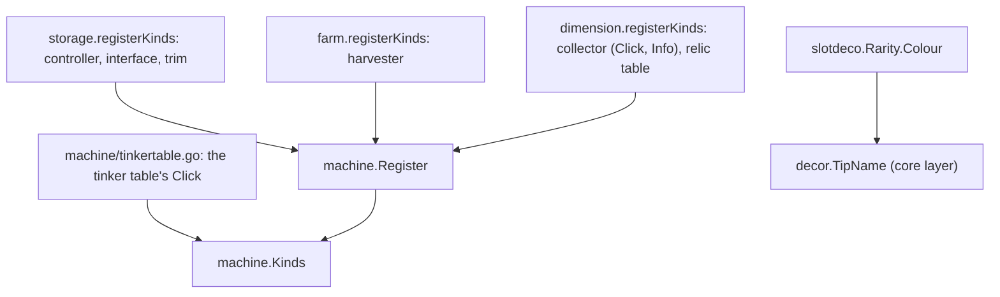
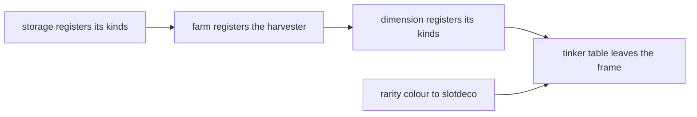

# Plan: structural rework phase 3j (machine kinds: storage, farm and dimension register theirs; the rarity colour; the tinker table)

**Review plan:** docs/plans/2026-11-10-cleanup-restructure.review.md
**Goal:** Review part 3-4, second third: `storage`, `farm` and `dimension` hand the behaviour of their six machine kinds to `machine.Register` from their `Setup`, and `machine` loses its clauses for them; a rarity's colour moves to `common/slotdeco`, so `decor` leaves the feature layer; the tinker table's click leaves the frame's `Activate` for one file that is the only feature import `machine` keeps.
**Architecture:** Runs after p3i (T75 to T78), whose `machine.Register(kind string, b Behaviour)`, `machine.Behaviour` and `machine.NoLines` every owner's task uses. REF is `docs/plans/2026-11-10-cleanup-restructure-p3-machine.md`: the inventory (section 1), the decisions (2), every new name (3), imports and layers (4), the measured numbers and what pins each kind (5), the order (6) and each task's code (7). The code of REF was built and run task by task; a task copies its blocks. An owner's task has four parts: `Owner` on its kinds in `machine.Kinds`, `registerKinds()` called last in the owner's `subscribe()`, the owner's `init` assignments deleted, `machine`'s clauses for those kinds deleted.
**Tech stack:** Go 1.26, patched Dragonfly in `third_party/dragonfly`, tests with `go test`.
**Spec:** none (the review plan binds)
**Detail:** contracts
**Target-min:** 35
**Ignore:** .superlite/

## Global constraints

- Language Go. Checkout `/home/user/SkyGear`, branch `superlite/sessions/cleanup-restructure`. Developers do not commit or push; the coordinator commits each task with its subject (English, no attribution lines).
- Who decides: the developer implements the task text and its REF section exactly. A name, a signature, a place or a behaviour the text leaves open, a REF block that does not fit the code found, a fact of the task that is false: stop, change nothing more, return `NEEDS_CONTEXT` with the question. No refactoring beside the task.
- Green at every commit: `go build ./... && go vet ./... && go test ./...` (51 packages) and `gofmt -l` clean. No test is skipped, deleted or weakened; a test file changes only where the task names it.
- Goldens: the nine files of `content/skygear/testdata/pin/` (with `kinds.golden` of T75), the four of `content/skygear/wire/testdata` and `content/skygear/dimension/testdata/popup.golden` stay byte for byte. No task here may set `SKYGEAR_GOLDEN=update`. A red golden means the change is wrong.
- No task moves a `world.RegisterBlock` or `world.RegisterItem` call, changes `machine.Order` or a kind's name, or adds an import between two packages that REF 4 does not list. In particular `tinker` does not import `machine` (REF 2.2, 6: measured, it changes 512 entries of `items.golden`).
- Every task runs `go test ./content/skygear/ -run 'TestPin|TestKind|TestLayers|TestFeature|TestCapability|TestEvery|TestRoot|TestMachine' -count=1`, `go test ./content/skygear/machine/ ./content/skygear/wire/`, then the full suite; T79, T80, T81 and T83 also the benchmarks `go test -run xxx -bench 'TickHarvester|TickDrawerController|MachineTick$|Second|LookMachine|LookInfoMachine' -benchmem -count 6 ./content/skygear`: B/op and allocs/op equal T75's report, median ns/op within 15 percent (REF 5).
- Scope: only the files of Owns. T82 may run at any time before T83; the others one at a time, in id order. Go comments in English, saying what the code does now. Disk: binaries and scratch worktrees only under the scratchpad's `<task id>/`, deleted before the report; never `go clean -cache`.
- Leave `.gitignore` alone. Ruling: no Wave 0 - an existing tree needs no stubs - an unused brief. Ruling: single checkout, no worktree - the owner's branch - none.
- Ruling: [scope] the tinker table's behaviour is set by `machine/tinkertable.go` and `machine` keeps importing `tinker` there - turning the import changes the client goldens - one feature import remains, guarded by `TestMachineImportsNoFeature`.
- Ruling: [scope] `decor` moves to the core group of `layers` - it imports only `naming` once the colour is in `slotdeco` - none.
- Ruling: [scope] the owners' own switches over their kinds stay (`storage.IsSetMachine`, `findNetwork`, `dimension.collectorAt`) - identity is `machine`'s by decision - REF 2.2, 10.

## Main diagram

## File structure

New: `storage/kinds.go`, `dimension/kinds.go`, `machine/tinkertable.go`. Changed: the files of each task's Owns (REF 7 has every diff).

## Task graph

## Predicted schedule

From `plan_tools schedule`: the chain T79, T80, T81, T83 (each edits `machine/machine.go` and `kinds_test.go`), with T82 beside it.

## owners

**Probe entry:** run=go test ./content/skygear -run 'TestKindOwners|TestPinKinds|TestPinLook|TestDrawerController|TestHarvester|TestCollectors|TestRelicTable'

### T79 the storage registers its kinds · Complexity 5 · Est. context 30k
**Owns:** content/skygear/storage/kinds.go, content/skygear/storage/storage.go, content/skygear/storage/subscribe.go, content/skygear/machine/machine.go, content/skygear/machine/look.go, content/skygear/kinds_test.go, content/skygear/netstore/keys_test.go
**Components:** 2
**LOC owned:** 90
**Tests:** slow
**Kind:** design
**Model:** sonnet
**Est. time:** 2.3 min
**Consumes:** none
**Produces:** none
**Review Focus:** `kinds.golden` `click/drawer_controller`, `click/drawer_interface`, `click/drawer_trim` (all `activate=true screens=-`) and `look.golden` `machine/drawer_*` byte for byte; the seven controller tests of `drawer_test.go` (REF 5) pass untouched; `netstore`'s `TestExternalDrawerController` passes because the test binary sets the storage up; `grep -n 'Controller' content/skygear/machine/*.go` finds only kind names and ids; benchmarks as T75 (`TickDrawerController`)
**Steps:**
1. Root `kinds_test.go`: the three storage rows in `kindOwners` (REF T79); `TestKindOwners` fails.
2. `storage/kinds.go` (REF T79); `registerKinds()` as the last line of `subscribe()` in `storage/subscribe.go`; delete the `init` at the end of `storage/storage.go` with its comment (REF T79 diff).
3. `machine/machine.go`: `Owner: "storage"` on the three kinds, the field `Def.Controller` and its two `Controller: true` removed, the clause `if m.Kind == KindDrawerTrim { return true }` removed from `Activate`. `machine/look.go`: `KindDrawerTrim` leaves the clause of `MachineLines`; `outputContainer` loses `st.Def.Controller ||` and its comment is the one of REF T79.
4. `netstore/keys_test.go`: the `init` of REF T79 (`storage.Feature.Setup()` after the registry is finalised) and the import of `storage`.
5. Commit `refactor(storage): register the drawer controller, interface and trim with the machine frame`.

### T80 the farm registers the harvester · Complexity 3 · Est. context 26k
**Owns:** content/skygear/farm/harvester.go, content/skygear/farm/subscribe.go, content/skygear/machine/machine.go, content/skygear/kinds_test.go
**Components:** 1
**LOC owned:** 20
**Tests:** slow
**Kind:** design
**Model:** sonnet
**Est. time:** 1.6 min
**Consumes:** none
**Produces:** none
**Review Focus:** `harvester_test.go` (3 tests), `magic_test.go` and `tier_test.go` pass untouched; `kinds.golden` and `look.golden` `machine/harvester` byte for byte; `BenchmarkTickHarvester` 200 B and 5 allocs as T75
**Steps:**
1. Root `kinds_test.go`: the harvester row (REF T80).
2. `farm/harvester.go`: the `init` in the last line becomes `registerKinds()` (REF T80); `farm/subscribe.go`: `registerKinds()` as the last line of `subscribe()`. `machine/machine.go`: `Owner: "farm"` on `KindHarvester`.
3. Commit `refactor(farm): register the harvester with the machine frame`.

### T81 the dimension registers its kinds · Complexity 5 · Est. context 30k
**Owns:** content/skygear/dimension/kinds.go, content/skygear/dimension/collector.go, content/skygear/dimension/relic.go, content/skygear/dimension/subscribe.go, content/skygear/machine/kinds.go, content/skygear/machine/machine.go, content/skygear/machine/look.go, content/skygear/kinds_test.go
**Components:** 2
**LOC owned:** 95
**Tests:** slow
**Kind:** design
**Model:** sonnet
**Est. time:** 2.4 min
**Consumes:** none
**Produces:** Behaviour.Info func(st *State) []wintext.Text
- e.g. a collector without a monster: the info icon's last lore line is `§c받을 몬스터를 정하지 않았습니다` (`kinds.golden` `info/essence_collector`)
- e.g. after `st.SetMob("zombie")`: `§d받는 몬스터: §f좀비` (`info/essence_collector/zombie`)
- e.g. a kind without `Info`: the lore is its help lines only (`info/crusher`)
**Review Focus:** the two `info/essence_collector*` and the four `click/essence_collector*`, `click/relic_table*` lines of `kinds.golden` and `look.golden` `machine/relic_table`, `machine/essence_collector` byte for byte; `TestCollectors` and `TestRelicTable` pass untouched; `dimension/relic.go`'s `init` still registers the relic items and the recipe, in the same order (`wire` goldens); `grep -n idCollector content/skygear/machine/*.go` finds the id's declaration and the table entry only
**Steps:**
1. Root `kinds_test.go`: the two dimension rows (REF T81).
2. `machine/kinds.go`: the field `Info` and the import of `wintext` (REF T81 diff). `machine/machine.go`: in `InfoItem` the `idCollector` block becomes the `Info` call; `Owner: "dimension"` on the two kinds; the comment of `SetMob`. `machine/look.go`: `KindRelicTable` leaves the clause of `MachineLines`.
3. `dimension/kinds.go` (REF T81: `registerKinds`, `collectorInfo`); `registerKinds()` as the last line of `subscribe()`; delete the `init` of `collector.go` with its comment and the `Click` assignment at the end of `relic.go`'s `init` (then the imports `cube` and `machine` of `relic.go` go).
4. Commit `refactor(dimension): register the essence collector and the relic table with the machine frame`.

## layers

**Probe entry:** run=go test ./content/skygear -run 'TestLayers|TestFeatureSiblings|TestCapabilityImports|TestMachineImportsNoFeature|TestTipNameColour'

### T82 a rarity's colour belongs to slotdeco · Complexity 3 · Est. context 26k
**Owns:** common/slotdeco/slotdeco.go, common/slotdeco/slotdeco_test.go, content/skygear/tinker/tinker.go, content/skygear/decor/decor.go, content/skygear/layers_test.go, content/skygear/decor_test.go
**Components:** 1
**LOC owned:** 70
**Tests:** slow
**Kind:** design
**Model:** sonnet
**Est. time:** 1.9 min
**Consumes:** none
**Produces:** Rarity.Colour() -> string
- e.g. `slotdeco.Common.Colour()` -> `"§f"`; `slotdeco.Uncommon.Colour()` -> `"§a"`; `slotdeco.Rare.Colour()` -> `"§b"`
- e.g. `slotdeco.Epic.Colour()` -> `"§d"`; `slotdeco.Legendary.Colour()` -> `"§6"`; `slotdeco.Rarity(9).Colour()` -> `"§f"`
**Review Focus:** `TestTipNameColour` (root, REF T82) is written first and passes on the unchanged code, then unchanged afterwards; `TestRarityColour` in `slotdeco`; the `wire` goldens unchanged (`machine` still imports `tinker`, so the tools still register before the machines); `go list -f '{{join .Imports "\n"}}' ./content/skygear/decor | grep content/skygear/` prints `naming` only
**Steps:**
1. Append `TestTipNameColour` to the root's `decor_test.go` (and the import of `naming`); run it: green before any other change.
2. `common/slotdeco`: the method `Colour` before `TierMark` and `TestRarityColour` (REF T82). `tinker/tinker.go`: `RarityColour(r)` becomes `r.Colour()` in `DescribeTool`'s name line and the function `RarityColour` is deleted. `decor/decor.go`: `r.Colour()`, the import of `tinker` goes.
3. `layers_test.go` as the REF T82 diff: `"decor"` after `"autofill"` in the core group of `layers` and out of the features group and of `featureLayer`; `siblings` loses the row `"decor"`, `"machine"` becomes `{"tinker"}`, `"netstore"` `{"conduit", "machine", "storage"}`; `onlyImports["decor"]` is `{"naming"}`.
4. Commit `refactor(slotdeco): own the colour of a rarity; decor leaves the feature layer`.

### T83 the tinker table's click leaves the frame · Complexity 4 · Est. context 28k
**Owns:** content/skygear/machine/tinkertable.go, content/skygear/machine/machine.go, content/skygear/machine/look.go, content/skygear/layers_test.go
**Components:** 1
**LOC owned:** 75
**Tests:** slow
**Kind:** design
**Model:** sonnet
**Est. time:** 2.0 min
**Consumes:** none
**Produces:** none
**Review Focus:** `TestMachineImportsNoFeature` (REF T83): `siblings["machine"]` is exactly `{"tinker"}` and `tinkertable.go` is the only non-test file of `machine` that imports a package of `featureLayer`; `kinds.golden` `click/tinker_table` (`screens=tinker.ShowTable`) and `look.golden` `machine/tinker_table` byte for byte; `TestTinkerTable` untouched; the `wire` goldens unchanged; `KindTinker` has no `Owner` and is not in `kindOwners`; `MachineLines` has no clause that returns `nil, nil` for a kind by name
**Steps:**
1. `layers_test.go`: `machineFeatureImports` and `TestMachineImportsNoFeature` before `TestLookExpandingWithTool` (REF T83); it fails (`machine.go` imports `tinker`).
2. `machine/tinkertable.go` (REF T83). `machine/machine.go`: the `KindTinker` clause of `Activate` and the import of `tinker` go. `machine/look.go`: the clause `case m.Kind == KindTinker: return nil, nil` goes.
3. Commit `refactor(machine): set the tinker table's behaviour where the kind is declared`.

## Review Focus

- owners (library): state, protocol. Each kind's click, lines, info and item I/O byte for byte (`kinds.golden`, `look.golden`); `Setup` runs once and registers each kind once.
- layers (library): state. `decor` below the features; `machine` imports the feature `tinker` in one file and no other.

## Self-review

Coverage: REF 1.2 rows M1, M8 (trim, tinker table), M12 (the three kinds), M13; 1.3 rows O1, O3, O4; decisions 6, 7, 10. Left to p3k: netstore (O6), the client shape (M4, M5), the private hooks, the documents.
