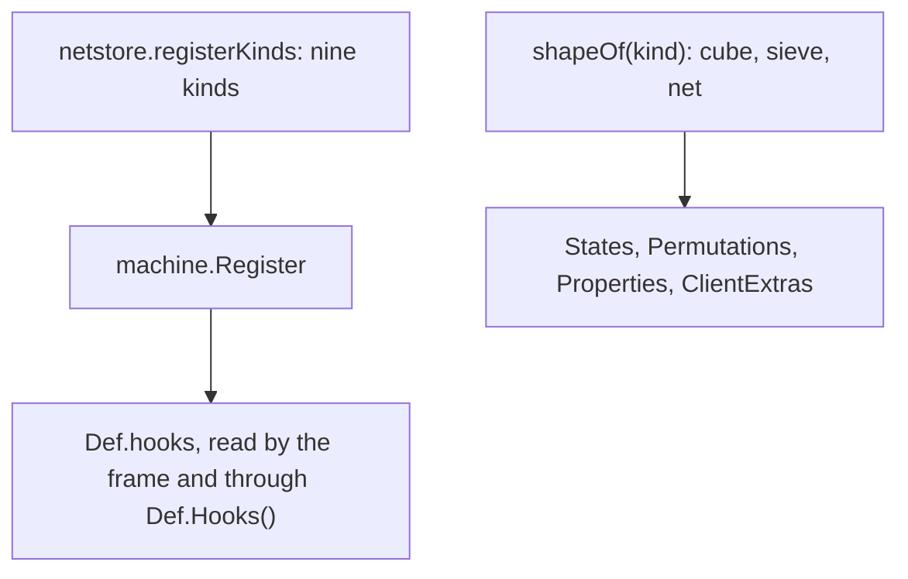
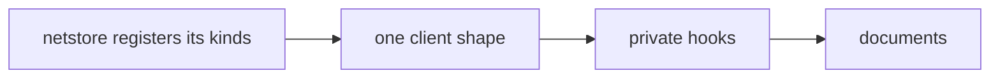

# Plan: structural rework phase 3k (machine kinds: netstore registers its nine; one client shape; private hooks; documents)

**Review plan:** docs/plans/2026-11-10-cleanup-restructure.review.md
**Goal:** Review part 3-4, last third: `netstore` hands the behaviour of its nine machine kinds to `machine.Register`, the four methods of the client definition follow one classification of a kind's shape, the hooks of a kind become private so that `Register` is the only way in, and the documents describe the registry.
**Architecture:** Runs after p3j (T79 to T83); it uses p3i's `machine.Register(kind string, b Behaviour)` and `machine.Behaviour`. REF is `docs/plans/2026-11-10-cleanup-restructure-p3-machine.md`: the inventory (section 1), the decisions (2), every new name (3), imports and layers (4), the measured numbers and what pins each kind (5), the order (6) and each task's code (7). A task copies REF's blocks.
**Tech stack:** Go 1.26, patched Dragonfly in `third_party/dragonfly`, tests with `go test`.
**Spec:** none (the review plan binds)
**Detail:** contracts
**Target-min:** 35
**Ignore:** .superlite/

## Global constraints

- Language Go. Checkout `/home/user/SkyGear`, branch `superlite/sessions/cleanup-restructure`. Developers do not commit or push; the coordinator commits each task with its subject (English, no attribution lines).
- Who decides: the developer implements the task text and its REF section exactly. A name, a signature, a place or a behaviour the text leaves open, a REF block that does not fit the code found, a fact of the task that is false: stop, change nothing more, return `NEEDS_CONTEXT` with the question. No refactoring beside the task.
- Green at every commit: `go build ./... && go vet ./... && go test ./...` (51 packages) and `gofmt -l` clean. No test is skipped, deleted or weakened; a test file changes only where the task names it.
- Goldens: the nine files of `content/skygear/testdata/pin/`, the four of `content/skygear/wire/testdata` and `content/skygear/dimension/testdata/popup.golden` stay byte for byte. No task here may set `SKYGEAR_GOLDEN=update`. A red golden means the change is wrong.
- No task moves a `world.RegisterBlock` or `world.RegisterItem` call, changes `machine.Order` or a kind's name, or adds an import between two packages that REF 4 does not list.
- A move changes no statement: a hook's body is copied into a named function; only what REF lists changes.
- Every code task runs `go test ./content/skygear/ -run 'TestPin|TestKind|TestLayers|TestFeature|TestCapability|TestEvery|TestRoot|TestMachine' -count=1`, `go test ./content/skygear/machine/ ./content/skygear/netstore/ ./content/skygear/wire/`, then the full suite, and the benchmarks `go test -run xxx -bench 'TickHarvester|TickDrawerController|MachineTick$|Second|EnergyStep|LookMachine|LookInfoMachine' -benchmem -count 6 ./content/skygear`: B/op and allocs/op equal T75's report, median ns/op within 15 percent (REF 5).
- Scope: only the files of Owns. One task at a time, in id order. Go comments in English; documents under `docs/` and the READMEs in Korean, the current state only (no history, no "was"), written with the repo skill `korean-humanizer`. Disk: binaries and scratch worktrees only under the scratchpad's `<task id>/`, deleted before the report; never `go clean -cache`.
- Leave `.gitignore` alone. Ruling: no Wave 0 - an existing tree needs no stubs - an unused brief. Ruling: single checkout, no worktree - the owner's branch - none.
- Ruling: [scope] the encoder's slots are declared in `machine.Kinds`, not set by `netstore` - slots are identity, and `Setup` runs after states may exist - the two numbers 12 and 14 are written in `machine` and in `netstore/encoder.go`.
- Ruling: [scope] `machine/netshape.go` and the step `machine.noteFace` stay - the thin shape is the block's registered model and the step's name is in `order.golden` - `machine` keeps naming the network's kinds as data.
- Ruling: [scope] the hooks become the unexported `Def.hooks` with the reader `Def.Hooks()` - the compiler then keeps every writer but `Register` out - five call sites outside `machine` change.

## Main diagram

## File structure

New: `netstore/kinds.go`, `machine/shape.go`. Changed: the files of each task's Owns (REF 7 has every diff); seven documents.

## Task graph

## Predicted schedule

From `plan_tools schedule`: one chain, T84 to T87.

## netstore

**Probe entry:** run=go test ./content/skygear/netstore ./content/skygear/machine

### T84 the storage network registers its kinds · Complexity 6 · Est. context 30k
**Owns:** content/skygear/netstore/kinds.go, content/skygear/netstore/filterui.go, content/skygear/netstore/terminal.go, content/skygear/netstore/network.go, content/skygear/netstore/craft.go, content/skygear/netstore/encoder.go, content/skygear/netstore/io.go, content/skygear/netstore/items.go, content/skygear/netstore/subscribe.go, content/skygear/netstore/keys_test.go, content/skygear/machine/machine.go, content/skygear/machine/netkinds_test.go, content/skygear/kinds_test.go
**Components:** 3
**LOC owned:** 190
**Tests:** slow
**Kind:** design
**Model:** sonnet
**Est. time:** 3.6 min
**Consumes:** none
**Produces:** none
**Review Focus:** the 18 `click/net_*`, `click/disk_drive*`, `click/pattern_encoder*` and the 9 `slots/` lines of the network's kinds in `kinds.golden` byte for byte (the encoder: `roles=IIIIIIIIIIIII-O------------`, standing click `machine.ShowMachine`, sneaking `netstore.showEncoder`); the 60 tests of `netstore` and `machine/netkinds_test.go` pass with only the two `init` lines of step 4; `grep -rn 'machine.Kinds\[[^]]*\]\.[A-Za-z]* *=[^=]' content/skygear --include=*.go` finds nothing outside `machine`; every `init` of `netstore` that remains still does its other work (`onBuild`, `onDispose`, the item registrations, the hook variables of `craft.go`) in the same order; benchmarks as T75
**Steps:**
1. Root `kinds_test.go`: the nine netstore rows in `kindOwners` (REF T84); `TestKindOwners` fails.
2. `netstore`: each anonymous hook becomes the named function REF T84 gives, in the file it is in (`clickFilter`; `clickController`, `clickTerminal`, `insertAt`, `peekAt`, `extractAt`; `runAutocrafter`; `encoderAccepts`, `clickEncoder`; `acceptsUpgrade`, `acceptsDisk`, `acceptsPattern`), and the assignments to `machine.Kinds[…]` are deleted: the whole `init` of `filterui.go`, `terminal.go`, `network.go` and `encoder.go`, the last statement of the `init` of `craft.go`, the loop at the end of the `init` of `io.go`, the loop and the two assignments at the end of that of `items.go`.
3. `netstore/kinds.go` (REF T84); `registerKinds()` as the last line of `subscribe()`. `machine/machine.go`: `Owner: "netstore"` on the nine kinds; the encoder's entry gets `Input: []int{0, 1, 2, 3, 4, 5, 6, 7, 8, 9, 10, 11, 12}, Output: []int{14}` and the comment of REF T84.
4. Tests: `netstore/keys_test.go`'s `init` also calls `Feature.Setup()`; `machine/netkinds_test.go` gets `func init() { netstore.Feature.Setup() }` (REF T84).
5. Commit `refactor(netstore): register the network's kinds with the machine frame`.

## machine

**Probe entry:** run=go test ./content/skygear/machine ./content/skygear/wire

### T85 one description of a kind's client shape · Complexity 5 · Est. context 33k
**Owns:** content/skygear/machine/shape.go, content/skygear/machine/machine.go, content/skygear/machine/kinds_test.go
**Components:** 1
**LOC owned:** 150
**Tests:** slow
**Kind:** design
**Model:** sonnet
**Est. time:** 2.6 min
**Consumes:** none
**Produces:** none
**Review Focus:** `wire/testdata/blocks.golden` byte for byte (`TestWire`); `TestEveryKindHasOneShape` (REF T85): every kind of `Order` is in exactly one of sieve, net shape, `plainCubes`, `cubeMachines`, `frontMachines`; `EncodeBlock`, `Hash` and `Model` are not touched; `TestDrawerStatesMatchRuntimeIDs`, `machine/netshape_test.go`, `animate_test.go` and `tier_test.go` pass untouched; `blockcounts_test.go` (the custom block and state counts) unchanged
**Steps:**
1. Append `TestEveryKindHasOneShape` to `machine/kinds_test.go` (REF T85); it fails to compile.
2. `machine/shape.go` (REF T85: `shape`, `shapeOf`, the three texture tables, `cubeProperties`, and the methods `States`, `Permutations`, `Properties`, `ClientExtras`).
3. `machine/machine.go`: delete everything from the comment `// cubeMachines are the machines drawn as plain cubes` to the end of the method `Properties` (the line before `// BreakInfo drops the machine and its contents.`), and the imports `customblock` and `clientdef`.
4. Commit `refactor(machine): derive the client definition from one shape per kind`.

### T86 only Register writes a kind's hooks · Complexity 4 · Est. context 30k
**Owns:** content/skygear/machine/machine.go, content/skygear/machine/look.go, content/skygear/machine/kinds.go, content/skygear/machine/kinds_test.go, content/skygear/machine/tinkertable.go, content/skygear/debug_ui.go, content/skygear/netstore/terminal_test.go, content/skygear/netstore/integration_test.go, content/skygear/netstore/io_test.go
**Components:** 1
**LOC owned:** 50
**Tests:** slow
**Kind:** design
**Model:** sonnet
**Est. time:** 2.0 min
**Consumes:** none
**Produces:** Def.Hooks() -> Behaviour
- e.g. `machine.Kinds[machine.KindCrusher].Hooks().Click` -> nil
- e.g. in the game `machine.Kinds[machine.KindNetTerminal].Hooks().Insert` -> `netstore`'s `insertAt`; `machine.Kinds[machine.KindTinker].Hooks().Lines` -> `machine.NoLines`
**Review Focus:** outside `machine` no code can assign a hook (the field is unexported): `go build ./...` proves it; the frame reads `st.Def.hooks.<Field>` at the 18 places of REF T86 and nothing else changes in them; the four test call sites and `debug_ui.go:32` read through `Hooks()`; `/sgdebug ui` lists the same kinds (`windowKinds`: `d.Hooks().Click == nil`); benchmarks as T75 (the tick reads the same field)
**Steps:**
1. `machine/machine.go`: the embedded `Behaviour` of `Def` becomes `hooks Behaviour` with the comment of REF T86; `st.Def.Info`, `st.Def.Accepts`, `m.State.Def.Click`, `.Insert`, `.Peek`, `.Extract` and `st.Def.Run` get `.hooks` after `Def` (15 places). `machine/look.go`: three places and the comment of `Waila`. `machine/kinds.go`: `d.hooks` in `Register`, and the method `Hooks`. `machine/tinkertable.go`: `Kinds[KindTinker].hooks`. `machine/kinds_test.go`: two places.
2. `debug_ui.go:32`: `d.Hooks().Click == nil`. `netstore/terminal_test.go`: `d := machine.Kinds[machine.KindNetController].Hooks()` and `tm := machine.Kinds[machine.KindNetTerminal].Hooks()`. `netstore/integration_test.go` and `netstore/io_test.go`: `.Hooks()` before `.Insert(` and `.Extract(`.
3. Commit `refactor(machine): keep a kind's hooks private behind Register`.

## documents

**Probe entry:** run=go test ./content/skygear -run 'TestLayers|TestFeature|TestKind'

### T87 describe the kind registry · Complexity 4 · Est. context 32k
**Owns:** docs/tech/extension.md, docs/tech/machines.md, docs/tech/slotdeco.md, content/skygear/README.md, common/README.md, content/skygear/machine/doc.go, content/skygear/core/doc.go
**Components:** 2
**LOC owned:** 160
**Tests:** slow
**Kind:** design
**Model:** sonnet
**Est. time:** 2.6 min
**Consumes:** none
**Produces:** none
**Steps:**
1. `docs/tech/extension.md`, from the code as built. The layer list: `decor` is in 핵심, not 기능; the import bullet and the rules row say `decor` imports `naming` only. Step 2 of "새 기능 더하기" lists `Check` after `Setup` (it runs at the end of `Install`; `Install` panics with its error). A new step after the panel step, "기능이 기계 종류를 소유하면": the kind's name, id, place in `Order` and `Def` are declared in `machine/machine.go` with `Owner: "<기능>"` (blocks and items register in `machine`'s `init`, and the client's item ids follow that order); the feature's `kinds.go` has `registerKinds()`, called last in `subscribe()`, with one `machine.Register(kind, machine.Behaviour{…})` per kind (the example is `dimension/kinds.go`); a table of the eight fields (`Click`, `Run`, `Insert`, `Peek`, `Extract`, `Accepts`, `Lines`, `Info`) and of the three flags (`NoDisplay`, `NoWindow`, `Cycle`); a row in `kindOwners` (`kinds_test.go`); a missing owner stops the start with `machine kinds without behaviour: …`; a test of a feature package that needs a kind's behaviour calls `<기능>.Feature.Setup()` in an `init` (`netstore/keys_test.go`). One paragraph: the tinker table is set in `machine/tinkertable.go` because `tinker` must initialise before `machine` (item ids), as `hopper` is registered by the root. The rules table gains `TestKindOwners`, `TestMachineImportsNoFeature`, `machine.TestCheckKindsNamesTheMissingOwner`, `machine.TestRegisterPanics`, `core.TestInstallRunsChecksAfterEverySetup`; the pins table gains `kinds.golden` (145 lines, `TestPinKinds`); the benchmark line gains `TickHarvester|TickDrawerController`.
2. `docs/tech/machines.md`: under 구조, the definition's flags, the registry (`Owner`, `Register`, `Behaviour`, `Hooks`, `CheckKinds`) and a table of the sixteen kinds by owner (REF 2.1, with the tinker table as `machine/tinkertable.go`); the client shape (`shape.go`: cube, sieve, net); under 검증 `pin_kinds_test.go`, `kinds_test.go`, `machine/kinds_test.go`.
3. `content/skygear/README.md`: the sentence that ends with `machine.Kinds[KindRelicTable].Click` says that a machine kind's behaviour is registered by its feature's `Setup` with `machine.Register`; `decor` moves to the 핵심 rows; the `machine` row says it holds the frame and the list of kinds. `common/README.md` row `slotdeco` and `docs/tech/slotdeco.md` (the Ore UI paragraph): the name colour is `Rarity.Colour`. `machine/doc.go`: the last paragraph (REF T87). `core/doc.go`: `Check` in the sentence on what a `Feature` is.
4. Check: every identifier a document names exists (`grep`); no document says `init` fills a machine kind; `go test ./...` green.
5. Commit `docs: describe the machine kind registry`.

## Review Focus

- netstore (library): state, protocol. Nine kinds, one registration each; the encoder's slots; the test binaries set the features up.
- machine (library): encoding, state. `blocks.golden`; the hooks unreachable from outside.
- documents (file): encoding. Names match the code; Korean reads naturally; no history.

## Self-review

Coverage: REF 1.2 rows M4, M5; 1.3 row O6; decisions 5, 9, 12, 13; the documents. The other rows are left by decision (REF 1, 2). Part 3-4 ends here; 3-5 is outlined in `2026-11-10-cleanup-restructure-p3-outline.md`.
