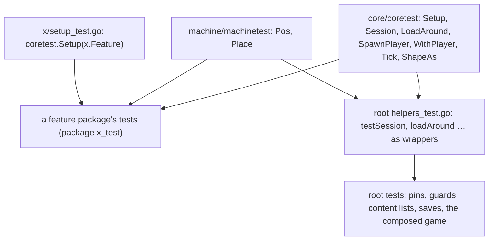
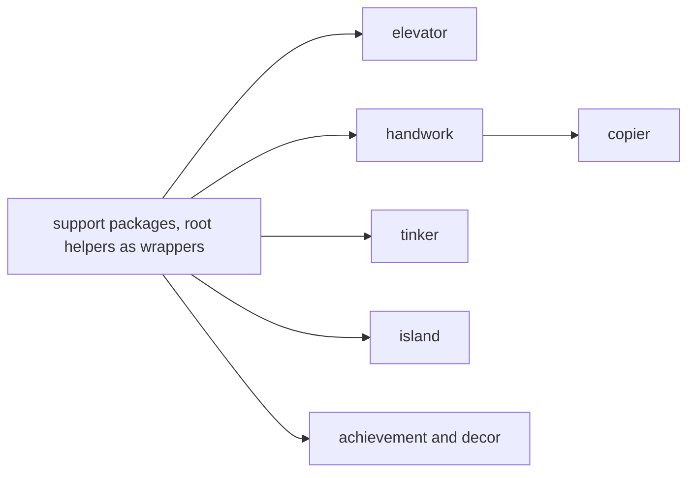

# Plan: structural rework phase 3l (feature tests leave the root: the support packages and the leaf packages)

**Review plan:** docs/plans/2026-11-10-cleanup-restructure.review.md
**Goal:** Review part 3-5, first third: a test of a feature package gets its session, its player and its features from two small support packages instead of the root package's helpers, and the tests of `elevator`, `handwork`, `copier`, `tinker`, `island`, `achievement` and `decor` live in those packages and run without the root.
**Architecture:** REF is `docs/plans/2026-11-10-cleanup-restructure-p3-tests.md`: the fate of every root test file (section 1), the decisions (2), the support packages (3), imports and guards (4), the risks (6), how a file moves (7: rules R1 to R9, whole file, split file, copied helper, `setup_test.go`, checks, developer rules), the order (8), each task's files and code (9). The part was built and run task by task; a task follows its REF section and designs nothing. A moved test is in the external package `<pkg>_test`; a test that needs the content lists, the root's hopper, a second feature or a root identifier stays, and its file is split by top-level declaration when the rest moves.
**Tech stack:** Go 1.26, patched Dragonfly in `third_party/dragonfly`, tests with `go test`.
**Spec:** none (the review plan binds)
**Detail:** contracts
**Target-min:** 35
**Ignore:** .superlite/

## Global constraints

- Language Go. Checkout `/home/user/SkyGear`, branch `superlite/sessions/cleanup-restructure`. Developers do not commit or push; the coordinator commits each task with its subject (English, no attribution lines).
- Who decides: the developer implements the task text and its REF section exactly. Anything the text leaves open, a REF list that does not fit the code found, a moved test that fails in its package: stop, return `NEEDS_CONTEXT`. No refactoring beside the task. The prototype patches named in REF are a reference; the task text and REF win over them.
- A task moves files, changes the call sites of REF 7.1 and package clauses. It changes no assertion, no test's name, no production file. No test is skipped, deleted or weakened.
- Green at every commit: `go build ./... && go vet ./... && go test ./...`, `gofmt -l` clean. The union of test names stays the 644 of the base: per task the developer lists `go test -list '.*'` of the root and of the target package before and after (REF 7.6) and reports the four counts; the names that left the root are the names that joined the package and the names REF lists.
- Goldens: the nine files of `content/skygear/testdata/pin/`, the four of `content/skygear/wire/testdata` and `content/skygear/dimension/testdata/popup.golden` stay byte for byte. `SKYGEAR_GOLDEN=update` is forbidden. A red golden means the change is wrong.
- A package's tests never call `core.Install` or a feature's `Setup` themselves: they name features in `coretest.Setup`, in the `init` of `setup_test.go`. `wire` and `dimension/popup_wire_test.go` are not touched.
- Run a package's tests three times as separate processes with `-count=1` (`-count=2` fails at the base in `netstore` and `wire`, REF 6).
- Scope: only the files of Owns. T88 first; then one task at a time in id order (T89, T93 and T94 share no file with another task, REF 8). Disk: scratch files only under the scratchpad's `<task id>/`, deleted before the report; never `go clean -cache`.
- Leave `.gitignore` alone. Ruling: no Wave 0 - an existing tree needs no stubs - an unused brief. Ruling: single checkout, no worktree - the owner's branch - none.
- Ruling: [scope] a file with one to three tests that cannot move is split by top-level declaration - whole files alone move 120 of 240 tests - 14 root files keep the tests that stay (REF 1.5).
- Ruling: [scope] every package that gets a session test sets its own feature up - a handler test takes the subscriber's path as in the game - one `setup_test.go` per package (REF 2).
- Ruling: [scope] shared helpers are copied, not exported - `coretest` holds what `helpers_test.go` held - some helpers exist twice (REF 1.2).

## Main diagram

## File structure

New: `core/coretest/coretest.go`, `machine/machinetest/machinetest.go`, per package a `setup_test.go` and the moved files (REF 9). Changed: the root's `helpers_test.go` and the root test files each task names.

## Task graph

## Predicted schedule

From `plan_tools schedule`: T88, then T89, T90, T92, T93 and T94, with T91 behind T90 (both edit `helpers_test.go`); the coordinator still runs one task at a time.

## support

**Probe entry:** run=go test ./content/skygear/core/... ./content/skygear/machine/... ./content/skygear/netstore

### T88 the test support packages · Complexity 5 · Est. context 32k
**Owns:** content/skygear/core/coretest/coretest.go, content/skygear/machine/machinetest/machinetest.go, content/skygear/helpers_test.go, content/skygear/machine_test.go, content/skygear/machine/netkinds_test.go, content/skygear/netstore/keys_test.go
**Components:** 3
**LOC owned:** 290
**Tests:** slow
**Kind:** design
**Model:** sonnet
**Est. time:** 3.0 min
**Consumes:** none
**Produces:** coretest.Setup(fs ...*core.Feature) · coretest.Session(t testing.TB) -> core.Lifecycle · coretest.LoadAround(s core.Lifecycle) · coretest.SpawnPlayer(s core.Lifecycle) -> *world.EntityHandle · coretest.WithPlayer(t testing.TB, s core.Lifecycle, h *world.EntityHandle, f func(p *player.Player, tx *world.Tx)) · coretest.Tick(s core.Lifecycle, n int) · coretest.ShapeAs(s core.Lifecycle, key any) -> debug.Shape · machinetest.Place(s core.Lifecycle, pos cube.Pos, kind string) -> *machine.State · machinetest.Pos
- e.g. `coretest.Setup(farm.Feature, farm.Feature)` runs `farm.Feature.Setup` once; a feature `core.Install` installed is skipped
- e.g. `coretest.Session(t)` -> a `core.Lifecycle` `s` with `s.SaveID` 1, `s.SaveName` "test", `s.HostID` "host"; `core.At(tx) == s.Session` inside `s.World.Do`
- e.g. `coretest.SpawnPlayer(s)` -> the handle of a player named "p" at (0.5, 64, 2.5); `coretest.ShapeAs(s, key)` -> nil when the session keeps no shape under `key`
- e.g. `machinetest.Place(s, machinetest.Pos, machine.KindSieve)` -> a state with `Unlimited` true and `Mesh` "string"; `machinetest.Pos` -> `cube.Pos{3, island.IslandY, 3}`
**Review Focus:** no test moves; `coretest` has no `init` (REF 6, risk 1); the root's `testSession` still opens its database first and sets `SaveID` and `SaveName` from its save; `go test -list` prints the same 644 names; the 32 tests of `machine` and the 62 of `netstore` pass with their `init` going through `coretest.Setup`; `TestLayers` and `TestEveryCounterIsCounted` pass
**Steps:**
1. Create `core/coretest/coretest.go` and `machine/machinetest/machinetest.go` with the code of REF T88.
2. Replace the root's `helpers_test.go` with the file of REF T88 (`machinePos` and `placeTestMachine` are declared here now).
3. `machine_test.go`: delete `machinePos` and `placeTestMachine` (REF T88 diff); its imports stay.
4. `machine/netkinds_test.go` and `netstore/keys_test.go`: the direct `Feature.Setup()` calls become one `coretest.Setup(…)` each (REF T88 diffs).
5. Checks of REF 7.6 (no name moves in this task). Commit `test: add the test support packages coretest and machinetest`.

## leaves

**Probe entry:** run=go test ./content/skygear/elevator ./content/skygear/handwork ./content/skygear/copier ./content/skygear/tinker ./content/skygear/island ./content/skygear/achievement ./content/skygear/decor

### T89 the elevator's ride test · Complexity 3 · Est. context 24k
**Owns:** content/skygear/elevator_test.go, content/skygear/elevator/elevator_test.go, content/skygear/elevator/setup_test.go
**Components:** 1
**LOC owned:** 90
**Tests:** slow
**Kind:** design
**Model:** sonnet
**Est. time:** 1.6 min
**Consumes:** none
**Produces:** none
**Review Focus:** `TestElevatorRides` passes in `elevator` alone; `TestElevatorRecipes` is still in the root, word for word; the root's count goes from 436 to 435, `elevator`'s from 0 to 1
**Steps:**
1. Lists of REF 7.6 before.
2. Split `elevator_test.go` as REF T89 and 7.3: `TestElevatorRecipes` stays in the root, the rest goes to `elevator/elevator_test.go` with R1 to R9 and the imports of the table.
3. `elevator/setup_test.go` as REF T89.
4. Checks of REF 7.6. Commit `test(elevator): move the ride test into the feature's package`.

### T90 the handwork tests · Complexity 3 · Est. context 25k
**Owns:** content/skygear/handwork_test.go, content/skygear/stickchest_test.go, content/skygear/helpers_test.go, content/skygear/handwork/handwork_test.go, content/skygear/handwork/stickchest_test.go, content/skygear/handwork/setup_test.go
**Components:** 1
**LOC owned:** 330
**Tests:** slow
**Kind:** design
**Model:** sonnet
**Est. time:** 2.0 min
**Consumes:** none
**Produces:** none
**Review Focus:** eight names go from the root to `handwork`; `droppedItems` is in the root's `helpers_test.go` word for word and `research_test.go` is untouched; the one call `droppedKeys(tx)` in `TestGrassSeeds` is `droppedItems(tx)`, nothing else in a test body changed
**Steps:**
1. Lists of REF 7.6 before.
2. Move `handwork_test.go` and `stickchest_test.go` whole (REF 7.2) with the imports of the table of REF T90.
3. Append `droppedItems` with its comment to the root's `helpers_test.go` and add the two imports (REF T90 diff). In the moved `handwork_test.go` change the one line REF T90 shows.
4. `handwork/setup_test.go` as REF T90.
5. Checks of REF 7.6. Commit `test(handwork): move the handwork tests into the feature's package`.

### T91 the copier tests · Complexity 3 · Est. context 24k
**Owns:** content/skygear/copier_test.go, content/skygear/helpers_test.go, content/skygear/copier/copier_test.go, content/skygear/copier/setup_test.go
**Components:** 1
**LOC owned:** 240
**Tests:** slow
**Kind:** design
**Model:** sonnet
**Est. time:** 1.8 min
**Consumes:** none
**Produces:** none
**Review Focus:** five names go from the root to `copier`; `chestWithBundle` is in the root's `helpers_test.go` word for word, so `TestPinLook` and `TestPinUse` pass with their goldens unchanged; the moved file keeps its own copy
**Steps:**
1. Lists of REF 7.6 before.
2. Move `copier_test.go` whole (REF 7.2) with the imports of the table of REF T91.
3. Append `chestWithBundle` with its comment to the root's `helpers_test.go` and add its imports (REF T91 diff).
4. `copier/setup_test.go` as REF T91.
5. Checks of REF 7.6. Commit `test(copier): move the copier tests into the feature's package`.

### T92 the tinker and hammer tests · Complexity 4 · Est. context 27k
**Owns:** content/skygear/tinker_test.go, content/skygear/autotool_test.go, content/skygear/hammer_test.go, content/skygear/tinker/tinker_test.go, content/skygear/tinker/autotool_test.go, content/skygear/tinker/hammer_test.go, content/skygear/tinker/setup_test.go
**Components:** 1
**LOC owned:** 460
**Tests:** slow
**Kind:** design
**Model:** sonnet
**Est. time:** 2.4 min
**Consumes:** none
**Produces:** none
**Review Focus:** twelve names go from the root to `tinker`; `TestVeinDiagonalSetting` stays (`s.g.db`); `tinker/tinker_test.go` declares its own `machinePos` and imports neither `machine` nor `machinetest`; `tinker/hammer_test.go` ends with the copy of `droppedKeys`; the root's `witchwater_test.go` is untouched; `TestHammerDropsCrushedBlock` and `TestDeathKeepsFood` pass in `tinker`
**Steps:**
1. Lists of REF 7.6 before.
2. Move `autotool_test.go` whole. Move `tinker_test.go` whole without R8, and declare `machinePos` after its import block (REF T92).
3. Split `hammer_test.go`: `TestVeinDiagonalSetting` stays; append the copy of `droppedKeys` to the moved half (REF T92, 7.4).
4. `tinker/setup_test.go` as REF T92.
5. Checks of REF 7.6. Commit `test(tinker): move the tinker and hammer tests into the feature's package`.

### T93 the island and payment tests · Complexity 3 · Est. context 25k
**Owns:** content/skygear/island_test.go, content/skygear/compact_test.go, content/skygear/island/island_test.go, content/skygear/island/compact_test.go, content/skygear/island/setup_test.go
**Components:** 1
**LOC owned:** 290
**Tests:** slow
**Kind:** design
**Model:** sonnet
**Est. time:** 2.0 min
**Consumes:** none
**Produces:** none
**Review Focus:** nine names go from the root to `island`; `TestCompactRecipesAndResearch` stays with its own copy of `compact`; `levels` and `worth` are only in the moved half; `TestLostAndFound` passes in `island`
**Steps:**
1. Lists of REF 7.6 before.
2. Move `island_test.go` whole. Split `compact_test.go`: `TestCompactRecipesAndResearch` stays, `compact` is in both halves (REF T93, 7.3).
3. `island/setup_test.go` as REF T93.
4. Checks of REF 7.6. Commit `test(island): move the island and payment tests into the feature's package`.

### T94 the counter and decoration tests · Complexity 2 · Est. context 22k
**Owns:** content/skygear/counter_test.go, content/skygear/decor_test.go, content/skygear/achievement/counter_test.go, content/skygear/achievement/setup_test.go, content/skygear/decor/decor_test.go
**Components:** 2
**LOC owned:** 190
**Tests:** slow
**Kind:** design
**Model:** sonnet
**Est. time:** 1.6 min
**Consumes:** none
**Produces:** none
**Review Focus:** two names go to `achievement` and two to `decor`; `decor/decor_test.go` differs from the root file in its package clause only; `decor` has no `setup_test.go`; `TestCapabilityImports` passes
**Steps:**
1. Lists of REF 7.6 before.
2. Move `counter_test.go` to `achievement` and `decor_test.go` to `decor`, whole (REF 7.2, T94).
3. `achievement/setup_test.go` as REF T94.
4. Checks of REF 7.6. Commit `test(achievement, decor): move the counter and decoration tests into their packages`.

## Review Focus

- support (library): state, protocol. One session per test, registered and closed; a feature set up once per binary; the root's helpers unchanged in name and effect.
- leaves (library): encoding. Files moved word for word but for R1 to R9; the names that left the root arrived.

## Self-review

Coverage: REF 1.3 rows of T88 to T94. Left to p3m: `fairy`, `netstore`, `storage`, `farm`, `conduit`, `dimension`, `climate`. Left to p3n: `wand`, `expand`, `screens`, `machine`, the documents and the guards.
