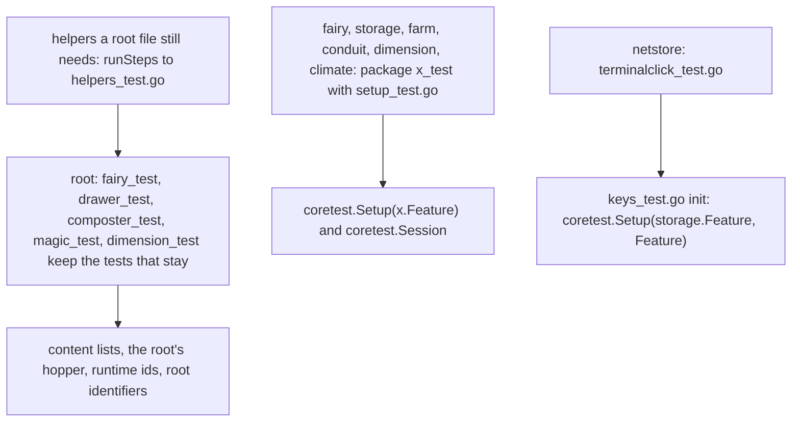
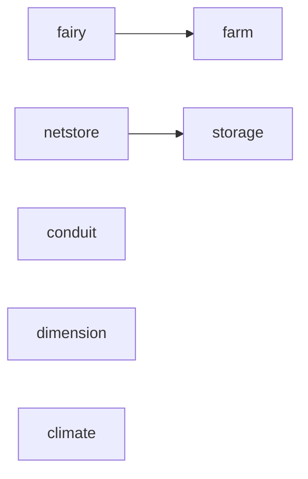

# Plan: structural rework phase 3m (feature tests leave the root: fairy, netstore, storage, farm, conduit, dimension, climate)

**Review plan:** docs/plans/2026-11-10-cleanup-restructure.review.md
**Goal:** Review part 3-5, second third: the tests of `fairy`, `netstore`, `storage`, `farm`, `conduit`, `dimension` and `climate` live in those packages and run without the root; what needs the content lists, the root's hopper, an item of another package or a root identifier stays in the root, named with its reason.
**Architecture:** Runs after p3l (T88 to T94), whose `coretest` and `machinetest` every task here uses. REF is `docs/plans/2026-11-10-cleanup-restructure-p3-tests.md`: the fate of every root test file (section 1), the decisions (2), the support packages (3), imports and guards (4), the risks (6), how a file moves (7: rules R1 to R9, whole file, split file, copied helper, `setup_test.go`, checks, developer rules), the order (8), each task's files and code (9). The part was built and run task by task; a task follows its REF section and designs nothing.
**Tech stack:** Go 1.26, patched Dragonfly in `third_party/dragonfly`, tests with `go test`.
**Spec:** none (the review plan binds)
**Detail:** contracts
**Target-min:** 35
**Ignore:** .superlite/

## Global constraints

- Language Go. Checkout `/home/user/SkyGear`, branch `superlite/sessions/cleanup-restructure`. Developers do not commit or push; the coordinator commits each task with its subject (English, no attribution lines).
- Who decides: the developer implements the task text and its REF section exactly. Anything the text leaves open, a REF list that does not fit the code found, a moved test that fails in its package: stop, return `NEEDS_CONTEXT`. No refactoring beside the task. The prototype patches named in REF are a reference; the task text and REF win over them.
- A task moves files, changes the call sites of REF 7.1 and package clauses. It changes no assertion, no test's name, no production file. No test is skipped, deleted or weakened.
- Green at every commit: `go build ./... && go vet ./... && go test ./...`, `gofmt -l` clean. The union of test names stays the 644 of the base: per task the developer lists `go test -list '.*'` of the root and of the target package before and after (REF 7.6) and reports the four counts; the names that left the root are the names that joined the package and the names REF lists.
- Goldens: the nine files of `content/skygear/testdata/pin/`, the four of `content/skygear/wire/testdata` and `content/skygear/dimension/testdata/popup.golden` stay byte for byte. `SKYGEAR_GOLDEN=update` is forbidden. A red golden means the change is wrong.
- A package's tests never call `core.Install` or a feature's `Setup` themselves: they name features in `coretest.Setup`, in the `init` of `setup_test.go`. `wire` and `dimension/popup_wire_test.go` are not touched. No test of `dimension` gets an import REF does not list (the ids of `popup.golden`, REF 4).
- Run a package's tests three times as separate processes with `-count=1` (`-count=2` fails at the base in `netstore` and `wire`, REF 6).
- Scope: only the files of Owns. One task at a time in id order; T99 edits the root's `helpers_test.go` after T91 of p3l, and T98 needs T92 of p3l done (REF 8). T100 and T101 share no file with another task. Disk: scratch files only under the scratchpad's `<task id>/`, deleted before the report; never `go clean -cache`.
- Leave `.gitignore` alone. Ruling: no Wave 0 - an existing tree needs no stubs - an unused brief. Ruling: single checkout, no worktree - the owner's branch - none.
- Ruling: [scope] `conduit`'s tests set up `network` beside `conduit` - the energy, item and fluid step runs on `Fast` in `network` - one package sets up two features (REF 2).
- Ruling: [scope] `TestHuntRecords` stays in the root - its fairy dust is an item `fairy` registers and `dimension` does not link; linking it would change `popup.golden` - one hunt test is not in `dimension` (REF 1.1).
- Ruling: [scope] `netstore` gets no `setup_test.go` - `keys_test.go` sets up `storage` and `netstore` since 3-4, through `coretest.Setup` since T88 - none.

## Main diagram

## File structure

New: per package a `setup_test.go` (not `netstore`) and the moved files (REF 9). Changed: the root's `helpers_test.go` (T99) and the root test files each task names; whole files leave the root.

## Task graph

## Predicted schedule

From `plan_tools schedule`: T95 before T98 and T96 before T97 (the later task moves the root file the earlier one copies a helper from); T99, T100 and T101 wait for nothing in this plan. The coordinator still runs one task at a time.

## features

**Probe entry:** run=go test ./content/skygear/fairy ./content/skygear/netstore ./content/skygear/storage ./content/skygear/farm ./content/skygear/conduit ./content/skygear/dimension ./content/skygear/climate

### T95 the fairy tests · Complexity 4 · Est. context 36k
**Owns:** content/skygear/fairy_test.go, content/skygear/fairytime_test.go, content/skygear/fairy/fairy_test.go, content/skygear/fairy/fairytime_test.go, content/skygear/fairy/setup_test.go
**Components:** 1
**LOC owned:** 430
**Tests:** slow
**Kind:** design
**Model:** sonnet
**Est. time:** 2.4 min
**Consumes:** none
**Produces:** none
**Review Focus:** eleven names go from the root to `fairy`; the three tests over the research tree stay (`TestGiftsComeFromDoneResearch`, `TestGiftsSkipProjectsAndResearchDoneOutOfOrder`, `TestDeeperResearchIsDeeper`); `fairy/fairytime_test.go` ends with the copies of `cropPos`, `plantAt`, `stageOf`, `advance` and the root's `crops_test.go` is untouched; `TestHittingTheFairyGivesTheGift` passes in `fairy`
**Steps:**
1. Lists of REF 7.6 before.
2. Move `fairytime_test.go` whole and append the four helper copies (REF T95, 7.4).
3. Split `fairy_test.go`: the three research tests stay (REF T95, 7.3).
4. `fairy/setup_test.go` as REF T95.
5. Checks of REF 7.6. Commit `test(fairy): move the fairy tests into the feature's package`.

### T96 the terminal click test · Complexity 2 · Est. context 33k
**Owns:** content/skygear/terminal_test.go, content/skygear/netstore/terminalclick_test.go
**Components:** 1
**LOC owned:** 55
**Tests:** slow
**Kind:** design
**Model:** sonnet
**Est. time:** 1.4 min
**Consumes:** none
**Produces:** none
**Review Focus:** `TestSneakingClickOpensTheTerminalOverEmptySlots` goes from the root to `netstore` (62 to 63 names there); the file is `terminalclick_test.go` because `netstore/terminal_test.go` exists; it ends with the copy of `useBlock`; the root's `drawer_test.go` is untouched; no `setup_test.go` is added
**Steps:**
1. Lists of REF 7.6 before.
2. Move `terminal_test.go` to `netstore/terminalclick_test.go` (REF 7.2) and append the copy of `useBlock` (REF T96, 7.4).
3. Checks of REF 7.6. Commit `test(netstore): move the terminal click test into the feature's package`.

### T97 the drawer tests · Complexity 4 · Est. context 40k
**Owns:** content/skygear/drawer_test.go, content/skygear/holder_test.go, content/skygear/storage/drawer_test.go, content/skygear/storage/holder_test.go, content/skygear/storage/setup_test.go
**Components:** 1
**LOC owned:** 810
**Tests:** slow
**Kind:** design
**Model:** sonnet
**Est. time:** 2.8 min
**Consumes:** none
**Produces:** none
**Review Focus:** 22 names go from the root to `storage`; `TestDrawerHopperAndDisplay` (the root's hopper) and `TestDrawerStatesMatchRuntimeIDs` (runtime ids) stay, word for word; `useBlock` is only in the moved half; the two tests of `storage/perf_test.go` still pass with `storage.Feature` set up
**Steps:**
1. Lists of REF 7.6 before.
2. Move `holder_test.go` whole. Split `drawer_test.go`: the two tests of REF T97 stay (7.3).
3. `storage/setup_test.go` as REF T97.
4. Checks of REF 7.6. Commit `test(storage): move the drawer tests into the feature's package`.

### T98 the farm tests · Complexity 5 · Est. context 44k
**Owns:** content/skygear/barrel_test.go, content/skygear/composter_test.go, content/skygear/crook_test.go, content/skygear/cropinfo_test.go, content/skygear/crops_test.go, content/skygear/harvester_test.go, content/skygear/leaves_test.go, content/skygear/magic_test.go, content/skygear/silkworm_test.go, content/skygear/witchwater_test.go, content/skygear/farm/barrel_test.go, content/skygear/farm/composter_test.go, content/skygear/farm/crook_test.go, content/skygear/farm/cropinfo_test.go, content/skygear/farm/crops_test.go, content/skygear/farm/harvester_test.go, content/skygear/farm/leaves_test.go, content/skygear/farm/magic_test.go, content/skygear/farm/silkworm_test.go, content/skygear/farm/witchwater_test.go, content/skygear/farm/setup_test.go
**Components:** 2
**LOC owned:** 1800
**Tests:** slow
**Kind:** design
**Model:** sonnet
**Est. time:** 3.6 min
**Consumes:** none
**Produces:** none
**Review Focus:** 41 names go from the root to `farm` (3 to 44 there); the two hopper tests of `composter_test.go` and `TestMagicSeedsAndRecipes` stay; eight files leave the root whole and no root file still calls `droppedKeys`, `always`, `count`, `plantAt`, `stageOf`, `advance` or `cropPos` (`go vet ./content/skygear/`); `farm/leaves_test.go` does not import `farm`; the five tests of REF 2 (decision 4) pass in `farm`; `farm/loops_test.go` still passes
**Steps:**
1. Lists of REF 7.6 before.
2. Move the eight whole files of REF T98 (7.2).
3. Split `composter_test.go` and `magic_test.go` as REF T98 (7.3).
4. `farm/setup_test.go` as REF T98.
5. Checks of REF 7.6. Commit `test(farm): move the farm tests into the feature's package`.

### T99 the energy and conduit tests · Complexity 3 · Est. context 38k
**Owns:** content/skygear/energy_test.go, content/skygear/helpers_test.go, content/skygear/conduit/energy_test.go, content/skygear/conduit/setup_test.go
**Components:** 1
**LOC owned:** 670
**Tests:** slow
**Kind:** design
**Model:** sonnet
**Est. time:** 2.2 min
**Consumes:** none
**Produces:** none
**Review Focus:** 17 names go from the root to `conduit` (14 to 31 there); `runSteps` is in the root's `helpers_test.go` word for word and `TestHandsFreeLine` passes; `conduit/setup_test.go` sets up `conduit.Feature` and `network.Feature` with the comment of REF T99; the 14 tests `conduit` had still pass
**Steps:**
1. Lists of REF 7.6 before.
2. Move `energy_test.go` whole (REF 7.2, T99).
3. Append `runSteps` with its comment to the root's `helpers_test.go` (REF T99 diff).
4. `conduit/setup_test.go` as REF T99.
5. Checks of REF 7.6. Commit `test(conduit): move the energy and conduit tests into the feature's package`.

### T100 the hunt tests · Complexity 4 · Est. context 40k
**Owns:** content/skygear/dimension_test.go, content/skygear/dimension/dimension_test.go, content/skygear/dimension/setup_test.go
**Components:** 1
**LOC owned:** 780
**Tests:** slow
**Kind:** design
**Model:** sonnet
**Est. time:** 2.8 min
**Consumes:** none
**Produces:** none
**Review Focus:** twelve names go from the root to `dimension` (2 to 14 there); `TestHuntRecords`, `TestWatchdog`, `TestGiveRelics` and `clearHunt` stay; `runTick` and `runMonsters` are in both halves, word for word; the moved file adds the imports `coretest` and `machinetest` and no other; `popup.golden` is unchanged and `dimension` passes five times as separate processes (the time-dependent hunt tests, REF 6 risk 9)
**Steps:**
1. Lists of REF 7.6 before.
2. Split `dimension_test.go` as REF T100 (7.3).
3. `dimension/setup_test.go` as REF T100.
4. Checks of REF 7.6, with `dimension` run five times. Commit `test(dimension): move the hunt tests into the feature's package`.

### T101 the weather spell tests · Complexity 2 · Est. context 32k
**Owns:** content/skygear/fairyspell_test.go, content/skygear/climate/fairyspell_test.go, content/skygear/climate/setup_test.go
**Components:** 1
**LOC owned:** 160
**Tests:** slow
**Kind:** design
**Model:** sonnet
**Est. time:** 1.5 min
**Consumes:** none
**Produces:** none
**Review Focus:** five names go from the root to `climate` (0 to 5 there); the helper `cast` takes `core.Lifecycle`; `TestSnowRunsMachinesFaster` places its machine with `machinetest.Place`; `TestLayers` passes (a test file's imports are not read, REF 4)
**Steps:**
1. Lists of REF 7.6 before.
2. Move `fairyspell_test.go` whole to `climate` (REF 7.2, T101).
3. `climate/setup_test.go` as REF T101.
4. Checks of REF 7.6. Commit `test(climate): move the weather spell tests into the feature's package`.

## Review Focus

- features (library): encoding, state. Files moved word for word but for R1 to R9; the names that left the root arrived; each package passes alone with the features REF 2 lists; `popup.golden` and the pins untouched.

## Self-review

Coverage: REF 1.3 rows of T95 to T101; decision 4 for `conduit` and `netstore`. Left to p3n: `wand`, `expand`, `screens`, `machine`, the documents and the guards.
