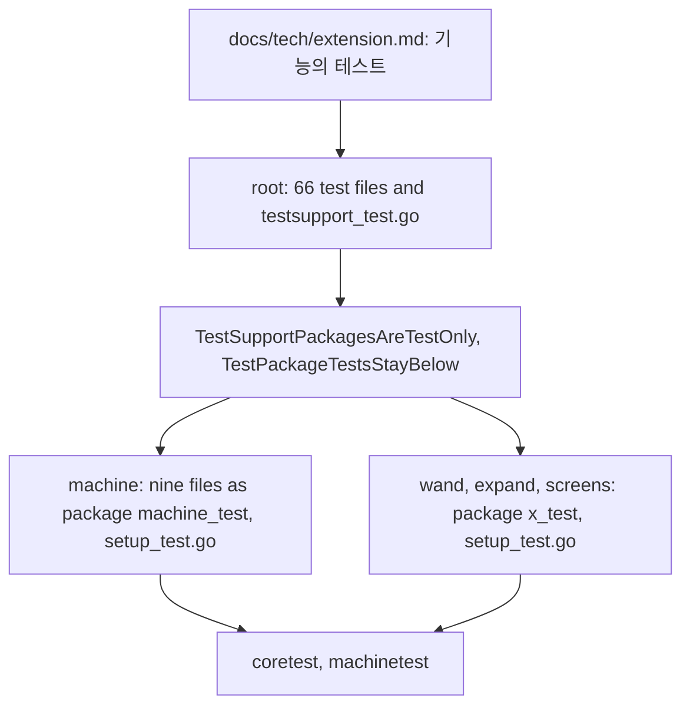
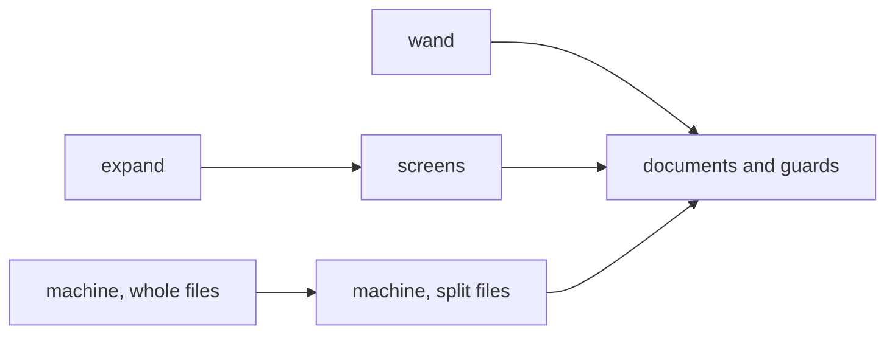

# Plan: structural rework phase 3n (feature tests leave the root: wand, expand, screens, machine; the documents and two guards)

**Review plan:** docs/plans/2026-11-10-cleanup-restructure.review.md
**Goal:** Review part 3-5, last third: the tests of `wand`, `expand`, `screens` and `machine` live in those packages and run without the root; the documents say where a feature's tests go and how they set features up; two guards keep the support packages test-only and a package's tests below the composed game.
**Architecture:** Runs after p3m (T95 to T101). REF is `docs/plans/2026-11-10-cleanup-restructure-p3-tests.md`: the fate of every root test file (section 1), the decisions (2), the support packages (3), imports and guards (4), the risks (6), how a file moves (7: rules R1 to R9, whole file, split file, copied helper, `setup_test.go`, checks, developer rules), the order (8), each task's files and code (9). The part was built and run task by task; a task follows its REF section and designs nothing. After T106 the root keeps 66 test files: the pins, the guards, the benchmarks, the tests of the content lists, the pack and the saves, and the tests that need several features, the root's hopper or a root identifier.
**Tech stack:** Go 1.26, patched Dragonfly in `third_party/dragonfly`, tests with `go test`.
**Spec:** none (the review plan binds)
**Detail:** contracts
**Target-min:** 35
**Ignore:** .superlite/

## Global constraints

- Language Go. Checkout `/home/user/SkyGear`, branch `superlite/sessions/cleanup-restructure`. Developers do not commit or push; the coordinator commits each task with its subject (English, no attribution lines).
- Who decides: the developer implements the task text and its REF section exactly. Anything the text leaves open, a REF list that does not fit the code found, a moved test that fails in its package: stop, return `NEEDS_CONTEXT`. No refactoring beside the task. The prototype patches named in REF are a reference; the task text and REF win over them.
- A task moves files, changes the call sites of REF 7.1 and package clauses. It changes no assertion, no test's name, no production file. No test is skipped, deleted or weakened.
- Green at every commit: `go build ./... && go vet ./... && go test ./...`, `gofmt -l` clean. The union of test names stays the 644 of the base (646 with the two guards of T107): per task the developer lists `go test -list '.*'` of the root and of the target package before and after (REF 7.6) and reports the four counts; the names that left the root are the names that joined the package and the names REF lists.
- Goldens: the nine files of `content/skygear/testdata/pin/`, the four of `content/skygear/wire/testdata` and `content/skygear/dimension/testdata/popup.golden` stay byte for byte. `SKYGEAR_GOLDEN=update` is forbidden. A red golden means the change is wrong.
- A package's tests never call `core.Install` or a feature's `Setup` themselves: they name features in `coretest.Setup`, in the `init` of `setup_test.go`. `wire` and `dimension/popup_wire_test.go` are not touched.
- Run a package's tests three times as separate processes with `-count=1` (`-count=2` fails at the base in `netstore` and `wire`, REF 6).
- Scope: only the files of Owns. One task at a time in id order; T105 edits the root's `helpers_test.go` after T99 of p3m (REF 8). T102 shares no file with another task. Disk: scratch files only under the scratchpad's `<task id>/`, deleted before the report; never `go clean -cache`.
- Documents under `docs/` and `content/skygear/README.md` are Korean, say what is and carry no history; `CONTRIBUTING.md` is English. T107 copies the text of REF T107.
- Leave `.gitignore` alone. Ruling: no Wave 0 - an existing tree needs no stubs - an unused brief. Ruling: single checkout, no worktree - the owner's branch - none.
- Ruling: [scope] the tests of `screens` move although the outline kept them - `screens` imports `catalog` and `codex`, so its binary has the content lists; measured, they pass alone - `screens` gets 12 tests (REF 1.5).
- Ruling: [scope] `machine`'s tests set up `machine` only, beside the `netstore` of `netkinds_test.go` - no moved test needs a kind owner's behaviour (measured) - `storage`, `farm` and `dimension` are not set up there (REF 2).
- Ruling: [scope] the guards are a new root test file, `testsupport_test.go` - `layers_test.go` keeps its import list - one more root test file.

## Main diagram

## File structure

New: per package a `setup_test.go` and the moved files (REF 9), `content/skygear/testsupport_test.go`. Changed: the root's `helpers_test.go` (T105), the root test files each task names, and the documents of T106.

## Task graph

## Predicted schedule

From `plan_tools schedule`: T103 before T104 (both cut the root's `screens_test.go`), T105 before T106 (the `setup_test.go` of `machine`), T102 beside them, T107 after all. The coordinator still runs one task at a time.

## features

**Probe entry:** run=go test ./content/skygear/wand ./content/skygear/expand ./content/skygear/screens ./content/skygear/machine

### T102 the wand tests · Complexity 3 · Est. context 36k
**Owns:** content/skygear/wand_test.go, content/skygear/wand/wand_test.go, content/skygear/wand/setup_test.go
**Components:** 1
**LOC owned:** 430
**Tests:** slow
**Kind:** design
**Model:** sonnet
**Est. time:** 2.2 min
**Consumes:** none
**Produces:** none
**Review Focus:** six names go from the root to `wand`; `TestAutofill` and `TestAutofillPlace` (they need `autofill` beside `wand`) and `TestPreviewGlassBlock` (`giveItems`) stay; `wandWall` and `countStone` are in both halves, word for word, so `TestPinUse` passes with `handler-use.golden` unchanged; `sentViews` is only in the moved half
**Steps:**
1. Lists of REF 7.6 before.
2. Split `wand_test.go` as REF T102 (7.3).
3. `wand/setup_test.go` as REF T102.
4. Checks of REF 7.6. Commit `test(wand): move the wand tests into the feature's package`.

### T103 the expansion tests · Complexity 3 · Est. context 34k
**Owns:** content/skygear/screens_test.go, content/skygear/expand/expand_test.go, content/skygear/expand/setup_test.go
**Components:** 1
**LOC owned:** 240
**Tests:** slow
**Kind:** design
**Model:** sonnet
**Est. time:** 2.0 min
**Consumes:** none
**Produces:** none
**Review Focus:** `TestExpansionMode` and `TestExpansionMap` go from the root to `expand` (0 to 2 there); `TestExpansionPlane` stays (it reads `screens.Boards`), and so do `press`, `TestMainMenuHasIcons`, `TestLostMenu` and `TestGiveItems`; `expand/expand_test.go` does not import `screens`; `TestExpansionMode` passes in `expand` (it needs `expand.Feature` set up)
**Steps:**
1. Lists of REF 7.6 before.
2. Split `screens_test.go` as REF T103 (7.3): the two tests go to the new file `expand/expand_test.go`.
3. `expand/setup_test.go` as REF T103.
4. Checks of REF 7.6. Commit `test(expand): move the expansion tests into the feature's package`.

### T104 the menu, research and sidebar tests · Complexity 3 · Est. context 36k
**Owns:** content/skygear/screens_test.go, content/skygear/research_split_test.go, content/skygear/researchtext_test.go, content/skygear/sidebar_test.go, content/skygear/screens/menu_test.go, content/skygear/screens/research_split_test.go, content/skygear/screens/researchtext_test.go, content/skygear/screens/sidebar_test.go, content/skygear/screens/setup_test.go
**Components:** 1
**LOC owned:** 450
**Tests:** slow
**Kind:** design
**Model:** sonnet
**Est. time:** 2.4 min
**Consumes:** none
**Produces:** none
**Review Focus:** twelve names go from the root to `screens` (1 to 13 there): the ten of the three whole files and `TestMainMenuHasIcons`, `TestLostMenu` in `screens/menu_test.go`; the root's `screens_test.go` keeps `press`, `TestGiveItems` and `TestExpansionPlane`, and `TestLabScreen` (which calls `press`) passes; `screens/help_test.go` still passes
**Steps:**
1. Lists of REF 7.6 before.
2. Move `research_split_test.go`, `researchtext_test.go` and `sidebar_test.go` whole (REF 7.2, T104).
3. Split `screens_test.go`: the two menu tests go to `screens/menu_test.go` (REF T104, 7.3).
4. `screens/setup_test.go` as REF T104.
5. Checks of REF 7.6. Commit `test(screens): move the menu, research and sidebar tests into the feature's package`.

### T105 the machine tests that move whole · Complexity 4 · Est. context 40k
**Owns:** content/skygear/animate_test.go, content/skygear/magicsieve_test.go, content/skygear/monitor_test.go, content/skygear/naturegen_test.go, content/skygear/tier_test.go, content/skygear/helpers_test.go, content/skygear/machine/animate_test.go, content/skygear/machine/magicsieve_test.go, content/skygear/machine/monitor_test.go, content/skygear/machine/naturegen_test.go, content/skygear/machine/tier_test.go, content/skygear/machine/setup_test.go
**Components:** 2
**LOC owned:** 790
**Tests:** slow
**Kind:** design
**Model:** sonnet
**Est. time:** 2.8 min
**Consumes:** none
**Produces:** none
**Review Focus:** 22 names go from the root to `machine` (32 to 54 there); the five files are in the package `machine_test`, never `machine`; `runSeconds` is in the root's `helpers_test.go` word for word, so `rest_perf_test.go` passes untouched; `machine/netkinds_test.go` is untouched and the 32 tests `machine` had pass with `machine.Feature` set up beside its `netstore`
**Steps:**
1. Lists of REF 7.6 before.
2. Move `animate_test.go`, `magicsieve_test.go`, `monitor_test.go`, `naturegen_test.go` and `tier_test.go` whole (REF 7.2, T105).
3. Append `runSeconds` with its comment to the root's `helpers_test.go` (REF T105 diff).
4. `machine/setup_test.go` as REF T105.
5. Checks of REF 7.6. Commit `test(machine): move the machine tests that move whole into the feature's package`.

### T106 the machine tests of the split files · Complexity 5 · Est. context 46k
**Owns:** content/skygear/autoequip_test.go, content/skygear/lab_test.go, content/skygear/machine_test.go, content/skygear/sieve_test.go, content/skygear/machine/autoequip_test.go, content/skygear/machine/lab_test.go, content/skygear/machine/machine_test.go, content/skygear/machine/sieve_test.go
**Components:** 2
**LOC owned:** 1810
**Tests:** slow
**Kind:** design
**Model:** sonnet
**Est. time:** 3.6 min
**Consumes:** none
**Produces:** none
**Review Focus:** 50 names go from the root to `machine` (54 to 104 there); seven tests stay with their reasons (REF 1.3): `TestHandsFreeLine`, `TestLabScreen`, three of `autoequip_test.go`, two of `sieve_test.go`; `rangeBoxAt`, `fillLab` and `countIn` are in both halves, so `look_branches_test.go` and `pin_look_test.go` pass untouched; `machine/autoequip_test.go` has no `hasLine`; `kinds.golden` and `look.golden` unchanged
**Steps:**
1. Lists of REF 7.6 before.
2. Split `autoequip_test.go` and `lab_test.go` as REF T106 (7.3).
3. Split `machine_test.go` and `sieve_test.go` as REF T106 (7.3).
4. Checks of REF 7.6. Commit `test(machine): move the machine tests of the split files into the feature's package`.

## documents

**Probe entry:** run=go test ./content/skygear -run 'TestSupportPackagesAreTestOnly|TestPackageTestsStayBelow|TestLayers'

### T107 where a feature's tests live · Complexity 4 · Est. context 36k
**Owns:** content/skygear/testsupport_test.go, docs/tech/extension.md, docs/tech/machines.md, docs/design/11-research-essences.md, content/skygear/README.md, CONTRIBUTING.md
**Components:** 2
**LOC owned:** 170
**Tests:** slow
**Kind:** design
**Model:** sonnet
**Est. time:** 2.6 min
**Consumes:** none
**Produces:** none
**Review Focus:** `TestSupportPackagesAreTestOnly` and `TestPackageTestsStayBelow` (REF T107) pass on the tree T106 leaves, and each fails for the case it names (try one: a `catalog` import in a test of `farm`, then undo it); `docs/tech/extension.md` has the section "기능의 테스트" before "클라이언트 항목 고치기", the two rows in the rules table, and step 5's line names `coretest.Setup`; every file and identifier a document names exists; the Korean reads naturally and says nothing of how things were
**Steps:**
1. `content/skygear/testsupport_test.go` with the code of REF T107; both tests pass.
2. `docs/tech/extension.md`, `content/skygear/README.md`, `CONTRIBUTING.md`, `docs/tech/machines.md` and `docs/design/11-research-essences.md` as the diffs of REF T107.
3. Check: `grep` every file and identifier the new text names; `go test ./...` green (646 names).
4. Commit `docs, test: say where a feature's tests live and guard it`.

## Review Focus

- features (library): encoding, state. Files moved word for word but for R1 to R9; the names that left the root arrived; `machine`'s tests are external and pass with `machine` and `netstore` set up.
- documents (file): encoding. Names match the code; the guards fail for what they name; Korean reads naturally; no history.

## Self-review

Coverage: REF 1.3 rows of T102 to T106; REF 4 (the guards); the documents. Part 3-5 ends here; what stays in the root and why is REF 1.3.
