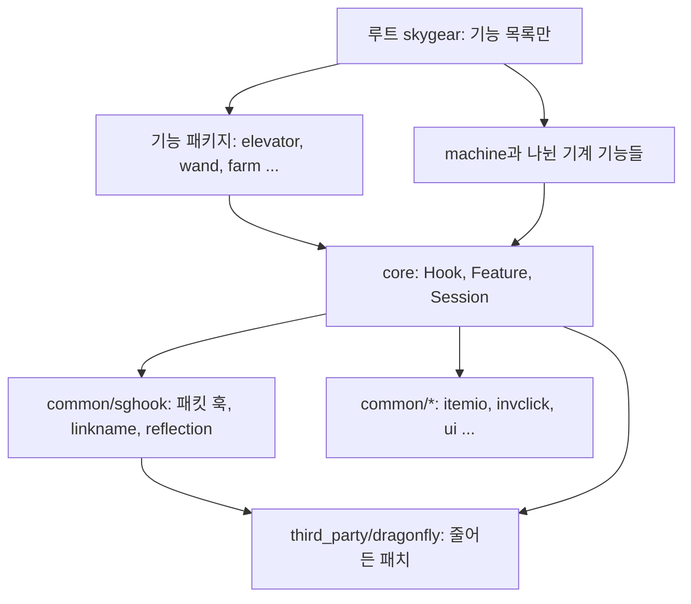
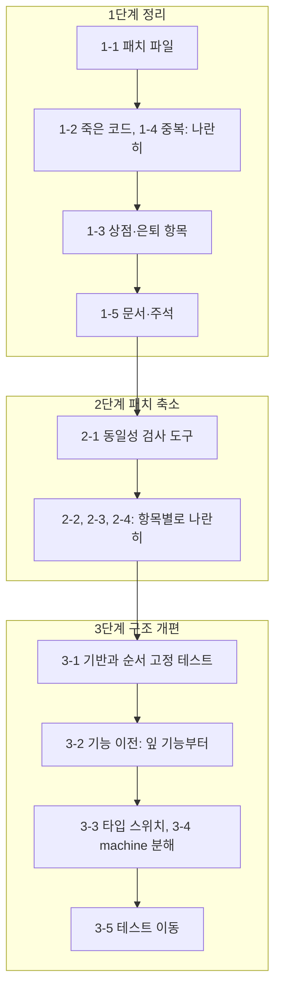

# 정리·패치 축소·구조 개편: 검토용 계획

## Summary
SkyGear 코드에서 죽은 코드와 낡은 문서를 걷어내고, Dragonfly 패치 가운데 패치 없이 구현할 수 있는 것을 `common/sghook`과 공개 API로 옮기고, 기능이 이벤트를 스스로 구독하는 구조로 바꿉니다. 지금은 루트 패키지의 `handler.go`가 18개 패키지를 약 110번 손으로 호출하고, 패치는 테스트를 빼고 51개 파일 +1,693줄이며, 끝난 실험과 없앤 기능의 잔재가 수천 줄 남아 있습니다. 세 단계로 나눠 차례로 하고, 단계마다 빌드와 전체 테스트를 통과시킵니다. 근거는 읽기 전용 감사 세 건이며, 각 작업은 시작할 때 감사의 주장을 코드로 다시 확인합니다.

## What you will get
- 죽은 코드가 없는 저장소: 상태 수 프로브와 `/sgdebug fill`, `spike/` 봇, 상점 잔재, 은퇴한 블록·아이템 7종과 텍스처 47개, 중복된 `nsmigrate`, 깨진 `tools/` 생성기가 사라집니다.
- 기존 세이브가 그대로 열립니다. 판매 상자와 은퇴한 블록·아이템은 26.11.9 마이그레이션 패치로 바꾸거나 지웁니다.
- 실제 패치와 일치하는 `third_party/dragonfly.patch`, 커밋 해시로 고정한 업스트림 기준, 현재 상태와 맞는 `third_party/README.md`.
- 더 작은 Dragonfly 패치: 옮기기 전후가 같다는 것을 테스트로 보인 항목만 패치에서 빠집니다.
- 한 곳에 모인 확장 기반: `content/skygear/core`의 이벤트 훅과 기능 기술자, 그 아래 `common/sghook`, 그 아래 Dragonfly 패치.
- 떼어낼 수 있는 기능 패키지: 기능이 자기 블록·아이템·이벤트 구독·틱·명령어·WAILA 줄·로케일을 스스로 등록하고, 루트 패키지는 기능 목록만 가집니다.
- 코드와 맞는 문서: README 패키지 표, 설계·기술 문서, `CONTRIBUTING.md`(변경 기록은 영어), 새 문서 `docs/tech/extension.md`.

## What will be built
| Part | What it does (one sentence) | Size (S/M/L) | Built by |
|---|---|---|---|
| 1-1 패치 파일 동기화 | `dragonfly.patch`와 README를 실제 패치에 맞추고 업스트림 기준을 커밋 해시로 고정합니다 | S | 빠른 도우미 |
| 1-2 죽은 코드 삭제 | 프로브·`/sgdebug fill`·`spike/`·깨진 `tools/` 생성기·테스트만 쓰는 공개 함수를 지웁니다 | M | 빠른 도우미 |
| 1-3 상점·은퇴 항목 제거 | 판매 상자, `Money`, `cheques`, `Owner`, 은퇴한 7종을 지우고 마이그레이션 패치와 테스트를 넣습니다 | M | 꼼꼼한 도우미 |
| 1-4 중복 정리 | `nsmigrate`를 `migrate`·`common/nbtrewrite`로 합치고 겹치는 도우미를 하나로 줄입니다 | M | 꼼꼼한 도우미 |
| 1-5 문서·주석 맞추기 | 낡은 주석, README 표, 설계·기술 문서, 쓰이지 않는 로케일 키를 현재 코드에 맞춥니다 | M | 빠른 도우미 |
| 2-1 동일성 검사 도구 | 클라이언트로 나가는 패킷을 옮기기 전후로 비교하는 테스트 틀을 만듭니다 | M | 꼼꼼한 도우미 |
| 2-2 지울 수 있는 패치 | 쓰는 곳이 없는 `SendForm` 가드와 `pack_icon.png` 교체를 되돌립니다 | S | 빠른 도우미 |
| 2-3 서버 동작 패치 이전 | 명령어 패닉 복구, 종료 시 킥, 퇴비통, 나뭇잎, 날씨 패킷, 블록 레이어를 핸들러와 훅으로 옮깁니다 | L | 꼼꼼한 도우미 |
| 2-4 클라이언트 데이터 패치 이전 | 블록·아이템 컴포넌트, 레시피 필터, 크리에이티브 목록을 `sghook`으로 옮기고 패킷이 같은지 검사합니다 | L | 꼼꼼한 도우미 |
| 3-1 기반 | `core.Hook[E]`와 `core.Feature`를 만들고 `second.go`·`game.go`의 호출 순서를 고정하는 테스트를 먼저 씁니다 | M | 꼼꼼한 도우미 |
| 3-2 기능 이전 | `handler.go`·`second.go`·`game.go`의 수동 호출을 기능별 구독으로 하나씩 옮깁니다(잎 기능부터) | L | 꼼꼼한 도우미 |
| 3-3 타입 스위치 제거 | `look`, `decor`, 크리에이티브 목록, `admin`의 타입 스위치를 능력 인터페이스로 바꿉니다 | L | 꼼꼼한 도우미 |
| 3-4 `machine` 분해 | 다른 기능 소유의 기계 17종을 `storage`·`tinker`·`dimension`·`farm`·`netstore`로 돌려보냅니다 | L | 꼼꼼한 도우미 |
| 3-5 테스트 이동 | 루트 패키지의 기능 테스트 81개 파일을 각 기능 패키지로 옮깁니다 | L | 빠른 도우미 |

## How it fits together

## How it gets built

## Decisions you can change
- 패치 이전 기준: 테스트로 동일성이 확인되는 것만(기본) | 전부 옮기고 실기 확인 목록 작성
- 기반 위치: `content/skygear/core`를 키움(기본) | 마지막에 `platform/`으로 올림
- 푸시 단위: 작업마다 `ccr-53c8be6e-5s1xr8`에 커밋·푸시하고 PR은 열지 않음(기본) | 단계마다 PR
- 이 계획 문서: 작업 브랜치에만 커밋하고 `dev`에 합치기 전에 지움(기본, `docs/`는 현재 설계만 적는다는 규칙) | `docs/plans/`에 남김
- 버전: 올리지 않음(기본, `dev`를 `main`에 머지할 때 올림). 마이그레이션 패치는 26.11.9로 적습니다.

## Risks
- 실제 클라이언트로 확인할 수 없습니다. 클라이언트 표시에 영향을 주는 이전은 패킷 동일성 테스트가 통과할 때만 하고, 그렇지 않은 항목은 패치로 남깁니다.
- 남는 패치: 감사가 꼭 필요하다고 본 19개(저장, 청크 캐시, 틱 성능, 패닉 복구 등)와, 실기 확인이 필요한 가짜 청크(`ViewFakeChunk`), `Activate` 뒤 재전송 두 건, 커스텀 블록 서버 파괴, 잔디 퍼짐 검사, 그리고 테스트로 동일성을 보이지 못한 항목.
- 호출 순서가 바뀌면 동작이 달라집니다. 옮기기 전에 현재 순서를 고정하는 테스트를 쓰고, 훅에 명시적 우선순위를 둡니다.
- 세이브 호환: 삭제하는 블록·아이템마다 마이그레이션 패치와, 옛 데이터를 읽는 테스트를 함께 넣습니다. 이미 출시된 패치는 고치지 않습니다.
- 감사의 주장이 틀릴 수 있습니다. 각 작업은 "쓰는 곳 없음", "글자까지 같음" 같은 전제를 먼저 확인하고, 틀리면 그 작업을 빼고 보고합니다.
- 범위가 큽니다. 작업은 작은 커밋으로 나누고, 3단계는 기능 하나씩 옮겨서 어디서 멈춰도 빌드와 테스트가 통과합니다.

## Out of scope
- 플레이어가 보는 동작의 변경과 새 기능. 밸런스 수치.
- Dragonfly 업스트림 버전 올리기.
- 연구·레시피 데이터, `common/*`의 기존 구조, 리소스팩 구조(감사가 지금도 괜찮다고 본 부분).
- Ore UI 페이지(`web/oreui`) 개편.
- 릴리스 태그와 `main` 머지.

## How we will know it works
- 모든 커밋에서 `go build ./...`, `go vet ./...`, `go test ./...`가 통과하고, 테스트를 끄거나 건너뛴 곳이 없습니다.
- 26.11.8 형식의 세이브(판매 상자, 은퇴한 블록·아이템 포함)를 읽는 마이그레이션 테스트가 통과합니다.
- 업스트림에 `third_party/dragonfly.patch`를 적용한 결과가 `third_party/dragonfly`와 같습니다.
- 옮긴 패치 항목마다 "옮기기 전후 패킷 또는 동작이 같다"는 테스트가 있습니다.
- 3단계 뒤: `handler.go`에 기능 패키지 직접 호출이 남지 않고, 새 기능 하나를 추가할 때 고치는 중앙 파일이 기능 목록 한 곳입니다(지금 `elevator`는 8곳).
- 끝에 독립 검토자가 전체 변경을 검토하고, 실기 확인이 필요한 것은 `docs/TODO.md`에 목록으로 남습니다.

## Rough time and cost
대략 작업 40~55개입니다(1단계 8~10, 2단계 12~15, 3단계 20~30). 도우미 여럿이 나란히 일해도 여러 시간에서 하루 이상 걸리고, 토큰 사용량도 큽니다. 기계용 계획을 쓰고 검사한 뒤에야 정확해지는 대략값입니다. 단계 사이에서 멈추고 결과를 보실 수 있습니다.
