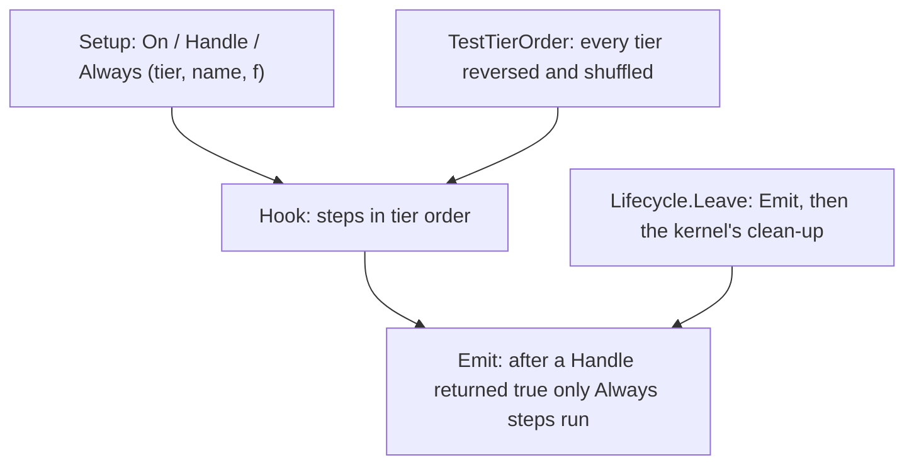
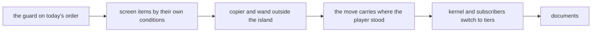

# Plan: hook tiers (six tiers replace the numeric priorities of the event kernel)

**Review plan:** docs/plans/2026-11-10-cleanup-restructure.review.md
**Goal:** A subscriber is registered in one of six tiers (`core.Lowest` to `core.Monitor`), each with one role, instead of at a number unique in its hook. No subscriber depends on its place inside a tier (a test reorders every tier), and a subscriber may choose to receive a cancelled event (`Hook.Always`). Nothing a player can observe changes.
**Architecture:** REF is `docs/plans/2026-11-11-hook-tiers.md`: measurements, every order dependence, the resolutions, the four exceptions the owner decides on, the design, and one "REF T<nn>" section per task with its exact code, built and run on 6016b31. A task copies its blocks and designs nothing. Order: the guard on today's numbers with the planned tiers simulated and a list of the dependences still kept (T120), one task per dependence a condition or the kernel removes (T121 to T123), the switch with the one intended re-record (T124), the documents (T125).
**Tech stack:** Go 1.26, patched Dragonfly, `go test`.
**Spec:** none (REF 1 binds)
**Detail:** contracts
**Target-min:** 30
**Ignore:** .superlite/

## Global constraints

- Checkout `/home/user/SkyGear`, branch `superlite/sessions/cleanup-restructure`. No push; who commits is said in the dispatch (the task's subject, English, no attribution lines). One task at a time, in id order; only the files of Owns.
- The developer implements the task text and its REF section exactly. Anything left open or a REF block that does not fit the code: stop, return `NEEDS_CONTEXT`. No refactoring beside the task. The exceptions of REF 6 stay as they are.
- Prototype patch of a task: `/tmp/claude-0/-home-user-SkyGear/a71fa8d5-6f20-5c3f-ba20-eeb27e13ad8a/scratchpad/proto-tiers-tasks/T<nn>.patch` (id order, on 6016b31). If `git apply --check` passes, apply it and check the result against REF; if not, do the task by hand from REF and say so. Never `--reject` or `-3`. T125 is done by hand.
- Green at every commit: `go build ./... && go vet ./... && go test -count=1 ./...` (62 packages), `gofmt -l` clean. No test skipped or weakened. The root's tests run through a binary (`go test -c -o <scratch>/root.test ./content/skygear`, run from `content/skygear`).
- Goldens: T120 to T123 change none. T124 re-records five files of `content/skygear/testdata/pin/` with `SKYGEAR_GOLDEN=update <root.test> -test.count=1 -test.run '^TestPin(Order|Simple|Blocks|Use|Lifecycle)$'`: `order.golden` gets the tier for the number; in the four scenario goldens only the trace before the first ` | ` may differ, the results of all 234 scenarios stay byte for byte (check script in REF T124). Every other golden is frozen.
- `TestTierOrder` passes at every commit; `orderKept` only shrinks.
- Hot path: T123 and T124 run `go test -run xxx -bench 'HandleMove$|Second$|UseOnBlock$|Use$' -benchmem -count 6 ./content/skygear` and `-bench Emit` on `./content/skygear/core` before and after: B/op and allocs/op equal, median ns/op within 15 percent (REF 8).
- Go comments in English; `docs/` in Korean, current state only. Binaries only under the scratchpad's `<task id>/`, deleted before the report; never `go clean -cache`.
- Ruling: no Wave 0 - an existing tree needs no stubs - an unused brief. Ruling: single checkout - the owner's branch - none.
- Ruling: [scope] T124 changes the kernel and all 120 call sites in one commit - `On` and `Handle` change a parameter's type - one large task with a patch.
- Ruling: [scope] the kernel's clean-up on leave becomes the tail of `Lifecycle.Leave` - it follows every subscriber - `order.golden` has 121 lines.
- Ruling: [scope] `MoveEvent` gets `From` - the walk counter must not read where a moved player is - one more event field.

## Main diagram

## File structure

New: `core/reorder.go`, `core/coretest/order.go`, `sgitem/screenitem.go`, their tests, five root tests. Changed: the kernel, the subscribe files, the pin tests, five goldens, four documents (each task's Owns).

## Task graph

## Predicted schedule

One chain, T120 to T125.

## root

**Probe entry:** run=go test ./content/skygear -run 'TestTierOrder|TestPin' -count=1

### T120 the tier order guard, on today's numbers · Complexity 5 · Est. context 36k
**Owns:** content/skygear/core/{reorder.go,reorder_test.go,hook.go}, content/skygear/{tierorder_test.go,pin_test.go,pin_order_test.go,pin_blocks_test.go,pin_use_test.go,helpers_test.go}
**Components:** 2
**LOC owned:** 640
**Tests:** slow
**Kind:** design
**Model:** sonnet
**Est. time:** 4.0 min
**Consumes:** none
**Produces:** core.Reorder(order func(hook string, subs []Subscription) []int) · orderKept []string
- e.g. `core.Reorder(func(string, []core.Subscription) []int { return []int{2, 0, 1} })` on a hook with a, b, c -> it runs c, a, b
- e.g. `core.Reorder` after a hook's first `Emit` panics with `core: Reorder: hook "x" has emitted`
**Review Focus:** `TestTierOrder` logs `5 orders, 3597 scenarios each`; `orderKept` has the 14 entries and `plannedTiers` the 123 lines of REF T120; production changes: `core/reorder.go`, one line of `anyHook`; no golden changes
**Steps:**
1. `core/reorder.go`, the line in `anyHook`, `core/reorder_test.go` as REF T120.
2. `tierorder_test.go` whole; the edits of the four pin test files and `helpers_test.go` as the REF T120 diff.
3. Root tests through the binary, then the full suite.
4. Commit `test(core): guard that no subscriber depends on its place inside its planned tier`.

## features

**Probe entry:** run=go test ./content/skygear -run 'TestHunterStoneOpensNothing|TestToolsLeaveTheClickOutsideTheIsland|TestWalkCountsTheMoveIntoTheVoid' -count=1

### T121 the menu item, the stone and the hunt exclude each other · Complexity 4 · Est. context 30k
**Owns:** content/skygear/sgitem/{screenitem.go,screenitem_test.go}, content/skygear/screens/{menu.go,subscribe.go}, content/skygear/dimension/subscribe.go, content/skygear/expand/subscribe.go, content/skygear/{screenitems_test.go,tierorder_test.go}
**Components:** 2
**LOC owned:** 150
**Tests:** slow
**Kind:** design
**Model:** sonnet
**Est. time:** 3.0 min
**Consumes:** orderKept []string (T120)
**Produces:** sgitem.IsMenuItem(s item.Stack) -> bool · sgitem.OpensScreen(s item.Stack) -> bool
- e.g. `sgitem.OpensScreen(item.NewStack(sgitem.DimensionStone{}, 1))` -> true; a plain nether star -> false
- e.g. `sgitem.IsMenuItem(star.WithValue(sgitem.MenuItemKey, true))` -> true
**Review Focus:** the four conditions of REF T121 and nothing else (`screens.menuItem` on a block and `useStone` take no hunter's click; `dimension.hunting` in the air leaves the menu item; `expand.guard` on `UseOnBlock` leaves a screen item); `orderKept` loses six entries; goldens byte for byte
**Steps:**
1. `sgitem/screenitem.go` and its test; `screens/menu.go` uses `sgitem.MenuItemKey` and `sgitem.IsMenuItem`.
2. The conditions as the REF T121 diff: `screens/subscribe.go`, `dimension/subscribe.go` (two places), `expand/subscribe.go`.
3. `screenitems_test.go`; remove the six entries from `orderKept`. Root tests, the four packages, the full suite.
4. Commit `refactor(screens): the menu item, the stone and the hunt exclude each other by their own conditions`.

### T122 the copier and the wand leave a click outside the island · Complexity 2 · Est. context 22k
**Owns:** content/skygear/copier/subscribe.go, content/skygear/wand/subscribe.go, content/skygear/{outsidetools_test.go,tierorder_test.go}
**Components:** 1
**LOC owned:** 70
**Tests:** slow
**Kind:** design
**Model:** sonnet
**Est. time:** 2.0 min
**Consumes:** orderKept []string (T120)
**Produces:** none
**Review Focus:** `copier.use` and `wand.use` take the click only where `island.CanBuild(e.S, e.Pos)`; `orderKept` loses the two `island.guard` entries; `TestLayers` passes; goldens byte for byte
**Steps:**
1. `copier/subscribe.go` and `wand/subscribe.go` as the REF T122 diff.
2. `outsidetools_test.go`; remove the two entries from `orderKept`. Root tests, the two packages, the full suite.
3. Commit `refactor(copier): the copier and the wand leave a click outside the island to the island's guard`.

### T123 the move carries where the player stood · Complexity 3 · Est. context 26k
**Owns:** content/skygear/core/{events.go,handler.go,handler_test.go}, content/skygear/achievement/{counter.go,subscribe.go}, content/skygear/{walkvoid_test.go,tierorder_test.go}
**Components:** 2
**LOC owned:** 80
**Tests:** slow
**Kind:** design
**Model:** sonnet
**Est. time:** 2.4 min
**Consumes:** orderKept []string (T120)
**Produces:** MoveEvent.From mgl64.Vec3 · achievement.CountWalk(s *core.Session, p *player.Player, from, newPos mgl64.Vec3)
- e.g. `HandleMove(ctx, to, rot)` for a player at (0.5, 64, 2.5) -> `MoveEvent{From: {0.5, 64, 2.5}, Pos: to, Rot: rot}`
- e.g. a move of one block that ends below the island -> the counter `walk` rises by 1
**Review Focus:** `From` is set once in `HandleMove`; `CountWalk` reads no position itself; `plannedTiers` has `Move MONITOR achievement.walk`; `BenchmarkHandleMove` 24 B/op, 0 allocs/op; no golden changes
**Steps:**
1. Benchmarks before. `core/events.go`, `core/handler.go`, `core/handler_test.go` as the REF T123 diff.
2. `achievement/counter.go`, `achievement/subscribe.go` as the REF T123 diff; `walkvoid_test.go`; the one line of `plannedTiers`.
3. Root tests, `core` and `achievement`, the full suite, benchmarks after.
4. Commit `refactor(core): a move carries where the player stood, the walk counter reads it`.

## kernel

**Probe entry:** run=go test ./content/skygear/core -run 'TestRunsInTierOrder|TestSameTier|TestAlways|TestHandleAtMonitor|TestReorder|TestLeaveDrops' -count=1

### T124 the kernel and every subscriber switch to tiers · Complexity 8 · Est. context 60k
**Owns:** content/skygear/core/, content/skygear/{achievement,climate,conduit,copier,dimension,elevator,expand,fairy,farm,handwork,island,look,machine,netstore,network,progress,screens,storage,tinker,wand}/subscribe.go, content/skygear/autofill/feature.go, content/skygear/expand/{setup_test.go,expand_test.go}, content/skygear/{tierorder_test.go,pin_order_test.go,pin_blocks_test.go,pin_use_test.go,monitor_test.go}, content/skygear/testdata/pin/{order,handler-simple,handler-blocks,handler-use,lifecycle}.golden
**Components:** 4
**LOC owned:** 1100
**Tests:** slow
**Kind:** design
**Model:** sonnet
**Est. time:** 6.0 min
**Consumes:** core.Reorder(order func(hook string, subs []Subscription) []int) (T120) · MoveEvent.From mgl64.Vec3 (T123)
**Produces:** core.Priority · Hook.On(prio Priority, name string, f func(E)) · Hook.Handle(prio Priority, name string, f func(E) bool) · Hook.Always(prio Priority, name string, f func(e E, cancelled bool)) · Actor.Cancelled() -> bool · coretest.ReorderHooks(kept ...string)
- e.g. `h.Handle(core.Normal, "a.stop", func(int) bool { return true }); h.On(core.Monitor, "b.on", f); h.Always(core.Monitor, "c.always", g)` -> `Emit` runs `a.stop`, then `g(e, true)`, not `f`, and returns true
- e.g. `h.Handle(core.Monitor, "x.y", f)` panics with `a Monitor subscriber does not cancel the event`
- e.g. `order.golden` lines `Sneak LOW achievement.sneak`, `Move MONITOR look.update always`; no line `core.parts`
**Review Focus:** `order.golden` equals REF T124's listing (the tiers of REF 3); `Emit` as REF T124, nothing allocated; `Handle` at `Monitor` panics, a shared tier does not; `Lifecycle.Leave` clears shapes and drops entries after `Emit`; `look.update` is the one `Always` subscriber; the check script prints no result difference; `orderKept` holds the three entries of REF 6; `TestTierOrder` green with `reverse` and `shuffle:1` to `shuffle:4`; `SKYGEAR_HOOK_ORDER=reverse go test -count=1 ./content/skygear/...` green; benchmarks in bounds
**Steps:**
1. Benchmarks before. Apply the prototype patch; if it does not apply, steps 2 to 5 by hand from REF T124.
2. Kernel: `hook.go` whole, `reorder.go`, `events.go`, `kernel.go`, `lifecycle.go`, `doc.go`, `coretest/order.go` and the call in `coretest.Session`; the kernel's five test files.
3. The 120 call sites: the number becomes `core.<Tier>` by the table of REF 3, `look.update` becomes `Always`; the comments as the diff.
4. Root tests: `tierorder_test.go`, `pin_order_test.go`, the trace rows of `pin_blocks_test.go` and `pin_use_test.go`, `monitor_test.go`.
5. Re-record the five goldens; run the check script of REF T124; `wc -l order.golden` gives 121.
6. Root tests, `./content/skygear/...` plain and with `SKYGEAR_HOOK_ORDER=reverse`, the full suite, benchmarks after.
7. Commit `refactor(core): six tiers replace the hook priorities, a subscriber may receive cancelled events`.

## documents

**Probe entry:** run=grep -c 'core.Lowest' docs/tech/extension.md

### T125 the documents · Complexity 3 · Est. context 30k
**Owns:** docs/tech/extension.md, docs/design/03-architecture.md, content/skygear/README.md, CONTRIBUTING.md
**Components:** 1
**LOC owned:** 120
**Tests:** none
**Kind:** design
**Model:** sonnet
**Est. time:** 2.6 min
**Consumes:** none
**Produces:** none
**Review Focus:** `docs/tech/extension.md` has the six roles in the owner's words (copied, not rephrased), the sentence on the option, the rule inside a tier, `On`/`Handle`/`Always`, how to choose a tier, what keeps each known order and the four exceptions; no hook priority number is left
**Steps:**
1. `docs/tech/extension.md`: the replacements of REF T125 (old text, new text), in the order given.
2. `docs/design/03-architecture.md`, `content/skygear/README.md`, `CONTRIBUTING.md`: the one sentence each of REF T125.
3. Commit `docs: the six hook tiers, the handleCancelled option and the order exceptions`.

## Review Focus

- root (library): state, encoding. The guard compares what REF 7.6 says; pin results never change.
- features (library): state. Each condition makes two subscribers exclusive and changes no scenario.
- kernel (library): state, concurrency. Tier order, the cancel and the Always walk, the panics; nothing allocated.
- documents (docs): the owner's words unchanged.

## Self-review

Coverage: every dependence of REF 4 is resolved by T121, T122, T123 or T124; the exceptions E1 to E4 of REF 6 keep today's behaviour. Not in this plan: the alternatives of REF 6, removing `expand.guardSide` (REF 9).
