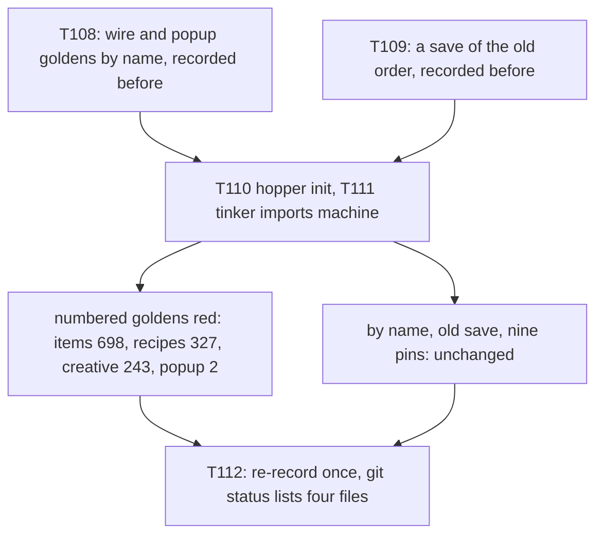
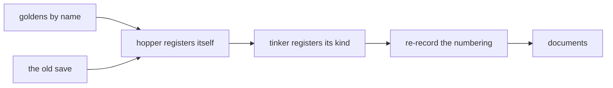

# Plan: the tinker owns its machine kind (and the hopper registers itself), with one re-record of the item ids

**Review plan:** docs/plans/2026-11-10-cleanup-restructure.review.md
**Goal:** Follow-up to part 3-4. The tinker table becomes like the sixteen other kinds of other features (`Owner: "tinker"`, behaviour registered by `tinker` with `machine.Register`), `machine` imports no feature, and `hopper` registers its own blocks and items. Both change the order custom items are registered in, so four goldens are re-recorded once, after the proof that nothing but the numbering changes is in the repository.
**Architecture:** REF is `docs/plans/2026-11-11-tinker-owns-its-kind.md`: the decisions (section 2), the measurements (3: goldens and entries, the proof by name, saves, initialisation order, pins, tests, the hopper), names and imports (4), the states that were run (5), each task's code and commands (6, one heading per task). REF was built and run task by task at b49fc81; a task copies its blocks and designs nothing.
**Tech stack:** Go 1.26, patched Dragonfly in `third_party/dragonfly`, tests with `go test`.
**Spec:** none (the owner's decision and REF bind)
**Detail:** contracts
**Target-min:** 25
**Ignore:** .superlite/

## Global constraints

- Language Go. Checkout `/home/user/SkyGear`, branch `superlite/sessions/cleanup-restructure`. Developers do not commit, push, `git add`, stash or check out tracked files (one exception, named in REF T112).
- Commits (the coordinator makes them; English subject, no attribution lines): T108 and T109 each with their subject. T110 and T111 are NOT committed on their own: each leaves the tree red on purpose, in exactly the golden tests its REF section lists. After T112 the coordinator makes ONE commit that holds T110, T111 and T112, with T112's subject. T113 with its subject. So every commit is green: `go build ./... && go vet ./... && go test ./...` (62 packages `ok`) and `gofmt -l` clean.
- Who decides: the developer implements the task text and its REF section exactly. A name, a place or a behaviour the text leaves open, a REF block that does not fit the code found, a count that differs from REF: stop, change nothing more, return `NEEDS_CONTEXT` with the output. No refactoring beside the task. The prototype patches named in REF are a reference for the task's own part only; the task text and REF win over them.
- Goldens. Frozen in every task: the nine files of `content/skygear/testdata/pin/` and `content/skygear/wire/testdata/blocks.golden`. Frozen from the task that records them: the four `*.byname.golden` (T108), `content/skygear/testdata/save/oldsave.zip` and `oldsave.golden` (T109). `SKYGEAR_GOLDEN=update` is allowed only as the commands of REF T108, REF T109 and REF T112; in T110 and T111 it is forbidden, and a developer who sees the expected red there does not make it green.
- A red result REF does not list (another test or count, an added or removed entry, a failing `by name`, `TestOldSaveLoads` or pin) means the change is wrong or the base moved: record nothing, report `BLOCKED` with the lines.
- No task edits `content/skygear/features.go`, `content/skygear/debug_ui.go`, `machine.Order`, a kind's name, or a `world.RegisterBlock`/`world.RegisterItem` call other than the hopper's (T110); no task adds an import between two game packages other than `tinker` importing `machine` (T111). No test is skipped, deleted or weakened; a test file changes only where the task names it.
- `TestWire` runs once per process: repeat it as separate processes with `-count=1`, never `-count=2`.
- Scope: only the files of Owns. T108 and T109 may run at the same time; T110 to T113 one at a time in id order. Go comments in English, saying what the code does now; documents in Korean, current state only. Disk: dumps and scratch worktrees only under the scratchpad's `<task id>/`, deleted before the report; never `go clean -cache`.
- Leave `.gitignore` alone. Ruling: no Wave 0 - an existing tree needs no stubs - an unused brief. Ruling: single checkout, no worktree - the owner's branch - none.
- Ruling: [scope] the hopper's move is in this plan, before the re-record - measured clean (REF 3.7), and the goldens are recorded once for both - one more id shift in the same commit.
- Ruling: [scope] the proof is two permanent tests (goldens by name, an old save), recorded before the change - a reviewer checks it with `git status` - 8,595 golden lines and a 36 kB fixture.
- Ruling: [scope] `Features` keeps `tinker.Feature` before `machine.Feature` - moving it changes `settings.golden` (REF decision 3) - the list order is not the import order.

## Main diagram

## File structure

New: `wire/byname_test.go`, four `*.byname.golden`, the root's `oldsave_test.go` with `testdata/save/oldsave.zip` and `oldsave.golden`, `tinker/kinds.go`, `tinker/kinds_test.go`. Deleted: the root's `hopper.go`, `machine/tinkertable.go`. Changed: the files of each task's Owns (REF 6).

## Task graph

## Predicted schedule

T108 and T109 side by side, then T110, T111, T112, T113.

## proof

**Probe entry:** run=go test ./content/skygear/wire -run 'TestWire$'

### T108 the client data by item name · Complexity 5 · Est. context 40k
**Owns:** common/sghook/hooktest/canon.go, common/sghook/hooktest/hooktest_test.go, common/sghook/hooktest/doc.go, content/skygear/wire/wire_test.go, content/skygear/wire/byname_test.go, content/skygear/wire/doc.go, content/skygear/wire/testdata/items.byname.golden, content/skygear/wire/testdata/recipes.byname.golden, content/skygear/wire/testdata/creative.byname.golden, content/skygear/dimension/popup_wire_test.go, content/skygear/dimension/testdata/popup.byname.golden
**Components:** 2
**LOC owned:** 250
**Tests:** slow
**Kind:** design
**Model:** sonnet
**Est. time:** 3.0 min
**Consumes:** none
**Produces:** hooktest.CanonWith(v any, field FieldText) -> string
- e.g. a struct `{ID: 7, Count: 2}` with `field` naming `ID` 7 -> `{\n  Count: int32(2)\n  ID: named "seven"\n}`
- e.g. `CanonWith(v, nil)` -> `Canon(v)`
- e.g. `byName(names)(protocol.ItemType{NetworkID: 2080})` holds the line `NetworkID: item "skygear:hammer"`
**Review Focus:** `TestCanonWith` (REF T108); `TestWire/by_name` passes and records 2,779, 3,907 and 1,877 lines, `popup.byname.golden` 32; the five existing goldens are unmodified in `git status`; `byNameSensitivity`: traded ids change two numbered entries and no entry by name, one component value changes exactly `registry/<name>` by name; three separate processes pass
**Steps:**
1. Copy the REF T108 blocks: `canon.go` (`FieldText`, `CanonWith`, `fieldText`), `hooktest_test.go` (`TestCanonWith`), `hooktest/doc.go`, `wire_test.go` (the `canon` parameter of the three entry functions, `diffEntries`, the subtest `by name`), `wire/byname_test.go` (new), `wire/doc.go`, `popup_wire_test.go` (`blockNamed`, the second `Golden`).
2. Record with the two commands of REF T108, once; check `git status` and `wc -l` as REF says.
3. Run the three packages three times as separate processes, then the full suite.
4. Commit `test(wire): pin the client data by item name beside the numbered goldens`.

## saves

**Probe entry:** run=go test ./content/skygear -run 'TestOldSaveLoads$'

### T109 a save written before the order changes · Complexity 4 · Est. context 36k
**Owns:** content/skygear/oldsave_test.go, content/skygear/testdata/save/oldsave.zip, content/skygear/testdata/save/oldsave.golden
**Components:** 1
**LOC owned:** 330
**Tests:** slow
**Kind:** design
**Model:** sonnet
**Est. time:** 2.6 min
**Consumes:** none
**Produces:** TestOldSaveLoads(t *testing.T) -> none
- e.g. `oldsave.golden` line `block/0,122,0` -> `skygear:crusher{skygear:tier="0"}`
- e.g. `item/2,122,0/00` -> `skygear:hammer:0 x77`; `player/inventory/00` -> `skygear:alloy_atomic:0 x1`
**Review Focus:** recorded from the unchanged code: 2,433 `block/`, 353 `item/`, 36 `player/` lines; the test passes three times without `SKYGEAR_GOLDEN`; the zip holds the six files of REF T109; no existing file changes
**Steps:**
1. Copy `content/skygear/oldsave_test.go` from REF T109 (it uses the root's test helpers as they are).
2. Record once: `SKYGEAR_GOLDEN=update go test ./content/skygear/ -run 'TestOldSaveLoads$' -count=1`; check the three counts and `git status` as REF says.
3. Run the test three times without the variable, then the full suite.
4. Commit `test: load a save written before the item numbering changes`.

## order

**Probe entry:** run=go test ./content/skygear -run 'TestKindOwners|TestMachineImportsNoFeature|TestPinKinds|TestOldSaveLoads'

### T110 the hopper registers itself · Complexity 2 · Est. context 24k
**Owns:** content/skygear/hopper.go, content/skygear/hopper/hopper.go
**Components:** 1
**LOC owned:** 10
**Tests:** slow
**Kind:** design
**Model:** sonnet
**Est. time:** 1.8 min
**Consumes:** none
**Produces:** none
**Review Focus:** the suite is red in exactly `TestWire/items` 698, `TestWire/recipes` 327, `TestWire/creative` 243 (0 added, 0 removed), 61 packages `ok`; `TestWire/by_name`, `TestOldSaveLoads`, `TestPin…`, `hopper_test.go` pass; nothing is recorded
**Steps:**
1. Delete `content/skygear/hopper.go`. In `hopper/hopper.go` the comment and the line `func Register() {` become the comment and `func init() {` of the REF T110 diff; the body stays.
2. `go build ./... && go vet ./...`; `grep -rn 'hopper\.Register' --include=*.go .` prints nothing.
3. Run the suite and compare with the lines of REF T110. No commit (Global constraints).

### T111 the tinker registers its kind · Complexity 5 · Est. context 34k
**Owns:** content/skygear/machine/tinkertable.go, content/skygear/machine/machine.go, content/skygear/machine/kinds.go, content/skygear/machine/doc.go, content/skygear/tinker/kinds.go, content/skygear/tinker/kinds_test.go, content/skygear/tinker/subscribe.go, content/skygear/layers_test.go, content/skygear/kinds_test.go
**Components:** 2
**LOC owned:** 130
**Tests:** slow
**Kind:** design
**Model:** sonnet
**Est. time:** 2.8 min
**Consumes:** none
**Produces:** tinker.registerKinds() -> none
- e.g. after `coretest.Setup(tinker.Feature)`: `machine.Kinds[machine.KindTinker].Hooks().Click != nil`, `Hooks().Lines("ko", nil, cube.Pos{})` -> nil
- e.g. `machine.Kinds[machine.KindTinker].Owner` -> `"tinker"`; `siblings["machine"]` -> absent, `siblings["tinker"]` -> `{"machine"}`
**Review Focus:** `TestTinkerTableKind` (new), `TestKindOwners` with the row `machine.KindTinker: "tinker"`, `TestMachineImportsNoFeature` without an exception, `TestLayers`, `TestFeatureSiblings`, `TestFeatureNames` untouched; `kinds.golden` keeps `click/tinker_table: activate=true screens=tinker.ShowTable`; the suite is red in the three lines of T110 and `popup.golden` 2, 60 packages `ok`; nothing is recorded; `features.go` untouched
**Steps:**
1. `tinker/kinds_test.go` (REF T111); it fails: the kind has no owner.
2. Delete `machine/tinkertable.go`; `machine/machine.go` (`Owner: "tinker"`, the comment of `hooks`), `machine/kinds.go` (the comment of `Hooks`), `machine/doc.go`; `tinker/kinds.go` (new) and the last line of `subscribe()` in `tinker/subscribe.go`; `kinds_test.go` (the row); `layers_test.go` (`layers`, `siblings`, `featureLayer`, `machineFeatureImports` removed, `TestMachineImportsNoFeature`). All as the REF T111 blocks.
3. Run the tests REF T111 names, then the suite; compare with its lines. No commit (Global constraints).

### T112 re-record the numbering, with the proof · Complexity 3 · Est. context 26k
**Owns:** content/skygear/wire/testdata/items.golden, content/skygear/wire/testdata/recipes.golden, content/skygear/wire/testdata/creative.golden, content/skygear/dimension/testdata/popup.golden
**Components:** 1
**LOC owned:** 10
**Tests:** slow
**Kind:** design
**Model:** sonnet
**Est. time:** 1.8 min
**Consumes:** none
**Produces:** none
**Review Focus:** `git status --short` over the three testdata directories lists exactly the four numbered goldens; `git diff --numstat` is 698/698, 327/327, 243/243, 2/2; no `*.byname.golden`, no `oldsave.*`, no pin is modified; the dumps differ only in `RuntimeID`, `NetworkID` and the popup's `uint32(2)` lines and in 0 entries by name; 62 packages `ok`
**Steps:**
1. The two record commands of REF T112, once.
2. `git status --short` and `git diff --numstat` as REF T112; on any other result undo the recording as REF says and report `BLOCKED`.
3. The dump comparison of REF T112 (scratch worktree of `HEAD` under the scratchpad's `T112/`, removed afterwards); report its counts.
4. Full suite. One commit for T110, T111 and T112, with the four `numstat` lines in the message: `refactor(tinker): the tinker registers its machine kind and the hopper itself; item ids re-recorded`.

## documents

**Probe entry:** run=go test ./content/skygear -run 'TestLayers|TestFeatureSiblings'

### T113 the documents · Complexity 2 · Est. context 30k
**Owns:** docs/tech/extension.md, docs/tech/machines.md, docs/tech/dragonfly.md, content/skygear/README.md
**Components:** 1
**LOC owned:** 45
**Tests:** fast
**Kind:** design
**Model:** sonnet
**Est. time:** 1.5 min
**Consumes:** none
**Produces:** none
**Review Focus:** no document names `machine/tinkertable.go`, `machineFeatureImports`, the root's `hopper.go` or `hopper.Register` any more (the `grep` of REF T113 prints nothing); the layer lists say `machine`, `tinker`; the section "id 만 바뀌는 변경" and the three new rows of the pin table are there; the to-do document of `docs/` is unchanged
**Steps:**
1. Apply the four diffs of REF T113 line for line (Korean text as given).
2. The `grep` of REF T113; `go test ./...`.
3. Commit `docs: the tinker owns its kind; goldens by name and the old save`.

## Review Focus

- proof (library): encoding, state. The texts by name leave out the numbering and nothing else.
- saves (file I/O): file, encoding. The fixture is read by name; a renamed item fails it.
- order (library): state, protocol. No start without the tinker's registration; exactly four goldens change, in ids only.
- documents (generator): encoding. Current state, no stale name.

## Self-review

Coverage: REF decisions 1 to 13; T110 to T112's expected lines check the measurements of REF 3. Left out on purpose: `debug_ui.go`, the order of `Features`.
