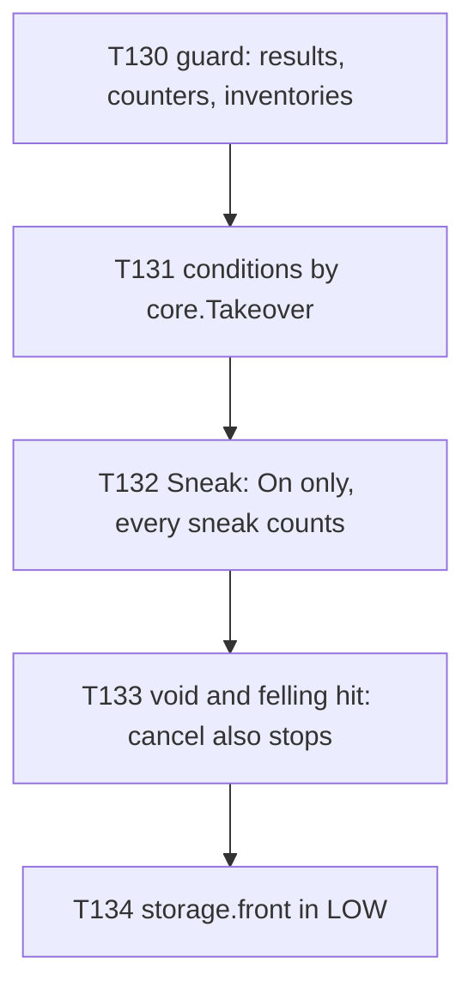
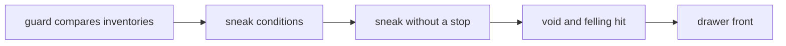

# Plan A: no propagation stop (the behaviour changes on today's kernel, T130 to T134)

**Review plan:** docs/plans/2026-11-10-cleanup-restructure.review.md
**Goal:** Prepare the event kernel for "no subscriber stops the others": the order guard also compares what players hold, the two `Sneak` stops go, and a cancel also keeps the later subscribers away where it did not (the void, a felling hit, a drawer's front). Plan B (`…-plan-b.md`, T135 to T139) follows with the last order pairs, the kernel switch and the documents.
**Architecture:** REF is `docs/plans/2026-11-12-no-propagation-stop.md`: the measurements, the table of the 31 `Handle` subscribers, the behaviour changes C1 to C9, the design, and one "REF T<nn>" section per task with its exact code and diffs, built and run on 5a8815b. A task copies its blocks and designs nothing. Every task works on TODAY's kernel (`On`, `Handle`, `Always`); each behaviour change is its own commit with its own test.
**Tech stack:** Go 1.26, patched Dragonfly, `go test`.
**Spec:** none (REF 1 binds)
**Detail:** contracts
**Target-min:** 30
**Ignore:** .superlite/

## Global constraints

- Checkout `/home/user/SkyGear`, branch `superlite/sessions/cleanup-restructure`, base 5a8815b. No push; the dispatch says who commits (the task's subject, English, no attribution lines). One task at a time, in id order; only the files of Owns.
- The developer implements the task text and its REF section exactly. Anything left open, or a REF block that does not fit the code: stop, return `NEEDS_CONTEXT`. No refactoring beside the task.
- Prototype patch of a task: `/tmp/claude-0/-home-user-SkyGear/a71fa8d5-6f20-5c3f-ba20-eeb27e13ad8a/scratchpad/proto-nostop-tasks/T<nn>.patch` (id order, on 5a8815b). If `git apply --check` passes, apply it and check the result against REF; if not, do the task by hand from REF and say so. Never `--reject` or `-3`.
- Green at every commit: `go build ./... && go vet ./... && go test -count=1 ./...` (62 packages), `gofmt -l` clean. No test skipped or weakened except the one T133 names. The root's tests run through a binary (`go test -c -o <scratch>/root.test ./content/skygear`, run from `content/skygear`).
- Goldens: a task re-records only the pin goldens its Steps name, with `SKYGEAR_GOLDEN=update <root.test> -test.count=1 -test.run '^TestPin(<names>)$'`, and runs the check script of REF 13: it must print no `RESULT` line (the part after ` | ` of every scenario line stays byte for byte) and the trace counts REF gives. Every other golden is frozen.
- `TestTierOrder` passes at every commit; `orderKept` does not grow.
- Hot path: no new allocation. T130 adds the benchmarks; the plan's tasks do not rerun them (REF 11 has the numbers).
- Go comments in English; `docs/` in Korean. Binaries only under the scratchpad's `<task id>/`, deleted before the report; never `go clean -cache`.
- Ruling: no Wave 0 - an existing tree needs no stubs - an unused brief. Ruling: single checkout - the owner's branch - none.
- Ruling: [scope] the behaviour changes come before the kernel switch - each is expressible on today's kernel - the switch (plan B) is then proven exact.
- Ruling: [scope] T133 rewrites `TestWalkCountsTheMoveIntoTheVoid` as `TestMoveIntoTheVoidIsNotWalked` - change C5 reverses what it asserted - the one test changed.

## Main diagram

## File structure

New: root tests `sneak_test.go`, `fellinghit_test.go`, `drawerfront_test.go`; `elevator/held_test.go`, `farm/held_test.go`. Changed: seven `subscribe.go`, the pin helpers, three pin goldens (each task's Owns).

## Task graph

## Predicted schedule

One chain, T130 to T134.

## guard

**Probe entry:** run=go test ./content/skygear -run 'TestTierOrder|TestPin' -count=1

### T130 the order guard compares what the players hold · Complexity 3 · Est. context 24k
**Owns:** content/skygear/{helpers_test.go,pin_test.go,tierorder_test.go,pin_bench_test.go}
**Components:** 1
**LOC owned:** 110
**Tests:** slow
**Kind:** design
**Model:** sonnet
**Est. time:** 2.2 min
**Consumes:** none
**Produces:** pinNoteInventory(p *player.Player) · pinInventoryDump() -> string
- e.g. a scenario whose player holds a stick in slot 0 and 10 dirt in slot 14 -> the dump line ends ` | 0=minecraft:stick:0x1,14=minecraft:dirt:0x10`
- e.g. a player that holds nothing -> `-`
**Review Focus:** the dump line is `<scenario> | <results> | <counters> | <inventories>`; `withPlayer` notes the player's inventory only when `SKYGEAR_PIN_DUMP` is set and is otherwise the plain call it was (no wrapper closure: the handler benchmarks run in it); a player of another world starts the list again; `BenchmarkBlockBreak` and `BenchmarkBlockPlace` exist (48 B/op, 1 allocs/op each); `TestTierOrder` logs `5 orders, 3597 scenarios each`; no golden and no production file changes
**Steps:**
1. `tierorder_test.go`, `pin_test.go`, `helpers_test.go`, `pin_bench_test.go` as the REF T130 diff.
2. Root tests through the binary, then the full suite.
3. Commit `test(skygear): the tier order guard compares what the players hold`.

## sneak

**Probe entry:** run=go test ./content/skygear/elevator ./content/skygear/farm -run 'Held' -count=1

### T131 the elevator and the saplings leave a player a mode holds · Complexity 2 · Est. context 22k
**Owns:** content/skygear/elevator/{subscribe.go,held_test.go}, content/skygear/farm/{subscribe.go,held_test.go}
**Components:** 1
**LOC owned:** 120
**Tests:** slow
**Kind:** design
**Model:** sonnet
**Est. time:** 2.2 min
**Consumes:** none
**Produces:** none
**Review Focus:** `elevator.down` rides only when `core.Takeover(e.S, e.P) == ""` (asked before `Down`), `farm.crouchGrow` grows only then; both tests register a takeover of their own and fail before the change (`a held player rode the elevator`, `a held player's sneaks grew the sapling`); goldens byte for byte; the dump of T130 unchanged
**Steps:**
1. `elevator/held_test.go`, `farm/held_test.go` as REF T131; run them: both fail.
2. The two conditions as the REF T131 diff; the two packages, root tests, the full suite.
3. Commit `refactor(elevator): the elevator and the saplings leave a sneak a mode holds`.

### T132 no subscriber stops a sneak · Complexity 4 · Est. context 28k
**Owns:** content/skygear/{achievement,elevator,expand,farm}/subscribe.go, content/skygear/sneak_test.go, content/skygear/testdata/pin/{order,handler-simple}.golden
**Components:** 2
**LOC owned:** 130
**Tests:** slow
**Kind:** design
**Model:** sonnet
**Est. time:** 2.8 min
**Consumes:** none
**Produces:** none
**Review Focus:** `expand.show` is `On` in `core.Normal` and cancels nothing; `elevator.down` is `On`; `achievement.sneak` is `On` in `core.Monitor`; `farm.crouchGrow` stays in `core.High`; `TestEverySneakCounts` and `TestSneakRideGrowsSaplingsWhereItArrives` fail before; `order.golden` has `Sneak NORMAL expand.show`, `Sneak NORMAL elevator.down`, `Sneak HIGH farm.crouchGrow`, `Sneak MONITOR achievement.sneak`; `handler-simple.golden`: 3 traces changed (`Sneak/start`, `Sneak/elevator`, `Sneak/expanding`, each `expand.show elevator.down farm.crouchGrow achievement.sneak`), no `RESULT` line
**Steps:**
1. `sneak_test.go` as REF T132; run: both tests fail.
2. The four `subscribe.go` as the REF T132 diff.
3. Re-record `^TestPin(Order|Simple)$`; the check script.
4. The four packages, root tests, the full suite. Commit `feat(core): no subscriber stops a sneak, every sneak counts`.

## cancel

**Probe entry:** run=go test ./content/skygear -run 'TestMoveIntoTheVoid|TestFellingHit|TestDrawerFrontHit' -count=1

### T133 a cancelled move and a cancelled hit are not counted · Complexity 3 · Est. context 24k
**Owns:** content/skygear/island/subscribe.go, content/skygear/dimension/subscribe.go, content/skygear/{walkvoid_test.go,fellinghit_test.go}, content/skygear/testdata/pin/handler-simple.golden
**Components:** 1
**LOC owned:** 95
**Tests:** slow
**Kind:** design
**Model:** sonnet
**Est. time:** 2.2 min
**Consumes:** none
**Produces:** none
**Review Focus:** `island.void` and `dimension.fallen` are `Handle` in `core.Highest` and return true exactly where they cancel; `look.update` still runs for the void move; `TestMoveIntoTheVoidIsNotWalked` (walk 0 for the void move, 1 for the next block) and `TestFellingHitIsNotAHurt` (hurt stays 1) fail before; `handler-simple.golden`: 2 traces changed (`Move/void` = `expand.hold island.void look.update`, `Hurt/fallen` = `dimension.frozen dimension.fallen`), no `RESULT` line
**Steps:**
1. `walkvoid_test.go` (the test renamed and rewritten) and `fellinghit_test.go` as REF T133; run: both fail.
2. `island/subscribe.go`, `dimension/subscribe.go` as the REF T133 diff.
3. Re-record `^TestPinSimple$`; the check script.
4. `island`, `dimension`, root tests, the full suite. Commit `fix(achievement): a cancelled move and a cancelled hit are not counted`.

### T134 a drawer hit on its front is no break · Complexity 3 · Est. context 26k
**Owns:** content/skygear/storage/subscribe.go, content/skygear/{drawerfront_test.go,pin_blocks_test.go}, content/skygear/testdata/pin/{order,handler-blocks}.golden
**Components:** 1
**LOC owned:** 105
**Tests:** slow
**Kind:** design
**Model:** sonnet
**Est. time:** 2.4 min
**Consumes:** none
**Produces:** none
**Review Focus:** new subscriber `storage.front`, `Handle` in `core.Low`: block type first, then the last punch on this block's front, then `island.CanBuild`; cancels and returns true; `storage.break` no longer cancels; `TestDrawerFrontHitIsNoBreak` fails before (`block_break counted 1`, `the tool gained 1 experience`); `order.golden` gains `BlockBreak LOW storage.front`; `handler-blocks.golden`: 15 traces changed, `BlockBreak/drawerFront` = `expand.guard island.guard storage.front`, no `RESULT` line
**Steps:**
1. `drawerfront_test.go` as REF T134; run: fails.
2. `storage/subscribe.go` and the two rows of `pin_blocks_test.go` as the REF T134 diff.
3. Re-record `^TestPin(Order|Blocks)$`; the check script.
4. `storage`, root tests, the full suite. Commit `fix(storage): a drawer hit on its front is no break for the other subscribers`.

## Review Focus

- guard (library): state, encoding. The dump adds inventories; nothing else changes.
- sneak (library): state. Each `Sneak` subscriber acts by its own condition; none stops.
- cancel (library): state. A cancel keeps the later default subscribers away; results never change.

## Self-review

Coverage: C1 to C6 of REF 7 (T131 to T134) and the guard of REF 10 (T130). Not in this plan: C7 to C9, the kernel switch and the documents (plan B); E4 and the candidates of REF 12.
