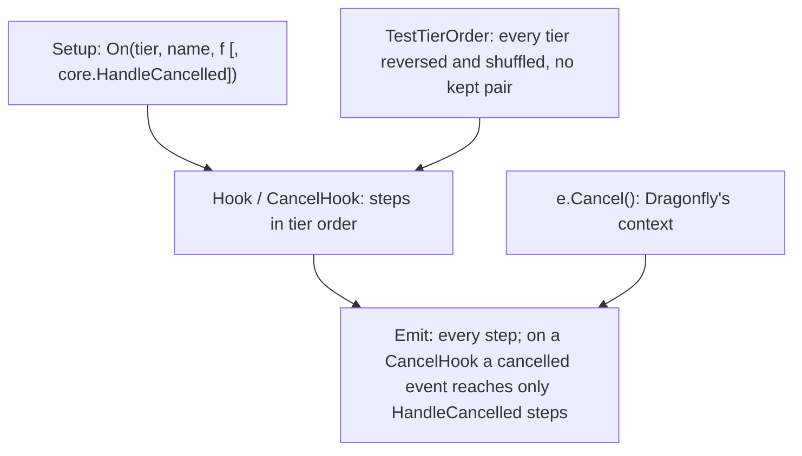
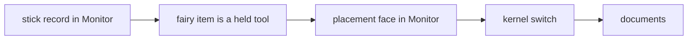

# Plan B: no propagation stop (the last order pairs, the kernel switch, the documents, T135 to T139)

**Review plan:** docs/plans/2026-11-10-cleanup-restructure.review.md
**Goal:** No subscriber can stop the others. `Handle` and `Always` go; a subscriber is `On(tier, name, f)`, cancels through the event (`e.Cancel()`), and is not called for a cancelled event unless it gave `core.HandleCancelled`. The subscribers of one tier have no order and no pair is kept in one (`orderKept` is removed). Starts when plan A (`…-plan-a.md`, T130 to T134) is committed.
**Architecture:** REF is `docs/plans/2026-11-12-no-propagation-stop.md` (measurements, the 31 subscribers, the behaviour changes C1 to C9, the design, one "REF T<nn>" section per task with exact code and diffs, built and run on 5a8815b). A task copies its blocks and designs nothing. T135 to T137 resolve the three same-tier pairs on today's kernel; T138 switches the kernel and changes nothing a test can see; T139 is the documents.
**Tech stack:** Go 1.26, patched Dragonfly, `go test`.
**Spec:** none (REF 1 binds)
**Detail:** contracts
**Target-min:** 30
**Ignore:** .superlite/

## Global constraints

- Checkout `/home/user/SkyGear`, branch `superlite/sessions/cleanup-restructure`, after T134. No push; the dispatch says who commits (the task's subject, English, no attribution lines). One task at a time, in id order; only the files of Owns.
- The developer implements the task text and its REF section exactly. Anything left open, or a REF block that does not fit the code: stop, return `NEEDS_CONTEXT`. No refactoring beside the task. E4 and the candidates of REF 12 stay as they are.
- Prototype patch of a task: `/tmp/claude-0/-home-user-SkyGear/a71fa8d5-6f20-5c3f-ba20-eeb27e13ad8a/scratchpad/proto-nostop-tasks/T<nn>.patch` (id order, on 5a8815b after T130 to T134). If `git apply --check` passes, apply it and check the result against REF; if not, do the task by hand from REF and say so. Never `--reject` or `-3`.
- Green at every commit: `go build ./... && go vet ./... && go test -count=1 ./...` (62 packages), `gofmt -l` clean. No test skipped or weakened; T138 replaces the kernel's tests of `Handle` and `Always` by the tests REF T138 gives. The root's tests run through a binary (`go test -c -o <scratch>/root.test ./content/skygear`, run from `content/skygear`).
- Goldens: a task re-records only the pin goldens its Steps name (`SKYGEAR_GOLDEN=update <root.test> -test.count=1 -test.run '^TestPin(<names>)$'`) and runs the check script of REF 13: no `RESULT` line, and the trace counts REF gives. T138 re-records `order.golden` alone; the four scenario goldens stay byte for byte there, traces included. Every other golden is frozen.
- `TestTierOrder` passes at every commit; from T136 no pair is kept.
- Hot path: T138 runs `go test -run xxx -bench 'HandleMove$|Second$|UseOnBlock$|Use$|BlockBreak$|BlockPlace$' -benchmem -count 8 ./content/skygear` and `-bench Emit` on `./content/skygear/core` before (a worktree of the commit before) and after, alternating: B/op and allocs/op equal; the report gives the medians next to REF 11.
- Go comments in English; `docs/` in Korean, current state only. Binaries only under the scratchpad's `<task id>/`, deleted before the report; never `go clean -cache`.
- Ruling: no Wave 0 - an existing tree needs no stubs - an unused brief. Ruling: single checkout - the owner's branch - none.
- Ruling: [scope] T138 changes the kernel and 33 registrations in one commit - `Handle` and `Always` cease to exist - one large task with a patch.
- Ruling: [scope] the handleCancelled option is an argument of `On` and the callback stays `func(E)` - the state is the event's (`e.Cancelled()`) - no second callback shape (REF 9.1).

## Main diagram

## File structure

New: root tests `stickother_test.go`, `hourglassplate_test.go`, `noteface_test.go`. Changed: the kernel, 16 `subscribe.go`, the pin tests, two pin goldens, five documents (each task's Owns).

## Task graph

## Predicted schedule

One chain, T135 to T139.

## pairs

**Probe entry:** run=go test ./content/skygear -run 'TestStickOther|TestHourglassWinds|TestRefusedClickNotes|TestTierOrder' -count=1

### T135 the stick record is a Monitor subscriber · Complexity 3 · Est. context 28k
**Owns:** content/skygear/handwork/{handwork.go,subscribe.go}, content/skygear/{conduit,storage}/subscribe.go, content/skygear/{stickother_test.go,pin_use_test.go,tierorder_test.go}, content/skygear/testdata/pin/{order,handler-use}.golden
**Components:** 2
**LOC owned:** 135
**Tests:** slow
**Kind:** design
**Model:** sonnet
**Est. time:** 2.8 min
**Consumes:** none
**Produces:** handwork.CountStickOther(s *core.Session, p *player.Player, tx *world.Tx, pos cube.Pos, held item.Stack)
- e.g. a stick on stone, the click not cancelled -> `stick_other` +1; the same click again within 100 ms -> +0
- e.g. a stick on a crop (the crop cancels the click) -> the subscriber is not called, +0
**Review Focus:** `UseStick` counts nothing for another block; new subscriber `handwork.stickOther`, `On` in `core.Monitor`; `orderKept` loses the two `handwork.stick` entries; `TestStickOtherCountsTheTapNothingTook` fails before at the crop (`counted 2`); `order.golden` gains `UseOnBlock MONITOR handwork.stickOther`; `handler-use.golden`: 28 traces changed, no `RESULT` line
**Steps:**
1. `stickother_test.go` as REF T135; run: fails at the crop.
2. `handwork/handwork.go`, `handwork/subscribe.go`, the comments of `conduit` and `storage`, `tierorder_test.go`, the row of `pin_use_test.go` as the REF T135 diff.
3. Re-record `^TestPin(Order|Use)$`; the check script.
4. `handwork`, root tests, the full suite. Commit `refactor(handwork): the stick record is a Monitor subscriber of the click that went through`.

### T136 a fairy item takes the click like the other held tools · Complexity 3 · Est. context 28k
**Owns:** content/skygear/fairy/{fairytime.go,subscribe.go}, content/skygear/conduit/subscribe.go, content/skygear/core/coretest/order.go, content/skygear/{hourglassplate_test.go,pin_use_test.go,tierorder_test.go}, content/skygear/testdata/pin/{order,handler-use}.golden
**Components:** 2
**LOC owned:** 165
**Tests:** slow
**Kind:** design
**Model:** sonnet
**Est. time:** 3.0 min
**Consumes:** none
**Produces:** fairy.TimeItem(held item.Stack) -> bool · coretest.ReorderHooks()
- e.g. `fairy.TimeItem(item.NewStack(sgitem.FairyHourglass{}, 1))` -> true; a stick -> false
- e.g. `SKYGEAR_HOOK_ORDER=reverse`: every tier reversed, no pair put back
**Review Focus:** `fairy.time` is in `core.Low` and acts only when `TimeItem(e.Held) && island.CanBuild(e.S, e.Pos)` (in that order, before `UseFairyTime`); `orderKept`, the `kept` parameter and the code that put pairs back are gone; `TestHourglassWindsTheMachineBehindAPlate` fails before (`wound by 0 ticks`); `order.golden`: `UseOnBlock LOW fairy.time`; `handler-use.golden`: 62 traces changed, no `RESULT` line; `TestLayers` passes
**Steps:**
1. `hourglassplate_test.go` as REF T136; run: fails.
2. `fairy/fairytime.go`, `fairy/subscribe.go`, `conduit/subscribe.go`, `core/coretest/order.go`, `tierorder_test.go`, the row of `pin_use_test.go` as the REF T136 diff.
3. Re-record `^TestPin(Order|Use)$`; the check script.
4. `fairy`, `conduit`, `core/...`, root tests, the full suite. Commit `feat(fairy): a fairy item takes the click like the other held tools`.

### T137 the placement face is noted from the click that goes through · Complexity 2 · Est. context 24k
**Owns:** content/skygear/machine/subscribe.go, content/skygear/{noteface_test.go,pin_use_test.go}, content/skygear/testdata/pin/{order,handler-use}.golden
**Components:** 1
**LOC owned:** 80
**Tests:** slow
**Kind:** design
**Model:** sonnet
**Est. time:** 2.0 min
**Consumes:** none
**Produces:** none
**Review Focus:** `machine.noteFace` is `On` in `core.Monitor`; `TestRefusedClickNotesNoFace` fails before (`faces west, want down`); `TestMonitorSubscribersDoNotShape` passes; `order.golden`: `UseOnBlock MONITOR machine.noteFace`; `handler-use.golden`: 51 traces changed, no `RESULT` line
**Steps:**
1. `noteface_test.go` as REF T137; run: fails.
2. `machine/subscribe.go` and the row of `pin_use_test.go` as the REF T137 diff.
3. Re-record `^TestPin(Order|Use)$`; the check script.
4. `machine`, root tests, the full suite. Commit `refactor(machine): the placement face is noted from the click that goes through`.

## kernel

**Probe entry:** run=go test ./content/skygear/core -run 'TestCancelSkips|TestAfterCancel|TestNoSubscriberStops|TestOnlyActorEvents|TestMonitorCancelPanics|TestReorder' -count=1

### T138 no subscriber stops the others · Complexity 8 · Est. context 62k
**Owns:** content/skygear/core/, content/skygear/{achievement,conduit,copier,dimension,elevator,expand,fairy,farm,handwork,island,look,screens,storage,tinker,wand}/subscribe.go, content/skygear/{pin_order_test.go,monitor_test.go}, content/skygear/testdata/pin/order.golden
**Components:** 4
**LOC owned:** 1150
**Tests:** slow
**Kind:** design
**Model:** sonnet
**Est. time:** 6.0 min
**Consumes:** coretest.ReorderHooks() (T136)
**Produces:** core.NewCancelHook[E Cancellable](name string) -> *CancelHook[E] · CancelHook.On(prio Priority, name string, f func(E), opts ...Option) · Hook.On(prio Priority, name string, f func(E)) · Hook.Emit(e E) · core.HandleCancelled · core.Who · Actor.Cancel() · Actor.Cancelled() -> bool
- e.g. `h.On(core.Low, "a.c", func(e E) { e.Cancel() }); h.On(core.Normal, "b.on", f); h.On(core.Monitor, "c.all", g, core.HandleCancelled)` -> `Emit` runs `a.c`, then `g` (which reads `e.Cancelled() == true`), not `f`
- e.g. `core.Jump.On(core.Normal, "x.y", func(e core.NoticeEvent) { e.Cancel() })` does not compile; `core.Join.On(core.Normal, "x.y", f, core.HandleCancelled)` does not compile
- e.g. `order.golden` line `Move MONITOR look.update handleCancelled`; the lines of one tier sorted by name; 123 lines
**Review Focus:** `hook.go` as REF T138 (`Emit` returns nothing; no `Handle`, no `Always`); 20 player hooks are `NewCancelHook`, `Jump`, `Death`, `Respawn` and the 12 session and world hooks `NewHook`; every former `Handle` body keeps its `e.Cancel()` and loses only its returns; `look.update` is the one `core.HandleCancelled` subscriber; the four scenario goldens are untouched (`git status`), the sorted dump before equals the sorted dump after (REF T138 commands); `TestTierOrder` green; `SKYGEAR_HOOK_ORDER=reverse go test -count=1 ./content/skygear/...` green; allocations equal
**Steps:**
1. Dump before (REF T138). Apply the prototype patch; if it does not apply, steps 2 to 4 by hand from REF T138.
2. Kernel: `hook.go` and `hook_test.go` whole; `events.go`, `handler.go`, `reorder.go`, `kernel.go`, `lifecycle.go`, `doc.go`, `handler_test.go`, `reorder_test.go`, `newfeature_test.go` as the diff.
3. The 33 registrations and the five `NoticeEvent` subscribers in the 15 `subscribe.go` as the diff; `guard` of `expand` and `island` takes `core.Actor`.
4. `pin_order_test.go`, `monitor_test.go`; re-record `^TestPinOrder$`.
5. Dump after and compare; root tests, `./content/skygear/...` plain and with `SKYGEAR_HOOK_ORDER=reverse`, the full suite, the benchmarks.
6. Commit `refactor(core): no subscriber stops the others, a cancelled event reaches only handleCancelled subscribers`.

## documents

**Probe entry:** run=grep -c 'core.HandleCancelled' docs/tech/extension.md

### T139 the documents · Complexity 3 · Est. context 34k
**Owns:** docs/tech/extension.md, docs/*.md, docs/design/03-architecture.md, content/skygear/README.md, CONTRIBUTING.md
**Components:** 1
**LOC owned:** 125
**Tests:** none
**Kind:** design
**Model:** sonnet
**Est. time:** 2.6 min
**Consumes:** none
**Produces:** none
**Review Focus:** `docs/tech/extension.md` has the section "구독자와 취소" with the two ways in the owner's words ("어떤 상태에서만 처리하고 취소한다", "기능은 처리하되 불필요하면 취소하지 않는다"), the option, which events can be cancelled, "같은 티어에 선 구독자 사이에는 순서가 없다", the section "역할과 다른 티어" with E4 alone; no `Handle`, `Always` or `orderKept` is left; the list of open work in `docs/` (the file REF T139 names) has the open decisions of REF 12
**Steps:**
1. Apply the prototype patch (documents only); if it does not apply, the replacements of REF T139 by hand, in the order given.
2. `grep -n 'Always\|orderKept' docs/tech/extension.md` prints nothing.
3. Commit `docs: no propagation stop, the handleCancelled option, no order inside a tier`.

## Review Focus

- pairs (library): state. Each pair is exclusive by its own conditions or in different tiers; results never change.
- kernel (library): state, concurrency. Tier order, the cancel-based skip, the option, the panics; nothing allocated; nothing observable changes.
- documents (docs): the owner's words unchanged.

## Self-review

Coverage: C7 to C9 (T135 to T137), the API and the guard of REF 9 and 10 (T138), the documents (T139). Not in this plan: E4 (REF 8), the candidates of REF 12.1, the alternative of REF 12.2.
