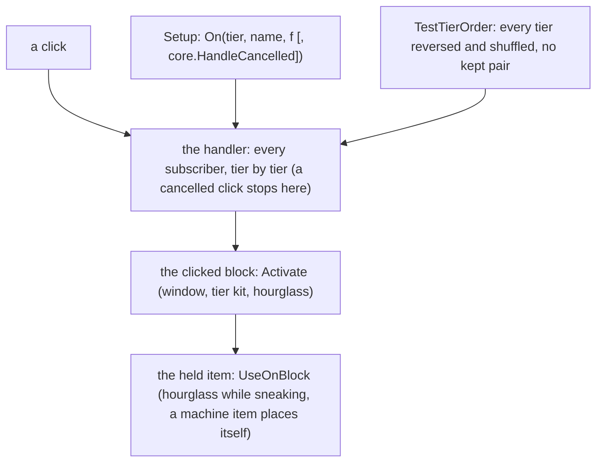
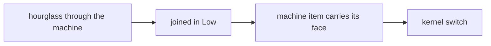

# Plan C: no propagation stop (the hourglass and the machine item as mediators, E4, the kernel switch, T140 to T143)

**Review plan:** docs/plans/2026-11-10-cleanup-restructure.review.md
**Goal:** No subscriber can stop the others, and nothing depends on the order inside a tier (`orderKept` is removed in T140). Where Dragonfly's own mediator carries a click (`block.Activatable`, `item.UsableOnBlock`), no subscriber does: the fairy hourglass is used through the machine, a machine item carries its placement face. `dimension.joined` stands in its role's tier. Then `Handle` and `Always` go. Replaces T136 to T138 of plan B; starts at 3848f7f (T135). Plan D (`…-plan-d.md`, T144 to T146) follows it.
**Architecture:** REF is `docs/plans/2026-11-12-no-propagation-stop-2.md` (the ruling, the behaviour changes C10 to C13, one "REF T<nn>" section per task with exact code and diffs, built and run on 3848f7f); for the kernel it points into REF1, `docs/plans/2026-11-12-no-propagation-stop.md` (sections 9 to 11, "REF T138"). A task copies its blocks and designs nothing. T140 to T142 run on today's kernel; T143 switches the kernel and changes nothing a test can see.
**Tech stack:** Go 1.26, patched Dragonfly, `go test`.
**Spec:** none (REF 1 binds)
**Detail:** contracts
**Target-min:** 30
**Ignore:** .superlite/

## Global constraints

- Checkout `/home/user/SkyGear`, branch `superlite/sessions/cleanup-restructure`, HEAD 3848f7f. No push; the dispatch says who commits (the task's subject, English, no attribution lines). One task at a time, in id order; only the files of Owns.
- The developer implements the task text and its REF section exactly. Anything left open, or a REF block that does not fit the code: stop, return `NEEDS_CONTEXT`. No refactoring beside the task. `dimension.fallen` and the items used on the air are plan D's; the candidates of REF 9.2 stay as they are.
- Prototype patch of a task: `/tmp/claude-0/-home-user-SkyGear/a71fa8d5-6f20-5c3f-ba20-eeb27e13ad8a/scratchpad/proto-nostop2-tasks/T<nn>.patch` (id order, base 3848f7f). If `git apply --check` passes, apply it and check the result against REF; if not, do the task by hand from REF and say so. Never `--reject` or `-3`. The patches of plan B (`proto-nostop-tasks/T136.patch` to `T139.patch`) are not used.
- Green at every commit: `go build ./... && go vet ./... && go test -count=1 ./...` (62 packages), `gofmt -l` clean. No test skipped or weakened; T143 replaces the kernel's tests of `Handle` and `Always` by the tests REF1 "REF T138" gives. The root's tests run through a binary (`go test -c -o <scratch>/root.test ./content/skygear`, run from `content/skygear`).
- Goldens: a task re-records only the pin goldens its Steps name and runs the check script of REF 6. It prints no `RESULT` line except the two REF T142 names, and the trace counts REF gives. T143 re-records `order.golden` alone. Every other golden is frozen.
- A change that moves work into a block's or an item's method has a test that clicks through Dragonfly (`Player.UseItemOnBlock`); the pin scenarios call the handler only.
- `TestTierOrder` passes at every commit with no kept pair.
- Hot path: T143 runs the benchmarks of REF 8 before (a worktree of the commit before) and after, alternating: B/op and allocs/op equal; the report gives the medians and the spread.
- Go comments in English; `docs/` in Korean, current state only; the place is 이차원, never a hunting ground. Binaries only under the scratchpad's `<task id>/`, deleted before the report; never `go clean -cache`.
- Ruling: no Wave 0 - an existing tree needs no stubs - an unused brief. Ruling: single checkout - the owner's branch - none.
- Ruling: [scope] T143 changes the kernel and 33 registrations in one commit - `Handle` and `Always` cease to exist - one large task with a patch.
- Ruling: [scope] the hourglass and the placement face are mediators, not subscribers - Dragonfly asks the block, then the item - the plate stays a subscriber and comes first (REF 2).

## Main diagram

## File structure

New: root tests `hourglass_test.go`, `strandedjoin_test.go`, `machineface_test.go`; `machine/hourglass_test.go`. Changed: `machine`, `sgitem`, `fairy`, `dimension`, `conduit`, `core/coretest`, the kernel, 16 `subscribe.go`, the pin tests, three pin goldens (each task's Owns).

## Task graph

## Predicted schedule

One chain, T140 to T143.

## mediators

**Probe entry:** run=go test ./content/skygear -run 'TestHourglass|TestStrandedPlayer|TestMachineItemPlaces|TestMachinePlacedWithout|TestTierOrder' -count=1

### T140 the fairy hourglass is used through the machine · Complexity 4 · Est. context 30k
**Owns:** content/skygear/machine/{machine.go,hourglass_test.go}, content/skygear/sgitem/fairy.go, content/skygear/fairy/{fairytime.go,subscribe.go}, content/skygear/conduit/subscribe.go, content/skygear/core/coretest/order.go, content/skygear/{hourglass_test.go,tierorder_test.go,layers_test.go}
**Components:** 3
**LOC owned:** 275
**Tests:** slow
**Kind:** design
**Model:** sonnet
**Est. time:** 3.2 min
**Consumes:** none
**Produces:** sgitem.HourglassWound interface { WindHourglass(pos cube.Pos, tx *world.Tx) bool } · sgitem.FairyHourglass.UseOnBlock(pos, face, clickPos, tx, user, ctx) -> bool · machine.Machine.WindHourglass(pos cube.Pos, tx *world.Tx) -> bool · coretest.ReorderHooks()
- e.g. standing click on a crusher's top with 5 hourglasses -> `Boost` 12000, 4 left (`Machine.Activate`); sneaking -> the same (`FairyHourglass.UseOnBlock`)
- e.g. standing click on the plate centre of that crusher -> `Boost` 0, 5 left (`conduit.plate` cancelled); the outward face of a crusher at x=15 -> 0, 5 left (C10); a wound machine -> the players around see the arm swing (C11)
**Review Focus:** `Machine.Activate` winds beside the tier kit and spends through `ctx.SubtractFromCount(1)`; `UseFairyTime` has no hourglass case and `fairy` no longer imports `machine` (`siblings` row `fairy: {"farm"}`); `fairy.time` stays `Handle` in `core.Normal` with no new condition; `orderKept`, the `kept` parameter and the code that put pairs back are gone; `TestHourglassOnTheOutwardFaceIsRefused`, `TestHourglassWindShowsTheArmSwing` and `machine.TestHourglassIsUsedByTheMachine` fail before; `TestHourglassThroughTheMachine` fails before under `SKYGEAR_HOOK_ORDER=reverse` with the pair removed; no golden changes
**Steps:**
1. The three test files as REF T140; run: the failures REF T140 gives.
2. `machine/machine.go`, `sgitem/fairy.go`, `fairy/fairytime.go`, the comments of `fairy/subscribe.go` and `conduit/subscribe.go`, `core/coretest/order.go`, `tierorder_test.go`, `layers_test.go` as the REF T140 diff.
3. `git status --short content/skygear/testdata` is empty; the check script prints 0 traces changed.
4. `machine`, `fairy`, `sgitem`, `core/...`, root tests in the orders of REF T140, the full suite. Commit `refactor(machine): the fairy hourglass is used through the machine, no subscriber order is kept`.

### T141 a player stranded in the second dimension is restored before the join steps · Complexity 3 · Est. context 24k
**Owns:** content/skygear/dimension/subscribe.go, content/skygear/core/coretest/coretest.go, content/skygear/strandedjoin_test.go, content/skygear/testdata/pin/{order,lifecycle}.golden
**Components:** 2
**LOC owned:** 150
**Tests:** slow
**Kind:** design
**Model:** sonnet
**Est. time:** 2.4 min
**Consumes:** none
**Produces:** coretest.SessionOver(t testing.TB, state []byte, store func([]byte) error) -> core.Lifecycle
- e.g. `coretest.SessionOver(t, nil, nil)` is `coretest.Session(t)`; with the document a first session stored, the second session reads the stash of a player who was in the second dimension
- e.g. that player joins a save owed 6 dust -> slot 0 holds the 3 stone it carried, 6 fairy dust in the inventory (before: 0)
**Review Focus:** `dimension.joined` is `On` in `core.Low`, body unchanged; `TestStrandedPlayerKeepsBackfilledDust` fails before (`0 fairy dust in the inventory after the join, want 6`); `order.golden`: `Join LOW dimension.joined` after `Join LOWEST screens.menuItem`; `lifecycle.golden`: the traces of the 5 `Join/` lines, no `RESULT` line
**Steps:**
1. `core/coretest/coretest.go` and `strandedjoin_test.go` as REF T141; run: fails.
2. `dimension/subscribe.go` as the REF T141 diff.
3. Re-record `^TestPin(Order|Lifecycle)$`; the check script.
4. `dimension`, `core/...`, root tests, the full suite. Commit `fix(dimension): a player the server stopped under is restored before the join steps hand out items`.

### T142 a machine item carries its placement face · Complexity 4 · Est. context 30k
**Owns:** content/skygear/machine/{machine.go,netshape.go,subscribe.go}, content/skygear/{machineface_test.go,pin_use_test.go}, content/skygear/testdata/pin/{order,handler-use}.golden
**Components:** 2
**LOC owned:** 195
**Tests:** slow
**Kind:** design
**Model:** sonnet
**Est. time:** 3.0 min
**Consumes:** none
**Produces:** machine.Machine.UseOnBlock(pos, face, clickPos, tx, user, ctx) -> bool · machine.Place(s *core.Session, p *player.Player, tx *world.Tx, pos cube.Pos, b Machine)
- e.g. a real click with a miner on an east face -> the miner stands east of the block, `State.Facing` west, one item spent (none in creative)
- e.g. a miner in hand opens a chest, then `HandleBlockPlace` places a miner (as the wand does) -> it faces down (before: east)
**Review Focus:** `machine.noteFace`, `NotePlaceFace`, `takePlaceFace` and `placeFaces` are gone; `UseOnBlock` repeats Dragonfly's placement conditions (replaceable, bounds) and places through `block.Placer`; `Place` reads `clicked`/`placedOn` of the block handed in and never its `State`; `TestMachinePlacedWithoutAClickFacesItsDefault` fails before (`faces west`, `faces east`); `order.golden` loses `UseOnBlock NORMAL machine.noteFace`; `handler-use.golden`: 53 traces changed and exactly the two `RESULT` lines of REF T142
**Steps:**
1. `machineface_test.go` as REF T142; run: fails.
2. `machine/machine.go`, `machine/netshape.go`, `machine/subscribe.go`, the rows of `pin_use_test.go` as the REF T142 diff.
3. Re-record `^TestPin(Order|Use)$`; the check script.
4. `machine`, `wand`, `netstore`, root tests, the full suite. Commit `refactor(machine): a machine item carries the face it is placed on`.

## kernel

**Probe entry:** run=go test ./content/skygear/core -run 'TestCancelSkips|TestAfterCancel|TestNoSubscriberStops|TestOnlyActorEvents|TestMonitorCancelPanics|TestReorder' -count=1

### T143 no subscriber stops the others · Complexity 8 · Est. context 62k
**Owns:** content/skygear/core/, content/skygear/{achievement,conduit,copier,dimension,elevator,expand,fairy,farm,handwork,island,look,screens,storage,tinker,wand}/subscribe.go, content/skygear/{pin_order_test.go,monitor_test.go}, content/skygear/testdata/pin/order.golden
**Components:** 4
**LOC owned:** 1150
**Tests:** slow
**Kind:** design
**Model:** sonnet
**Est. time:** 6.0 min
**Consumes:** coretest.ReorderHooks() (T140)
**Produces:** core.NewCancelHook[E Cancellable](name string) -> *CancelHook[E] · CancelHook.On(prio Priority, name string, f func(E), opts ...Option) · Hook.On(prio Priority, name string, f func(E)) · Hook.Emit(e E) · core.HandleCancelled · core.Who · Actor.Cancel() · Actor.Cancelled() -> bool
- e.g. `h.On(core.Low, "a.c", func(e E) { e.Cancel() }); h.On(core.Normal, "b.on", f); h.On(core.Monitor, "c.all", g, core.HandleCancelled)` -> `Emit` runs `a.c`, then `g` (which reads `e.Cancelled() == true`), not `f`
- e.g. `core.Jump.On(core.Normal, "x.y", func(e core.NoticeEvent) { e.Cancel() })` does not compile; `core.Join.On(core.Normal, "x.y", f, core.HandleCancelled)` does not compile
- e.g. `order.golden` line `Move MONITOR look.update handleCancelled`; the lines of one tier sorted by name; 122 lines
**Review Focus:** `hook.go` as REF1 "REF T138" (`Emit` returns nothing; no `Handle`, no `Always`); 20 player hooks are `NewCancelHook`, `Jump`, `Death`, `Respawn` and the 12 session and world hooks `NewHook`; every former `Handle` body keeps its `e.Cancel()` and loses only its returns; `look.update` is the one `core.HandleCancelled` subscriber; `fairy.time` is `On` in `core.Normal` (REF T143, not REF1); the four scenario goldens are untouched (`git status`), the sorted dump before equals the sorted dump after; `TestTierOrder` green; `SKYGEAR_HOOK_ORDER=reverse go test -count=1 ./content/skygear/...` green; allocations equal
**Steps:**
1. Dump before (REF1 "REF T138"). Apply `T143.patch`; if it does not apply, steps 2 to 4 by hand.
2. Kernel: every file under `core/` as REF1 "REF T138".
3. The registrations in the 15 `subscribe.go` as REF1 "REF T138", except `fairy/subscribe.go` and `conduit/subscribe.go` as REF T143.
4. `pin_order_test.go`, `monitor_test.go`; re-record `^TestPinOrder$`: `order.golden` is REF T143's.
5. Dump after and compare; root tests, `./content/skygear/...` plain and with `SKYGEAR_HOOK_ORDER=reverse`, the full suite, the benchmarks.
6. Commit `refactor(core): no subscriber stops the others, a cancelled event reaches only handleCancelled subscribers`.

## Review Focus

- mediators (library): state. Dragonfly's order decides between the handler, the block and the item; results change only where REF 5 says.
- kernel (library): state, concurrency. Tier order, the cancel-based skip, the option, the panics; nothing allocated; nothing observable changes.

## Self-review

Coverage: C10 to C13 (T140 to T142), the API and the guard of REF1 9 and 10 (T143). Gone from plan B: T136's tier move and C8, T137's tier move (C9 is replaced by C13). Not in this plan: the items used on the air, the death in the second dimension and the documents (plan D), the block clean-up (plan E).
