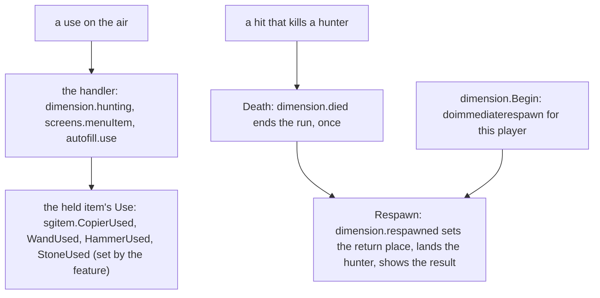
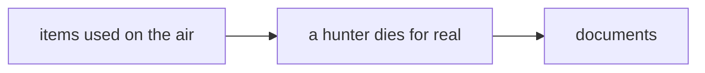

# Plan D: no propagation stop (the items used on the air, the death in the second dimension, the documents, T144 to T146)

**Review plan:** docs/plans/2026-11-10-cleanup-restructure.review.md
**Goal:** The owner's two later answers, after the kernel switch. The copier, the wands, the hammers and the teleport stone are `item.Usable` and do their work on the air in their own `Use`; four `Use` subscribers go. A hunter that takes a killing hit dies for real and respawns at once; `dimension.fallen` and its cancel go. The documents describe the kernel, hooks against the methods of blocks and items, and the death, with the list of real-client checks. Starts when plan C (`…-plan-c.md`, T140 to T143) is committed.
**Architecture:** REF is `docs/plans/2026-11-12-no-propagation-stop-2.md` (sections 3.4, 3.5 and 3.7, the behaviour changes C14 to C19, the real-client checks of 9.1, one "REF T<nn>" section per task with exact code and diffs, built and run on 3848f7f after T140 to T143); for the documents it points into REF1, `docs/plans/2026-11-12-no-propagation-stop.md` ("REF T139"). A task copies its blocks and designs nothing.
**Tech stack:** Go 1.26, patched Dragonfly, `go test`.
**Spec:** none (REF 1 binds)
**Detail:** contracts
**Target-min:** 30
**Ignore:** .superlite/

## Global constraints

- Checkout `/home/user/SkyGear`, branch `superlite/sessions/cleanup-restructure`, after T143. No push; the dispatch says who commits (the task's subject, English, no attribution lines). One task at a time, in id order; only the files of Owns.
- The developer implements the task text and its REF section exactly. Anything left open, or a REF block that does not fit the code: stop, return `NEEDS_CONTEXT`. No refactoring beside the task. The candidates of REF 9.2 stay as they are (a lost run counts as a death; the blast is not changed).
- Prototype patch of a task: `/tmp/claude-0/-home-user-SkyGear/a71fa8d5-6f20-5c3f-ba20-eeb27e13ad8a/scratchpad/proto-nostop2-tasks/T<nn>.patch` (id order, base 3848f7f). If `git apply --check` passes, apply it and check the result against REF; if not, do the task by hand from REF and say so. Never `--reject` or `-3`.
- Green at every commit: `go build ./... && go vet ./... && go test -count=1 ./...` (62 packages), `gofmt -l` clean. No test skipped or weakened; T145 removes `fellinghit_test.go` and the last part of `dimension.TestHuntClear` (they assert the cancelled hit) for the tests REF T145 gives. The root's tests run through a binary (`go test -c -o <scratch>/root.test ./content/skygear`, run from `content/skygear`).
- Goldens: a task re-records only the goldens its Steps name and runs the check script of REF 6: exactly the `RESULT` lines REF names for the task (three in T144, one in T145) and the trace counts. T144 alone re-records two wire goldens, 14 lines each, proven line by line (REF T144). Every other golden is frozen.
- A test kills, uses and clicks through Dragonfly (`Player.Hurt`, `Player.UseItem`); what only a connected client can show is not claimed: it goes into the list of real-client checks (REF 9.1), marked unverified.
- `TestTierOrder` passes at every commit.
- Hot path: T144 and T145 run `-bench 'Use$|HandleMove$' -benchmem` on the root's binary before and after: allocs/op equal (REF 8).
- Go comments in English; `docs/` in Korean, current state only; the place is 이차원, never a hunting ground. Binaries only under the scratchpad's `<task id>/`, deleted before the report; never `go clean -cache`.
- Ruling: no Wave 0 - an existing tree needs no stubs - an unused brief. Ruling: single checkout - the owner's branch - none.
- Ruling: [scope] the item types stay in `sgitem` and call their feature through a function variable - `sgitem` is below `core` - moving six item types (REF 3.4).
- Ruling: [scope] T145 comes after the kernel switch - it is not forced by the new model and only a client can show its point - a switch that sits on top of it (REF 3.7).

## Main diagram

## File structure

New: `sgitem/airuse.go`, root tests `airuse_test.go`, `seconddeath_test.go`, `platform/instance/death_test.go`. Removed: `fellinghit_test.go`. Changed: four `subscribe.go`, `dimension/run.go`, `dimension/monster.go`, the pin tests, three pin goldens, two wire goldens, six documents (each task's Owns).

## Task graph

## Predicted schedule

One chain, T144 to T146.

## airuse

**Probe entry:** run=go test ./content/skygear -run 'TestAirItemsAreUsable|TestItemsUsedOnTheAir|TestHunterUsesNothingOnTheAir|TestTierOrder' -count=1

### T144 the items used on the air do their work in their own Use · Complexity 5 · Est. context 36k
**Owns:** content/skygear/sgitem/{airuse.go,dimension.go}, content/skygear/{copier,wand,tinker,dimension}/subscribe.go, content/skygear/{airuse_test.go,pin_use_test.go}, content/skygear/testdata/pin/{order,handler-use}.golden, content/skygear/wire/testdata/{items,items.byname}.golden
**Components:** 3
**LOC owned:** 290
**Tests:** slow
**Kind:** design
**Model:** sonnet
**Est. time:** 3.6 min
**Consumes:** none
**Produces:** sgitem.CopierUsed, sgitem.WandUsed, sgitem.HammerUsed, sgitem.StoneUsed func(tx *world.Tx, user item.User) · Use(tx, user, ctx) -> false on sgitem.ConfigCopier, Wand, InfinityWand, Hammer, DimensionStone
- e.g. `Player.UseItem` with a filled copier -> the card is gone; with a sneaking stone wand -> its settings open; standing -> nothing
- e.g. a hunter's `Player.UseItem` with any of them -> nothing (`dimension.hunting` cancelled the use; `Use` is not called)
**Review Focus:** `copier.clear`, `wand.options`, `tinker.veinToggle` and `dimension.stone` on `Use` are gone, `dimension.stone` on `UseOnBlock` stays; each feature sets its function in `subscribe.go` with the conditions the subscriber had (the iron hammer, sneaking, `Debounced`); every `Use` returns false; `TestAirItemsAreUsable` fails before; `order.golden` loses 4 `Use` lines; `handler-use.golden`: 27 traces changed and exactly the three `RESULT` lines of `Use/stone…`; the wire goldens change in the 14 lines of the seven items and the entry dump differs only by `minecraft:use_modifiers`
**Steps:**
1. `airuse_test.go` as REF T144; run: `TestAirItemsAreUsable` fails, the other two pass.
2. `sgitem/airuse.go`, `sgitem/dimension.go`, the four `subscribe.go`, `pin_use_test.go` as the REF T144 diff.
3. Re-record `^TestPin(Order|Use)$`; the check script. Re-record the wire goldens and prove them as REF T144, points 2 and 3.
4. `sgitem`, `copier`, `wand`, `tinker`, `dimension`, `wire`, root tests, the full suite. Commit `refactor(sgitem): the items used on the air do their work in their own Use`.

## death

**Probe entry:** run=go test ./content/skygear -run 'TestHunterDiesAndComesBack|TestHitThatKills|TestDeadHunterWho|TestBlastThatKills|TestDeathOnTheIsland' -count=1

### T145 a hunter that falls dies for real and respawns at once · Complexity 6 · Est. context 42k
**Owns:** content/skygear/dimension/{run.go,subscribe.go,monster.go,dimension_test.go}, content/skygear/{seconddeath_test.go,fellinghit_test.go}, platform/instance/death_test.go, content/skygear/testdata/pin/{order,handler-simple}.golden
**Components:** 3
**LOC owned:** 400
**Tests:** slow
**Kind:** design
**Model:** sonnet
**Est. time:** 4.2 min
**Consumes:** none
**Produces:** dimension.Respawned(s *core.Session, p *player.Player, pos *mgl64.Vec3) sets the run's return place · dimension.Begin sends `Player.EnableInstantRespawn()` · no dimension.Fallen
- e.g. `p.Hurt(1000, entity.AttackDamageSource{})` on a hunter -> dead, the run ended, `hurt` +1, `death` +1, `wave_fail` +1, slot 0 holds the carried stone, nothing on the ground, 7 levels
- e.g. `HandleRespawn` after it -> `pos` is where the hunter went in from; a second call leaves `pos` alone
**Review Focus:** `dimension.fallen` and `Fallen` are gone and nothing cancels a killing hit; `Run.end` keeps the return place for a dead hunter and takes the game rule back for a living one; `Respawned` sets the place, takes the rule back, schedules `instance.PlaceAt` and the result; the melee hit adds knock-back and effect only to a living target; the blast is not changed; the four tests of `seconddeath_test.go` that REF T145 lists fail before as given and `TestDeathOnTheIslandIsUntouched` passes before and after; `handler-simple.golden`: 2 traces changed and exactly one `RESULT` line (`Hurt/fallen`); no claim about the client
**Steps:**
1. `seconddeath_test.go` and `platform/instance/death_test.go` as REF T145; run: the failures REF T145 gives.
2. `dimension/subscribe.go`, `dimension/run.go`, `dimension/monster.go` as the REF T145 diff; remove `fellinghit_test.go` and the last part of `TestHuntClear`.
3. Re-record `^TestPin(Order|Simple)$`; the check script.
4. `dimension`, `platform/instance`, root tests, the full suite. Commit `feat(dimension): a hunter that falls dies for real and respawns at once`.

## documents

**Probe entry:** run=grep -c 'core.HandleCancelled' docs/tech/extension.md

### T146 the documents · Complexity 3 · Est. context 30k
**Owns:** docs/tech/extension.md, docs/*.md, docs/design/{03-architecture,17-dimension}.md, content/skygear/README.md, CONTRIBUTING.md
**Components:** 1
**LOC owned:** 185
**Tests:** none
**Kind:** design
**Model:** sonnet
**Est. time:** 3.0 min
**Consumes:** none
**Produces:** none
**Review Focus:** `docs/tech/extension.md` has "구독자와 취소" with the owner's two ways ("어떤 상태에서만 처리하고 취소한다", "기능은 처리하되 불필요하면 취소하지 않는다") and "훅과 블록·아이템의 메서드" (what Dragonfly calls after the handler, the items used on the air and `sgitem/airuse.go`, the four cases that stay subscribers, the test rule); "역할과 다른 티어" is gone; the `Hurt`, `Death` and `Respawn` bullets describe the real death; no `Handle`, `Always`, `orderKept`, `machine.noteFace`, `dimension.fallen` is left; the list of open work in `docs/` (the file REF T146 names) has the real-client checks of REF 9.1 under "실기 확인", every one marked as not yet checked, and the open decisions of REF 9.2; `docs/design/17-dimension.md` says the hunter dies and that the client half is unchecked
**Steps:**
1. Apply `T146.patch` (documents only); if it does not apply, the replacements of REF1 "REF T139", then those of REF T146, in the order given.
2. `grep -n 'Always\|orderKept\|noteFace\|역할과 다른\|dimension.fallen\|copier.clear' docs/tech/extension.md` prints nothing; no `—` in the changed files.
3. Commit `docs: no propagation stop, hooks and the methods of blocks and items, the death in the second dimension`.

## Review Focus

- airuse (library): state. The conditions of each use and the hunter's guard are kept; the client entries change in one component.
- death (library): state, concurrency. The run ends once; nothing is lost at a death; the island's deaths are untouched; the scheduled landing follows the player.
- documents (docs): the owner's words unchanged; nothing a client was not seen to do is stated as fact.

## Self-review

Coverage: C14 (T144), C15 to C19 and the replacement of C6 (T145), the documents and the real-client checks (T146). Not in this plan: the block clean-up (plan E), the decisions of REF 9.2.
