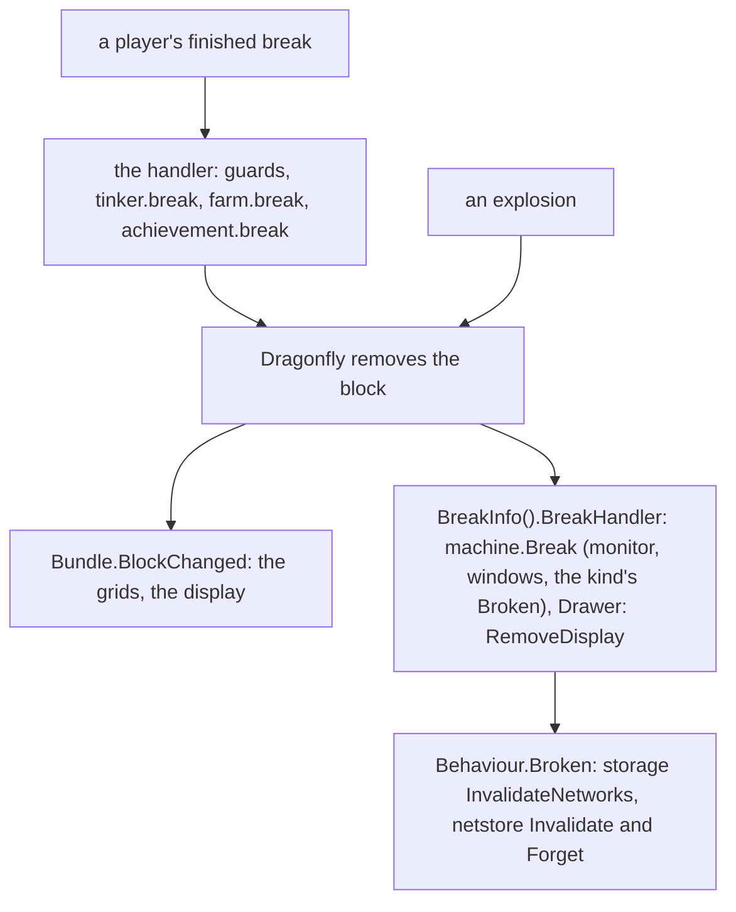
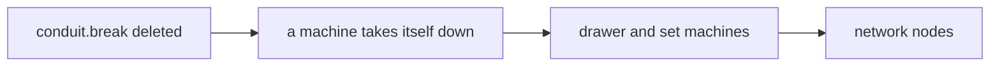

# Plan E: the block clean-up follows the block (T147 to T150)

**Review plan:** docs/plans/2026-11-10-cleanup-restructure.review.md
**Goal:** What a block leaves behind when it goes is cleaned up by the block's own callbacks, not by a subscriber of a player's break: `conduit.break` is deleted (the bundle's `BlockChanged` does it already), `machine.break`, `storage.break` and `netstore.break` move into `BreakInfo().BreakHandler`. Starts when plan D (`…-plan-d.md`, T144 to T146) is committed. **T148 to T150 wait for the owner's decision 1 of REF 9.2:** they also clean up after an explosion, which a player can see (C20 to C22). T147 changes nothing a player sees and may run at once.
**Architecture:** REF is `docs/plans/2026-11-12-no-propagation-stop-2.md` (section 3.6, the behaviour changes C20 to C22, one "REF T<nn>" section per task with exact code and diffs, built and run on 3848f7f after T140 to T146). A task copies its blocks and designs nothing. Dragonfly calls `BreakHandler` after it removed a block a player broke, and for a block an explosion removed; the subscribers of `BlockBreak` see a player's break only.
**Tech stack:** Go 1.26, patched Dragonfly, `go test`.
**Spec:** none (REF 1 binds)
**Detail:** contracts
**Target-min:** 30
**Ignore:** .superlite/

## Global constraints

- Checkout `/home/user/SkyGear`, branch `superlite/sessions/cleanup-restructure`, after T146. No push; the dispatch says who commits (the task's subject, English, no attribution lines). One task at a time, in id order; only the files of Owns.
- The developer implements the task text and its REF section exactly. Anything left open, or a REF block that does not fit the code: stop, return `NEEDS_CONTEXT`. No refactoring beside the task.
- Prototype patch of a task: `/tmp/claude-0/-home-user-SkyGear/a71fa8d5-6f20-5c3f-ba20-eeb27e13ad8a/scratchpad/proto-nostop2-tasks/T<nn>.patch` (id order, base 3848f7f). If `git apply --check` passes, apply it and check the result against REF; if not, do the task by hand from REF and say so. Never `--reject` or `-3`.
- Green at every commit: `go build ./... && go vet ./... && go test -count=1 ./...` (62 packages), `gofmt -l` clean. No test skipped or weakened. The root's tests run through a binary (`go test -c -o <scratch>/root.test ./content/skygear`, run from `content/skygear`).
- Goldens: every task re-records `^TestPin(Order|Blocks)$` and runs the check script of REF 6: `handler-blocks: 33 scenarios, 14 traces changed`, one line less in `order.golden`, no `RESULT` line except the one REF T150 names. Every other golden is frozen.
- Every task's test removes the block through Dragonfly (`Player.BreakBlock`, an explosion); the pin scenarios call the handler only. A hand break behaves as before in every task; the test's explosion case is the task's behaviour change and fails before.
- Hot path: `BreakInfo` allocates nothing new (REF 3.6); T148 and T149 run `-bench 'LookMachine$|LookInfoMachine$|BlockBreak$|MachineTick$' -benchmem` before and after: allocs/op equal.
- `TestTierOrder` passes at every commit.
- Go comments in English; `docs/` in Korean, current state only. Binaries only under the scratchpad's `<task id>/`, deleted before the report; never `go clean -cache`.
- Ruling: no Wave 0 - an existing tree needs no stubs - an unused brief. Ruling: single checkout - the owner's branch - none.
- Ruling: [scope] `BreakHandler`, not `BlockChanged`, for machines and drawers - they set their own block on every change of look - a hook on every such `SetBlock` (REF 3.6).

## Main diagram

## File structure

New: root test `blockbroken_test.go` (T147 creates it; T148 to T150 add to it). Changed: `conduit`, `machine`, `storage`, `netstore`, `pin_blocks_test.go`, two pin goldens, the list of open work in `docs/` (each task's Owns).

## Task graph

## Predicted schedule

One chain, T147 to T150.

## cleanup

**Probe entry:** run=go test ./content/skygear -run 'TestBroken|TestPinBlocks|TestPinOrder|TestTierOrder' -count=1

### T147 a broken bundle is cleaned up by its own BlockChanged alone · Complexity 2 · Est. context 22k
**Owns:** content/skygear/conduit/subscribe.go, content/skygear/{blockbroken_test.go,pin_blocks_test.go}, content/skygear/testdata/pin/{order,handler-blocks}.golden, docs/*.md
**Components:** 1
**LOC owned:** 90
**Tests:** slow
**Kind:** design
**Model:** sonnet
**Est. time:** 2.0 min
**Consumes:** none
**Produces:** none
**Review Focus:** `conduit.break` is gone, `conduit.place` stays; `Bundle.BlockChanged` is unchanged; `TestBrokenBundleLosesItsDisplay` breaks with `Player.BreakBlock` and blows up, and passes before and after (the subscriber was redundant); the mutation of REF T147 is reported; `order.golden` loses `BlockBreak NORMAL conduit.break`; `handler-blocks.golden`: 14 traces changed, no `RESULT`
**Steps:**
1. `blockbroken_test.go` as REF T147; run: passes.
2. `conduit/subscribe.go`, the row of `pin_blocks_test.go`, the bullet of the list of open work in `docs/` (the file REF names) as the REF T147 diff.
3. Re-record `^TestPin(Order|Blocks)$`; the check script. In a scratch worktree, the mutation of REF T147.
4. `conduit`, root tests, the full suite. Commit `refactor(conduit): a broken bundle is cleaned up by its own BlockChanged alone`.

### T148 a broken machine takes itself down, also after an explosion · Complexity 3 · Est. context 26k
**Owns:** content/skygear/machine/{machine.go,subscribe.go}, content/skygear/{blockbroken_test.go,pin_blocks_test.go}, content/skygear/testdata/pin/{order,handler-blocks}.golden, docs/*.md
**Components:** 1
**LOC owned:** 70
**Tests:** slow
**Kind:** design
**Model:** sonnet
**Est. time:** 2.4 min
**Consumes:** none
**Produces:** machine.Machine.BreakInfo().BreakHandler (nil for a machine without a state) · machine.Break(s *core.Session, tx *world.Tx, pos cube.Pos, m Machine)
- e.g. `Player.BreakBlock` on a crusher -> `machine.Ticking(s, machine.KindCrusher)` no longer lists it (as before)
- e.g. an explosion removes a crusher -> not listed (before: listed for 10 s)
**Review Focus:** `machine.break` is gone; the handler is `State.broken`, made once in `New`, so `BreakInfo` allocates nothing new (allocs/op of the four benchmarks equal); `TestBrokenMachineIsTakenDown` fails before for the explosion only (`blown up: the monitor still lists the machine`); `order.golden` loses `BlockBreak NORMAL machine.break`; `handler-blocks.golden`: 14 traces changed, no `RESULT`
**Steps:**
1. The test of REF T148 into `blockbroken_test.go`; run: fails for the explosion.
2. `machine/machine.go`, `machine/subscribe.go`, the row of `pin_blocks_test.go`, the bullet of the list of open work in `docs/` (the file REF names) as the REF T148 diff.
3. Re-record `^TestPin(Order|Blocks)$`; the check script; the benchmarks.
4. `machine`, root tests, the full suite. Commit `refactor(machine): a broken machine takes itself down, also after an explosion`.

### T149 a broken drawer and a broken set machine clean up in the block · Complexity 4 · Est. context 30k
**Owns:** content/skygear/storage/{drawer.go,kinds.go,subscribe.go}, content/skygear/machine/{kinds.go,machine.go}, content/skygear/{blockbroken_test.go,pin_blocks_test.go}, content/skygear/testdata/pin/{order,handler-blocks}.golden, docs/*.md
**Components:** 2
**LOC owned:** 135
**Tests:** slow
**Kind:** design
**Model:** sonnet
**Est. time:** 2.8 min
**Consumes:** machine.Break called from Machine.BreakInfo().BreakHandler (T148)
**Produces:** machine.Behaviour.Broken func(s *core.Session, tx *world.Tx, pos cube.Pos) · storage.Drawer.BreakInfo().BreakHandler
- e.g. an explosion removes a drawer -> `storage.LocalOf(s).Displays[pos]` is gone and its label is hidden (before: both stay)
- e.g. a trim between a controller and a drawer is removed -> `len(storage.Network(tx, ctl))` is 0 at once
**Review Focus:** `storage.break` is gone, `storage.front` and `storage.place` unchanged; the drawer's handler captures nothing; `machine.Break` calls the kind's `Broken` after its own take-down; the three set kinds register it; `TestBrokenDrawerLosesItsDisplay` and `TestBrokenTrimCutsTheDrawerSet` fail before for the explosion cases as REF T149 gives; `order.golden` loses `BlockBreak NORMAL storage.break`; `handler-blocks.golden`: 14 traces changed, no `RESULT`
**Steps:**
1. The helper and the two tests of REF T149 into `blockbroken_test.go`; run: fail for the explosion cases.
2. `machine/kinds.go`, `machine/machine.go`, `storage/drawer.go`, `storage/kinds.go`, `storage/subscribe.go`, the row of `pin_blocks_test.go`, the bullet of the list of open work in `docs/` (the file REF names) as the REF T149 diff.
3. Re-record `^TestPin(Order|Blocks)$`; the check script; the benchmarks.
4. `storage`, `machine`, root tests, the full suite. Commit `refactor(storage): a broken drawer and a broken set machine clean up in the block`.

### T150 a broken node drops its network and its setting in the block · Complexity 3 · Est. context 26k
**Owns:** content/skygear/netstore/{kinds.go,subscribe.go}, content/skygear/{blockbroken_test.go,pin_blocks_test.go}, content/skygear/testdata/pin/{order,handler-blocks}.golden, docs/*.md
**Components:** 1
**LOC owned:** 110
**Tests:** slow
**Kind:** design
**Model:** sonnet
**Est. time:** 2.4 min
**Consumes:** machine.Behaviour.Broken (T149)
**Produces:** none
**Review Focus:** `netstore.break`, its deferred function and the mark `netstore.breakDeferred` are gone; the eight kinds of `machine.NetNodes` register `Broken: nodeBroken`, the pattern encoder does not; `netstore.place` keeps its `Forget`; `TestBrokenNodeLeavesItsNetwork` fails before for the explosion case; `order.golden` loses `BlockBreak NORMAL netstore.break` (113 lines); `handler-blocks.golden`: 14 traces changed and exactly one `RESULT` line (`BlockBreak/netNode`: `filter=0` becomes `filter=1`)
**Steps:**
1. The test of REF T150 into `blockbroken_test.go`; run: fails for the explosion case.
2. `netstore/kinds.go`, `netstore/subscribe.go`, the rows and comments of `pin_blocks_test.go`, the bullet of the list of open work in `docs/` (the file REF names) as the REF T150 diff.
3. Re-record `^TestPin(Order|Blocks)$`; the check script.
4. `netstore`, root tests, the full suite. Commit `refactor(netstore): a broken node drops its network and its setting in the block`.

## Review Focus

- cleanup (library): state. A hand break cleans up as before; an explosion now cleans up too; nothing allocates in `BreakInfo`; no subscriber of `BlockBreak` that cancels is touched.

## Self-review

Coverage: T147 (no change), C20 to C22 (T148 to T150). Not in this plan: a block replaced by a plain `SetBlock` (the wand's undo) is still not cleaned up by these callbacks; `netstore.place` forgets a setting left at the position.
